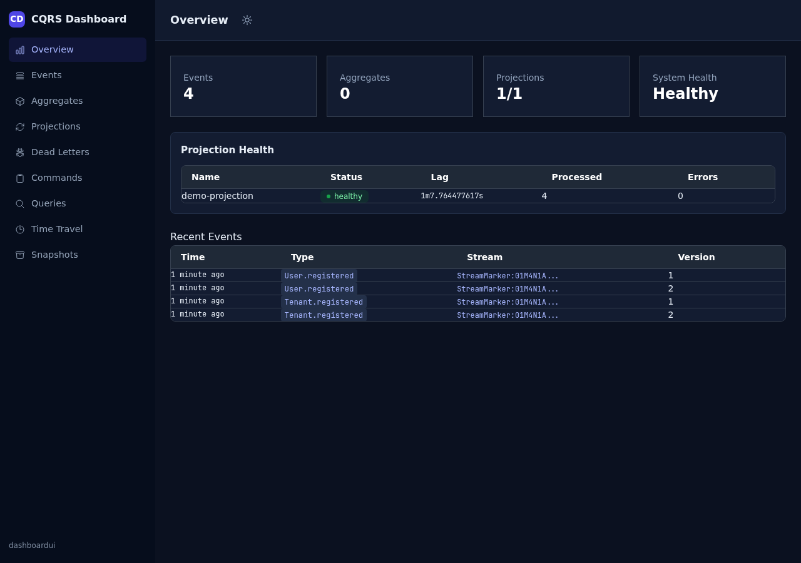

# cqrs-htmx

[](https://pkg.go.dev/github.com/larsartmann/cqrs-htmx/v4)
[](https://github.com/LarsArtmann/cqrs-htmx/releases)
[](https://github.com/LarsArtmann/cqrs-htmx/actions/workflows/ci.yml)
[](https://opensource.org/licenses/MIT)
[](https://go.dev/)
[](docs/goth-stack.md)

**CQRS + event sourcing for server-rendered Go apps — wired to HTTP and HTMX in one declarative line per endpoint.**

```bash
go get github.com/larsartmann/cqrs-htmx/v4
```

<p align="center">
  <a href="docs/screenshots/dark/dashboard-overview.png">
    
  </a>
</p>
<p align="center"><sub>The optional <a href="dashboardui/README.md">dashboardui</a> module — live event-store observability. More shots in <a href="docs/screenshots/">docs/screenshots</a> (light + dark).</sub></p>

Wire [go-cqrs-lite](https://github.com/larsartmann/go-cqrs-lite) commands and queries to `net/http` and stop writing glue: request decoding, Casbin authorization, validation, HTMX response headers, partial-vs-full rendering, error-to-status mapping, and SSE fan-out are all `HandlerOption`s. Event-sourced user management (passkeys, OAuth2, TOTP), a ready-made admin panel, an event-store observability dashboard, and a one-call full-stack setup exist as optional modules — entirely out of your way until you want them.

Bring your own router (`net/http`, [Chi](https://github.com/go-chi/chi), [Gin](https://github.com/gin-gonic/gin), …), your own [templ](https://templ.guide) components, your own persistence. The library never picks your stack for you, and never enforces a default you might disagree with.

```go
mux.Handle("POST /items", app.Command("CreateItem",
    cqrshtmx.DecodeJSON(mapToCmd),          // decode body → command
    cqrshtmx.Authorize("items", "create"),  // Casbin check
    cqrshtmx.ValidateCommand(validate),     // domain validation
    cqrshtmx.WithSuccessStatus(201),        // configure response
    cqrshtmx.PushURL("/items")))            // HTMX: update address bar
```

One endpoint, five concerns, in declarative order. The same shape works for queries, form posts, and SSE handlers.

> **Part of the GOTH stack** — pair with
> [templ-components](https://github.com/larsartmann/templ-components) (UI components
> for templ + HTMX + Tailwind v4) and
> [go-cqrs-lite](https://github.com/larsartmann/go-cqrs-lite) (event sourcing core)
> for a complete server-rendered Go web stack with zero framework lock-in.
> The stack, piece by piece: [docs/goth-stack.md](docs/goth-stack.md).

## Contents

- [Why](#why) — the glue this library deletes
- [What you get](#what-you-get) — feature map at a glance
- [Install](#install) — one import, or pick individual modules
- [Quick start](#quick-start) — first endpoint in minutes
- [The composition model](#the-composition-model) — how `HandlerOption`s compose
- [Choose your integration path](#choose-your-integration-path) — setup SDK vs hand-wiring
- [The modules](#the-modules) — usermgmt, adminui, dashboardui, setup, datastar
- [Realtime: SSE and offline sync](#realtime-sse-and-offline-sync)
- [Error handling](#error-handling) — domain errors → HTTP status mapping
- [Ready-made UIs & the one-call setup](#ready-made-uis--the-one-call-setup)
- [Examples](#examples) — 13 runnable, tested demos
- [Documentation](#documentation) — 30+ guides, ADRs, runbooks
- [Versioning & migrations](#versioning--migrations) — v2→v3→v4→v5 + upgrade codemod
- [Contributing](#contributing) · [License](#license) (MIT)

## Why

Every Go backend that combines CQRS + HTMX ends up writing the same glue, endpoint after endpoint:

- HTTP request → CQRS command/query dispatch
- User identity from cookie/session → event metadata
- Casbin policy check before dispatch
- CQRS error families → HTTP status codes (with HTMX-aware auth redirects)
- HTMX partial vs full-page rendering
- HTMX response headers (`HX-Trigger`, `HX-Redirect`, `HX-Push-Url`)
- templ component rendering for query results
- CSRF protection, rate limiting, security headers

This library handles all of it — and if your endpoint doesn't need all of it, you opt out piece by piece. Every layer (auth, CSRF, rate limit, HTMX) is a middleware or a `HandlerOption` you choose to apply.

**If you are not using go-cqrs-lite**, this library is not for you — it is the HTMX/HTTP binding for that specific CQRS core, not a generic web framework.

## What you get

**Endpoints & rendering**

- **Command & query dispatch** — `app.Command()` / `app.Query()` return `http.HandlerFunc` that decode, authorize, validate, dispatch, and respond; typed variants (`CommandTyped[Q]`, `QueryTyped[Q, R]`) eliminate mappers and type assertions
- **HTMX-aware responses** — fluent builder for every `HX-*` header, notifications (`NotifySuccess`/`NotifyError`/…), out-of-band swaps (`OOBHTML`), and `RenderPartialOrFull` to kill the `if HX-Request` branch in every handler
- **templ integration** — duck-typed `TemplComponent` renders templ components without importing templ
- **Pagination** — `DecodePagination(r)` + `RenderPaginatedJSON[T]()`
- **Embedded HTMX assets** — htmx v2.0.10 plus the SSE and idiomorph extensions, served from your binary with ETag + 1-year immutable caching; zero CDN dependency

**Identity & access**

- **Event-sourced user management** — the [`usermgmt`](usermgmt/README.md) module: register/login/logout/me, sessions, roles, tenants, bots, account lockout, audit log; SQL stores for SQLite, Postgres, and MySQL
- **Passwordless auth** — WebAuthn/passkeys by default; [TOTP MFA](usermgmt/totp/) and [OAuth2/OIDC](usermgmt/oauth2/) as independent sub-modules (import only what you need — zero auth deps in core)
- **Casbin authorization** — `Authorize(resource, action)` gates dispatch; domain/tenant-aware RBAC with a projection that derives policies from identity events
- **Actor + audit chain built-in** — every event carries who acted (user/bot/system), impersonation chains, and correlation/request IDs, auto-derived from the HTTP session; auth-audit events (`LoginSucceeded`/`LoginFailed`/`RegistrationClosed`) ride their own streams and fold into the audit log ([guide](docs/guides/actor-and-audit-trail.md))

**Realtime**

- **SSE, hub-first** — thread-safe `Broadcaster` fan-out, durable replay via `JournalSSEStore`, the canonical `transport.ServeDomainEvents` domain-event surface with filtering and replay caps, heartbeats for proxy keepalive, and an opt-in ACK protocol for command confirmation ([guide](docs/guides/sse-and-datastar.md))
- **Offline sync protocol** — cursor-based, permission-filtered event pull (`SyncPullHandler`) + batched command push (`App.SyncPushHandler`) with per-command outcomes, plus an embedded JS client (IndexedDB queue + event cache, `window.cqrsSync`). The server keeps all authority: clients sync commands up, cache events down ([guide](docs/guides/frontend-sync.md))
- **DataStar adapter** — optional [`datastar`](datastar/README.md) module: script serving, signal decoding, SSE response builder ([guide](docs/guides/datastar-integration.md))

**Production posture**

- **Async projection startup** — bind HTTP while projections replay in the background; `ProjectionReadinessCheck` answers 503 until every worker is live, so load balancers hold traffic for zero-downtime restarts ([guide](docs/guides/async-projection-startup.md))
- **Projection health & rebuilds** — live status endpoints, `/health` wiring, and one-call `RebuildProjection(ctx, name)` replay ([guides](docs/guides/projection-health-monitoring.md))
- **SQL event stores** — Postgres, SQLite, and MySQL via go-cqrs-lite storage: auto-migrating schemas, automatic error classification, one-call setup templates ([MySQL guide](docs/guides/mysql-setup.md))
- **API documentation surfaces** — a dependency-free [OpenAPI 3.1 builder](openapi/) (`WithOpenAPI` attaches metadata per endpoint), an immutable [EventCatalog](docs/guides/event-catalog-guide.md) for the published event language, and projection-status JSON for alerting
- **Security middleware** — `RecommendedSecurityMiddleware()` (security headers + per-request CSP nonce + panic recovery); CSRF, rate limiting, CORS, compression, and Server-Timing via the companion [httputil](https://github.com/larsartmann/httputil) library — all opt-in ([guide](docs/guides/leveraging-httputil.md))
- **Composable dispatch middleware** — the dispatchers you hand to `Config.Commands`/`Config.Queries` accept every go-cqrs-lite middleware factory (retry, circuit breaker, OTel, metrics, idempotency) with zero glue ([guide](docs/guides/leveraging-go-cqrs-lite.md))

**Ready-made UIs** — [adminui](adminui/README.md) (identity operations), [dashboardui](dashboardui/README.md) (event-store observability), [loginpage](loginpage/README.md) (passwordless sign-in), and [setup](setup/README.md) (all of it in one call). See [below](#ready-made-uis--the-one-call-setup).

**Ecosystem bridges** — [health](health/README.md) (go-health probes over projection health), [auditlog](auditlog/README.md) (samber-do-auditlog with a live SSE viewer), [systemadapter](systemadapter/README.md) (go-cqrs-lite `system.New` + metaengine).

## Install

Requires Go 1.27+.

```bash
go get github.com/larsartmann/cqrs-htmx/v4
```

Add the pieces you need — each is an independent module:

```bash
go get github.com/larsartmann/cqrs-htmx/usermgmt/v4            # event-sourced identity
go get github.com/larsartmann/cqrs-htmx/usermgmt/webauthn/v4   # passkeys
go get github.com/larsartmann/cqrs-htmx/usermgmt/totp/v4       # TOTP MFA
go get github.com/larsartmann/cqrs-htmx/usermgmt/oauth2/v4     # OAuth2/OIDC
go get github.com/larsartmann/cqrs-htmx/adminui/v4             # admin panel
go get github.com/larsartmann/cqrs-htmx/dashboardui/v4         # ES observability
go get github.com/larsartmann/cqrs-htmx/loginpage/v4           # login page
go get github.com/larsartmann/cqrs-htmx/setup/v4               # one-call full stack
go get github.com/larsartmann/cqrs-htmx/datastar/v4            # DataStar adapter
```

## Quick start

A complete, runnable server — copy into `main.go` and `go run .`:

```go
package main

import (
	"context"
	"log"
	"net/http"
	"sync"

	cqrshtmx "github.com/larsartmann/cqrs-htmx/v4"
	"github.com/larsartmann/go-cqrs-lite/command/v4"
	"github.com/larsartmann/go-cqrs-lite/id/v4"
	"github.com/larsartmann/go-cqrs-lite/query/v4"
)

type item struct {
	ID   string `json:"id"`
	Name string `json:"name"`
}

type itemStore struct {
	mu    sync.RWMutex
	items []item
}

func (s *itemStore) add(name string) item {
	s.mu.Lock()
	defer s.mu.Unlock()
	it := item{ID: id.NewStreamID().Get(), Name: name}
	s.items = append(s.items, it)
	return it
}

func (s *itemStore) list() []item {
	s.mu.RLock()
	defer s.mu.RUnlock()
	out := make([]item, len(s.items))
	copy(out, s.items)
	return out
}

// createItemCmd embeds *command.BasicCommand, which provides
// Type(), StreamID(), and ID() — the full command.Command interface.
type createItemCmd struct {
	*command.BasicCommand
	Name string
}

type listItemsQuery struct{}

func (q *listItemsQuery) Type() query.Type { return "ListItems" }

type createItemRequest struct {
	Name string `json:"name"`
}

func main() {
	var db itemStore

	// Register handlers on the go-cqrs-lite dispatchers YOU own.
	cmdDisp := command.NewDispatcher()
	_ = command.RegisterTyped(cmdDisp, "CreateItem",
		func(_ context.Context, c *createItemCmd) error {
			db.add(c.Name)
			return nil
		})

	qryDisp := query.NewDispatcher()
	_ = query.RegisterTyped(qryDisp, "ListItems",
		func(_ context.Context, _ *listItemsQuery) ([]item, error) {
			return db.list(), nil
		})

	// Build the App: dispatchers in, http.Handlers out.
	app := cqrshtmx.MustNew(cqrshtmx.Config{
		Commands: cmdDisp,
		Queries:  qryDisp,
	})

	mux := http.NewServeMux()

	// POST /items — JSON body → command → 201
	mux.Handle("POST /items", app.Command("CreateItem",
		cqrshtmx.DecodeJSON(func(req createItemRequest) (command.Command, error) {
			core, err := command.New("CreateItem", id.NewStreamID())
			if err != nil {
				return nil, err
			}
			return &createItemCmd{BasicCommand: core, Name: req.Name}, nil
		}),
		cqrshtmx.WithSuccessStatus(201),
	))

	// GET /items — query → JSON
	mux.Handle("GET /items", app.Query("ListItems",
		cqrshtmx.DecodeJSONQuery(func(_ struct{}) (query.Query, error) {
			return &listItemsQuery{}, nil
		}),
		cqrshtmx.RenderJSON[[]item](),
	))

	// Embedded htmx.js — no CDN, ETag + 1-year immutable cache.
	mux.Handle("GET /htmx.js", cqrshtmx.HTMXScriptHandler())

	log.Fatal(http.ListenAndServe(":8080",
		cqrshtmx.RecommendedSecurityMiddleware()(mux)))
}
```

Try it:

```bash
curl -X POST localhost:8080/items -d '{"name":"Buy milk"}'
curl localhost:8080/items
```

The full-featured version of this example — SSE live updates, typed endpoints, pagination, actor metadata — is [`examples/basic`](examples/basic/README.md). For the whole stack (identity, admin panel, dashboard, login page) in one call, see [setup](#ready-made-uis--the-one-call-setup).

## The composition model

The whole API is one `App`, configured once, that turns dispatchers into handlers. Each endpoint is a command/query type plus a list of `HandlerOption`s that run as a pipeline:

```go
mux.Handle("POST /widgets", app.Command("CreateWidget",
    cqrshtmx.Authorize("widgets", "create"),         // (1) authz — gate first
    cqrshtmx.DecodeJSON(mapToCommand),               // (2) decode body → command
    cqrshtmx.ValidateCommand(validateWidget),         // (3) validate — after decode
    cqrshtmx.RequestGuard(ownershipCheck),            // (3b) custom auth — after decode
    cqrshtmx.WithSuccessStatus(201),                  // (4) response config
    cqrshtmx.NotifySuccess("Widget created"),         // (5) side effects
    cqrshtmx.PushURL("/widgets"),
))
```

**Two ordering rules:**

1. `Authorize` / `RequireAuth` first — fail fast before touching the body.
2. `ValidateCommand` / `RequestGuard` **after** the decoder — they read the decoded value from context. Reversing the order silently skips validation.

**HandlerOption families:** authorization (`Authorize`, `RequireAuth`, `RequestGuard`), decoding (`DecodeJSON`/`DecodeForm`/`DecodeJSONQuery`/`DecodeFormQuery` + typed variants + request-aware variants), validation (`ValidateCommand`, `ValidateQuery`), rendering (`RenderJSON[T]`, `RenderTempl`, `RenderTemplResult[T]`, `RenderPartialOrFull`, `Redirect`, custom `Render`), HTMX effects (`PushURL`, `Trigger`, `TriggerWithDetail`, `Notify*`, `Reswap`/`Retarget` via the response builder), and per-handler config (`WithSuccessStatus`, `WithTimeout`, `WithMaxBodySize`, `RequireMethod`, `OnError`, `CSRFProtect`, `WithOpenAPI`).

**Middleware order** (outer → inner): recovery & security headers first; then your **session** middleware; then **CSRF**; then **HTMX**; then `app.Middleware()` (context enrichment). The non-negotiable trio is `CSRF → HTMX → enrichment`:

```go
handler := cqrshtmx.Chain(
    cqrshtmx.RecommendedSecurityMiddleware(), // headers + CSP nonce + recovery
    sessionMW,                                 // your session middleware
    httputil.CSRFMiddleware(httputil.CSRFConfig{}),
    cqrshtmx.HTMXMiddleware,                  // parses HX-* headers once
    app.Middleware(),                          // request/correlation IDs, user context
)(mux)
```

`App` itself is configured through `Config` — dispatchers, `Enforcer`, `UserIDExtractor`, `LoginRedirect`, dispatch `Timeout`, `MaxBodySize`, `ErrorHandler`, `BeforeDispatch`/`AfterDispatch` hooks, and `ServiceName` for event metadata.

## Choose your integration path

```
Do you need CQRS dispatch (command/query endpoints)?
├─ NO  →  PATH 0: Building blocks only (middleware, SSE, errors, HTMX — no App)
└─ YES →  Does the app need user accounts / authentication?
          ├─ NO  →  PATH A: root App only (CQRS + HTMX endpoints)
          └─ YES →  Do you want ready-made UIs?
                    ├─ NO  →  PATH B: root App + usermgmt Service + AuthHandler
                    └─ YES →  PATH C: setup.New() — everything wired in one call
                               (or usermgmt + adminui mounted by hand)
```

| Path  | You write                             | The library provides                                                                                                                   |
| ----- | ------------------------------------- | -------------------------------------------------------------------------------------------------------------------------------------- |
| **0** | HTTP handlers                         | `Chain`, recovery + security middleware, request logging, SSE building blocks, `MapError`, `WriteJSON`, HTMX helpers, embedded htmx.js |
| **A** | Domain commands/queries + route table | Everything above + `app.Command`/`app.Query` pipelines, authz, error mapping, context enrichment                                       |
| **B** | + auth config                         | Everything above + event-sourced `usermgmt.Service`, `/auth/*` routes, session middleware, RBAC, SQL stores                            |
| **C** | + a `setup.Config`                    | Everything above + admin panel, ES dashboard, login page, `/health`, middleware ordering, graceful shutdown                            |

Realtime (SSE, frontend sync) composes onto any path. Persistence composes onto any path — pass a `*sql.DB` or a go-cqrs-lite store.

The decision guide with full tradeoffs is [docs/guides/setup-vs-hand-wiring.md](docs/guides/setup-vs-hand-wiring.md); the complete wiring manual is [docs/guides/fullstack-wiring.md](docs/guides/fullstack-wiring.md).

## The modules

Independent Go modules under one repo — import only what you use.

| Module                                     | Import path                           | What it gives you                                                                                                                                                            |
| ------------------------------------------ | ------------------------------------- | ---------------------------------------------------------------------------------------------------------------------------------------------------------------------------- |
| **root**                                   | `github.com/larsartmann/cqrs-htmx/v4` | The `App` builder, `HandlerOption`s, middleware, context IDs, error→HTTP mapping, SSE + `transport/` surface, frontend sync, OpenAPI builder, EventCatalog, embedded htmx.js |
| [identity-model](identity-model/README.md) | `…/cqrs-htmx/identity-model/v4`       | Pure domain types: branded IDs, 25 event payloads, 21 commands, fold functions, Casbin-backed Authz engine — zero IO                                                         |
| [usermgmt](usermgmt/README.md)             | `…/cqrs-htmx/usermgmt/v4`             | Event-sourced identity `Service` (register/login/logout/me, roles, tenants, bots), `/auth/*` HTTP handlers, SQL + in-memory stores, session middleware                       |
| [usermgmt/webauthn](usermgmt/README.md)    | `…/cqrs-htmx/usermgmt/webauthn/v4`    | WebAuthn passkeys — inject as `ServiceConfig.WebAuthn`                                                                                                                       |
| [usermgmt/totp](usermgmt/README.md)        | `…/cqrs-htmx/usermgmt/totp/v4`        | TOTP MFA — inject as `ServiceConfig.TOTP`                                                                                                                                    |
| [usermgmt/oauth2](usermgmt/README.md)      | `…/cqrs-htmx/usermgmt/oauth2/v4`      | OAuth2/OIDC login incl. public PKCE clients — inject as `ServiceConfig.OAuth2`                                                                                               |
| [adminui](adminui/README.md)               | `…/cqrs-htmx/adminui/v4`              | Ready-made admin panel: users, tenants, members, audit log — role-gated write actions over a `*usermgmt.Service`                                                             |
| [dashboardui](dashboardui/README.md)       | `…/cqrs-htmx/dashboardui/v4`          | Ready-made event-store observability: projection health, event catalog, live SSE, time-travel — read-only by default                                                         |
| [loginpage](loginpage/README.md)           | `…/cqrs-htmx/loginpage/v4`            | Ready-made passwordless login page (templ + Tailwind, CSP-nonce hooks)                                                                                                       |
| [setup](setup/README.md)                   | `…/cqrs-htmx/setup/v4`                | One-call composition root: stores + service + all three UIs + `/health` + middleware ordering + graceful `Run`                                                               |
| [datastar](datastar/README.md)             | `…/cqrs-htmx/datastar/v4`             | DataStar adapter: script serving, signal decoding, SSE builder — depends only on go-datastar + go-sse                                                                        |
| [health](health/README.md)                 | `…/cqrs-htmx/health/v4`               | go-health bridge: liveness/readiness probes and a dashboard over projection health                                                                                           |
| [auditlog](auditlog/README.md)             | `…/cqrs-htmx/auditlog/v4`             | samber-do-auditlog bridge with a live SSE viewer — zero cqrs-htmx deps                                                                                                       |
| [systemadapter](systemadapter/README.md)   | `…/cqrs-htmx/systemadapter/v4`        | Bridge into go-cqrs-lite `system.New()` + metaengine auto-projections ([guide](docs/guides/leveraging-system-metaengine.md))                                                 |

Dependency direction is strict: identity-model is the pure domain source of truth; usermgmt re-exports it; the root module never imports usermgmt; UI modules sit on top; nothing depends on the UI/setup/bridge modules.

## Realtime: SSE and offline sync

Realtime is building blocks, not a server — you own the HTTP handler, the library gives you the stream and the fan-out:

```go
broadcaster := cqrshtmx.NewBroadcaster() // wraps *sse.Broadcaster[sse.Event]

// Bridge CQRS → SSE: broadcast after successful dispatch
app := cqrshtmx.MustNew(cqrshtmx.Config{
    Commands:      cmdDisp,
    AfterDispatch: broadcaster.BroadcastOnSuccess("itemCreated", ""),
})

mux.HandleFunc("GET /events", func(w http.ResponseWriter, r *http.Request) {
    stream := sse.NewStream(w, r)
    defer stream.Close()
    ch := broadcaster.Subscribe()
    defer broadcaster.Unsubscribe(ch)
    stream.Send(sse.Event{Event: "connected", Data: "ok"})
    for {
        select {
        case <-stream.Context().Done():
            return
        case evt, ok := <-ch:
            if !ok || stream.Send(evt) != nil {
                return
            }
        }
    }
})
```

```html
<div hx-ext="sse" sse-connect="/events" sse-swap="itemCreated">
	<!-- content swapped here -->
</div>
```

- For **event-sourced streams**, use the canonical `transport/` surface: `transport.ServeDomainEvents` + `DomainEventToSSE` envelope + `WithSSEFilter`/`WithSSEMaxReplay` (replay caps, permission filtering; envelope bytes are golden-pinned against drift) and `WithRequestFilter` for per-request scoping from query params/headers (malformed filter input answers 400 before the stream opens; guide: [docs/guides/sse-and-datastar.md](docs/guides/sse-and-datastar.md)).
- For **durable replay**, `JournalSSEStore` adapts any go-cqrs-lite journal into an `sse.EventStore` for reconnecting clients — a journal that also implements `TailReader` (`ReadLastN`) serves first-connect backfill at O(n) instead of O(journal) (one `ORDER BY ... DESC LIMIT n` for SQL stores).
- For **offline-capable clients**, the frontend sync protocol ([ADR-0056](docs/adr/0056-frontend-sync-protocol.md)): `SyncPullHandler` serves cursor-based, permission-filtered event pulls (payloads included, ETag/304 re-polls, backend-reset detection); `App.SyncPushHandler()` accepts batched commands and answers per-command `confirmed`/`rejected` outcomes — each envelope replays the exact pipeline its single-command endpoint registered. The embedded JS client (`window.cqrsSync`) handles the IndexedDB queue and event cache. Runnable walkthrough: [`examples/sync-demo`](examples/sync-demo/README.md).
- **Slow consumers** are dropped, never blocked — pair with idempotency middleware and the ACK protocol when you need delivery guarantees.

WebSocket transport was removed in v5 ([ADR 0046](docs/adr/0046-drop-websocket-sse-only.md)) — SSE covers the same use cases with simpler reconnect semantics. See [docs/guides/sse-and-datastar.md](docs/guides/sse-and-datastar.md) and [docs/guides/frontend-sync.md](docs/guides/frontend-sync.md).

## Error handling

CQRS error families map to HTTP status codes through one function — your domain layer classifies errors once, every transport gets correct statuses:

| CQRS family    | HTTP status               |
| -------------- | ------------------------- |
| Rejection      | 400 Bad Request           |
| Conflict       | 409 Conflict              |
| Corruption     | 500 Internal Server Error |
| Transient      | 503 Service Unavailable   |
| Infrastructure | 503 Service Unavailable   |

Auth sentinels: `ErrUnauthorized` → 401, `ErrForbidden` → 403, `ErrValidationFailed` → 400, `ErrMethodNotAllowed` → 405, `ErrRequestTooLarge` → 413.

Plug in the response format you want via `Config.ErrorHandler`:

- `JSONErrorHandler` / `JSONErrorHandlerWithRedirect` — `{"error": "...", "status": 409, "code": "battle.exists"}`
- `ProblemDetailsErrorHandler` — RFC 7807 `application/problem+json`
- `DefaultErrorHandler*` — plain text, with HTMX-aware `HX-Redirect` to `Config.LoginRedirect` on auth errors

`MapError(err)` returns the status for any error; `NewStructuredError(err, r)` builds the RFC 7807 payload for SSE error events.

## Ready-made UIs & the one-call setup

Three UI panels ship as independent modules. They answer different questions, so most apps mount several:

| Module                               | Question it answers            | Write ops            | Wired to                              |
| ------------------------------------ | ------------------------------ | -------------------- | ------------------------------------- |
| [adminui](adminui/README.md)         | "Who uses my app?"             | Yes (role-gated)     | `*usermgmt.Service`                   |
| [dashboardui](dashboardui/README.md) | "How is my event store doing?" | Read-only by default | go-cqrs-lite introspection interfaces |
| [loginpage](loginpage/README.md)     | "How do users sign in?"        | No (auth UX)         | `*usermgmt.Service`                   |

adminui = identity operations (users, tenants, members, audit log); dashboardui = event-store observability (journal, aggregates, projections, DLQ, snapshots). They are complementary, not alternatives.

The [`setup`](setup/README.md) module composes everything — shared stores, the usermgmt service with your auth strategies, all three panels, a projection-aware `/health`, and correct middleware ordering — in one call (full quick start with imports and error handling: [setup/README.md](setup/README.md)):

```go
bundle, err := setup.New(setup.Config{
    Title: "My App",
    TOTP:  totp.New(totp.Config{Issuer: "MyApp"}), // auth strategies you inject
})
if err := bundle.Run(context.Background(), ":8080"); err != nil { // safe timeouts + graceful SIGINT drain
    log.Fatal(err)
}
```

| Route          | Panel        | Access                                                                                               |
| -------------- | ------------ | ---------------------------------------------------------------------------------------------------- |
| `/auth/*`      | Auth API     | mixed (ceremonies gated, see [ADR-0055](docs/adr/0055-owner-session-gated-credential-ceremonies.md)) |
| `/admin/*`     | Admin panel  | session + CSRF (401 without)                                                                         |
| `/dashboard/*` | ES dashboard | session-gated (401 without)                                                                          |
| `/sse`         | Shared SSE   | session-gated (opt-in)                                                                               |
| `/health`      | Readiness    | public (503 while draining)                                                                          |
| `/`            | Login page   | public                                                                                               |

Adopt your own `*usermgmt.Service` (`Config.Service`), override the full `ServiceConfig`, or stay with the flattened convenience fields — the full config surface is in [setup/README.md](setup/README.md).

## Examples

Runnable, tested programs in [`examples/`](examples/README.md) — the index lists every demo with its port:

| Example                                                         | Shows                                                                         |
| --------------------------------------------------------------- | ----------------------------------------------------------------------------- |
| [`basic`](examples/basic/README.md)                             | Minimal CQRS + HTMX + SSE app with actor metadata and typed endpoints         |
| [`setup-demo`](examples/setup-demo/README.md)                   | The one-call full stack (`setup.New` → `bundle.Run`)                          |
| [`admin-demo`](examples/admin-demo/README.md)                   | Admin panel showcase with all identity operations                             |
| [`dashboard-demo`](examples/dashboard-demo/README.md)           | Event-store observability dashboard                                           |
| [`sync-demo`](examples/sync-demo/README.md)                     | Offline sync protocol end-to-end (pull, batched push, offline reads, OpenAPI) |
| [`datastar-demo`](examples/datastar-demo/README.md)             | Real-time todo app via the DataStar adapter (SSE + signals)                   |
| [`middleware-demo`](examples/middleware-demo/README.md)         | Dispatch middleware composition (retry, circuit breaker, metrics, tracing)    |
| [`middleware-showcase`](examples/middleware-showcase/README.md) | All httputil HTTP middleware composed into one validated stack                |
| [`observability-demo`](examples/observability-demo/README.md)   | OTel tracing + Prometheus metrics proofs                                      |
| [`async-startup-demo`](examples/async-startup-demo/README.md)   | Zero-downtime restarts: bind HTTP while projections replay                    |
| [`samber-do-demo`](examples/samber-do-demo/README.md)           | samber/do v2 dependency injection best practice                               |
| [`system-demo`](examples/system-demo/README.md)                 | go-cqrs-lite `system.New` integration via systemadapter                       |
| [`catalog-demo`](examples/catalog-demo/README.md)               | Catalog doc-server example                                                    |

Each runs with `go run .` from its directory and opens on a documented port.

## Documentation

**Start here**

- [Full-Stack Wiring Guide](docs/guides/fullstack-wiring.md) — the integration manual: setup SDK, manual wiring, feature flags, persistence, middleware ordering
- [setup vs Hand-Wiring](docs/guides/setup-vs-hand-wiring.md) — which integration path, with tradeoffs
- [Production Readiness Guide](docs/guides/production-readiness.md) — the single checklist for going to production
- [Leveraging go-cqrs-lite](docs/guides/leveraging-go-cqrs-lite.md) — dispatch middleware, OTel/Prometheus, signing/encryption, sagas, schema evolution

**Identity & auth**

- [Provider Implementation Guide](docs/guides/provider-implementation.md) — implement your own auth strategy
- [Auth Provider Fault Tolerance](docs/guides/auth-provider-fault-tolerance.md) — degradation when providers fail
- [Actors and the Audit Trail](docs/guides/actor-and-audit-trail.md) — who did what, proven by event metadata

**Realtime & sync**

- [SSE and Datastar Broadcaster Guide](docs/guides/sse-and-datastar.md) — hub sharing, ACK protocol, transport comparison
- [Datastar Integration](docs/guides/datastar-integration.md) — signals, SSE builder, EventBridge
- [Frontend Sync Protocol](docs/guides/frontend-sync.md) — offline reads, batched command push, conflict outcomes

**Event store & projections**

- [Consistency Model](docs/guides/consistency-model.md) — read-your-writes, eventual consistency boundaries
- [Async Projection Startup](docs/guides/async-projection-startup.md) — zero-downtime restarts
- [Projection Health Monitoring](docs/guides/projection-health-monitoring.md) — status endpoints and alerting
- [Event Replay and Projection Rebuild](docs/guides/event-replay-and-rebuild.md) + [Rebuild Runbook](docs/guides/rebuild-projection-runbook.md)
- [Declarative Projections](docs/guides/declarative-projections.md) — from ProjectionLayer to `system.New()`
- [Event Store Storage Health](docs/guides/event-store-storage-health.md) and [MySQL Setup](docs/guides/mysql-setup.md)
- [Leveraging system/metaengine](docs/guides/leveraging-system-metaengine.md)

**HTTP layer**

- [Leveraging httputil](docs/guides/leveraging-httputil.md) — CSRF, rate limiting, CORS, compression, Server-Timing
- [CSRF TrustedProxies Production Setup](docs/guides/csrf-trusted-proxies.md)
- [Dispatch Middleware Ordering](docs/guides/dispatch-middleware-ordering.md)

**Reference**

- [Event Catalog Guide](docs/guides/event-catalog-guide.md) — publishing your event schemas
- [Hybrid templ-components Adoption](docs/guides/hybrid-templ-components-adoption.md) — mixing library UI components with hand-written templ
- [ADR index](docs/adr/INDEX.md) — the _why_ behind each design decision
- [CHANGELOG](CHANGELOG.md) — what shipped in every version
- API reference: [pkg.go.dev/github.com/larsartmann/cqrs-htmx/v4](https://pkg.go.dev/github.com/larsartmann/cqrs-htmx/v4)

## Versioning & migrations

The current major is **v4** (module paths carry `/v4`). WebSocket transport is removed in v5 — the tree is already SSE-only, and [docs/guides/v5-removal-inventory.md](docs/guides/v5-removal-inventory.md) lists every removal.

A dry-run-by-default codemod rewrites consumer code off deprecated APIs (httputil re-exports, go-sse shims, deprecated aliases), deriving its symbol tables from the version in your module graph so it can never drift (rule table and usage: [the migration guide's codemod section](docs/migrations/v4-to-v5.md#the-cqrs-htmx-upgrade-codemod)):

```bash
go run github.com/larsartmann/cqrs-htmx/v4/cmd/cqrs-htmx-upgrade@latest ./...   # dry run
go run github.com/larsartmann/cqrs-htmx/v4/cmd/cqrs-htmx-upgrade@latest -apply ./...
```

Migration guides: [v2→v3](docs/migrations/v2-to-v3.md) · [v3→v4](docs/migrations/v3-to-v4.md) · [v4→v5](docs/migrations/v4-to-v5.md)

## Contributing

See [CONTRIBUTING.md](CONTRIBUTING.md) for build/test/lint commands, code style, and the PR checklist.

A pre-push hook enforces CI parity at the push boundary (release-train strict + version-drift strict). Install it once per clone: `bash scripts/tools/install-git-hooks.sh`. If a push is blocked, the hook output names the gate and its fix — resolve it rather than pushing with `--no-verify`.

## License

MIT
