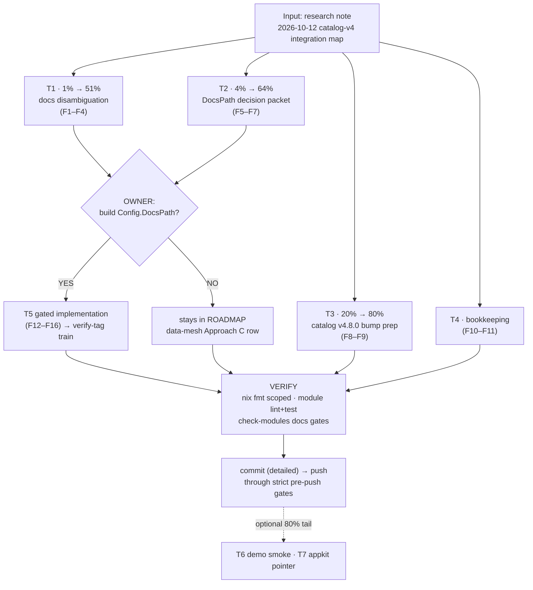

# SUPERB Pareto Plan — catalog/v4 Integration: Decide, Document, or Build?

> **Status: AWAITING OWNER APPROVAL** (planning turn only — no execution beyond bookkeeping).
> **Created:** 2026-10-12 17:33 · **Input:** `docs/research/2026-10-12_catalog-v4-integration-map.md`
> **Question driving this plan:** setup and go-appkit do NOT embed go-cqrs-lite/catalog —
> what should we *really* do about that?
>
> **2026-10-12 update:** tier T3 was consumed the same day by the 10-sweep family
> alignment (catalog v4.8.0 landed here; push `291b2c51`). Execution supersedes to
> [`2026-10-12_18-20_SUPERB-post-alignment-execution-wave-pareto-plan.md`](2026-10-12_18-20_SUPERB-post-alignment-execution-wave-pareto-plan.md).

## 1. Context — what we know (verified 2026-10-12)

| Fact | Evidence |
| --- | --- |
| `setup` has **no** `catalog/v4` dep; it serves the root's own `EventCatalog` (`cqrshtmx.EventCatalogHandler(usermgmt.DefaultEventCatalog())`, `setup/machine.go`) | `setup/go.mod`, research note §"Why setup does not depend" |
| `catalog/v4` IS consumed at the edges: `integration_test` (contract tests) + `examples/catalog-demo` (executable guide), both at v4.7.1 | `integration_test/go.mod:19`, `examples/catalog-demo/go.mod:6` |
| go-appkit: `docs` module wraps `catalog/docserver` (`NewCatalogBuilder`/`RegisterDocs`); `integration` uses it test-only; `cqrs` deliberately clean | `go-appkit/docs/go.mod:5`, `docs/docs.go`, AGENTS.md module table |
| **Upstream drift: `catalog/v4.8.0` is published** (tag `c3b55fd15` in go-cqrs-lite); all four consumer pins sit at v4.7.1 | `git -C ~/projects/go-cqrs-lite tag \| grep catalog` |
| **ROADMAP prior art exists** — the data-mesh interchange proposal already recommends "Approach C + D: evaluate consolidating the hand-rolled `EventCatalog`/`openapi/` with `catalog/v4`" (status: under consideration, no code) | `ROADMAP.md:75-83` |
| Pre-existing gap: "catalog-demo visual smoke" test | `ROADMAP.md:236` |
| **The strongest value signal: the owner himself confused the two catalog concepts** ("does setup embed catalog?") — the distinction is not documented where consumers look | conversation 2026-10-12; guide See Also has no cross-link |

**The two catalogs (never conflate):**

1. cqrs-htmx `EventCatalog` — dependency-free immutable-JSON schema surface for the
   21 identity events (Published Language; `docs/guides/event-catalog-guide.md`).
2. `go-cqrs-lite/catalog/v4` — the doc-generation suite (OpenAPI/AsyncAPI 3.0/D2/
   EventCatalog MDX from Go types) pulling templ, go-faster/yaml, go-snaps.

## 2. Pareto breakdown

- **1% → 51%:** Document the two-catalog distinction where consumers actually look
  (guide See Also, setup README, demo pointer). The owner being confused IS the
  customer-value proof. Zero risk, ~40 min total.
- **4% → 64%:** The `setup.Config.DocsPath` **decision packet** — extend the existing
  ROADMAP Approach-C item with a seam design + go/no-go demand-signal criteria.
  Decides the biggest open question without writing feature code.
- **20% → 80%:** Fleet currency (catalog v4.8.0 bump prep across 4 modules / 2 repos),
  bookkeeping (TODO rows, outcome annotation), and the pre-existing catalog-demo
  visual smoke gap.
- **Remaining 80% of work (only on approval):** the actual DocsPath implementation
  (T5) + optional cross-repo hygiene (T7).

## 3. Comprehensive plan (30–100 min tasks, sorted by value/effort)

| # | Task | Tier | Est | Impact | Effort | Value | Gate |
| --- | --- | --- | --- | --- | --- | --- | --- |
| T1 | **Two-catalogs docs disambiguation** — distinction note + cross-links in `event-catalog-guide.md` (See Also + Serving), `setup/README.md` (EventCatalogPath row), `examples/catalog-demo` pointer | 1% | 40 min | High | Low | **High** (kills the exact conflation the owner hit) | none |
| T2 | **`setup.Config.DocsPath` decision packet** — seam design (mount docserver next to the M6 machine endpoints; proof: `integration_test/catalog_test.go` App introspection), demand-signal + go/no-go criteria, consolidate INTO the ROADMAP data-mesh Approach-C row (no duplicate artifact) | 4% | 50 min | High (decision) | Low | Medium | owner YES/NO at the end |
| T3 | **catalog v4.7.1 → v4.8.0 bump prep** — read upstream diff (`catalog/v4.7.1..v4.8.0`), classify benign/breaking, schedule per release playbook (wave-ordered; consumers: integration_test + catalog-demo here, go-appkit docs + integration cross-repo) | 20% | 35 min | Medium | Low | Medium | release playbook §4a |
| T4 | **Bookkeeping** — TODO_LIST rows (done at plan time below), research-note outcome annotation after T1/T2 execute | 20% | 25 min | Low | Low | Low | docs conventions |
| T5 | **(GATED) Implement `Config.DocsPath`** — config field + path validation (reject `/`, collisions — same class as machine endpoints), `machine.go` wiring, tests, README row, CHANGELOG, verify-tag train + consumer sweep | 80% | 100 min | High | Medium | High **if** approved | **owner YES required** |
| T6 | **catalog-demo visual smoke e2e** — pre-existing ROADMAP gap: boot the demo server in CI-safe `-export-only`-adjacent mode, assert /openapi.json + /asyncapi.json + /diagram.d2 | 80% | 30 min | Low | Low | Low | none |
| T7 | **(Optional, cross-repo)** go-appkit `docs/README.md` one-liner pointing at the integration map | 80% | 30 min | Low | Low | Low | separate repo session |

**Execution order (per Pareto): T1 → T2 → T3 → T4 → (decision) → T5 or stop → T6/T7.**

## 4. Fine breakdown (≤12 min tasks, sorted)

| # | Task | Parent | Est | Gate |
| --- | --- | --- | --- | --- |
| F1 | Guide § See Also: add "Two catalogs" distinction note + link demo + research note | T1 | 12 min | — |
| F2 | Guide § Serving: pointer "for full API docs (OpenAPI/AsyncAPI/D2) see examples/catalog-demo" | T1 | 8 min | — |
| F3 | `setup/README.md` machine-endpoint table: footnote on the `EventCatalogPath` row (≠ go-cqrs-lite/catalog; link) | T1 | 8 min | — |
| F4 | `examples/catalog-demo/main.go` doc comment: link the guide + research note | T1 | 8 min | — |
| F5 | Packet: seam design sketch (config field, validation, docserver mount, session-gating question) | T2 | 12 min | — |
| F6 | Packet: scenarios + demand-signal + go/no-go criteria; verdict slot for owner | T2 | 12 min | — |
| F7 | ROADMAP data-mesh row: append packet link + DocsPath as the concrete C+D probe (edit in place, no new section) | T2 | 8 min | — |
| F8 | Read upstream `catalog/v4.7.1..v4.8.0` diff + CHANGELOG; classify | T3 | 12 min | — |
| F9 | Write bump-scheduling row (wave order, cross-repo coordination note) into TODO_LIST | T3 | 10 min | — |
| F10 | TODO_LIST P2 rows for T1/T3 (done at plan time — see below) | T4 | 8 min | done |
| F11 | Research note: append outcome note (annotations are append-only) once T1/T2 land | T4 | 6 min | after T1/T2 |
| F12 | (GATED) `Config.DocsPath` field + `New` validation tests | T5 | 12 min | owner YES |
| F13 | (GATED) `machine.go` wiring + construction-failure path test | T5 | 12 min | owner YES |
| F14 | (GATED) Handler-serving integration test (golden on docserver routes) | T5 | 12 min | owner YES |
| F15 | (GATED) README config-table row + `doc.go` surface note + CHANGELOG | T5 | 12 min | owner YES |
| F16 | (GATED) `verify-tag.sh` train + `bump-dep` consumer sweep + strict gates | T5 | 12 min | owner YES |
| F17 | catalog-demo smoke spec skeleton (httptest boot + route asserts) | T6 | 12 min | — |
| F18 | Wire spec into the demo's test suite; green run; ROADMAP gap strike | T6 | 12 min | — |
| F19 | go-appkit docs README pointer (in that repo, its rules) | T7 | 8 min | cross-repo |

## 5. Execution graph



## 6. Anti-Verschlimmbesserung guardrails

1. **No T5 code without explicit owner YES** — ROADMAP's own rule: setup-surface
   ideas "need a demand signal before graduating" (`ROADMAP.md:222`).
2. **No duplicate planning artifacts** — T2 extends the existing data-mesh
   Approach-C row in place; do not open a competing proposal.
3. **No out-of-playbook bump** — catalog v4.8.0 rides wave order with strict
   release-train gates; cross-repo consumers coordinate per gotcha 27e
   (`--refresh-cache` after ANY cross-repo family release).
4. **Append-only research note** — annotate outcomes, never rewrite findings.
5. **TODO_LIST hygiene** — only `[ ]`/`[~]`; completed work → CHANGELOG; this is a
   docs-only turn (no CHANGELOG receipt owed).
6. **Scoped formatting** — `nix run .#fmt -- <paths>` on touched files only; never
   whole-tree `nix fmt` churn.

## 7. Verification

```sh
nix run .#fmt -- docs/planning/2026-10-12_17-33_SUPERB-catalog-v4-integration-pareto-plan.md TODO_LIST.md
nix run .#check-docs-tail-budget   # advisory
bash scripts/checks/check-status-annotations.sh 2>/dev/null || true  # n/a this turn
git diff --stat                    # docs-only assertion
nix run .#train-preflight          # only if T5 executes
```

Per-task verify: after T1 `rg -n 'catalog-demo' docs/guides/event-catalog-guide.md setup/README.md`;
after T3 `git -C ~/projects/go-cqrs-lite log --oneline catalog/v4.7.1..catalog/v4.8.0 -- catalog`;
after T5 `nix run .#test` + strict train gate.
