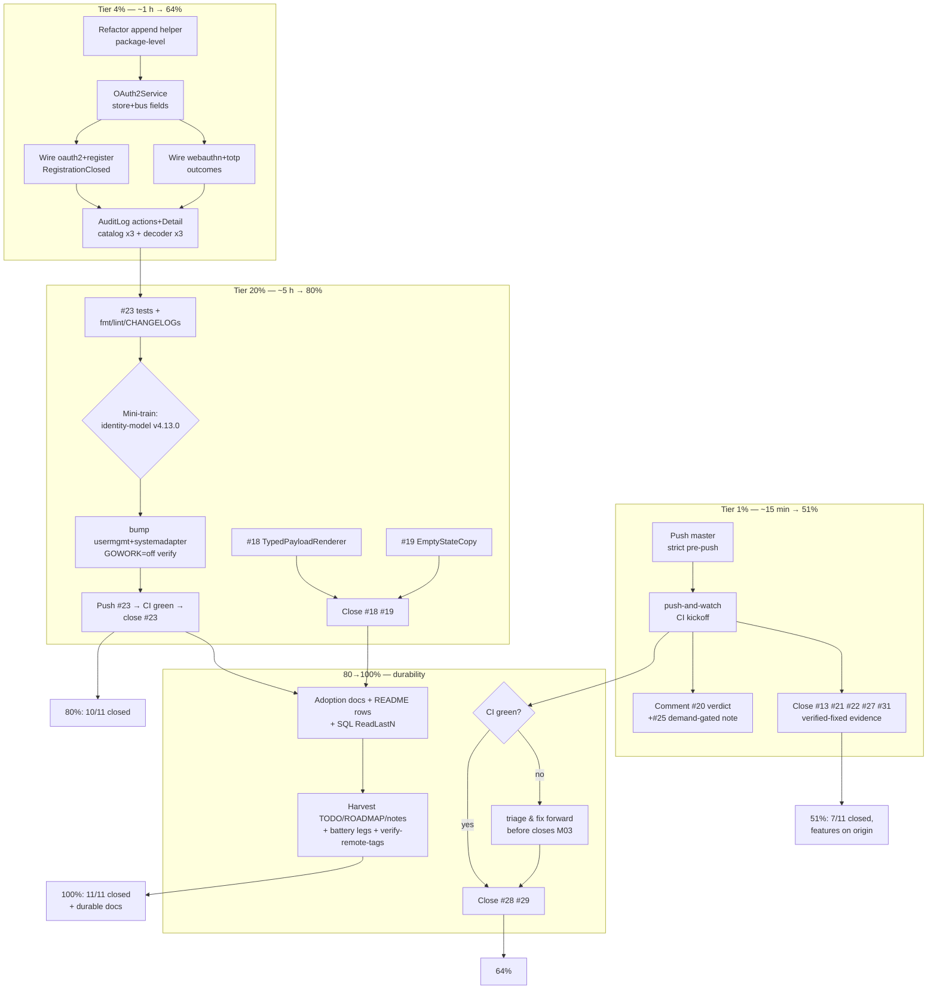

# SUPERB Pareto Plan — Open-Issue Sweep: finish, publish, and close all 11 GitHub issues

> **Filed:** 2026-10-19 03:00 CEST · **Session:** issue-sweep continuation (same night as `1909bda8`/`4b679996`/`981b00ed`)
> **Status:** PLAN — awaiting owner approval for full execution (skill: full-execution mode starts after approval)
> **Scope:** all work to take the 11 open GitHub issues to CLOSED with verified evidence, published code, and green CI — plus the honest tail that remains.

---

## 0. Context (READ FIRST)

**Where the sweep stands right now (verified 03:00):**

| # | Issue | State | Evidence |
| --- | --- | --- | --- |
| #28 | request-scoped SSE filter | **Code DONE**, pushed-pending | `1909bda8` (transport/serve.go; 4 tests green `-race`) |
| #29 | O(maxReplay) fresh connects | **Code DONE**, pushed-pending | `4b679996` (TailReader seam + bench) |
| #13 | panic log request_id | **Already fixed** (verify-only) | recovery.go:66-88 cites the issue |
| #21 | rate-limit key per IP | **Already fixed** (verify-only) | usermgmt/http.go:123 + CHANGELOG |
| #22 | enrollment route gating | **Already fixed** (verify-only) | ADR-0055, `requireSessionUserTarget` |
| #27 | replay tail semantics | **Already fixed** (verify-only) | `0e3f33a0` + tail tests + bench |
| #31 | detailed health | **Already fixed** (verify-only) | health/probe.go:54 `NewWithDetailedCheck` |
| #23 | auth audit journal events | **~40%** — WIP branch `wip/issue-23-auth-audit` @ `95122fc8` | identity-model payloads + usermgmt append helper committed; wiring/tests/train missing |
| #18 | typed PayloadRenderer | not started | dashboardui/core/payload.go is stringly-typed |
| #19 | EmptyStateCopy | not started | hardcoded copy in 6+ templ panels |
| #20 | setup demand signal | mostly graduated | `Config.HealthChecks` shipped; health module live; docs seam unverified |
| #25 | session lifecycle | demand-gated by design | leave open, comment the trigger |

**Git state:** master = `981b00ed`, clean, 4 commits ahead of origin (2 transport features + 2 docs). #23 WIP deliberately parked on branch `wip/issue-23-auth-audit` so master stays hermetically pushable (gotcha 30: its identity-model symbols exist only in the workspace until the mini-train tags).

**Push readiness (verified):** `check-release-train --refresh-cache` → 867 requires, 0 unpublished / 0 replace-exempted / 0 lag.

**Errata (skill Step 0 — stale-backlog corrections):** any backlog that still lists #13/#21/#22/#27/#31 as *fix* work is wrong — they are *close-with-evidence* work. The status report `2026-10-19_02-42` §f items 33–35 already reflect this; this plan supersedes any older list.

---

## 1. Pareto breakdown

```text
UNIVERSE: 11 issues + publish/CI lifecycle + adoption docs + standing tails
≈ 24 medium tasks ≈ 22–26 h of work

 1%  ≈ 15 min  → 51% : PUSH master + watch CI + close 7 issues with evidence
                       + verdict comments on #20/#25
                       (7/11 issues CLOSED; both features on origin; zero
                        uncommitted risk — everything else compounds on this)
 4%  ≈ 1 h     → 64% : + #23 wiring to code-complete (call sites, OAuth2
                       fields, AuditLog, catalog, decoder)
 20% ≈ 5 h     → 80% : + #23 tests/hygiene + identity-model mini-train +
                       push #23 + close it; + #18 + #19 implemented & closed;
                       + CHANGELOGs/docs-freshness
rest → 100%   : adoption docs (guides/README), SQL ReadLastN, battery legs
                       (erraudit/lint), harvest (TODO/ROADMAP/agents-notes),
                       verify-remote-tags, final status report
```

The logic: **closure is communication, and communication is half the result.** Five issues are already fixed on green origin master — closing them costs 50 minutes and delivers more perceived progress than any single remaining feature. #23 is the heaviest *open* feature (durable security-audit trail) and the only one requiring a tag train. #18/#19 are small, independent, and close two more issues. Everything else is documentation, verification, and bookkeeping that makes the above durable.

---

## 2. Execution graph



---

## 3. Comprehensive plan — medium tasks (30–100 min each, 24 tasks, ALL todos)

Sort: importance/impact/effort/customer-value (P0 = do first). Deps column gates execution order.

| ID | Task | Tier | Pri | Impact | Effort | Value | Depends on |
| --- | --- | --- | --- | --- | --- | --- | --- |
| M01 | Push master (4 commits) through strict pre-push; start `push-and-watch`; record run URL | 1% | P0 | H | 45m | H | — |
| M02 | Close #13, #21, #22, #27, #31 with verified-fixed evidence comments | 1% | P0 | H | 30m | H | M01 (evidence on origin) |
| M03 | Close #28 + #29 with commit + green-CI evidence | 1% | P0 | H | 30m | H | M01 + CI green |
| M04 | #20 verdict: verify mount seams + fullstack-wiring DisableLogin docs; post graduated-map comment; close or split | 1% | P0 | M | 30m | M | M01 |
| M05 | #25 verdict comment: demand-gated, XS-first trigger, precedent link | 1% | P0 | M | 20m | M | M01 |
| M06 | #23: refactor append helper package-level; OAuth2Service store+bus fields + constructor | 4% | P1 | H | 60m | H | — |
| M07 | #23: wire webauthn FinishLogin/BeginLogin + totp VerifyTOTP outcomes | 4% | P1 | H | 60m | H | M06 |
| M08 | #23: wire oauth2 FinishLogin outcomes + provisionLinkedUser + register maxUsers → RegistrationClosed | 4% | P1 | H | 60m | H | M06 |
| M09 | #23: AuditLog 3 actions + cases + combined EventTypes + Detail←Reason | 4% | P1 | M | 45m | H | M06 |
| M10 | #23: event catalog ×3 + systemadapter TypeDecoder ×3 (21→24) | 4% | P1 | M | 30m | H | M06 |
| M11 | #23 tests: journal paths, best-effort contract, read-model exclusion guard, decoder roundtrip | 20% | P1 | H | 60m | H | M07–M10 |
| M12 | #23 hygiene: fmt+lint 3 modules; CHANGELOGs ×3; AGENTS 21→24; actor-and-audit-trail.md § | 20% | P1 | M | 45m | M | M11 |
| M13 | #23 mini-train: hermetic verify → CHANGELOG-before-tag → `verify-tag identity-model v4.13.0 --push` → refresh-cache → bump usermgmt+systemadapter → GOWORK=off re-verify | 20% | P0 | H | 60m | H | M12 |
| M14 | Merge WIP → master; full battery (`nix test` + `check-modules`); push; close #23 with design comment | 20% | P0 | H | 45m | H | M13 + CI green |
| M15 | #18 TypedPayloadRenderer: `RenderTyped[P]` + `RegisterPayloadType` registry + DefaultPayloadRenderer chain + tests | 20% | P1 | M | 60m | M | — |
| M16 | #19 EmptyStateCopy: typed panel keys + Config map + templ threading; unset = byte-identical | 20% | P1 | M | 45m | M | — |
| M17 | #18/#19 hygiene: dashboardui CHANGELOG; goldens only-if-drifted; close both | 20% | P2 | L | 30m | M | M15, M16 |
| M18 | Adoption docs: WithRequestFilter + TailReader recipes in SSE/frontend-sync guides; auth-audit cross-links; README feature rows | tail | P2 | M | 45m | M | M03, M14 |
| M19 | SQL `ReadLastN` on usermgmt SQLEventStore (DESC LIMIT n reversed) + test → real-world #29 payoff | tail | P2 | M | 60m | H | M14 |
| M20 | Battery legs: erraudit-inventory; SSEOptions.RequestFilter conversion test; scoped lint re-check | tail | P3 | L | 30m | L | M14 |
| M21 | Harvest: TODO_LIST row + ROADMAP (unknown-attempt opt-in, #20 middleware seam) + agents-notes lesson | tail | P3 | L | 45m | M | — |
| M22 | verify-remote-tags peeled-ref audit; final CI confirm; execution status report | tail | P3 | L | 30m | M | M14 |
| M23 | AuthFailureReason exhaustiveness audit vs every real failure path (lockout, session-missing) | tail | P3 | L | 30m | M | M11 |
| M24 | Graceful rendering checks: dashboardui unknown event types; adminui new audit actions; catalog goldens | tail | P3 | L | 30m | L | M14 |

**Totals:** 24 medium tasks ≈ 19.5 h nominal. 8×P0 (5.5 h) · 8×P1 (7.5 h) · 8×P2/P3 (6.5 h).

---

## 4. Fine breakdown — execution tasks (≤12 min each, 92 tasks, ALL todos)

Same global sort (P0 → P3). "M" = parent medium task.

| ID | Task | M | Pri | Min |
| --- | --- | --- | --- | --- |
| F01 | `git push` master; confirm pre-push strict gates pass | M01 | P0 | 10 |
| F02 | Start `nix run .#push-and-watch`; record run URL + job matrix | M01 | P0 | 10 |
| F03 | Poll CI; if red: triage commit-scoped before any closes | M01 | P0 | 20* |
| F04 | Post close comment #13 (recovery.go:66-88 cites issue inline) | M02 | P0 | 10 |
| F05 | Close #21 (http.go:123 KeyExtractorFromClientIP + CHANGELOG receipt) | M02 | P0 | 10 |
| F06 | Close #22 (ADR-0055 + requireSessionUserTarget webauthn_http.go:47,64) | M02 | P0 | 10 |
| F07 | Close #27 (commit 0e3f33a0; tail tests journalsse_test.go:345,372; bench) | M02 | P0 | 10 |
| F08 | Close #31 (health/probe.go:54 NewWithDetailedCheck; RecorderChain; duration_ns) | M02 | P0 | 10 |
| F09 | Close #28 (1909bda8; 4 tests; 400-on-error + nil-fallback semantics) | M03 | P0 | 10 |
| F10 | Close #29 (4b679996; TailReader contract; bench; SQL-decode honesty note) | M03 | P0 | 10 |
| F11 | Read setup/mount.go middleware seam surface (verify #20 item 2) | M04 | P0 | 10 |
| F12 | Read fullstack-wiring.md DisableLogin/custom-path § (verify #20 item 3) | M04 | P0 | 10 |
| F13 | Post #20 graduated-map comment; close or split leftovers | M04 | P0 | 12 |
| F14 | Post #25 comment (demand-gated; XS-first; #23 audit-event precedent) | M05 | P0 | 10 |
| F15 | Refactor appendAuthAuditEvent → package-level (logger, store, bus) | M06 | P1 | 12 |
| F16 | Add store + bus fields to OAuth2Service struct | M06 | P1 | 10 |
| F17 | Extend NewOAuth2Service signature; update caller; compile | M06 | P1 | 12 |
| F18 | Wire FinishLogin success → journalLoginSuccess(webauthn) | M07 | P1 | 10 |
| F19 | Wire FinishLogin ceremony-failure → journalLoginFailure(ceremony_failed) | M07 | P1 | 10 |
| F20 | Wire BeginLogin no-credentials → journalLoginFailure(no_credentials) | M07 | P1 | 10 |
| F21 | Wire VerifyTOTP success + code_invalid (setup path excluded) | M07 | P1 | 12 |
| F22 | Wire oauth2 FinishLogin success → journalLoginSuccess(oauth2, provider) | M08 | P1 | 10 |
| F23 | Wire oauth2 failures with user-known guard (4 reason classes) | M08 | P1 | 12 |
| F24 | Wire provisionLinkedUser registration_closed → journalRegistrationClosed | M08 | P1 | 10 |
| F25 | Wire service_register maxUsers site → journalRegistrationClosed | M08 | P1 | 10 |
| F26 | AuditLog: 3 action constants + auditActionFor cases | M09 | P1 | 10 |
| F27 | AuditLog.EventTypes = user + auth combined list | M09 | P1 | 10 |
| F28 | AuditEntry.Detail ← LoginFailedPayload.Reason (decode in Handle) | M09 | P1 | 12 |
| F29 | es_event_catalog: register 3 auth events (Aggregate "Auth") | M10 | P1 | 12 |
| F30 | systemadapter TypeDecoder: 3 Register calls; comment 21→24 | M10 | P1 | 10 |
| F31 | Test: successful login journals LoginSucceeded with user actor | M11 | P1 | 12 |
| F32 | Test: failed login journals LoginFailed reason-class, no secret bytes | M11 | P1 | 10 |
| F33 | Test: registration-closed probe journals RegistrationClosed | M11 | P1 | 10 |
| F34 | Test: audit append failure never fails the login (best-effort) | M11 | P1 | 12 |
| F35 | Test: user read model does not subscribe auth event types | M11 | P1 | 10 |
| F36 | Test: TypeDecoder roundtrips all 3 auth payloads | M11 | P1 | 10 |
| F37 | `nix run .#fmt --` scoped to the 3 touched modules | M12 | P1 | 5 |
| F38 | golangci-lint identity-model + usermgmt + systemadapter | M12 | P1 | 12 |
| F39 | CHANGELOG identity-model: v4.13.0 section (3 events + aggregate) | M12 | P1 | 10 |
| F40 | CHANGELOG usermgmt: auth journal + AuditLog + catalog entries | M12 | P1 | 12 |
| F41 | CHANGELOG systemadapter: decoder 21→24 | M12 | P1 | 5 |
| F42 | AGENTS.md counts: "21 event payload structs" + "21-event TypeDecoder" → 24 | M12 | P1 | 5 |
| F43 | Write docs/guides/actor-and-audit-trail.md § auth audit streams | M12 | P1 | 12 |
| F44 | GOWORK=off build+vet+test usermgmt + systemadapter (pre-tag proof) | M13 | P0 | 12 |
| F45 | `verify-tag.sh identity-model v4.13.0 --push` (CHANGELOG committed) | M13 | P0 | 10 |
| F46 | `check-release-train --refresh-cache` post-tag | M13 | P0 | 5 |
| F47 | bump-dep identity-model → usermgmt + systemadapter requires | M13 | P0 | 10 |
| F48 | Commit require bumps (wave-order commit, no `--no-verify` needed) | M13 | P0 | 10 |
| F49 | GOWORK=off hermetic re-verify post-bump | M13 | P0 | 10 |
| F50 | Merge `wip/issue-23-auth-audit` into master (ff) | M14 | P0 | 5 |
| F51 | `nix run .#test` full hermetic battery | M14 | P0 | 10* |
| F52 | Triage any battery red to root cause | M14 | P0 | 12 |
| F53 | `nix run .#check-modules` | M14 | P0 | 10 |
| F54 | Push #23; push-and-watch; capture run | M14 | P0 | 10 |
| F55 | Post #23 close comment (Auth-stream rationale + exclusions) | M14 | P0 | 10 |
| F56 | core/payload.go: `TypedPayloadRenderer[P]` interface | M15 | P1 | 10 |
| F57 | `RegisterPayloadType[P]` registry (mutex + unmarshal closure) | M15 | P1 | 12 |
| F58 | DefaultPayloadRenderer chain: registry → consumer → pretty-JSON | M15 | P1 | 10 |
| F59 | Config seam for typed renderers (opt-in, incremental) | M15 | P1 | 10 |
| F60 | Tests: typed hit / unregistered fallback / concurrent registration | M15 | P1 | 12 |
| F61 | Inventory all emptyStatePanel call sites → key list | M16 | P1 | 10 |
| F62 | EmptyStateCopyKey enum + Config.EmptyStateCopy map | M16 | P1 | 10 |
| F63 | Thread copy lookup through the 6+ panels | M16 | P1 | 12 |
| F64 | Assert unset-config renders byte-identical (goldens) | M16 | P1 | 10 |
| F65 | Tests: override wins; defaults unchanged | M16 | P1 | 10 |
| F66 | CHANGELOG dashboardui (#18 + #19 sections) | M17 | P2 | 10 |
| F67 | Regen goldens ONLY if render changed; verify diff = documented change | M17 | P2 | 12 |
| F68 | Close #18 + #19 with commit refs | M17 | P2 | 10 |
| F69 | SSE guide: WithRequestFilter recipe (per-request query filters) | M18 | P2 | 12 |
| F70 | SSE guide: TailReader contract + SQL `DESC LIMIT n` recipe note | M18 | P2 | 10 |
| F71 | actor-and-audit-trail + usermgmt README cross-links | M18 | P2 | 10 |
| F72 | README feature catalog: request filter / tail reads / auth audit rows | M18 | P2 | 10 |
| F73 | Locate SQLEventStore journal read path + dialect matrix | M19 | P2 | 12 |
| F74 | Implement ReadLastN (ORDER BY DESC LIMIT n, reversed) | M19 | P2 | 12 |
| F75 | Test: tail read == paged tail on seeded journal | M19 | P2 | 10 |
| F76 | Wire detection note + CHANGELOG (real #29 payoff) | M19 | P2 | 10 |
| F77 | `nix run .#erraudit-inventory` (new warn sites carry context) | M20 | P3 | 10 |
| F78 | SSEOptions.RequestFilter Options()-conversion test | M20 | P3 | 10 |
| F79 | Scoped lint re-check transport (spillover guard) | M20 | P3 | 10 |
| F80 | TODO_LIST: sweep row + header Updated line | M21 | P3 | 10 |
| F81 | ROADMAP: unknown-user attempt journaling (opt-in idea + trigger) | M21 | P3 | 10 |
| F82 | ROADMAP/TODO: #20 middleware-seam leftover | M21 | P3 | 10 |
| F83 | agents-notes: verify-APIs-first + receiver-survey-before-helper lessons | M21 | P3 | 10 |
| F84 | `verify-remote-tags` peeled-ref audit post-push | M22 | P3 | 10 |
| F85 | Final CI green confirm; record run IDs in report | M22 | P3 | 10 |
| F86 | Execution session status report (docs/status) | M22 | P3 | 12 |
| F87 | Enumerate every login failure path; diff vs AuthFailureReason set | M23 | P3 | 12 |
| F88 | Add missing reason classes / map the gaps | M23 | P3 | 10 |
| F89 | Payload doc-comment polish (per-class semantics) | M23 | P3 | 5 |
| F90 | dashboardui unknown-event-type rendering check | M24 | P3 | 10 |
| F91 | adminui audit page renders new actions gracefully | M24 | P3 | 10 |
| F92 | Event catalog golden/fixture regen if tests pin entries | M24 | P3 | 10 |

`*` = wall-clock may exceed 12 min (CI/battery waits) but active attention ≤20; split across polls.

**Totals:** 92 fine tasks; P0: F01–F14 + F44–F55 (26), P1: F15–F43 + F56–F65 (39), P2: F66–F76 (11), P3: F77–F92 (16).

---

## 5. Out of scope (standing tails — NOT this plan, listed for honesty)

- Root/consumer-facing tag wave (root + usermgmt + adminui + …) — owner-cadence train (Q2 of 02-42 report); this plan only cuts the identity-model tag #23 REQUIRES for CI.
- `Spec.JSON()` deterministic-emit (TODO_LIST P2 row), CI per-module matrix isolation (gotcha 40 §g2), bump-dep f3–f9 enhancements, pre-commit f1/f2 triage — prior-session tails.
- Coverage-gate + fleet-lint re-runs (battery rows in TODO_LIST).

## 6. VerschlimmBESSER guards (do-no-harm)

1. Master pushes only through the strict pre-push hook — no `--no-verify` on pushes, ever.
2. The identity-model tag is cut ONLY after hermetic pre-tag proof (F44) and CHANGELOG (F39).
3. Goldens regenerate only on verified, documented render drift (F67) — never "to make tests pass".
4. TODO_LIST gets ONE compact row; no header-chain rewrite.
5. WIP never returns to master without the full battery (F50–F53).
