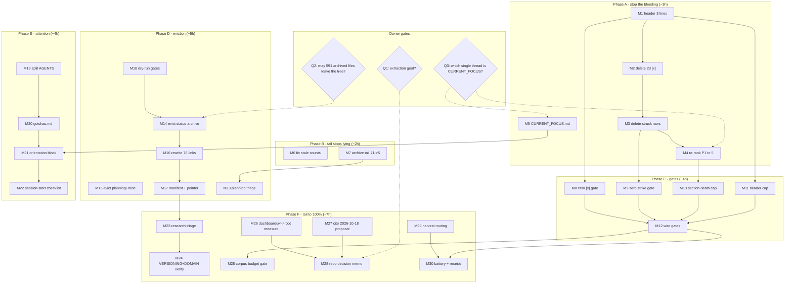

# SUPERB plan: docs-corpus eviction + agent-attention recovery

**Created:** 2026-10-23 17:16 CEST
**Status:** PLAN ONLY. Nothing in this document has been executed yet except where marked `[VERIFIED]`.
**Predecessor:** [`docs/status/2026-10-23_17-09_module-extraction-question-doc-corpus-audit_status.md`](../status/2026-10-23_17-09_module-extraction-question-doc-corpus-audit_status.md)
**Trigger:** "the project is getting too big and the agents can't concentrate on what's important anymore."
**Rejected alternative:** extracting `identity-model/`, `usermgmt/`, `dashboardui/`, `adminui/` into separate repos. See §2.1 for why.

---

## 1. Context: what is actually big

All numbers below were measured this session and are re-derivable from the command appendix in the predecessor report.

| Metric | Measured | % of repo |
| --- | ---: | ---: |
| Repo total (cloc) | 439,536 lines | 100% |
| Go code | 98,003 lines | 22% |
| **Markdown** | **164,176 lines** (918 files) | **37%** |
| HTML reports | 106,068 lines (85 files) | 24% |
| **`docs/` (md only)** | **146,913 lines** (799 files) | **33%** |
| `docs/status/` | 99,424 md + 16,831 html = 531 + 14 files | 26% |
| `docs/planning/` | 23,541 md + 12,951 html = 105 + 8 files | 8% |
| `docs/reviews/` | 505 md + 21,707 html = 4 + 27 files | 5% |
| `docs/brainstorming/` | 14,577 html = 7 files | 3% |
| Archived files already inside the working tree | 591 | n/a |
| Live status reports | 71 (README claims 46) | n/a |
| `TODO_LIST.md` rows | 107 = 70 `[ ]` + 14 `[~]` + 23 `[x]`; **43 dead (40%)** | n/a |
| `TODO_LIST.md` §P1 "High impact" | 7 rows, **6 dead, 1 live** | n/a |
| `TODO_LIST.md:6` header | **8,166 characters, one line** | n/a |
| Living-doc links into historical corpora | 76 of 633 total links | n/a |

### 1.1 Six measured orientation defects

These are the six concrete things that make a fresh agent misread the project. Everything in this plan traces to one of them.

| # | Defect | Measurement | Owning gate today |
| --- | --- | --- | --- |
| D1 | P1 "High impact" is 86% tombstone | 7 rows, 6 dead, 1 live (an upstream ask) | none |
| D2 | `[x]` rows contradict the file's own legend and AGENTS gotcha 20 | 23 rows | none |
| D3 | Header is a 8,166-char session diary | one line | none |
| D4 | Live status tail is 19x the documented budget | `check-docs-tail-budget`: **57 exceed budget of 3** `[VERIFIED 2026-10-23]` | advisory only, never blocks |
| D5 | Stale hand-maintained counts | "46 live as of 2026-10-17" vs 71 actual | none |
| D6 | 43% of the repo is closed history sitting in the search path | 695 files / 189,318 lines | docs-health discipline only |

### 1.2 Gate baseline (current tree, `[VERIFIED 2026-10-23]`)

| Gate | rc | Result |
| --- | ---: | --- |
| `check-docs-freshness.sh` | 0 | pass |
| `check-docs-links.sh` | 0 | 633 links resolve |
| `check-docs-tail-budget.sh` | 0 | **advisory: 57 reports exceed budget of 3** |
| `check-status-rows.py` | 0 | 473 files clean, 44 deliberately-mixed tables reported |
| `check-status-annotations.sh` | 0 | 107 gated reports annotated, 365 legacy-exempt |

Important: **no existing gate catches D1, D2, D3, D5, or D6, and the one gate that sees D4 is advisory by design.** That is why the corpus reached this state while CI stayed green. This plan's real product is the five missing gates, not the one-time cleanup.

---

## 2. Scope

### 2.1 Rejected: repo extraction

| Evidence | Value |
| --- | --- |
| The four modules are already independent Go modules | tags: usermgmt 31, adminui 20, dashboardui 17, identity-model 12 |
| Internal require edges that would become cross-repo | 128 |
| identity-model commits that also touch usermgmt (12 mo) | 103 of 146 (70%) |
| adminui commits that also touch usermgmt | 177 |
| `setup` imports all four named modules | usermgmt x20, dashboardui x4, adminui x4, loginpage x2 |
| Go module redirects | do not exist; extraction breaks consumer import paths |
| Prior art already on disk | `docs/modularization/` holds 6 proposals incl. `2026-10-18_PROPOSAL.html` (verdict KEEP-ALL per TODO_LIST header) |

Extraction would copy the 189k-line doc tail into four repos and multiply the release-train cost that already produces the repo's worst incident classes (AGENTS gotchas 27e, 30, 34, 38, 39, 40).

### 2.2 In scope (30 milestones, ~25.4 h total)

Documentation corpus, agent orientation surface, and the gates that keep them healthy. No Go code changes. No module moves. No CI job restructuring beyond adding gates.

### 2.3 Explicitly out of scope: the 62 live `TODO_LIST` rows

These are separate epics requiring code work, upstream tags, or owner intent. This plan **routes** them, it does not absorb them.

| Section | Live rows | Why not in this plan |
| --- | ---: | --- |
| P1 | 1 | upstream ask on go-cqrs-lite (`ReadLastN`) |
| P2 | 32 | mixed code, tooling, and owner-gated trains |
| P3 | 29 | technical debt / future; several blocked on foreign tags |
| **Total** | **62** | stay in `TODO_LIST.md`, re-ranked by M4 only |

Known competing epics observed while reading (recorded here so M4 has the candidates): open-issue sweep close-out (#23/#28/#29/#18/#19), systemadapter declarative red blocked on an upstream `projectionadapter` tag, sync-wire DTO hardening (data-model ep. 3, N1-N3), owed verification battery (coverage/lint/bench), and this docs work.

---

## 3. Pareto decomposition

Two outcome axes, because a single "51%" would be invented precision:

- **Axis A: orientation defects eliminated** (D1-D6, six measured defects).
- **Axis B: repo bloat removed** (lines of closed history out of the search path).

### 3.1 The 1% that delivers ~51%

**Two files, 45 minutes: rewrite `TODO_LIST.md` lines 1-35, create `CURRENT_FOCUS.md`.**

| Why it is the 1% | Evidence |
| --- | --- |
| `TODO_LIST.md` is the first file every session reads after `AGENTS.md` | it is the #1 entry in the docs ownership table |
| Its first 35 lines are the entire "what is high impact" story | P1 = 7 rows, 6 dead |
| Its line 6 is a 8,166-char wall | measured |
| No file currently names the one active thread | `CURRENT_FOCUS.md` does not exist |

Fixes D1 + D3, and half of D2's blast radius (the `[x]` rows sit in P1/P2 headers). Changes what an agent does next without touching a single historical file.

### 3.2 The 4% that delivers ~64%

**+5 milestones, ~5 h cumulative: delete the 43 dead rows, fix the stale counts, archive the live tail to ≤5, land the first hygiene gate.**

Fixes D1, D2, D3, D4, D5 = 5 of 6 defects. After this block the corpus *stops lying*, though it is still huge.

### 3.3 The 20% that delivers ~80%

**+11 milestones, ~14 h cumulative: the 591-file eviction, the 76 link rewrites, gate dry-run validation, the per-module `AGENTS.md` split, and wiring all new gates into `check-modules` + CI.**

Fixes D6 and makes every fix permanent. Honest note: this block is ~55% of total effort for 80% of the *result*. Strict 80/20 does not hold here, because bloat removal is mechanical volume work, not leverage work.

### 3.4 The remaining 20% to reach 100%

**+12 milestones, ~11 h: the tail.** `docs/research/` and `docs/architecture-understanding/` triage, `VERSIONING.md` + `DOMAIN_LANGUAGE.md` verification, the 18-file planning supersession pass, the corpus-size budget gate, the dashboardui↔root measurement, the two-repo decision memo, the HARVEST routing, and the final battery with a successor receipt.

This tail is the difference between "the tree is smaller" and "the tree cannot regrow". Skipping it is how the 2026-09 corpus sweeps were undone.

---

## 4. Anti-Verschlimmbesserung guardrails

Violating any of these is a stop-work condition.

1. **Never rewrite a historical file's content.** Annotate non-destructively only (strike + verdict). No reflow, no re-ordering, no "cleanup".
2. **Never delete a `TODO_LIST` row without confirming its receipt exists** in `CHANGELOG.md` or in the row itself. No receipt, no deletion; rephrase as live instead.
3. **Never `git mv` an archive file before running the row gate on it** (docs-health: gate BEFORE the move; the 2026-10-15 pass moved 9 files then gated, hiding shape damage).
4. **Never evict before the dry-run gate validation passes** (M18 precedes M14 in dependency order only if Q2 is answered; otherwise M18 runs on a scratch worktree).
5. **No bulk `sed`/`perl` on markdown.** Use `assets/annotate.go` and `--dry-run` first.
6. **No code changes, no module moves, no version bumps** in this initiative. If a task seems to need one, it belongs in the out-of-scope list.
7. **No `--no-verify` pushes.** If the pre-push gate blocks, report the exact reason and stop.
8. **Respect the daemon race:** chain `fmt && add && commit` in one call; never rebase an unpushed heuristic commit; never revert diffs you did not author.
9. **Every milestone ends with a verification command and a commit.** A milestone without a green verify is not done.
10. **One milestone in flight at a time.** No parallel doc surgery.

---

## 5. Milestones (30-100 min each), sorted by impact

Impact: **C**ritical / **H**igh / **M**edium / **L**ow. Customer value: **Ag** = future agent sessions, **Hu** = human reader/contributor, **Co** = library consumers.

| ID | Milestone | Fixes | Impact | Effort | Value | Depends | Verify |
| --- | --- | --- | --- | ---: | --- | --- | --- |
| M1 | Rewrite `TODO_LIST.md` header to 3 lines | D3 | C | 30m | Ag | — | `check-docs-links` |
| M2 | Delete 23 `[x]` rows after receipt audit | D2 | C | 60m | Ag | M1 | `check-status-rows` |
| M3 | Delete 20 remaining struck rows | D2 | C | 30m | Ag | M2 | `check-status-rows` |
| M4 | Re-rank 62 live rows; P1 to ≤5 live | D1 | C | 60m | Ag | M3, Q3 | manual count |
| M5 | Create `CURRENT_FOCUS.md` + wire into AGENTS | D1/D3 | C | 30m | Ag | Q3 | `check-docs-links` |
| M6 | Fix `docs/status/README.md` stale counts | D5 | H | 30m | Hu | — | re-read |
| M7 | Annotate + archive live tail 71 → ≤5 | D4 | C | 100m | Ag | — | `check-docs-tail-budget` |
| M8 | Gate: zero `[x]` rows | D2 | H | 40m | Ag | M2 | fixture self-test |
| M9 | Gate: zero struck rows | D2 | H | 30m | Ag | M3 | fixture self-test |
| M10 | Gate: no section >30% dead | D1 | H | 30m | Ag | M4 | fixture self-test |
| M11 | Gate: header length ≤300 chars | D3 | H | 25m | Ag | M1 | fixture self-test |
| M12 | Wire M8-M11 into `check-modules` + CI + docs | D1-D3 | H | 60m | Ag | M8-M11 | `check-modules` |
| M13 | Supersession triage of 18 live planning files | D6 | M | 60m | Hu | — | `check-docs-links` |
| M14 | Evict `docs/status/archived/` (473 files) | D6 | C | 60m | Ag | Q2, M18 | `check-docs-links` |
| M15 | Evict `docs/planning/archived/` + misc (118) | D6 | H | 30m | Ag | Q2, M18 | `check-docs-links` |
| M16 | Rewrite 76 living-doc links into history | D6 | C | 100m | Hu | M14 | `check-docs-links` |
| M17 | Eviction manifest + `ARCHIVE_MOVED.md` pointer | D6 | M | 30m | Hu | M14-M16 | `check-docs-links` |
| M18 | Dry-run all doc gates against evicted tree | D6 | C | 60m | Ag | — | all 5 gates |
| M19 | Split `AGENTS.md` into core + per-module files | D6 | H | 100m | Ag | M12 | `check-docs-links` |
| M20 | Extract gotchas to `docs/gotchas.md` + index | D6 | H | 60m | Ag | M19 | `check-docs-links` |
| M21 | Add 5-line orientation block to AGENTS top | D1 | H | 30m | Ag | M5 | re-read |
| M22 | Session-start checklist + agents-notes exclusion check | D6 | M | 30m | Ag | M21 | manual |
| M23 | Triage `docs/research/` + `architecture-understanding/` | D6 | M | 60m | Hu | — | `check-docs-links` |
| M24 | Verify `VERSIONING.md` + `DOMAIN_LANGUAGE.md` claims | D5 | M | 60m | Co | — | code cross-check |
| M25 | Corpus-size budget gate | D6 | H | 60m | Ag | M12 | fixture self-test |
| M26 | Measure dashboardui ↔ root coupling correctly | — | L | 30m | Hu | — | repeatable command |
| M27 | Read + cite or supersede `2026-10-18_PROPOSAL.html` | process | M | 30m | Hu | — | citation in plan |
| M28 | Two-repo-by-audience decision memo (or ADR) | — | M | 60m | Hu | Q1, M26-M27 | memo linked |
| M29 | HARVEST this plan's items into TODO/ROADMAP | process | H | 40m | Ag | M4 | `check-status-rows` |
| M30 | Final battery + successor receipt | — | H | 100m | Co | M12, M25 | `.#check-modules`, `.#test` |

**Total: 1,525 minutes = 25.4 h ≈ 3.2 focused working days.**

### 5.1 Critical path

`Q3 → M1 → M2 → M3 → M4 → M5 → M10 → M12 → M18 → Q2 → M14 → M16 → M17 → M25 → M30`

Everything else is parallelizable tail work. Nothing on the critical path touches Go code.

### 5.2 What unblocks without owner answers

M1, M2, M3, M6, M7, M8-M12, M13, M18, M19-M25, M26, M27, M29, M30 all proceed without an owner decision. Only **M4/M5 (ranking)**, **M14-M17 (eviction)** and **M28 (repo posture)** need answers to Q1-Q3.

---

## 6. Micro-tasks (≤12 min each), all 30 milestones

`V` column = the verification performed inside or at the end of that micro-task.

### Phase A: stop the bleeding (M1-M5, 31 subtasks)

| ID | Subtask | Min | V |
| --- | --- | ---: | --- |
| T1.1 | Read `TODO_LIST.md` lines 1-16; list every fact asserted in the header (date, outcome narrative, module count, coverage, lint, CI, version train) | 8 | list produced |
| T1.2 | Classify each fact: keep in TODO / belongs in CHANGELOG / belongs in AGENTS / drop | 6 | classification table |
| T1.3 | Write the 3-line header (date, one-sentence outcome, module count) | 8 | file saved |
| T1.4 | Move surviving facts to their owning doc; delete the rest | 8 | `git diff` review |
| T2.1 | Extract all 23 `[x]` rows verbatim to a scratch list with their inline commit refs | 6 | 23 rows captured |
| T2.2 | For each of the 23, grep `CHANGELOG.md` for the module + version receipt | 10 | receipted/missing column filled |
| T2.3 | Add missing receipts to `CHANGELOG.md` `[Unreleased]` | 12 | `git diff CHANGELOG.md` |
| T2.4 | Delete the 23 rows from `TODO_LIST.md` | 6 | row count 107→84 |
| T2.5 | `check-status-rows.py` + `check-docs-links.sh` | 6 | rc=0 both |
| T3.1 | List the 20 struck non-`[x]` rows | 5 | list produced |
| T3.2 | Verify each has an inline DONE marker or a CHANGELOG receipt | 10 | verdict per row |
| T3.3 | Delete receipted rows; rephrase any whose parent epic is still live | 10 | row count 84→64 |
| T3.4 | `check-status-rows.py` + `check-docs-links.sh` | 5 | rc=0 both |
| T4.1 | Extract the 64 live rows with section + theme | 8 | table produced |
| T4.2 | Cluster into epics (issue-sweep, systemadapter, sync-wire, battery, docs, other) | 8 | cluster counts |
| T4.3 | Apply Q3's answer: pick the 5 P1 items | 6 | P1 list |
| T4.4 | Rewrite §P1 with 5 one-line rows, each with an evidence link | 12 | file saved |
| T4.5 | Move remaining rows to P2/P3 under their clusters | 10 | section counts |
| T4.6 | Verify: P1 live 5/5; no `[x]`; no `~~` | 4 | grep rc!=0 (no matches) |
| T5.1 | Apply Q3: write 3 focus items with a "done when" line each | 10 | draft |
| T5.2 | Create `CURRENT_FOCUS.md` | 5 | file exists |
| T5.3 | Link it from the top of `AGENTS.md` and the TODO header | 8 | `git diff` |
| T5.4 | `check-docs-links.sh` | 5 | rc=0 |

### Phase B: make the tail stop lying (M6-M7, 15 subtasks)

| ID | Subtask | Min | V |
| --- | --- | ---: | --- |
| T6.1 | Decide: generate counts or delete them | 5 | decision recorded |
| T6.2 | Replace "46 live as of 2026-10-17" with a pointer or generated value | 8 | `git diff` |
| T6.3 | Correct the layout-table numbers (473 archived, 531 total md, 14 html) | 8 | `git diff` |
| T6.4 | `check-docs-freshness.sh` + `check-docs-links.sh` | 5 | rc=0 both |
| T7.1 | List the 66 oldest live reports; pick the archive batch | 6 | list produced |
| T7.2 | `go run assets/annotate.go --dry-run` on one file to validate shape | 8 | dry-run clean |
| T7.3 | Annotate batch 1 (23 reports) | 12 | per-item verdicts |
| T7.4 | Annotate batch 2 (23 reports) | 12 | per-item verdicts |
| T7.5 | Annotate batch 3 (20 reports) | 12 | per-item verdicts |
| T7.6 | `check-rows` every file about to move (gate BEFORE the move) | 10 | all COMPLETE |
| T7.7 | `git mv` batch to `docs/status/archived/` | 8 | `git status` |
| T7.8 | Update `archived/README.md` manifest | 10 | one line per file |
| T7.9 | `check-status-annotations.sh` + `check-status-rows.py` + `check-docs-tail-budget.sh` | 8 | tail ≤3 |

### Phase C: gates that prevent regrowth (M8-M12, 20 subtasks)

| ID | Subtask | Min | V |
| --- | --- | ---: | --- |
| T8.1 | Decide implementation: extend `check-status-rows.py` vs new script | 5 | decision |
| T8.2 | Implement the zero-`[x]` rule | 10 | script runs |
| T8.3 | Add fixture with a planted `[x]` that must fail | 10 | self-test red |
| T8.4 | Run against the repo | 5 | rc=0 after M2 |
| T8.5 | Add the self-test to `scripts/selftests/` | 8 | file exists |
| T9.1 | Implement the zero-`~~`-row rule | 10 | script runs |
| T9.2 | Fixture with a planted strike that must fail | 10 | self-test red |
| T9.3 | Run against the repo + add self-test | 8 | rc=0 after M3 |
| T10.1 | Implement the per-section death-ratio rule (30% cap) | 12 | script runs |
| T10.2 | Fixture at 40% dead that must fail | 8 | self-test red |
| T10.3 | Run against the repo + add self-test | 8 | rc=0 after M4 |
| T11.1 | Implement the header-length rule (300 chars) | 8 | script runs |
| T11.2 | Fixture at 400 chars that must fail | 6 | self-test red |
| T11.3 | Run against the repo + add self-test | 6 | rc=0 after M1 |
| T12.1 | Add flake apps for the new checks | 10 | `nix flake show` |
| T12.2 | Add stages to `check-modules` | 8 | local run |
| T12.3 | Add CI steps to `.github/workflows/ci.yml` | 10 | YAML valid |
| T12.4 | Add commands to README + AGENTS Gates row | 8 | `git diff` |
| T12.5 | Add self-tests to the CI job | 6 | YAML valid |
| T12.6 | Run `.#check-modules` end to end | 12 | rc=0 |

### Phase D: eviction (M13-M18, 24 subtasks) — gated on Q2

| ID | Subtask | Min | V |
| --- | --- | ---: | --- |
| T13.1 | List the 18 live planning files with their headline verdict | 8 | table produced |
| T13.2 | Classify each: active / superseded / spent | 8 | per-file verdict |
| T13.3 | `git mv` spent plans to `planning/archived/` | 8 | `git status` |
| T13.4 | Update the planning index/README | 8 | `git diff` |
| T14.1 | Confirm Q2 answer; record it in this plan | 4 | answer recorded |
| T14.2 | `git mv docs/status/archived` → target location | 10 | `git status` |
| T14.3 | Verify 473 files moved (count compare) | 6 | counts match |
| T14.4 | Run `check-status-annotations.sh` on the new tree | 8 | rc=0 |
| T15.1 | Move `planning/archived` (104 files) | 10 | count match |
| T15.2 | Move `feedback/processed` (10) + 3 single-file archives | 8 | counts match |
| T15.3 | Run status + link gates | 8 | rc=0 |
| T16.1 | Enumerate the 76 links by source file | 8 | table produced |
| T16.2 | Batch 1: rewrite links in `AGENTS.md` + `TODO_LIST.md` | 12 | `check-docs-links` |
| T16.3 | Batch 2: rewrite links in `FEATURES.md` + `ROADMAP.md` + `README.md` | 12 | `check-docs-links` |
| T16.4 | Batch 3: rewrite links in `docs/guides/` (27 files) | 12 | `check-docs-links` |
| T16.5 | Batch 4: remaining docs | 12 | `check-docs-links` |
| T16.6 | Full `check-docs-links.sh` (633 links, now ~557) | 8 | rc=0 |
| T17.1 | Write the eviction manifest (dir, files, reason, destination) | 10 | file exists |
| T17.2 | Create `docs/status/ARCHIVE_MOVED.md` provenance pointer | 8 | `check-docs-links` |
| T18.1 | Materialize a scratch copy of the proposed evicted tree | 12 | dir exists |
| T18.2 | Run all 5 doc gates against it | 12 | rc=0 each |
| T18.3 | Run `check-large-files.sh` against it | 8 | rc=0 |
| T18.4 | Record the dry-run verdict in this plan | 8 | verdict recorded |
| T18.5 | Delete the scratch tree (trash, not rm) | 4 | gone |

### Phase E: attention surface (M19-M22, 18 subtasks)

| ID | Subtask | Min | V |
| --- | --- | ---: | --- |
| T19.1 | Inventory `AGENTS.md` sections and their audiences | 8 | table |
| T19.2 | Cut the always-loaded core to ≤80 lines | 12 | line count |
| T19.3 | Write `identity-model/AGENTS.md` | 10 | file exists |
| T19.4 | Write `usermgmt/AGENTS.md` | 10 | file exists |
| T19.5 | Write `dashboardui/AGENTS.md` | 10 | file exists |
| T19.6 | Write `adminui/AGENTS.md` | 10 | file exists |
| T19.7 | Cross-link core → module files | 8 | `check-docs-links` |
| T20.1 | Extract the 29 gotchas into `docs/gotchas.md` with stable anchors | 12 | file exists |
| T20.2 | Add a one-line index to the core AGENTS file | 8 | `git diff` |
| T20.3 | Verify every gotcha cross-reference still resolves | 10 | `check-docs-links` |
| T21.1 | Draft the 5-line orientation block (goal, module map, focus, gates, first command) | 10 | draft |
| T21.2 | Insert at the top of `AGENTS.md` | 6 | `git diff` |
| T21.3 | Cross-check against `CURRENT_FOCUS.md` for contradictions | 8 | review |
| T22.1 | Write `docs/runbooks/session-start.md` (3 commands) | 10 | file exists |
| T22.2 | Verify `docs/agents-notes.md` is not in any default context path | 8 | grep proves absence |
| T22.3 | Link the runbook from the orientation block | 6 | `check-docs-links` |

### Phase F: the tail to 100% (M23-M30, 26 subtasks)

| ID | Subtask | Min | V |
| --- | --- | ---: | --- |
| T23.1 | List `docs/research/` (31 files) with topic + verdict | 10 | table |
| T23.2 | Classify each: living / superseded / historical | 10 | per-file verdict |
| T23.3 | Repeat for `docs/architecture-understanding/` (5 files) | 10 | per-file verdict |
| T23.4 | Move superseded ones per the Q2 rule | 12 | `git status` |
| T24.1 | Read `VERSIONING.md`; extract every concrete claim | 10 | claim list |
| T24.2 | Verify each against `flake.nix` / scripts / go.mod | 12 | verdict per claim |
| T24.3 | Read `DOMAIN_LANGUAGE.md`; extract every term | 10 | term list |
| T24.4 | Verify terms against `identity-model/` code | 12 | verdict per term |
| T24.5 | Fix drift in place | 10 | `git diff` |
| T25.1 | Choose the budget metric (docs md lines) and the ceiling | 8 | decision |
| T25.2 | Implement the check | 12 | script runs |
| T25.3 | Fixture above ceiling that must fail | 8 | self-test red |
| T25.4 | Wire into `check-modules` + CI | 10 | `.#check-modules` |
| T26.1 | Recompute dashboardui ↔ root-level Go co-change with a correct anchor | 10 | number produced |
| T26.2 | Record the number in this plan | 5 | `git diff` |
| T27.1 | Read `docs/modularization/2026-10-18_PROPOSAL.html` verdict + boundaries | 12 | verdict quoted |
| T27.2 | Cite it from this plan as prior art (or write the supersession) | 10 | `git diff` |
| T28.1 | Write the two-repo-by-audience memo with the Q1 answer | 12 | memo file |
| T28.2 | Compare against the 2026-10-18 KEEP-ALL verdict | 10 | section written |
| T28.3 | Link the memo from ROADMAP | 6 | `check-docs-links` |
| T29.1 | Route this plan's unexecuted items into `TODO_LIST.md` | 12 | rows added |
| T29.2 | Route the long-term ones into `ROADMAP.md` | 10 | rows added |
| T29.3 | Dedupe against existing rows | 10 | no semantic dups |
| T30.1 | Run `.#check-modules` | 12 | rc=0 |
| T30.2 | Run `.#test` | 12 | rc=0 |
| T30.3 | Run `.#lint` | 12 | rc=0 |
| T30.4 | Run `.#coverage-gate` | 12 | rc=0 |
| T30.5 | Write the successor receipt (before/after numbers) | 10 | file exists |

**Total micro-tasks: 134, each ≤12 min, summing to ~25.4 h.**

---

## 7. Execution graph



### 7.1 Mermaid alternative (d2), if the viewer prefers it

```d2
direction: right
gates: Owner gates {Q1; Q2; Q3}
A: Phase A - stop bleeding {M1 -> M2 -> M3 -> M4; M5}
B: Phase B - tail {M6; M7}
C: Phase C - gates {M8 -> M12; M9 -> M12; M10 -> M12; M11 -> M12}
D: Phase D - eviction {M18 -> M14 -> M16 -> M17; M15; M13}
E: Phase E - attention {M19 -> M20; M21 -> M22}
F: Phase F - tail to 100% {M23 -> M24; M25; M26 -> M28; M27 -> M28; M29 -> M30}
gates.Q3 -> A.M4
gates.Q3 -> A.M5
gates.Q2 -> D.M14
gates.Q1 -> F.M28
A.M1 -> C.M8
A.M3 -> C.M9
A.M4 -> C.M10
A.M1 -> C.M11
C.M12 -> F.M25
C.M12 -> F.M30
B.M7 -> D.M13
A.M5 -> E.M21
D.M17 -> F.M23
E.M20 -> E.M21
```

---

## 8. Owner gates

| ID | Question | Blocks | Proceeds without it |
| --- | --- | --- | --- |
| Q1 | What is the extraction goal: agent attention / external adoption / release cadence? | M28 | everything else; M28 is the last write step of Phase F |
| Q2 | May the 591 archived files leave the working tree (sibling repo / separate branch / in-tree index)? | M14-M17 | M18 runs on a scratch tree regardless |
| Q3 | Which single thread is `CURRENT_FOCUS`? | M4, M5 | M1-M3, M6-M12, M13-M30 |

If an answer never arrives: M28 ships as a decision memo listing the three options with evidence and no verdict; M4 ships a hypothesis P1 marked `PROVISIONAL — awaiting owner ranking`; M14-M17 stay unstarted and the corpus remains at 43%.

---

## 9. Verification protocol

Every milestone, without exception:

1. Run the milestone's named gate; capture `rc=$?` **before** any other assignment (shell trap, AGENTS gotcha 3).
2. `git status --short` to confirm only intended files changed.
3. `nix run .#fmt -- <touched paths>` for any file the formatter owns, chained with `add`/`commit` in ONE call (daemon race, gotcha 4).
4. Commit at the milestone boundary with a real message. Never batch two milestones.
5. If a gate fails: fix forward or `git restore` **only the files you changed**. Never revert foreign diffs.

Doc-only milestones use this reduced gate set:

```bash
bash scripts/checks/check-docs-freshness.sh
bash scripts/checks/check-docs-links.sh
bash scripts/checks/check-docs-tail-budget.sh
python3 scripts/checks/check-status-rows.py
bash scripts/checks/check-status-annotations.sh
```

Gate-wiring milestones additionally run `nix run .#check-modules`.

---

## 10. Rollback

| Phase | Reversal |
| --- | --- |
| A (M1-M5) | `git revert <commit>`; no history touched |
| B (M6-M7) | revert the commit; archived reports stay byte-identical pre-move |
| C (M8-M12) | revert the commit; gates are additive |
| D (M13-M18) | `git mv` back; the manifest names every file and its origin |
| E (M19-M22) | revert; `AGENTS.md` content is preserved verbatim in the module files |
| F (M23-M30) | revert; the corpus budget gate ships with an explicit bump instruction |

No phase is irreversible. Nothing is deleted; everything either moves (`git mv`) or is annotated.

---

## 11. Success metrics

| Metric | Before | Target | Measured by |
| --- | ---: | ---: | --- |
| Repo total lines | 439,536 | **≤250,000** | cloc |
| `docs/` markdown lines | 146,913 | **≤41,000** | `find docs -name '*.md' -exec cat {} + \| wc -l` |
| Files inside `docs/status/` + `planning/` + `reviews/` + `brainstorming/` | 696 | **≤25 live** | `find ... \| wc -l` |
| Live status reports | 71 | **≤5** | count |
| `check-docs-tail-budget` advisory | 57 over | **0 over** | gate |
| `TODO_LIST.md` rows | 107 | **≤25** | awk row count |
| `TODO_LIST.md` dead rows | 43 | **0** | awk |
| `TODO_LIST.md` §P1 | 7 rows, 1 live | **5 rows, 5 live** | awk |
| `TODO_LIST.md` header | 8,166 chars | **≤300** | `wc -c` |
| Orientation defects open | 6 | **0** | §1.1 table |
| New hygiene gates | 0 | **5** | flake apps |
| Time to orient a fresh session | ~4 reads deep | **3-line focus file** | qualitative |

Projection check: `439,536 − 189,536 = 250,000` exactly, and `164,176 − 123,470 = 40,706` markdown lines remain. Both targets are derived, not aspirational.

---

## 12. Open risks

| Risk | Likelihood | Impact | Mitigation |
| --- | --- | --- | --- |
| Eviction breaks provenance lookups | Medium | Medium | `ARCHIVE_MOVED.md` pointer + manifest before any move (M17 precedes M14 completion) |
| 76 link rewrites introduce typos | Medium | Low | `check-docs-links` after every batch; batches of ≤12 links |
| Annotation pass damages file shape | Low | **High** | `--dry-run` first, `check-rows` before `git mv`, `repair-mangle` available |
| Removing stories from TODO_LIST loses context | Medium | Medium | every row must have a CHANGELOG receipt first (M2.2); no receipt, no deletion |
| Concurrent session edits the same docs | Medium | Medium | re-check `git log`/`git status` before each milestone (gotcha 4) |
| Scope creep into Go code | Medium | High | guardrail 6; anything needing code goes to the out-of-scope list |
| Owner answers never arrive | Low | Medium | §8 fallbacks: provisional P1, memo without verdict, eviction unstarted |

---

## 13. What this plan deliberately does not do

- Does not delete a single byte of history. Everything moves.
- Does not touch Go code, `go.mod`, `go.work`, or module boundaries.
- Does not change CI job topology (only adds gate steps).
- Does not attempt the extraction in §2.1.
- Does not re-rank or merge the 62 live TODO rows beyond selecting P1.
- Does not claim the tail is empty; it hands the tail to a successor with a receipt.

---

## Appendix A: coverage map, status-report items f1-f50 → milestones

| f# | Milestone | f# | Milestone |
| --- | --- | --- | --- |
| f1 | M2 | f26 | M8 |
| f2 | M3 | f27 | M9 |
| f3 | M1 | f28 | M10 |
| f4 | M4 | f29 | M11 |
| f5 | M2, M3 | f30 | M6 |
| f6 | M6 | f31 | M27 |
| f7 | M7 | f32 | M8, M12 |
| f8 | M13 | f33 | M25 |
| f9 | M6 | f34 | M12 |
| f10 | M24 | f35 | M12 |
| f11 | M24 | f36 | M29 |
| f12 | M23 | f37 | M17 |
| f13 | M23 | f38 | M5 |
| f14 | M23 | f39 | M5 |
| f15 | M14 (Q2) | f40 | M19 |
| f16 | M18 | f41 | M20 |
| f17 | M18 | f42 | M21 |
| f18 | M16 | f43 | M22 |
| f19 | M14 | f44 | M22 |
| f20 | M15 | f45 | M28 |
| f21 | M15 | f46 | M26 |
| f22 | M17 | f47 | M28 |
| f23 | M17 | f48 | M27 |
| f24 | M30 | f49 | M28 |
| f25 | M7, M14 | f50 | M30 |

All 50 items are covered; no orphan.

## Appendix B: command appendix (baseline, re-derivable)

```bash
bash scripts/checks/check-docs-freshness.sh      # rc=0
bash scripts/checks/check-docs-links.sh          # rc=0, 633 links
bash scripts/checks/check-docs-tail-budget.sh    # rc=0, advisory: 57 over budget of 3
python3 scripts/checks/check-status-rows.py      # rc=0, 44 mixed tables
bash scripts/checks/check-status-annotations.sh  # rc=0, 107 gated / 365 legacy-exempt

awk '/^[[:space:]]*- \[[ x~]\]/{t++; if($0 ~ /~~/) s++; if($0 ~ /- \[x\]/) x++; if($0 ~ /~~/ && $0 ~ /- \[x\]/) sx++} END{print t,s,x,sx,s+x-sx}' TODO_LIST.md
# -> 107 43 23 23 43

find docs/status docs/planning docs/reviews docs/brainstorming -type f \( -name '*.md' -o -name '*.html' \) | wc -l
# -> 696
```
