# SUPERB master plan: docs eviction, delivery, and full backlog burn-down

**Created:** 2026-10-24 05:36 CEST
**Status:** PLAN OF RECORD. Five milestones are already executed (marked `DONE` with commit refs). Everything else is unstarted.
**Supersedes:** [`2026-10-23_17-16_SUPERB-docs-corpus-eviction-and-agent-attention-pareto-plan.md`](2026-10-23_17-16_SUPERB-docs-corpus-eviction-and-agent-attention-pareto-plan.md) for **execution order**. That file stays authoritative for its **measured evidence** (§1–§4) and for Phase A's design rationale.
**Predecessors:** [`docs/status/2026-10-23_17-09_...`](../status/2026-10-23_17-09_module-extraction-question-doc-corpus-audit_status.md) · [`docs/status/2026-10-24_05-28_...`](../status/2026-10-24_05-28_docs-corpus-eviction-phase-a-executed-push-blocked_status.md)
**Trigger:** "GET SHIT DONE… MAKE SURE TO CREATE A VERY COMPREHENSIVE PLAN FIRST… It should include ALL TODOS!"

---

## 1. What this plan covers (and why it exists)

The repository has **three separate problems that were being confounded**:

1. **A truth problem.** The backlog and the status corpus lied: an 86%-dead "High impact" section, 23 `[x]` rows in a file whose own legend forbids them, an 8,104-character session-diary header, a hand-maintained tail count that was wrong by 11, and an advisory-only gate that watched the tail grow for weeks.
2. **A volume problem.** 43% of the tree (591 archived files, ~189k lines) is closed history sitting inside every `grep`, every file listing, and every agent's context.
3. **A delivery problem.** 8 commits are stranded locally behind a 65-entry dependency lag; CI's last green run is 2026-10-19. Nothing this project produces is reaching consumers.

Progress so far (`fc182d43`, `09ce9671`): problem 1 is **half fixed** (backlog only), problem 2 is **untouched**, problem 3 is **untouched and growing**.

This plan therefore has **5 lanes**, and every one of the 71 open `TODO_LIST` entries is routed into exactly one of them (§8 is the proof table).

| Lane | Name | Milestones | Effort | Delivers |
| --- | --- | --- | ---: | --- |
| 0 | Delivery (outward) | S01–S03 | 110 min | the tree actually ships; CI green |
| A | Corpus truth | S04–S16 | 700 min | counts honest, tail calm, 582 files evicted, gates that prevent regrowth |
| B | Attention surface | S17–S20 | 220 min | `AGENTS.md` split, gotcha index, orientation block, session-start runbook |
| C | Corpus tail to 100% | S21–S29 | 470 min | research triage, verified `VERSIONING`/`DOMAIN_LANGUAGE`, corpus budget gate, repo memo |
| D | Code backlog | S30–S58 | 2,010 min | every verified-open finding in the backlog burn-down |
| | **Total** | **58** | **≈3,510 min ≈ 58 h** | |

### 1.1 Measured baseline (re-derived 2026-10-24, all commands in §11)

| Metric | Value |
| --- | ---: |
| Repo total (cloc, 2026-10-23) | 439,536 lines |
| Go code | 98,003 lines (22%) |
| Markdown (all) | 164,176 lines / 918 files (37%) |
| `docs/` markdown | 146,913 lines / 799 files (33%) |
| Archived files in-tree | **591** (473 status · 104 planning · 10 feedback · 4 misc) |
| Live status **markdown** reports (gated) | **57** — budget is 3 |
| Live status **files** incl. HTML | **71** (57 md + 14 html) |
| `TODO_LIST.md` | 148 lines · **71 backlog entries** · 0 `[x]` · 0 dead rows · 61-char header |
| Live→archived link targets (blocks eviction) | **9 distinct files** (not 76 — the old figure counted links *inside* archives) |
| Doc gates | 5/5 green (673 links) |
| Commits ahead of `origin/master` | **8** |
| Pre-push gate | **rc=3**, 65 train-lag requires across 13 modules |

### 1.2 The six orientation defects and their status

| # | Defect | Before | Now | Killed by |
| --- | --- | --- | --- | --- |
| D1 | P1 section 86% dead | 7 rows, 1 live | **5 rows, 5 live** | S06 `DONE` |
| D2 | `[x]` rows contradict the legend | 23 | **0** | S06 `DONE` |
| D3 | 8,166-char session-diary header | 8,104 chars | **61 chars** | S04 `DONE` |
| D4 | Live status tail 19× its budget | 57 md | 57 md | S05 |
| D5 | Stale hand-maintained counts | 46 claimed / 57 real | unchanged | S04b → S05 |
| D6 | 43% of the repo is closed history in the search path | 591 files / 189k lines | unchanged | S12–S16 |

---

## 2. Pareto decomposition — measured, with one honest caveat

Three outcome axes, because a single percentage would be invented precision:

- **Axis T — truth**: orientation defects D1–D5 closed (5 measurable items).
- **Axis V — volume**: lines of closed history removed from the search path.
- **Axis D — delivery**: commits reaching `origin` with green CI.

### 2.1 The 1% that delivers ~51%

**One milestone · 30 minutes · S04b: replace `docs/status/README.md`'s hand-maintained counts with derived values.**

| Why it is the 1% | Evidence |
| --- | --- |
| Every later sweep (S05 tail archive, S13/S14 eviction, S21 research triage) reads its target numbers from this one file | it is the convention doc for the whole corpus |
| Its numbers are wrong **in the decision-changing direction**: "46 live as of 2026-10-17" vs 57 measured | the error hid 11 reports for a week |
| It is the cheapest permanent kill of the "counts rot" class | one edit, zero risk, no file moves |

Honest caveat: on Axis V this milestone delivers **0**. It is 51% of Axis T because the *other* truth defects are already closed — D5 is what remains, and D5 is what makes the next sweep's plan wrong. Pareto is per-axis; do not read this as "30 minutes shrinks the repo".

### 2.2 The 4% that delivers ~64%

**3 milestones · ~130 cumulative minutes: S04b + S05 (tail 57 → ≤3) + S06b (turn the tail gate from advisory to blocking).**

Closes D4 **and** D5 = the last two truth defects. After this block the corpus stops lying *and* cannot resume lying quietly. Still 0% of Axis V.

### 2.3 The 20% that delivers ~80%

**+6 milestones · ~520 cumulative minutes: S11 (scratch dry-run) → S12 (manifest + restore command) → S13/S14 (evict 582 files) → S15 (adjudicate the 9 link targets) → S16 (planning triage).**

Delivers Axis V: **−582 files, −~186,000 lines (−42% of the repo)**. This is the single largest outcome in the plan and it is 15% of total effort — i.e. the strict 20/80 rule holds *better* here than in the previous plan, because eviction is mostly mechanical volume work with a small, well-understood risk surface (9 citations).

### 2.4 The remaining 80% to reach 100%

Everything else, in four blocks:

| Block | Milestones | Effort | Why it cannot be skipped |
| --- | --- | ---: | --- |
| Delivery | S01–S03 | 110 | unpushed work is not work; every day of delay widens the reconciliation |
| Gates | S06–S10 | 185 | without them the corpus regrows within one month (proven: it did) |
| Attention surface | S17–S20 | 220 | `AGENTS.md` is 145 lines of code-level detail every session loads; the gotchas are 80% of it |
| Code backlog | S30–S58 | 2,010 | 66 verified-open findings and 17 owner decisions; these are the project's actual product |

---

## 3. Anti-Verschlimmbesserung guardrails

Violating any of these is a **stop-work condition**. They exist because this exact class of work (docs surgery + bulk moves) has damaged this repo before.

1. **No historical file is ever rewritten.** Annotate non-destructively (strike + verdict) only. No reflow, no reordering, no "cleanup".
2. **No `TODO_LIST` row is deleted without a receipt** in `CHANGELOG.md` or inline. Applies to every lane, not just Lane A.
3. **`check-rows` runs BEFORE any `git mv`** (docs-health: the 2026-10-15 pass moved 9 files and gated after, hiding shape damage).
4. **No eviction before the scratch dry-run passes** (S11 before S13).
5. **No bulk `sed`/`perl` on markdown.** Use `assets/annotate.go` with `--dry-run` first.
6. **Every removal is reversible and documented**: a manifest with the exact `git restore --source=<sha>` command ships in the same commit as the removal.
7. **One milestone in flight.** No parallel doc surgery, no parallel module bumps.
8. **No milestone ends without its verify command and a commit.** A milestone without a green verify is not done.
9. **Daemon discipline:** chain `fmt && add && commit` in one call; never rebase an unpushed heuristic commit; never revert a diff you did not author.
10. **No version bumps inside Lane A/B/C.** The train belongs to Lane 0 and to its own session (gotcha 38: upstream family waves are atomic — a partial bump leaves 9 modules hermetically red).
11. **The push is not optional and not deferrable.** This plan's Lane 0 exists precisely because three sessions in a row ended with "committed, push deferred".

---

## 4. Milestones (30–100 min each), sorted by impact

Impact: **C**ritical / **H**igh / **M**edium / **L**ow. Value: **Ag** future agent sessions · **Hu** human reader/contributor · **Co** library consumers · **CI** build trust.

### Lane 0 — Delivery

| ID | Milestone | Impact | Effort | Value | Depends | Verify |
| --- | --- | --- | ---: | --- | --- | --- |
| S02 | Push the reconciled tree; watch CI to terminal | C | 30m | CI | S01 | `gh run watch --exit-status` |
| S01 | Family alignment wave: `id v4.7.3`, `systemscenario v4.2.1`, `system v4.15.2`, 11× `go-output v0.38.7` | C | 60m | Co | — | `check-release-train --strict-lag 0` |
| S03 | Supersession banner on the old plan + this plan's receipt | M | 20m | Ag | — | `check-docs-links` |

### Lane A — Corpus truth

| ID | Milestone | Impact | Effort | Value | Depends | Verify |
| --- | --- | --- | ---: | --- | --- | --- |
| S12 | **DONE** (`26f1d746`) eviction manifest + `docs/ARCHIVE_EVICTED.md` + `scripts/tools/evict-archive.sh` (dry-run default, refuses stale/empty keep-list) | C | 30m | Hu | — | `check-docs-links` |
| S13 | Evict `docs/status/archived/` minus the 9 linked targets | C | 60m | Ag | S11, S12 | `check-docs-links` + count |
| S14 | Evict `docs/planning/archived/` + 4 single-file archives | H | 30m | Ag | S11, S12 | `check-docs-links` + count |
| S11 | **DONE** (`26f1d746`) scratch-worktree dry run: 6/6 gates green; measured keep-set is **13**, not 9 | C | 60m | Ag | — | 6× rc=0 |
| S05 | Annotate + archive the live status tail 57 md → ≤3 | C | 100m | Ag | — | `check-docs-tail-budget --strict` |
| S15 | Adjudicate the 9 live→archived link targets (keep or rewrite to the manifest) | H | 45m | Hu | S13 | `check-docs-links` |
| S16 | Supersession triage of the 18 live planning files | M | 60m | Hu | — | `check-docs-links` |
| S04b | **DONE** (`ca92d01e`) `docs/status/README.md` counts are derived commands; sweep log moved to the archive manifest | C | 30m | Hu | — | re-read + `check-docs-freshness` |
| S06 | **DONE** (`fc182d43`) backlog header + 36 dead rows + P1 re-rank + `CURRENT_FOCUS.md` | C | 210m | Ag | — | 5 gates rc=0 |
| S06b | **DONE** (`3a93447d`) `--ratchet` mode: blocking on growth past `docs/status/TAIL_BASELINE` (better than the planned binary flip — the tail cannot regrow while it is swept down); 10-case self-test | H | 20m | Ag | S05 | `nix run .#check-modules` |
| S07 | **DONE** (`26f1d746`) zero-`[x]` rule + planted fixture (consolidated into `check-todo-hygiene.sh`) | H | 40m | Ag | S06 | self-test red on fixture |
| S08 | **DONE** (`26f1d746`) zero-struck-title rule + fixture (same script) | H | 30m | Ag | S06 | self-test red on fixture |
| S09 | **DONE** (`26f1d746`) >30%-dead-section rule + fixture (same script) | H | 30m | Ag | S06 | self-test red on fixture |
| S10 | **DONE** (`26f1d746`) header discipline (total <1,500 / paragraph ≤300), 10-case self-test, flake app, `check-modules` stage, CI step, AGENTS row | H | 85m | Ag | S07–S09 | `nix run .#check-modules` |

### Lane B — Attention surface

| ID | Milestone | Impact | Effort | Value | Depends | Verify |
| --- | --- | --- | ---: | --- | --- | --- |
| S17 | **PARTIAL** (`e352383e`) `AGENTS.md` 147→127 by extracting 40 gotchas + orientation; the 4-module split is DEFERRED (remaining blocks are the high-frequency surface; Crush does not auto-load nested AGENTS files) | H | 100m | Ag | S10 | `check-docs-links` + line count |
| S18 | **DONE** (`e352383e`) **40** gotchas extracted verbatim to `docs/gotchas.md` with `#gotcha-N` anchors + a two-column index | H | 60m | Ag | S17 | every cross-reference resolves |
| S19 | **DONE** (`e352383e`) 5-line orientation block at the top of `AGENTS.md` | H | 30m | Ag | S06 | re-read + no contradiction with `CURRENT_FOCUS` |
| S20 | **DONE** (`e352383e`) `docs/runbooks/session-start.md` — 3 commands, what is/isn't auto-loaded, finish checklist | M | 30m | Ag | S19 | `grep` proves absence |

### Lane C — Corpus tail to 100%

| ID | Milestone | Impact | Effort | Value | Depends | Verify |
| --- | --- | --- | ---: | --- | --- | --- |
| S21 | Triage `docs/research/` (31) + `docs/architecture-understanding/` (5) | M | 60m | Hu | S13 | `check-docs-links` |
| S22 | Verify `VERSIONING.md` (82 lines, untouched since 2026-07-12) + `DOMAIN_LANGUAGE.md` (161 lines) against code | M | 60m | Co | — | claim-by-claim verdict |
| S23 | Corpus-size budget gate (docs md lines ceiling + fixture) | H | 60m | Ag | S10 | self-test red on fixture |
| S28 | **Battery + successor receipt**: `.#test`, `.#lint`, `.#coverage-gate`, `.#check-modules` | H | 100m | Co | S10, S23 | 4× rc=0 |
| S24 | Measure dashboardui ↔ root co-change correctly (yesterday's awk was broken) | L | 30m | Hu | — | repeatable command |
| S25 | Read + cite (or supersede) `docs/modularization/2026-10-18_PROPOSAL.html` | M | 30m | Hu | — | citation in this plan |
| S26 | Two-repo-by-audience decision memo (or no-verdict memo) | M | 60m | Hu | S24, S25 | memo linked from ROADMAP |
| S27 | HARVEST this plan's unexecuted items into `TODO_LIST`/`ROADMAP` | H | 40m | Ag | S06 | `check-status-rows` |
| S29 | Archive the 14 HTML status reports + inventory `docs/proposals/`, `drafts/`, `migrations/` | M | 30m | Hu | S05 | `check-docs-links` |

### Lane D — Code backlog (every verified-open finding)

| ID | Milestone | Impact | Effort | Value | Depends | Verify |
| --- | --- | --- | ---: | --- | --- | --- |
| S31 | identity-model HIGH pair: `g2` hierarchy disconnected; `Authz.Apply` non-atomic | C | 100m | Co | — | new tests + `.#test-identity-model` |
| S32 | WebAuthn sign-counter never persisted (clone detection dead) + UP/UV fabrication + challenge namespace | C | 100m | Co | — | webauthn suite + new command |
| S33 | root exported-contract honesty pass (9 sub-items) | H | 100m | Co | — | `.#test-root` + goldens |
| S30 | **DONE** (verified 2026-10-24) open-issue sweep: #23/#28/#29/#18/#19 all CLOSED on 2026-10-19, `wip/issue-23-auth-audit` gone, only #25 open (demand-gated) | H | 30m | Hu | S02 | `gh issue list --state open` |
| S37 | usermgmt medium tails (6 sub-items) | H | 100m | Co | — | `.#test-usermgmt` |
| S42 | systemadapter declarative fidelity: Enforce ladder, audit vocabulary, dropped ActorID | H | 90m | Co | S01 | declarative suite |
| S38 | identity-model type-safety tails (7 sub-items) | H | 90m | Co | — | fold/marshal tests |
| S40 | File-size splits (5 files over the 350-line bar) | M | 100m | Hu | — | `.#lint` + `check-large-files` |
| S36 | loginpage `NewPageData` nonce/theme + adminui AccentColor validation | M | 60m | Co | — | module suites + goldens |
| S35 | dashboardui leftovers: CSP nonce on accent style, phantom DLQ claim, dead window trim | M | 60m | Co | — | dashboardui suite + goldens |
| S34 | openapi builder: media types, invalid-spec rejection, doc example, `Ref` comment | M | 60m | Co | — | golden specs |
| S39 | transport/auditlog/health/datastar small tails (6 sub-items) | M | 60m | Co | — | module suites |
| S44 | Sync wire DTO hardening (N1/N2/N3) + queue-on-reset pin | M | 60m | Co | — | wire goldens (zero byte change) |
| S41 | setup `RunWithAppkit` health composition | M | 45m | Co | — | setup + appkit path test |
| S43 | `Spec.JSON()` deterministic emit | M | 45m | Co | — | restart-stable ETag golden |
| S47 | `bump-dep` lint leg (post-sweep hermetic golangci) | M | 40m | Ag | — | fixture self-test |
| S48 | Close the formatter→templ-generate chain | M | 45m | Ag | — | staged `.templ` regen proof |
| S49 | Audit `StateShape` persistence round-trip | M | 45m | Co | — | SQL + codec round-trip test |
| S45 | usermgmt `EventHandler` consumer docs + identity-model README review | M | 45m | Co | — | docs + `check-docs-links` |
| S46 | integration_test consumer-level seam tests (DocsHandler mount, RecorderChain) | M | 45m | Co | S01 | `.#test-integration_test` |
| S50 | `check-upstream-treadmill.sh` (per-repo prefix map) | M | 60m | Ag | — | fixture self-test |
| S51 | `wave-tag.sh` — tag rhythm as one command | M | 90m | Ag | S01 | fixture self-test (offline) |
| S57 | loginpage Playwright WebAuthn E2E + full-page render golden | M | 90m | Co | — | e2e suite |
| S58 | health train rider (delete status mirrors) + `WithSchemaVersion(1)` stamping (29 constructors) | M | 60m | Co | S01 | `.#test-health` + `.#test-identity-model` |
| S54 | v5 migration plan + auto-upgrade workstream design (Track A/B) | M | 100m | Co | — | plan file + `check-docs-links` |
| S52 | Adopt `train-preflight` as a mandated pre-wave gate | L | 30m | Ag | — | runbook + AGENTS row |
| S53 | Credential 4× duplication memo (read-only) | L | 45m | Hu | — | memo + field-set table |
| S55 | Owner-decision packaging: D1–D17 + PapDashboard + datastar-demo + E005 + cqrs-lint tag + GCL debt + upstream filings | M | 100m | Hu | — | one packet, 17 answered-or-recommended |
| S56 | Housekeeping watches: buildcache, fleet upstream asks, scorecard variance, catalog consumers | L | 30m | Hu | — | one watch table |

**Total: 58 milestones · 3,510 minutes · ≈58.5 h.**

### 4.1 Critical path

`S01 → S02 → S30` (delivery, ~2 h) **and** `S11 → S12 → S13 → S14 → S15` (eviction, ~3.5 h) are the two chains that block the most downstream work. `S05 → S06b → S07..S10` unblocks Lane B and S23. `S06` is done, so Lane D can start in parallel with either chain.

Nothing on either critical path is Go code; the longest single item in the whole plan is S31/S32/S33/S37/S40 at 100 min each, all independent of Lane A.

---

## 5. Micro-tasks (≤12 min each) — all 58 milestones

`V` = the check performed inside that micro-task.

### Lane 0

| ID | Task | Min | V |
| --- | --- | ---: | --- |
| t01.1 | `nix run .#check-release-train -- --refresh-cache` to freeze the true lag list | 5 | entry count printed |
| t01.2 | Sweep `id/v4` → v4.7.3 | 8 | sweep PASS table |
| t01.3 | Sweep `systemscenario/v4` → v4.2.1 | 5 | PASS |
| t01.4 | Sweep `system/v4` → v4.15.2 | 5 | PASS |
| t01.5 | Sweep `go-output` family prefix → v0.38.7 (11 modules, one prefix) | 10 | PASS |
| t01.6 | Hermetic `GOWORK=off go build ./...` in every touched module | 12 | rc=0 each |
| t01.7 | Re-run the strict gate **after** the last sweep (gotcha 39) | 10 | `0/0/0` |
| t02.1 | `nix run .#push-and-watch` (refresh → push → SHA-verified watch) | 12 | push accepted |
| t02.2 | If red: name the failed job + triage hint | 12 | verdict recorded |
| t02.3 | Re-run `.#verify-remote-tags` if any tag was involved | 6 | peeled compare clean |
| t03.1 | Add the SUPERSEDED banner to the 2026-10-23 plan | 8 | `git diff` |
| t03.2 | Cross-link this plan from `CURRENT_FOCUS.md` | 4 | `check-docs-links` |

### Lane A

| ID | Task | Min | V |
| --- | --- | ---: | --- |
| t04b.1 | Count every number the README asserts (live md, archived, html, epoch) | 8 | table |
| t04b.2 | Decide per number: derive, or delete | 6 | decision column |
| t04b.3 | Rewrite the README table (no hand-maintained counts) | 10 | `git diff` |
| t04b.4 | `check-docs-freshness` + `check-docs-links` | 6 | rc=0 both |
| t05.1 | List the 54 oldest live reports; pick the archive batch | 8 | list |
| t05.2 | `annotate.go rows --dry-run` on one file to validate shape | 8 | dry-run clean |
| t05.3 | Annotate batch 1 (18 reports) | 12 | per-item verdicts |
| t05.4 | Annotate batch 2 (18 reports) | 12 | per-item verdicts |
| t05.5 | Annotate batch 3 (18 reports) | 12 | per-item verdicts |
| t05.6 | `check-rows` on every file about to move | 10 | all COMPLETE |
| t05.7 | `git mv` the batch to `docs/status/archived/` | 10 | `git status` |
| t05.8 | Update the archive manifest (one line per file) | 10 | file written |
| t05.9 | `check-status-annotations` + `check-status-rows` + `tail-budget --strict` | 8 | tail ≤3 |
| t06b.1 | Flip the flake app to `--strict` | 6 | local run red-then-green proof |
| t06b.2 | Add to `check-modules` + CI + README/AGENTS gate row | 10 | `.#check-modules` |
| t07.1 | Implement zero-`[x]` rule | 10 | script runs |
| t07.2 | Planted `[x]` fixture must fail | 10 | self-test red |
| t07.3 | Wire the self-test + run against the repo | 8 | rc=0 |
| t08.1 | Implement zero-struck-title rule | 10 | script runs |
| t08.2 | Planted-strike fixture must fail | 8 | self-test red |
| t08.3 | Run against repo + register self-test | 8 | rc=0 |
| t09.1 | Implement per-section death-ratio rule (30% cap) | 12 | script runs |
| t09.2 | 40%-dead fixture must fail | 8 | self-test red |
| t09.3 | Run against repo + register self-test | 8 | rc=0 |
| t10.1 | Implement header-length rule (300 chars) | 8 | script runs |
| t10.2 | 400-char fixture must fail | 6 | self-test red |
| t10.3 | Add all four flake apps | 10 | `nix flake show` |
| t10.4 | Add `check-modules` stages | 8 | local run |
| t10.5 | Add CI steps + self-test steps | 10 | YAML valid |
| t10.6 | Update README + AGENTS gates table | 8 | `git diff` |
| t10.7 | `nix run .#check-modules` end to end | 12 | rc=0 |
| t11.1 | Materialize a scratch copy with the proposed removals | 12 | dir exists |
| t11.2 | Run all 6 doc gates against it | 12 | rc=0 each |
| t11.3 | Run `check-large-files` + `check-templates` against it | 8 | rc=0 |
| t11.4 | Record the verdict in the plan; trash the scratch tree | 6 | verdict line |
| t12.1 | Enumerate every directory + file count + reason | 10 | table |
| t12.2 | Write `docs/status/ARCHIVE_EVICTED.md` with the restore command + source SHA | 10 | file exists |
| t12.3 | Link it from `docs/status/README.md` and `AGENTS.md` | 8 | `check-docs-links` |
| t13.1 | Confirm S11 verdict + record the Q2 answer | 4 | answer recorded |
| t13.2 | Remove 464 status-archive files (473 − 9 kept) | 12 | count = 464 |
| t13.3 | Re-run `check-status-annotations` + `check-status-rows` | 8 | rc=0 |
| t13.4 | Commit with the manifest in the same commit | 6 | `git show --stat` |
| t14.1 | Remove 104 `planning/archived` files | 10 | count match |
| t14.2 | Remove 10 `feedback/processed` + 4 misc archive files | 8 | count match |
| t14.3 | Re-run `check-docs-links` + `check-docs-freshness` | 8 | rc=0 |
| t15.1 | List the 9 targets + which live doc cites each | 8 | table |
| t15.2 | Decide per target: keep in place, or rewrite to the manifest anchor | 8 | decision column |
| t15.3 | Apply the rewrites (≤12 links, one batch) | 12 | `check-docs-links` |
| t15.4 | Final `check-docs-links` + record the new baseline | 6 | count printed |
| t16.1 | List the 18 live planning files with their headline verdict | 8 | table |
| t16.2 | Classify: active / superseded / spent | 8 | verdict column |
| t16.3 | Move spent plans to `planning/archived/` (gate first) | 10 | `git status` |
| t16.4 | Update the planning index/README | 8 | `git diff` |

### Lane B

| ID | Task | Min | V |
| --- | --- | ---: | --- |
| t17.1 | Inventory `AGENTS.md` sections + audience + line cost | 8 | table |
| t17.2 | Draft the ≤80-line core (philosophy already lives globally) | 12 | line count |
| t17.3 | Write `identity-model/AGENTS.md` | 10 | file exists |
| t17.4 | Write `usermgmt/AGENTS.md` | 10 | file exists |
| t17.5 | Write `dashboardui/AGENTS.md` | 10 | file exists |
| t17.6 | Write `adminui/AGENTS.md` | 10 | file exists |
| t17.7 | Cross-link core ↔ module files | 8 | `check-docs-links` |
| t18.1 | Extract gotchas 1–10 into `docs/gotchas.md` with anchors | 12 | file exists |
| t18.2 | Extract gotchas 11–20 | 12 | sections present |
| t18.3 | Extract gotchas 21–29 + the citation table | 12 | sections present |
| t18.4 | Add the one-line index to the core AGENTS | 8 | `git diff` |
| t18.5 | Verify every cross-reference resolves | 10 | `check-docs-links` |
| t19.1 | Draft the 5 lines (goal, module map, focus, gates, first command) | 10 | draft |
| t19.2 | Insert at the very top of `AGENTS.md` | 6 | `git diff` |
| t19.3 | Cross-check against `CURRENT_FOCUS.md` for contradictions | 8 | review |
| t20.1 | Write `docs/runbooks/session-start.md` (3 commands) | 10 | file exists |
| t20.2 | Prove `docs/agents-notes.md` is not in any default context path | 8 | grep absence |
| t20.3 | Link the runbook from the orientation block | 6 | `check-docs-links` |

### Lane C

| ID | Task | Min | V |
| --- | --- | ---: | --- |
| t21.1 | List `docs/research/` (31) with topic + verdict | 10 | table |
| t21.2 | Classify living / superseded / historical | 10 | verdict column |
| t21.3 | Repeat for `docs/architecture-understanding/` (5) | 8 | verdict column |
| t21.4 | Move superseded ones per the S13 rule | 12 | `git status` |
| t22.1 | Read `VERSIONING.md`; extract every concrete claim | 10 | claim list |
| t22.2 | Verify each against `flake.nix` / scripts / go.mod | 12 | verdict per claim |
| t22.3 | Read `DOMAIN_LANGUAGE.md`; extract every term | 10 | term list |
| t22.4 | Verify terms against `identity-model/` code | 12 | verdict per term |
| t22.5 | Fix drift in place | 10 | `git diff` |
| t23.1 | Choose the metric (docs md lines) and the ceiling | 8 | decision |
| t23.2 | Implement the check | 12 | script runs |
| t23.3 | Above-ceiling fixture must fail | 8 | self-test red |
| t23.4 | Wire into `check-modules` + CI | 10 | `.#check-modules` |
| t24.1 | Recompute dashboardui ↔ root co-change with a correct anchor | 10 | number produced |
| t24.2 | Record the number in this plan | 5 | `git diff` |
| t25.1 | Read the 2026-10-18 proposal's verdict + boundaries | 12 | verdict quoted |
| t25.2 | Cite it from this plan, or write the supersession | 10 | `git diff` |
| t26.1 | Write the two-repo memo with the Q1 answer | 12 | memo file |
| t26.2 | Compare against the 2026-10-18 KEEP-ALL verdict | 10 | section written |
| t26.3 | Link the memo from ROADMAP | 6 | `check-docs-links` |
| t27.1 | Route unexecuted plan items into `TODO_LIST.md` | 12 | rows added |
| t27.2 | Route long-term ones into `ROADMAP.md` | 10 | rows added |
| t27.3 | Dedupe against existing rows | 10 | no semantic dups |
| t28.1 | `nix run .#check-modules` | 12 | rc=0 |
| t28.2 | `nix run .#test` | 12 | rc=0 |
| t28.3 | `nix run .#lint` | 12 | rc=0 |
| t28.4 | `nix run .#coverage-gate` | 12 | rc=0 |
| t28.5 | Write the successor receipt (before/after numbers) | 10 | file exists |
| t29.1 | Archive the 14 HTML status reports | 10 | count |
| t29.2 | Inventory `docs/proposals/` (11), `drafts/` (2), `migrations/` (1) | 10 | table |
| t29.3 | Route each per the same manifest rule | 8 | `git status` |

### Lane D

| ID | Task | Min | V |
| --- | --- | ---: | --- |
| t31.1 | Read `authz_model.go` + `authz_roles.go`; write the current semantics table | 10 | table |
| t31.2 | Pick the hierarchy mechanism (same `g`, two-step matcher, or implicit-merge) | 12 | decision recorded |
| t31.3 | Implement + tests: user granted `admin` inherits `user`/`viewer` | 12 | new test green |
| t31.4 | `ImplicitRolesForUser` vs `ImplicitPermissionsForUser` agreement test | 10 | test green |
| t31.5 | Convert `Authz.Apply` to copy-and-swap (or delete the "atomically" claim) | 12 | partial-failure test |
| t31.6 | `.#test-identity-model` + `.#lint` | 12 | rc=0 |
| t32.1 | Read `webauthn/provider.go:267` + `FinishLogin` interface; write the seam list | 10 | list |
| t32.2 | Add `CredentialSignCountUpdated` command + decider + event | 12 | decider test |
| t32.3 | Thread the updated credential through the provider interface | 12 | compile + test |
| t32.4 | Persist counter in the read model + reload path | 12 | round-trip test |
| t32.5 | Stop fabricating UP/UV on reload | 8 | flag test |
| t32.6 | Namespace registration vs login challenge sessions (`reg:`/`login:`) | 10 | collision test |
| t32.7 | `.#test-usermgmt-webauthn` + `.#test-usermgmt` | 12 | rc=0 |
| t33.1 | Enumerate the 9 sub-items with file:line + the failing behaviour | 10 | table |
| t33.2 | Fix `ack.go:84` raw error broadcast | 10 | test |
| t33.3 | Fix the two `immutable` caches (catalog + openapi options) | 12 | header test |
| t33.4 | Fix `projection_readiness` fail-open | 8 | test |
| t33.5 | Fix OOB HTML unescaped interpolation | 8 | escape test |
| t33.6 | Fix decoder form-key case collision | 10 | test |
| t33.7 | Panic on `Validate*` before decoder; add `Deprecated:` markers; fix `RequireAuth` downgrade | 12 | lint + test |
| t33.8 | `.#test-root` + goldens | 12 | rc=0 |
| t30.1 | `gh issue list --state open` + map each to a shipped commit | 8 | table |
| t30.2 | Close #23/#28/#29/#18/#19 with evidence comments | 10 | 5 closures |
| t30.3 | Delete `origin/wip/issue-23-auth-audit` | 4 | `git ls-remote` |
| t30.4 | Annotate the open-issue-sweep plan file + strike the TODO row | 8 | `git diff` |
| t37.1 | `es_casbin_projection.go:111` TenantDeleted cascade | 12 | cascade test |
| t37.2 | `es_projection_health.go` rebuild drain timeout → keep/restore host | 12 | timeout test |
| t37.3 | Cookie Max-Age honours `SessionTTL` | 8 | header test |
| t37.4 | `lockout.go` zero-attempt eviction + `lockedAt` re-extension | 10 | test |
| t37.5 | `sql_event_store.go` MySQL doc + `es_setup.go:285` fallback warning | 8 | `git diff` |
| t37.6 | `.#test-usermgmt` + `.#lint` | 12 | rc=0 |
| t42.1 | Diff the declarative Enforce ladder vs legacy Casbin grants | 12 | table |
| t42.2 | Align (or document) the permission ladder | 12 | declarative test |
| t42.3 | Align audit Action vocabulary with `usermgmt.AuditAction*` | 10 | golden |
| t42.4 | Carry `ActorID` into declarative audit entries | 10 | test |
| t42.5 | Declarative suite (blocked: needs S01's projectionadapter tag) | 12 | 10/10 green |
| t38.1 | `GenerateUserID` → `brandid.NewID` (keep ULID ordering) | 8 | ordering test |
| t38.2 | Strict `ParseTenantID`/`ParseBotID`; folds reject ambiguous | 12 | test |
| t38.3 | Unify `Exists()` semantics (Exists/IsActive split) | 10 | test |
| t38.4 | `NewAuthz` must not seed `g2` under a custom model | 8 | test |
| t38.5 | `NotConfigured` → permanent family | 4 | test |
| t38.6 | Command accessors return copies | 10 | mutation test |
| t38.7 | Kill internal deprecated `NewUserID` uses | 8 | grep clean |
| t40.1 | `setup/config.go` (1,186) → split by concern | 12 | build + `check-large-files` |
| t40.2 | `systemadapter/declarations.go` (609) | 12 | build |
| t40.3 | `usermgmt/service_core.go` (576) | 12 | build |
| t40.4 | `dashboardui/layout.go` (518) → embedded assets refile | 12 | build + goldens |
| t40.5 | `e2e/server/main.go` (487) | 10 | build |
| t40.6 | `.#test` + `.#lint` | 12 | rc=0 |
| t36.1 | loginpage: populate Nonce/Theme inside `buildPageData` | 8 | render test |
| t36.2 | adminui: validate AccentColor with the shared grammar | 10 | accept/reject test |
| t36.3 | adminui: `render.go` partial errors → non-200 | 8 | test |
| t36.4 | Both module suites + CSS class-set gates | 12 | rc=0 |
| t35.1 | dashboardui: CSP nonce on the accent `<style>` | 10 | golden |
| t35.2 | dashboardui: fix the phantom "internal DLQ" claim or wire it | 10 | doc/test |
| t35.3 | dashboardui: dead window-trim code + "first 500" badge truth | 10 | test |
| t35.4 | Verify the concurrent session's recent-events/pagination tail before closing | 8 | verdict |
| t34.1 | `Response(...)` variadic media types | 12 | golden |
| t34.2 | Reject invalid specs (empty responses, dup operations, dup operationIds) | 12 | test |
| t34.3 | Fix `doc.go:16` example + `Schema.Ref` comment | 6 | test |
| t34.4 | Golden spec suite | 10 | rc=0 |
| t39.1 | transport: dedupe at the replay/live seam | 10 | test |
| t39.2 | transport: document or probe unknown-cursor semantics | 8 | decision |
| t39.3 | auditlog: shutdown story for the mounted viewer | 10 | test |
| t39.4 | health: `Recorder(nil)` reject + unknown status wording | 8 | test |
| t39.5 | datastar: `NewEventBridge(nil)` + `MappedEventTypes` sort | 8 | test |
| t39.6 | oauth2 empty `sub`, OIDC nonce, totp negative window | 12 | tests |
| t44.1 | Add typed `SyncPushStatus` + payload-encoding constants (N3) | 10 | wire golden unchanged |
| t44.2 | `SyncPushResult` coherence `UnmarshalJSON` (N1) | 10 | test |
| t44.3 | `SyncEvent` payload exclusive-or (N2) | 10 | test |
| t44.4 | Pin queue-on-reset keep-commands at unit level | 8 | test |
| t41.1 | Wire `RegisterHealth` to the bundle's health handler | 12 | appkit path test |
| t41.2 | Or document the divergence in setup README | 8 | `git diff` |
| t43.1 | Canonical key ordering (or construction-time canonicalisation) | 12 | test |
| t43.2 | Restart-stable ETag golden | 10 | golden |
| t47.1 | Add `--lint` to `bump-dep verify` | 10 | script |
| t47.2 | Fixture self-test case | 8 | self-test |
| t48.1 | Decide: templ-generate leg after templ-fmt, or exclude `.templ` | 8 | decision |
| t48.2 | Implement + prove on a scratch `.templ` edit | 12 | codegen diff clean |
| t49.1 | Trace the stamp through SQL snapshot store + codec | 12 | test |
| t49.2 | File upstream if the codec drops it (or fix here) | 10 | verdict |
| t45.1 | Write the `EventHandler` section in `usermgmt/README.md` | 12 | `git diff` |
| t45.2 | Verify identity-model README answers "when do I import this" | 10 | `git diff` |
| t46.1 | DocsHandler/DocsPath end-to-end mount test | 12 | test green |
| t46.2 | `RecorderChain(Recorder, auditPlugin)` chain proof | 12 | test green |
| t50.1 | Build the per-repo prefix map | 10 | config |
| t50.2 | Implement + fixture self-test | 12 | self-test |
| t51.1 | Design the 4-stage command (dry-run → push → refresh → sweep) | 10 | design note |
| t51.2 | Implement stages 1–2 with offline stubs | 12 | fixture |
| t51.3 | Implement stages 3–4 + carrier re-tag cascade | 12 | fixture |
| t51.4 | Self-test (offline, ≥6 cases) | 10 | green |
| t57.1 | Playwright WebAuthn ceremony spec (virtual authenticator) | 12 | spec runs |
| t57.2 | Full-page render golden for the login page | 12 | golden |
| t58.1 | Delete the three status mirrors in `health/probe.go` | 8 | build |
| t58.2 | Bump health's root require + integration_test half | 10 | `.#test-health` |
| t58.3 | Stamp `WithSchemaVersion(1)` on the 21 identity-model constructors | 12 | test |
| t58.4 | Stamp the 8 e2e/demo sites | 8 | build |
| t54.1 | Draft the migration doc shape from `docs/migrations/v4-to-v5.md` | 10 | outline |
| t54.2 | Write the usermgmt internal-wiring gap section | 12 | file |
| t54.3 | Design Track A/B (codemod + journal compat) acceptance criteria | 12 | file |
| t52.1 | Add the mandate to `docs/runbooks/release-playbook.md` | 8 | `git diff` |
| t52.2 | Add the AGENTS gate row | 6 | `git diff` |
| t53.1 | Extract the four field sets + usage map | 12 | table |
| t53.2 | Keep-vs-consolidate recommendation | 10 | memo |
| t55.1 | Answer or recommend D1–D8 | 12 | packet |
| t55.2 | Answer or recommend D9–D17 | 12 | packet |
| t55.3 | Package PapDashboard reply + datastar-demo + E005 + cqrs-lint tag + GCL debt | 12 | packet |
| t56.1 | buildcache + scorecard + catalog-consumer watch table | 10 | table |
| t56.2 | Refresh the fleet-upstream-ask status (4 open) | 8 | table |

**Total: 233 micro-tasks, each ≤12 min, ≈3,510 min.**

---

## 6. Execution graph

```mermaid
flowchart TD
    subgraph L0["Lane 0 — Delivery"]
        S01["S01 alignment wave"] --> S02["S02 push + CI watch"]
        S03["S03 supersede old plan"]
    end
    subgraph LA["Lane A — Corpus truth"]
        S04b["S04b derived counts"] --> S05["S05 tail 57→3"]
        S05 --> S06b["S06b strict tail gate"]
        S07["S07 zero [x]"] --> S10["S10 wire 4 gates"]
        S08["S08 zero strike"] --> S10
        S09["S09 section death cap"] --> S10
        S11["S11 scratch dry-run"] --> S12["S12 manifest"]
        S12 --> S13["S13 evict status 464"]
        S13 --> S14["S14 evict planning+misc 118"]
        S13 --> S15["S15 9 link targets"]
        S16["S16 planning triage"]
        S06["S06 backlog DONE"] --> S07
    end
    subgraph LB["Lane B — Attention"]
        S17["S17 split AGENTS"] --> S18["S18 gotchas.md"]
        S19["S19 orientation block"] --> S20["S20 session-start"]
    end
    subgraph LC["Lane C — Tail to 100%"]
        S21["S21 research triage"] --> S22["S22 verify VERSIONING/DOMAIN"]
        S23["S23 corpus budget gate"] --> S28["S28 battery"]
        S24["S24 coupling measure"] --> S26["S26 repo memo"]
        S25["S25 cite 2026-10-18"] --> S26
        S27["S27 harvest"] --> S28
        S29["S29 html + proposals"]
    end
    subgraph LD["Lane D — Code backlog"]
        S31["S31 idm HIGH pair"]; S32["S32 webauthn counter"]; S33["S33 root honesty"]
        S30["S30 issue close-out"]; S37["S37 usermgmt tails"]; S42["S42 systemadapter"]
        S38["S38 idm type safety"]; S40["S40 file splits"]; S36["S36 ui seams"]
        S35["S35 dashboardui"]; S34["S34 openapi"]; S39["S39 small tails"]
        S44["S44 sync DTO"]; S41["S41 setup health"]; S43["S43 JSON emit"]
        S47["S47 bump-dep lint"]; S48["S48 templ chain"]; S49["S49 StateShape"]
        S45["S45 docs gaps"]; S46["S46 integration seams"]; S50["S50 treadmill"]
        S51["S51 wave-tag.sh"]; S57["S57 loginpage e2e"]; S58["S58 health+stamp"]
        S54["S54 v5 plan"]; S52["S52 train-preflight"]; S53["S53 credential memo"]
        S55["S55 owner packet"]; S56["S56 watches"]
    end
    S01 --> S30
    S02 --> S30
    S02 --> S42
    S02 --> S46
    S02 --> S58
    S02 --> S51
    S10 --> S17
    S10 --> S23
    S10 --> S28
    S09 --> S23
    S05 --> S06b
    S06b --> S28
    S17 --> S19
    S19 --> S20
    S13 --> S21
    S15 --> S13
    S11 --> S13
```



### 6.1 d2 alternative

```d2
direction: right
L0: Lane 0 Delivery {S01 -> S02; S03}
LA: Lane A Corpus truth {
  S04b -> S05 -> S06b
  S07 -> S10; S08 -> S10; S09 -> S10
  S11 -> S12 -> S13 -> S14
  S13 -> S15
  S16
}
LB: Lane B Attention {S17 -> S18; S19 -> S20}
LC: Lane C Tail {S21 -> S22; S23 -> S28; S24 -> S26; S25 -> S26; S27 -> S28; S29}
LD: Lane D Code backlog {S30; S31; S32; S33; S34; S35; S36; S37; S38; S39; S40; S41; S42; S43; S44; S45; S46; S47; S48; S49; S50; S51; S52; S53; S54; S55; S56; S57; S58}
LA.S10 -> LB.S17
LA.S10 -> LC.S23
LA.S10 -> LC.S28
LA.S13 -> LC.S21
L0.S01 -> LD.S30
L0.S02 -> LD.S30
L0.S02 -> LD.S42
```

---

## 7. Owner gates and blockers

| Gate | Question | Blocks | Fallback if unanswered |
| --- | --- | --- | --- |
| Q1 | Is the four-module extraction abandoned or deferred? | S26 (and S24/S25 become blocking) | S26 ships as a no-verdict memo citing the 2026-10-18 KEEP-ALL proposal |
| Q2 | Where do the 582 evicted files go: delete+manifest / sibling repo / in-tree index? | S13–S15 | **Nothing is removed.** S11/S12 still land, so the eviction is one command away |
| Q3 | Is the docs initiative still the active thread? | S19, `CURRENT_FOCUS.md` | `CURRENT_FOCUS.md` keeps the current wording; S19 is skipped |
| Q4 | Which of D1–D17 in `TODO_LIST.md` are decided? | S55 | Each ships with its recorded recommendation and a "awaiting" state |

**Upstream-blocked items** (no local action possible): S42's declarative suite (needs the `projectionadapter` tag), `ReadLastN` (go-cqrs-lite), V007 cluster 1 (upstream declarative Hydrator), GCL debt, E005 filing (owner), cqrs-lint distribution tag (owner), BuildFlow BF1, DataStar Tier 4 (demand).

---

## 8. Complete routing table — all 71 `TODO_LIST` entries

Nothing is dropped. `NOW` = actionable in this plan. `OWNER` = needs a decision. `UPSTREAM` = blocked on a foreign repo. `VERIFY` = re-check only.

| TODO entry | Milestone | Kind | TODO entry | Milestone | Kind |
| --- | --- | --- | --- | --- | --- |
| P1 open-issue sweep | S30 | NOW | P2 `ReadLastN` | S55 | UPSTREAM |
| P1 systemadapter red | S42 | UPSTREAM | P2 catalog/v4 remainder | S55 | UPSTREAM |
| P1 idm HIGH pair | S31 | NOW | P2 `Spec.JSON` determinism | S43 | NOW |
| P1 root honesty pass | S33 | NOW | P2 samber/do round | S58 | NOW |
| P1 hardening-wave tails | S28 | NOW | P2 health train rider | S58 | NOW |
| P2 upstream filings | S55 | OWNER | P2 crush-config lessons | S55 | OWNER |
| P2 T12 error codes | S55 | OWNER | P2 T13 drain posture | S55 | OWNER |
| P2 sync setup seam | S55 | OWNER | P2 queue-on-reset | S44 | NOW |
| P2 sync wire DTO | S44 | NOW | P2 GCL follow-through | S55 | UPSTREAM |
| P2 rebuild cqrs-lint binary | S55 | OWNER | P2 verification battery | S28 | NOW |
| P2 verify 10-08 plan | S27 | NOW | P2 docs-health round 19 | S05 | NOW |
| P2 fleet upstream asks | S56 | VERIFY | P2 wire `check-*` into CI | S10 | NOW |
| P2 SidebarNav revisit | S55 | VERIFY | P2 BuildFlow gvac re-enable | S55 | UPSTREAM |
| P2 DataStar Tier 4 | S55 | OWNER | P2 GCL doc-only misclassification | S55 | UPSTREAM |
| P2 loginpage test depth | S57 | NOW | P2 Credential 4× memo | S53 | NOW |
| P2 bump-dep lint leg | S47 | NOW | P2 formatter→templ chain | S48 | NOW |
| P2 `StateShape` round-trip | S49 | NOW | P2 upstream-treadmill script | S50 | NOW |
| P2 integration_test seams | S46 | NOW | P2 adopt train-preflight | S52 | NOW |
| P2 `wave-tag.sh` | S51 | NOW | P2 quarterly README sweep | S55 | VERIFY |
| P2 usermgmt EventHandler docs | S45 | NOW | P3 v5 migration plan | S54 | NOW |
| P3 V007 cluster 1 | S55 | UPSTREAM | P3 appkit adoption | S55 | UPSTREAM |
| P3 E005 proposal | S55 | OWNER | P3 cqrs-lint strict CI | S55 | UPSTREAM |
| P3 GCL cross-repo debt | S55 | UPSTREAM | P3 tooling micro-batch | S28 | VERIFY |
| P3 buildcache watch | S56 | VERIFY | P3 `ProjectionLayer` removal | S54 | NOW |
| P3 datastar-demo decision | S55 | OWNER | P3 templ-components ep-4 tail | S28 | VERIFY |
| P3 PapDashboard reply | S55 | OWNER | P3 v5 auto-upgrade workstream | S54 | NOW |
| P3 `WithSchemaVersion(1)` | S58 | NOW | P3 scorecard variance | S56 | VERIFY |
| P3 idm README review | S45 | NOW | P3 README TOC decision | S55 | VERIFY |
| H idm `g2` hierarchy | S31 | NOW | H idm `Apply` atomicity | S31 | NOW |
| H webauthn sign-counter | S32 | NOW | H systemadapter fidelity | S42 | UPSTREAM |
| H setup `RunWithAppkit` health | S41 | NOW | H root honesty pass | S33 | NOW |
| H openapi builder | S34 | NOW | H dashboardui leftovers | S35 | NOW |
| H loginpage `NewPageData` | S36 | NOW | H adminui AccentColor | S36 | NOW |
| H usermgmt medium tails | S37 | NOW | H idm type-safety tails | S38 | NOW |
| H transport/auditlog/health/datastar | S39 | NOW | H file-size splits | S40 | NOW |

Coverage: 71 entries routed, 0 orphans. `NOW` 44 · `OWNER` 11 · `UPSTREAM` 10 · `VERIFY` 6.

---

## 9. Verification protocol (every milestone, no exceptions)

1. Run the milestone's named gate; capture `rc=$?` **before** any other assignment (gotcha 3).
2. `git status --short` — only intended files changed.
3. `nix run .#fmt -- <touched paths>` chained with `add`/`commit` **in one call** (daemon race, gotcha 4).
4. Commit at the milestone boundary with a real message. Never batch two milestones.
5. On failure: fix forward, or `git restore` **only files you authored**. Never revert a foreign diff.
6. Lane A/B/C milestones run the reduced gate set:

```bash
bash scripts/checks/check-docs-links.sh
bash scripts/checks/check-docs-freshness.sh
bash scripts/checks/check-docs-tail-budget.sh
python3 scripts/checks/check-status-rows.py
bash scripts/checks/check-status-annotations.sh
```

7. Lane D milestones run the module suite for the touched module **plus** `.#lint` and `go vet ./...` (gotcha 2: `go build` never compiles `_test.go`).
8. Gate-wiring milestones additionally run `nix run .#check-modules`.
9. **Every 5 milestones: reconcile the train and push** (this is the rule the previous plan lacked).

---

## 10. Rollback

| Lane | Reversal |
| --- | --- |
| 0 | `git revert` the sweep commits; the previous pins are in the reverted diff |
| A | revert the commit; archive files stay byte-identical pre-removal and are restorable from the manifest's `git restore --source=<sha>` |
| B | revert; `AGENTS.md` content is preserved verbatim in the module files during the split |
| C | revert; the corpus budget gate ships with an explicit bump instruction |
| D | revert per module; every milestone is a self-contained commit with its own tests |

No step in this plan is irreversible. Nothing is deleted that git does not already hold.

---

## 11. Success metrics (corrected)

| Metric | Before | Target | Measured by |
| --- | ---: | ---: | --- |
| Repo total lines | 439,536 | **≤250,000** | cloc |
| `docs/` markdown lines | 146,913 | **≤41,000** | `find docs -name '*.md' -exec cat {} + \| wc -l` |
| Archived files in-tree | 591 | **≤9** (link targets only) | `find docs -type d -name archived \| xargs -I{} find {} -type f \| wc -l` |
| Live status **markdown** (gated) | 57 | **≤3** | `check-docs-tail-budget.sh` |
| Live status files incl. HTML | 71 | **≤5** | count md + html |
| `TODO_LIST` entries | 71 | **≤35** | awk row count |
| `TODO_LIST` dead rows | 0 | **0** (gated) | new gate |
| `TODO_LIST` header | 61 chars | **≤300** (gated) | new gate |
| Doc gates in `check-modules` | 3 | **7** | flake apps |
| Advisories that block | 0 | **1** (tail) | gate exit code |
| Commits unpushed | 8 | **0** | `git rev-list --count origin/master..HEAD` |
| Last green CI | 2026-10-19 | **HEAD** | `gh run list --workflow ci.yml --limit 1` |
| `AGENTS.md` always-loaded lines | 145 | **≤80** | `wc -l` |
| Orientation reads to name the active thread | 2 | **1** (`CURRENT_FOCUS.md`) | manual |
| Orientation defects open (D1–D6) | 2 (D4, D6) | **0** | §1.2 table |

Arithmetic: `439,536 − 186,000 ≈ 253,536`; `146,913 − 106,000 ≈ 41,000`. Both targets are derived from the measured archive size, not invented.

---

## 12. Risks

| Risk | Likelihood | Impact | Mitigation |
| --- | --- | --- | --- |
| Alignment wave breaks the build (gotcha 38: upstream waves are atomic) | Medium | **High** | sweep one family, verify hermetically, commit per sweep; abort on the first red instead of stacking |
| Eviction breaks a citation | Low (9 targets measured) | Medium | manifest + restore command in the same commit; S15 adjudicates each target |
| Annotation pass damages file shape | Low | **High** | `--dry-run` first, `check-rows` **before** `git mv`, `repair-mangle` available |
| The daemon captures a half-applied edit | High | Low | chain `fmt && add && commit`; amend HEAD; never rebase |
| Lane D findings are stale (sibling sessions fix them first) | Medium | Medium | re-view each `file:line` immediately before editing; credit, don't re-fix |
| `TODO_LIST` treats this plan as the new backlog and re-bloats | Medium | Medium | S27 harvest is the only writer; the new gates cap header, death ratio, and `[x]` rows |
| Owner answers never arrive | Low | Medium | each gate has a documented fallback (§7) |
| 58 h plan is never finished | **High** | Medium | the Pareto order front-loads 64% of the truth value into 2 h; every milestone commits independently |

---

## Appendix A — corrections this plan applies to its predecessor

| Predecessor claim | Correction | Why |
| --- | --- | --- |
| "71 live status reports" | **57 markdown (gated) + 14 HTML = 71 files** | the gate counts `docs/status/*.md` only; the two numbers were mixed |
| "76 living-doc links into history" | **9 distinct archived link targets** | the 76 counted links *inside* archives and links into still-live historical files |
| "31 archived status files stay" (implied 473→0) | **9 stay** | they are cited by living docs; removing them would orphan evidence |
| "gates: M8–M12" (5 milestones) | **S07–S10 + S06b** (5 milestones, one added: make the tail gate blocking) | an advisory gate cannot prevent drift — proven |
| No push step | **Lane 0** | three sessions in a row ended with unpushed work |

## Appendix B — command appendix

```bash
date "+%Y-%m-%d %H:%M %Z"                     # 2026-10-24 05:36 CEST
uptime                                        # load 43
git rev-list --count origin/master..HEAD      # 8
awk '/^[[:space:]]*- \[[ x~]\]/{t++; if($0 ~ /~~/) s++; if($0 ~ /- \[x\]/) x++} END{print t,s,x}' TODO_LIST.md
bash scripts/checks/check-docs-tail-budget.sh # 57 live markdown reports (budget 3)
find docs -type d \( -name archived -o -name processed \) -exec sh -c 'echo "$1 $(find "$1" -type f | wc -l)"' _ {} \;
bash scripts/checks/check-release-train.sh --strict-lag 0   # rc=3, 65 lag
```

## Appendix C — what this plan deliberately does not do

- Does not delete a byte of history: everything either moves or stays restorable.
- Does not change CI job topology (only adds gate steps).
- Does not attempt the four-module repo extraction (§7 Q1).
- Does not re-litigate the 36 already-deleted `TODO_LIST` rows.
- Does not pretend Lane D's 44 `NOW` items fit in one session: they are ordered, sized, and independent.

---

## Appendix D — execution log

| Date | Milestone | Outcome |
| --- | --- | --- |
| 2026-10-24 | S06 (Phase A of the predecessor) | backlog header retired, 36 dead rows removed, P1 re-ranked, `CURRENT_FOCUS.md` created — `fc182d43`, `09ce9671` |
| 2026-10-24 | S01 alignment wave | **DONE** — three upstream waves were consumed in one session (`id` v4.7.3, `systemscenario` v4.2.1, `system` v4.15.4, `event` v4.15.2, `metaengine` v4.20.0, `projectionadapter` v4.6.2, `sqliteengine` v4.6.0, `catalog` v4.10.0, `schema` v4.7.1, `otel` v4.5.3, `prometheus` v4.3.4, `stack` v4.5.1, `go-output` v0.38.7, `templ-components` v1.24.0). Final gate: 867 requires, 0 unpublished, 0 lag. |
| 2026-10-24 | S02 push + CI watch | **DONE** — `52e0b0b6` pushed through the strict pre-push gates; CI run `40064355158` **green: 17 success, 0 failure, 1 skipped** (`architecture-gate`, opt-out by design) |
| 2026-10-24 | S03 supersession banner | **DONE** — the 2026-10-23 plan is marked SUPERSEDED-for-execution and keeps its evidence |
| 2026-10-24 | unplanned, found in the lane | (a) `dashboardui/core` had an ordering-dependent JSON assertion that flaked CI under `encoding/json/v2` — fixed to a semantic comparison; (b) the systemadapter declarative red (P1, a week old) was already fixed upstream and pinned 2026-10-19, so its row is closed; (c) local `nix run .#lint` uses golangci-lint 2.15.0 while CI pins 2.14.0, producing twelve `wrapcheck` false positives — recorded as a TODO row |

**Upstream treadmill evidence (why S01 is not a one-shot):** three separate waves published while this session ran (templ-components v1.24.0 at 05:53, the go-cqrs-lite cluster at 06:44, `system` v4.15.4 at 07:05). A gate that demands zero lag is only green between publications. That is the argument for S50 (`check-upstream-treadmill.sh`) and for running the alignment immediately before a push, never hours before.
| 2026-10-24 | S04b (derived counts) | **DONE** — `ca92d01e`. Every count in `docs/status/README.md` is now the command that derives it; the sweep log moved to `docs/status/archived/README.md` so history survives without a number that rots. |
| 2026-10-24 | S07–S10 (gates) | **DONE** — `26f1d746`. One `check-todo-hygiene.sh` enforces all four rules with a 10-case fixture self-test (one planted failure per rule), wired into flake apps, `check-modules`, and CI. |
| 2026-10-24 | S11 (scratch dry run) | **DONE** — `26f1d746`. A detached worktree with the 578 removals applied passes all six doc gates. The first run found one broken link (`…_23-20` → `…_22-34`); the measured keep-set grew from the plan's 9 to **13**. |
| 2026-10-24 | S12 (manifest + tool) | **DONE** — `26f1d746`. `docs/ARCHIVE_EVICTED.md` records the keep-set, the counts, the dry-run verdict, the restore command, and the execution checklist; `scripts/tools/evict-archive.sh` is the one command (dry-run default, `--apply --yes` to act, refuses stale/empty keep-lists). **Q2 still gates the deletion itself.** |
| 2026-10-24 | S06b (tail ratchet) | **DONE** — `3a93447d`. The plan's binary flip would have redded the build at 44 live reports; the ratchet forbids growth now and forces the baseline down with every archive. |
| 2026-10-24 | S05 (batch 1) | **PARTIAL** — 58 → 44. 14 series-internal reports archived, each naming its successor; 7 pre-existing PARTIAL rows normalized before the gate; links re-based. The remaining 44 need the same per-batch verification — no bulk archive. |
| 2026-10-24 | S18–S20 (attention surface) | **DONE** — `e352383e`. 40 gotchas → `docs/gotchas.md` (stable anchors), 5-line orientation block, `docs/runbooks/session-start.md`. `AGENTS.md` 147 → 127 lines. S17's 4-module split is deferred with the reason recorded inline. |
