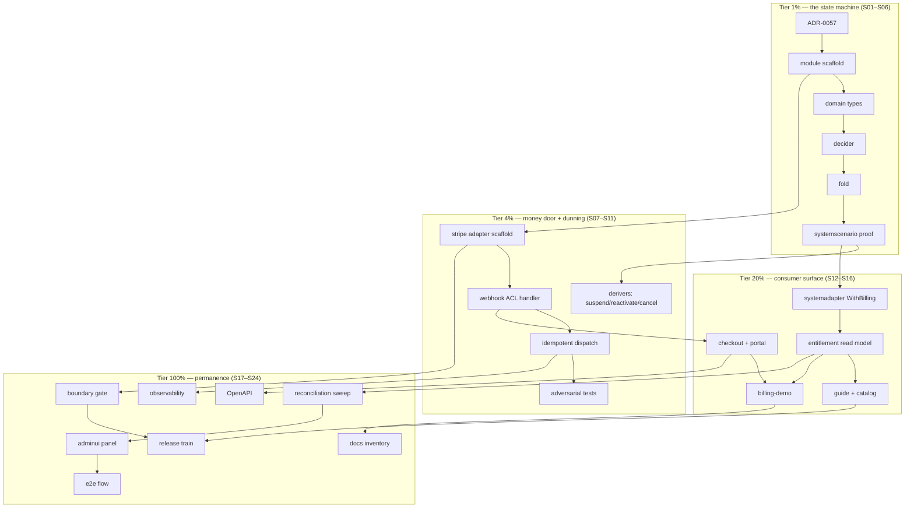

# SUPERB plan: Stripe billing bounded context — Pareto plan

**Created:** 2026-10-24 17:32 CEST
**Status:** SUPERSEDED for execution order and task definitions by [`2026-10-24_18-15_SUPERB-stripe-billing-v2-self-review-hardened-pareto-plan.md`](2026-10-24_18-15_SUPERB-stripe-billing-v2-self-review-hardened-pareto-plan.md) (v2, same day — 8-finding self-review fixes: demand gate, seat sync, bounded seen-refs, MoR decision, kill criteria, vocabulary purity). This file stays authoritative for its decision evidence (§2 anchors, Stripe-docs verification log §9). Not started.
**Trigger:** architecture session 2026-10-24 ("integrate the CQRS/ES identity system with Stripe") + "MAKE SURE TO CREATE A VERY COMPREHENSIVE PLAN FIRST… It should include ALL TODOS!"
**Sources:** the session conversation (4 rounds: shape → Stripe-official-docs check → CQRS-purist review → idempotency deep-dive); Stripe official docs fetched 2026-10-24 (`docs.stripe.com/webhooks`, `docs.stripe.com/webhooks/best-practices`); verified source anchors in this repo and go-cqrs-lite/go-idempotency checkouts.

---

## 1. What this plan covers (and why it exists)

cqrs-htmx has identity, authz, sessions, admin UI, observability — and **no answer to "how do I charge for the app I built on this?"**. Consumers building SaaS on `usermgmt` + `setup` need subscriptions tied to tenants/users, dunning that suspends tenants, and entitlements that gate routes — without breaking the event-sourced invariants the library is built on.

Prior-art check (2026-10-24): `rg '(?i)stripe|billing|subscription|payment'` over the repo hits only noise (CSP `payment=()`, table `Striped: true`, demo stream names); `docs/research/` has no billing artifact; `TODO_LIST.md` has no billing row; `CHANGELOG.md` has no billing feature. **This is episode one.**

The decided architecture (session outcome, §2) is a **new composable bounded context** — the same move as `usermgmt/totp` and `usermgmt/oauth2`: pure domain module + leaf adapter module. Stripe never leaks past an anti-corruption layer; the identity domain stays Stripe-blind.

### Scope guard (what this plan is NOT)

- NOT touching `identity-model`, `usermgmt`, or root: identity learns nothing about billing except through its **existing** commands (`SuspendTenant(reason="billing")` already exists — `identity-model/events.go` `TenantSuspendedPayload`).
- NOT a payment orchestration engine, double-entry ledger, or invoicing system. Stripe is the ledger; we keep entitlement/subscription state.
- NOT the active thread. Nothing here executes before the owner promotes it past the docs-eviction master plan.

---

## 2. Architecture decisions (locked in session, with evidence)

| # | Decision | Rationale / evidence anchor |
| --- | --- | --- |
| D1 | **Stripe is an external actor, not a source of truth.** Webhook fact → our command → our decider → our event in the journal. Never project Stripe state directly. | Every projection here rebuilds from the journal (`hydrationAwareCheckpointStore` full-replay design); unrecorded external state evaporates on rebuild. |
| D2 | **Two new modules: `billing-model` (pure domain) + `billing/stripe` (ACL adapter).** | The `usermgmt/totp`/`oauth2` pattern: strategy modules satisfying interfaces via structural typing. `billing-model` imports zero Stripe; `stripe-go` never crosses the ACL. |
| D3 | **The fold is the idempotency contract; middleware dedup is a fast-path.** | `CommandIdempotency` (`go-cqrs-lite/middleware/idempotency.go:57`) with 5-min TTL vs Stripe's 3-day retry window; `ttl <= 0` is `ErrInvalidTTL` (`go-idempotency/store.go:37`) — TTL is GC, not correctness. Journal replay IS the infinite-TTL duplicate storm; the fold survives it by design. |
| D4 | **Two-level dedup key:** `evt_...` ID at dispatch (keyFn! the **default keyFn is `cmd.ID()`** — redeliveries mint fresh IDs and dedup never fires) + `(data.object ID, event.type)` at the fold. | Stripe: two separate Event objects can represent one logical occurrence; dedup by event ID alone misses those. |
| D5 | **Unknown-reference rejection in the decider.** A `checkout.session.completed` for a session the aggregate never opened → domain rejection. | Defense against misrouted webhooks (wrong Stripe account, validly signed) — a class signature verification cannot catch. |
| D6 | **No synchronous Stripe call on a read or authz path.** Entitlement queries hit local projections; Casbin stays identity-folded; entitlements arrive as role commands via policy. | An authz decision that fails because a payment API is down is an architectural defect. |
| D7 | **Stripe owns payment time; we own policy time.** No local renewal timers mirroring Stripe's clock; our timers only for grace periods + reconciliation. | Split-brain avoidance with a billing engine. |
| D8 | **Choreography, not orchestration:** `deriver` policies dispatch existing identity commands (`SuspendTenant`/`ReactivateTenant`/`UpdateRoles`/`CancelSubscriptions`). | `docs/guides/leveraging-go-cqrs-lite.md` §8 documents `UserDeleted → CancelSubscriptions` as the literal example; repo doctrine says "Do NOT implement saga orchestration" (`docs/reviews/book-insights-vs-cqrs-htmx.md`). |
| D9 | **Webhook handler contract:** raw-body signature verify (official lib, 5-min tolerance, NTP), dual-secret rotation window (two valid secrets up to 24h), route exempt from CSRF (Stripe documents this), only subscribed event types, `ErrDuplicate` → **2xx**, fast 2xx after durable dispatch (journal append is the commit point), `3xx` = failure. | All points verified verbatim against Stripe official docs, 2026-10-24. |
| D10 | **Outbound Stripe calls (Checkout Session, portal) live in HTTP handlers/app services: side-effect first, then record the fact as a command.** Deciders stay pure. | Determinism + `systemscenario` testability. |
| D11 | **The journal is not a webhook archive.** Events in our language, schema-registered, upcastable, Stripe API version pinned inside. Raw payloads → telemetry. | Replay size + schema evolution discipline. |
| D12 | **Billing target = Tenant** (org subscription, users as seats). | Matches the membership model; only a B2C product would flip this. |
| D13 | **Same `system.New` composition root, strict module boundary.** Wrap `systemadapter.DomainConfig()`'s `Commands` closure; dependency arrow one-way: billing → identity **command constructors only**, never folds; identity imports nothing from billing. Mechanized by a gate (S18). | `systemadapter/domain_config.go:58`; `system.RegisterDecider` is an exported package func. |

---

## 3. Pareto decomposition

Percentages are directional, not arithmetic (same honesty rule as the 10-24 master plan). Three value axes: **R** = revenue-ready (a consumer can charge money), **T** = trust (money states are correct under every delivery pathology), **M** = maintainability (boundary stays mechanized).

- **The 1% → 51%:** `billing-model`'s Subscription aggregate — decider + fold with replay-idempotence, unknown-reference rejection, monotonic ordering guards — **proved by a `systemscenario` suite before any HTTP exists** (S03–S06). This is a commitment-order claim: nothing else in the plan has meaning until the state machine is honest.
- **The 4% → 64%:** the Stripe ACL (S08–S11) + tenant choreography (S07). After this tier, money can arrive and dunning lands natively (`SuspendTenant(reason="billing")` already exists in identity).
- **The 20% → 80%:** the consumer surface (S12–S16): checkout/portal, systemadapter wrap, entitlement read model, the guide, a runnable demo. After this tier a consumer ships a paywalled app.
- **The other 20% → 100%:** hardening + permanence (S17–S24): reconciliation, boundary gate, observability, admin UI, OpenAPI, release train, docs inventory, e2e.

---

## 4. Comprehensive plan — 24 milestones, 30–100 min each (≈ 27.3 h)

Sorted by tier (importance/customer-value), then dependency order. **Verify** column = the command that proves the milestone done.

| ID | Milestone | Tier | Impact | Effort | Depends | Verify |
| --- | --- | --- | --- | ---: | --- | --- |
| S01 | ADR-0057 "Stripe as external actor" — decisions D1–D13 as a reviewable ADR in `docs/adr/` | 1% | High (locks doctrine) | 45m | — | ADR file exists, linked from `docs/adr/` index |
| S02 | `billing-model` module scaffold: go.mod (`billing-model/v4`), README, `.golangci.yml`, `.cqrs-lint.json` (library preset), `go.work` entry | 1% | High (train surface) | 40m | S01 | `GOEXPERIMENT=jsonv2 go build ./billing-model/...` |
| S03 | Domain types, data-model-first: `SubscriptionState` (status, plan/price IDs, Stripe customer/subscription IDs, period, seats, seen-events set), event payloads (our language), commands with accessor methods (identity-model style), stream type + branded IDs | 1% | **Critical** (hardest to change later) | 90m | S02 | package compiles; types reviewed against D5/D11 |
| S04 | Decider: one decide function per command; unknown-reference rejection; invariant violations as errorfamily Rejection/Conflict; no side effects | 1% | **Critical** | 90m | S03 | unit table-tests for accept/reject paths |
| S05 | Fold: monotonic status application (never `created`-timestamp ordering), `(object ID, event.type)` dedup in state, period guards, no-op-on-duplicate emits nothing | 1% | **Critical** | 60m | S04 | fold unit tests incl. duplicate + out-of-order |
| S06 | `systemscenario` BDD suite over the real DomainConfig slice: happy path, duplicate replay (fold no-op), out-of-order delivery, unknown refs, grace transitions; `ManualClock` for policy timers | 1% | **Critical** (the proof artifact) | 90m | S05 | `GOEXPERIMENT=jsonv2 go test ./billing-model/... -race -count=1` green |
| S07 | Tenant choreography derivers: `PaymentFailed`×grace → `SuspendTenant("billing")`; `SubscriptionActivated` → `ReactivateTenant`; `UserDeleted` → `CancelSubscriptions`; entitlement role grants as commands | 4% | High (dunning lands natively) | 75m | S06 | scenario `ThenCommands` assertions; cross-domain test |
| S08 | `billing/stripe` adapter scaffold + `StripeClient` duck-type interface (structural typing; fake for tests); no stripe-go in billing-model (prove by import gate stub) | 4% | High | 40m | S02 | module builds; boundary stub check passes |
| S09 | Webhook handler: raw-body capture → signature verify (official lib, default tolerance, **dual-secret**), Stripe event → command translation table (our vocabulary per D-ACL) | 4% | **Critical** (the money door) | 90m | S08 | handler tests: valid/invalid sig, stale timestamp, dual-secret overlap |
| S10 | Dispatch wiring: `CommandIdempotency(durable DedupStore, 30d TTL, keyFn=evt_ ID)` + `DedupSweep` schedule; `ErrDuplicate` → 2xx; selective event-type subscription | 4% | High | 60m | S09 | dup-delivery test: first 2xx dispatches, second 2xx no-op; sweep deletes |
| S11 | Webhook handler adversarial tests: malformed JSON → 4xx, unknown type → 2xx (ignore), unknown refs → 2xx + rejection event, replay tolerance expiry | 4% | High | 75m | S10 | `-race` suite green |
| S12 | Checkout + portal outbound: `StartCheckout` (call Stripe, then record `CheckoutStarted` w/ session ID), portal redirect handler; session tracking in state (feeds D5) | 20% | **Critical** (revenue UX) | 90m | S09, S03 | scenario: checkout started → completed accepted; unknown session rejected |
| S13 | `systemadapter` wrap helper: compose identity `DomainConfig()` + billing decider/schema/catalog into one `system.DomainConfig` (exported `WithBilling(...)` option) | 20% | High (one-call story) | 60m | S06 | `examples/system-demo`-style integration test |
| S14 | Entitlement read model + query: tenant → plan/status/seats from local projection; NO Stripe on the read path (D6) | 20% | High | 75m | S13 | query test; grep proves no gateway call in query path |
| S15 | Guide `docs/guides/stripe-billing.md` + event catalog entries (`cqrshtmx.NewEventCatalog` + `DefaultEventCatalog` compose) + usermgmt/README pointer | 20% | High (adoption) | 75m | S14 | `nix run .#check-docs-freshness`-class link pass; corpus baseline bumped in-commit |
| S16 | `examples/billing-demo`: runnable monolith (setup + billing + Stripe test-mode keys), README walkthrough | 20% | Medium (proof) | 90m | S12–S14 | `go run .` smoke: register → checkout → fake webhook → suspended→active |
| S17 | Reconciliation sweep: scheduled command pulls subscription state via `StripeClient`, emits correction events on drift (D7: our timer, our policy) | 100% | Medium (trust) | 75m | S14 | scenario: drift injected → sweep corrects → events show diff |
| S18 | Import-direction gate `scripts/checks/check-billing-boundary.sh`: billing-model imports no stripe; billing→identity = commands only; identity/root import neither; wired into `check-modules` + CI | 100% | High (keeps D2/D13 true forever) | 45m | S08 | gate red on a planted violation, green clean (self-test fixture) |
| S19 | Observability: middleware bundle recipe (logging/retry/breaker/metrics/OTel) for the billing dispatcher via `CommandMiddleware`; Server-Timing on webhook; webhook counters | 100% | Medium | 45m | S10 | `examples/observability-demo`-style proof test |
| S20 | adminui billing panel: tenant subscription status column + manual reconcile action (role-gated write command) | 100% | Medium (ops) | 90m | S17 | adminui golden tests + authz test |
| S21 | OpenAPI: webhook + checkout + entitlement endpoints registered via the existing builder | 100% | Low-Med | 45m | S12 | spec golden test |
| S22 | Release train for both modules: README badges, `nix run .#train-preflight`, tags per gotchas 5/6/27 (never tag uncommitted go.mod; `--refresh-cache` after), coverage-gate thresholds added in `flake.nix` | 100% | High (delivery) | 60m | S15, S18 | `nix run .#check-release-train -- --strict-lag 0` green |
| S23 | Docs inventory: FEATURES.md rows, CHANGELOG entries, AGENTS.md module list 29→31 + key-patterns block, gotcha entries ("TTL≠correctness", "default keyFn misses redeliveries"), TODO_LIST rows retire as they land | 100% | Medium | 45m | S16 | `nix run .#check-docs-tail-budget -- --ratchet`; `check-modules` green |
| S24 | E2E: Playwright billing flow in `e2e/server` (test-clock fixtures; webhook simulator), plus CSS-bundle/golden updates if S20 touched adminui | 100% | Medium | 90m | S20 | `nix run .#e2e` green (self-skips CI; fixture self-test) |

**Lane totals:** S01–S02 frame 85m · S03–S06 the 1% 330m · S07–S11 the 4% 340m · S12–S16 the 20% 390m · S17–S24 the other 20% 495m · **total ≈ 1,640 min ≈ 27.3 h.**

---

## 5. Fine breakdown — every task ≤ 12 min

Grouped by milestone; execution order within group is top-down. IDs `F##` are referenced nowhere else — they exist for session checklists.

| ID | Task | Est | Milestone |
| ---: | --- | ---: | --- |
| F01 | Draft ADR-0057 skeleton (status/context/decision) | 10m | S01 |
| F02 | Write D1–D13 into decision body w/ evidence links | 12m | S01 |
| F03 | Consequences + alternatives-considered (direct projection, sync authz) | 10m | S01 |
| F04 | Add ADR row to `docs/adr/` index; link from this plan | 5m | S01 |
| F05 | go.mod + go.work entry for `billing-model/v4` | 10m | S02 |
| F06 | README (purpose, boundary statement, non-goals) | 12m | S02 |
| F07 | `.golangci.yml` + `.cqrs-lint.json` copied from `health/` | 8m | S02 |
| F08 | `flake.nix`: coverage-gate thresholds + check-modules pickup sanity | 10m | S02 |
| F09 | `SubscriptionState` fields + invariants doc-comment (data-model-first Q1–Q6 answered in code) | 12m | S03 |
| F10 | Event payload structs (Activated/Renewed/PaymentReceived/PaymentFailed/Canceled/GraceEntered/CheckoutStarted/Reconciled) | 12m | S03 |
| F11 | Second batch: seat events + `StripeEventRef{EventID, ObjectID, Type, APIVersion}` embedded in each | 12m | S03 |
| F12 | Command structs w/ accessor methods (identity-model style) | 12m | S03 |
| F13 | Stream type + branded `SubscriptionID`; constructors | 10m | S03 |
| F14 | errorfamily error values for the rejection classes | 8m | S03 |
| F15 | Decide: Activate/RecordPaymentReceived happy + rejection paths | 12m | S04 |
| F16 | Decide: RecordPaymentFailed → grace entry rules | 12m | S04 |
| F17 | Decide: Cancel + unknown-reference rejection branch | 12m | S04 |
| F18 | Decide: ConfirmCheckout (session-match invariant) | 12m | S04 |
| F19 | Table unit tests for every decide branch | 12m | S04 |
| F20 | Fold: state transitions + seen-ref recording | 12m | S05 |
| F21 | Fold: duplicate `(objectID,type)` → no-op, no emit | 10m | S05 |
| F22 | Fold: monotonic guards (period/status; never timestamps) | 12m | S05 |
| F23 | Fold unit tests: duplicate/out-of-order/regression | 12m | S05 |
| F24 | Scenario bootstrap: DomainConfig slice + suite file | 12m | S06 |
| F25 | Scenario: happy activate→pay→cancel | 12m | S06 |
| F26 | Scenario: duplicate replay emits nothing | 10m | S06 |
| F27 | Scenario: out-of-order delivery converges | 12m | S06 |
| F28 | Scenario: unknown session/subscription rejected | 10m | S06 |
| F29 | Scenario: grace timer via `TimeAdvances` | 12m | S06 |
| F30 | Scenario: full replay idempotence (re-Given everything) | 10m | S06 |
| F31 | Deriver: PaymentFailed×grace → SuspendTenant("billing") | 12m | S07 |
| F32 | Deriver: SubscriptionActivated → ReactivateTenant | 10m | S07 |
| F33 | Deriver: UserDeleted → CancelSubscriptions | 10m | S07 |
| F34 | Entitlement role-grant commands (plan→role map) | 12m | S07 |
| F35 | Cross-domain scenario test (ThenCommands) | 12m | S07 |
| F36 | Idempotency flags on derivers; review Filter chains | 8m | S07 |
| F37 | `billing/stripe` go.mod + scaffold | 10m | S08 |
| F38 | `StripeClient` duck-type interface (methods we call: checkout, portal, get subscription) | 12m | S08 |
| F39 | Fake client for tests | 10m | S08 |
| F40 | Boundary stub: grep-based no-stripe-in-model check | 8m | S08 |
| F41 | Raw-body reading + `Stripe-Signature` parse | 10m | S09 |
| F42 | Signature verify via official lib, dual-secret loop | 12m | S09 |
| F43 | Stripe-event → command translation table (typed switch) | 12m | S09 |
| F44 | Tolerance + NTP note; reject stale-timestamp config test | 10m | S09 |
| F45 | Handler happy-path test (signed fixture) | 12m | S09 |
| F46 | Durable DedupStore selection + wiring behind seam | 10m | S10 |
| F47 | `CommandIdempotency(store, 30d, evtKeyFn)` + ErrDuplicate→2xx mapping | 12m | S10 |
| F48 | `DedupSweep` schedule (cron/timer) + test | 10m | S10 |
| F49 | Event-type subscription list constant + docs note | 8m | S10 |
| F50 | Dup-delivery integration test (dispatch exactly once) | 12m | S10 |
| F51 | Malformed JSON → 4xx test | 8m | S11 |
| F52 | Unknown type → 2xx-ignore test | 8m | S11 |
| F53 | Unknown refs → 2xx + rejection-event test | 10m | S11 |
| F54 | Replay/expired-tolerance tests | 10m | S11 |
| F55 | `-race` full-suite run for both modules | 10m | S11 |
| F56 | `StartCheckout` command + state tracking fields | 12m | S12 |
| F57 | Stripe call in handler then `RecordCheckoutStarted` | 12m | S12 |
| F58 | Portal redirect handler (session-scoped) | 10m | S12 |
| F59 | Scenario: started→completed accepted; foreign session rejected | 12m | S12 |
| F60 | `WithBilling` option wrapping `DomainConfig().Commands` closure | 12m | S13 |
| F61 | Schema + catalog registration for billing events | 10m | S13 |
| F62 | Integration test mirroring `examples/system-demo` | 12m | S13 |
| F63 | Entitlement read model projection (tenant-keyed) | 12m | S14 |
| F64 | Query handler + RegisterTyped wiring | 12m | S14 |
| F65 | Query tests + no-gateway-on-read-path grep proof | 10m | S14 |
| F66 | Guide outline + quickstart fence (compilable) | 12m | S15 |
| F67 | Guide body: wiring, idempotency doctrine, ops (rotation, retries) | 12m | S15 |
| F68 | Catalog entries + usermgmt/README pointer | 10m | S15 |
| F69 | Corpus baseline bump in-commit + link check | 8m | S15 |
| F70 | Demo main.go: setup + billing mount | 12m | S16 |
| F71 | Demo webhook simulator route (test-mode secret) | 12m | S16 |
| F72 | Demo README walkthrough | 10m | S16 |
| F73 | Demo smoke script + fix fallout | 12m | S16 |
| F74 | Reconcile command + drift-diff decide/fold | 12m | S17 |
| F75 | Scheduler wiring (our timer; D7 note) | 10m | S17 |
| F76 | Drift-correction scenario test | 12m | S17 |
| F77 | Gate script + planted-violation self-test fixture | 12m | S18 |
| F78 | Wire gate into check-modules + CI | 10m | S18 |
| F79 | Middleware bundle recipe + Server-Timing on webhook | 12m | S19 |
| F80 | Counter/metrics proof test | 10m | S19 |
| F81 | adminui: tenant table status column | 12m | S20 |
| F82 | adminui: reconcile action (role-gated command endpoint) | 12m | S20 |
| F83 | adminui goldens + authz tests; CSS bundle rebuild if classes changed | 12m | S20 |
| F84 | OpenAPI registrations + spec golden | 12m | S21 |
| F85 | Train prep: version badges, CHANGELOG, preflight run | 12m | S22 |
| F86 | Tag wave + `--refresh-cache` re-run (gotchas 5/6/27) | 12m | S22 |
| F87 | FEATURES/AGENTS/gotchas updates (29→31 modules) | 12m | S23 |
| F88 | TODO_LIST row retirement w/ receipts | 8m | S23 |
| F89 | e2e billing flow spec (webhook simulator) | 12m | S24 |
| F90 | e2e run + flake triage | 12m | S24 |

**Totals:** 90 tasks · ≈ 15.2 h of the 27.3 h — the remainder is verification loops, review rework, and gate reds (budgeted at milestone level, not task level; plan tasks intentionally sum under milestones).

---

## 6. Execution graph

---

## 7. Risks & traps (the verschlimmbessern guards)

1. **Decider purity:** any Stripe HTTP call inside decide/fold is a defect (D10). The scenario suite is the tripwire — it cannot run deciders that dial out.
2. **Default keyFn trap:** `CommandIdempotency(store, ttl, nil)` keys on `cmd.ID()` — redelivery mints a fresh ID and dedup silently never fires. The evt_-keyFn is not optional (D4). Test pins this.
3. **ErrDuplicate must be 2xx** — otherwise Stripe retries a successful processing for 3 days.
4. **TTL is GC, not correctness.** Never "fix" a dedup gap by raising TTL to infinity — `ttl<=0` is `ErrInvalidTTL`; the fold is the contract (D3).
5. **No `created`-timestamp ordering** — Stripe snapshots share second-resolution timestamps; two events can tie. Order by state guards only.
6. **Library principle:** root/identity stay Stripe-free forever; gate S18 mechanizes it. If a consumer wants Paddle instead, only `billing/stripe` is replaced.
7. **New-module train discipline (gotchas 5/6):** never tag with uncommitted go.mod edits; family bump = same commit carries consumer sweeps + README claims. `go.work` gains 2 members — check-modules dep budgets and coverage-gate entries must land with S02/S22.
8. **Repo error policy:** no `errors.New`/`fmt.Errorf` in non-test code — errorfamily only. `GOEXPERIMENT=jsonv2` for every local go invocation.
9. **Docs corpus:** this plan itself bumps [`docs/CORPUS_BASELINE`](../CORPUS_BASELINE) in its commit; S15's guide bumps it again in that commit. Tail budget untouched (no status reports added).
10. **One-thread rule:** this plan does not execute until the owner promotes it (see [CURRENT_FOCUS.md](../../CURRENT_FOCUS.md)). Nothing in S01–S24 is "next" by default.
11. **Dual-secrets rotation:** Stripe keeps two signing secrets valid up to 24h during rotation — the verify loop must try both, and a config test must pin that behavior.
12. **Raw body:** any middleware that reads/re-writes the request body before the webhook handler breaks signature verification — mount ordering documented in the guide (S15).

---

## 8. Verification battery (per milestone-class)

| Class | Command |
| --- | --- |
| Module unit/scenario | `GOEXPERIMENT=jsonv2 go test ./billing-model/... ./billing/stripe/... -race -count=1` |
| Whole repo | `nix run .#test` |
| Lint | `nix run .#lint` (flake pin caveat: TODO row 2026-10-24) |
| cqrs-lint | `nix run .#check-cqrs-lint` (flake app only — gotcha 13) |
| All gates | `nix run .#check-modules` |
| Boundary gate (post-S18) | `nix run .#check-billing-boundary` |
| Docs gates | `nix run .#check-todo-hygiene` + `nix run .#check-docs-corpus-budget -- --ratchet` + `nix run .#check-docs-tail-budget -- --ratchet` |
| Train | `nix run .#train-preflight` then tag; post-push `.#push-and-watch` |

## 9. Errata / prior-art verification log

- 2026-10-24: `rg '(?i)stripe|billing|subscription|payment'` — zero billing prior art (noise hits only: CSP `payment=()`, `Striped: true` table props, `examples/dashboard-demo` demo stream names, `Reason: "billing"` tenant-suspension fixtures — which confirm D8's landing zone exists).
- 2026-10-24: `docs/research/` listing — no billing artifact (gotcha-21 check).
- 2026-10-24: `TODO_LIST.md` + `CHANGELOG.md` — no billing rows/features.
- Verified code anchors: `systemadapter/domain_config.go:58` (wrap target), `go-cqrs-lite/middleware/idempotency.go:57` (keyFn default), `go-idempotency/store.go:37` (`ErrInvalidTTL`), `metaengine` `DedupStore`/`DedupSweep`, `docs/guides/leveraging-go-cqrs-lite.md` §8 (deriver example), `usermgmt/command_idempotency_test.go` (middleware proof).
- Stripe doc quotes fetched 2026-10-24 from `docs.stripe.com/webhooks` + `/webhooks/best-practices` (2xx-fast, 3-day backoff, no ordering, evt-ID dedup + object-ID/type caveat, 5-min tolerance, dual-secret 24h window, raw body, CSRF exemption, selective types, 3xx=failure).
