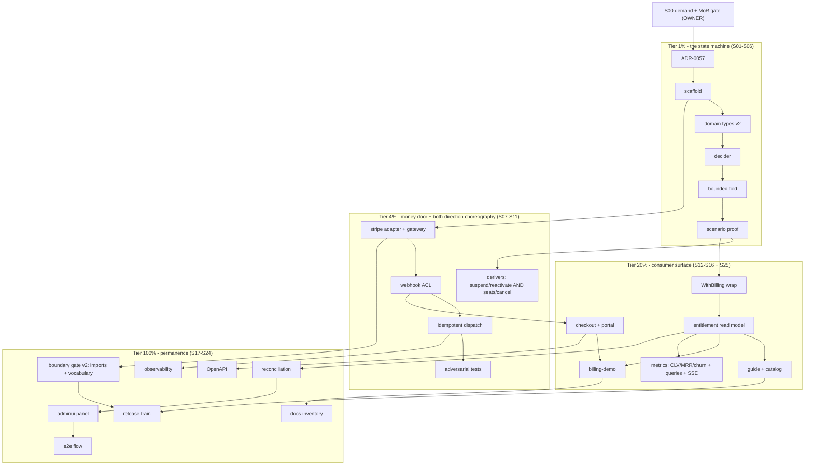

# SUPERB plan: Stripe billing bounded context v2 — self-review-hardened

**Created:** 2026-10-24 18:15 CEST
**Status:** PLAN — proposed, NOT started. **Not the active thread** ([CURRENT_FOCUS.md](../../CURRENT_FOCUS.md) unchanged; owner-gated like everything in this lane).
**Amended (same day, evening):** +**S25 metrics lane** — CLV/MRR/churn delivery to consumer apps via projections + typed queries + SSE (§2.5, owner ask "data like CLTV back to my apps"). 26 milestones / 104 tasks / ≈30.7 h.
**Supersedes:** [`2026-10-24_17-32_SUPERB-stripe-billing-bounded-context-pareto-plan.md`](2026-10-24_17-32_SUPERB-stripe-billing-bounded-context-pareto-plan.md) (v1) **for execution order and task definitions**. v1 stays authoritative for its decision evidence (its §2 anchors, the Stripe-docs verification log) — do not re-derive those.
**Predecessor:** the brutal self-review of v1 (session turn, 2026-10-24): 8 findings, all fixed here (§1).
**Trigger:** "CREATE A SUPERB PLAN!" + the standing plan-format contract (Pareto tiers → milestone table 30–100 min → fine table ≤12 min → mermaid graph → commit+push).

---

## 1. Why v2 exists — the 8 findings and their fixes

| # | v1 finding (self-review) | Fix in v2 | Where |
| --- | --- | --- | --- |
| 1 | Violates the repo's own demand-gating doctrine (ADR-0050 gates features on consumer demand evidence; v1 planned 27 h on zero signal) | **S00 demand gate**: no milestone executes before one consumer demand artifact exists (an issue, a Discord/API ask, a concrete consumer repo need). Owner interest ≠ consumer demand — stated honestly. | S00, §8 K1 |
| 2 | `seats` field had no writer (billing→identity was one-directional; no `MemberAdded/Removed → UpdateSeats`) | **Bidirectional choreography**: S07 now owns both directions, incl. seat-quantity sync and its scenarios. | S07, F-tasks |
| 3 | Unbounded seen-events set in fold state → snapshot bloat | **Bounded seen-refs**: state retains refs for the current + previous billing period only; older duplicates are *structurally* rejected by the monotonic guards, so the window is safe. Compaction is a fold invariant with a test, not a cleanup job. | S03/S05, §3.2 |
| 4 | Merchant-of-record decision smuggled (Stripe picked unilaterally; MoR is a tax-liability product decision) | **S00b owner decision packet**: processor (Stripe) vs MoR (Paddle-class). The domain design survives either — that is now *asserted by naming* (§3.1), not just claimed. | S00, §8 K3 |
| 5 | No kill criteria / no thread-level "done when" | **§8**: four kill criteria + one done-when line, repo style. | §8 |
| 6 | "Replaceable by Paddle" untested (fake client Stripe-shaped; domain carried Stripe vocabulary: `StripeEventRef`, `evt_`) | **Processor-agnostic domain naming** (`ProcessorRef`; no `stripe`/`evt_`/`cus_` tokens in billing-model identifiers) **enforced by the S18 gate** — the portability claim becomes a mechanized check, not prose. | §3.1, S18 |
| 7 | BuildFlow `nix-fmt` tmpdir-loop bug was mentioned, not filed (skill: "mentioned is not a state") | TODO_LIST row with repro evidence path → filed upstream in the BuildFlow repo's tracker by the owning session. | TODO_LIST (landed with this commit) |
| 8 | Grew the corpus 270 lines against the active eviction thread | v2 bumps the baseline again (deliberate, in-commit, gated) — and v1 becomes superseded-in-place, an immediate candidate for the master plan's `docs/planning/archived/` sweep. Net new live-file load: +1 now, −1 at the next eviction batch. | commit; §10 |

What v1 got right and v2 inherits unchanged: the full D1–D13 decision set (see v1 §2 for the evidence anchors — external-actor doctrine, fold-is-contract idempotency, unknown-reference rejection, no-sync-calls-on-read-paths, time ownership, choreography-over-orchestration, journal-not-archive, tenant-as-billing-target, one-way module boundary, composition-root wrap).

## 2. Design deltas (the four substantive changes)

### 2.1 Processor-agnostic domain vocabulary (fixes #4+#6 at the root)

v1's `StripeEventRef` put processor vocabulary inside the pure domain. v2:

- `billing-model` speaks of a **`ProcessorRef{EventID, ObjectID, Type, APIVersion}`** and a **`ProcessorGateway`** interface — generic by construction.
- `billing/stripe` (and any future `billing/paddle`) are the only places the words Stripe, `evt_`, `cus_`, `sub_` appear.
- The S18 boundary gate grows a vocabulary check: `rg -i 'stripe|evt_|cus_|sub_' billing-model/` must return zero hits outside doc-comments explaining the ban. Portability stops being an aspiration; it is a gate.

Consequence for MoR (S00b): if the owner picks a MoR provider, the domain decisions hold; only the adapter milestone set shrinks (MoR providers own dunning + tax, so S07's suspend choreography and S17 reconciliation get re-scoped, not redesigned).

### 2.2 Bounded seen-refs (fixes #3)

The fold's dedup set is **time-boxed to the current + previous billing period** (both derived from the aggregate's own period state, not wall clocks). Invariant: any event older than the window is also older than the monotonic state guards, so re-delivery of it is rejected by *state comparison*, not by set membership. The state stays O(1)-ish; snapshots stop growing; journal replay stays correct because replay re-derives the same window. Pinned by a dedicated scenario (duplicate-after-window → rejected as stale, not silently applied).

### 2.3 Bidirectional choreography (fixes #2)

| Direction | Event | → Command | Effect |
| --- | --- | --- | --- |
| billing → identity | `PaymentFailed` × grace | `SuspendTenant("billing")` | existing identity command |
| billing → identity | `SubscriptionActivated` | `ReactivateTenant` (+ role grant) | existing |
| identity → billing | `MemberAdded` / `MemberRemoved` | `UpdateSeats{tenant, delta}` | **new** — the seats writer |
| identity → billing | `UserDeleted` (last admin semantics per identity rules) | `CancelSubscription` | v1 had it |

Seat updates are *requests*: the billing decider clamps to the processor's plan limits and reconciles quantity with the processor on the next outbound sync — identity never blocks on the gateway (D6 holds in both directions).

### 2.4 Demand + MoR gate before any code (fixes #1+#4)

S00 produces two artifacts and nothing else: (a) the demand evidence file path or an explicit park decision, (b) the MoR decision record. Until both exist, S01+ is frozen — matching how ADR-0050 treats its tiers.

### 2.5 Metrics lane (added same day on owner ask: "data like CLTV back to my apps")

Doctrine: **events carry settled facts; metrics are disposable projections.** `PaymentReceived` carries `amount_minor` + ISO currency (the settled fact from `invoice.paid`); Stripe stays the ledger — we keep the facts we need to reason. CLV/MRR/ARPU/churn/seat-utilization are folds over those facts, never aggregate state:

| Metric | Computation shape | Surface |
| --- | --- | --- |
| CLV per tenant | exact running-sum scalar view (sqlite/turso materialized view, O(1)) | typed query + adminui card + `ServeSSE` live tick |
| MRR / active counts | state snapshot folded by period; point-in-time = fold-to-journal-position | query + adminui card |
| Churn cohorts, dunning funnel | group-by-history via metaengine planned tables (no live scans) | query |
| ARPU, seat utilization | derived off the same views | query |

Delivery is through surfaces the library already has: `query.RegisterTyped` handlers behind the existing Casbin posture (tenant admin sees own CLV, platform owner sees all), `metaengine.ServeSSE[V]` for live read-model push, ADR-0056 sync (permission-filtered), and the S20 adminui panel. New metric = one projection + one query handler; full history backfills via journal replay; formula disputes (gross-vs-net CLV) version the projection, never the events.

Hard traps: CAC is external input (never fabricated from billing events); FX conversion happens at the projection with dated rates — rates never enter the journal; ship named metric variants (`clv_gross_realized`) and document them in the event/metric catalog; refunds/disputes flow through the fold so realized metrics drop honestly.

## 3. Pareto decomposition (v2)

- **1% → 51%:** unchanged from v1 — the honest state machine (S03–S06), now with bounded seen-refs and processor-agnostic naming baked in from the first type definition.
- **4% → 64%:** the money door (S08–S11) + **both** choreography directions (S07) — dunning lands AND seats stay truthful.
- **20% → 80%:** consumer surface (S12–S16) **+ the metrics lane (S25)** — CLV/MRR/churn data back into consumer apps.
- **Other 20% → 100%:** permanence (S17–S24), where the boundary gate now carries the portability proof.

## 4. Comprehensive plan — 25 milestones (S00–S24), 30–100 min each (≈ 29.2 h)

| ID | Milestone | Tier | Impact | Effort | Depends | Verify |
| --- | --- | --- | --- | ---: | --- | --- |
| S00 | **Demand + MoR gate**: consumer-demand artifact (or park decision) + processor-vs-MoR decision record | gate | **Blocking** | 30m | — | both artifacts exist in `docs/adr/` or plan parked to ROADMAP |
| S01 | ADR-0057 — v1's D1–D13 + §2 deltas (ProcessorRef naming, bounded seen-refs, bidirectional choreography, kill criteria) | 1% | High | 45m | S00 | ADR filed, linked from `docs/adr/` index |
| S02 | `billing-model` scaffold (go.mod, README, lint configs, go.work) | 1% | High | 40m | S01 | `GOEXPERIMENT=jsonv2 go build ./billing-model/...` |
| S03 | Domain types v2: `ProcessorRef`, bounded seen-refs shape, seats + plan-limit fields, events/commands in our vocabulary, branded IDs | 1% | **Critical** | 90m | S02 | compiles; vocabulary ban holds (`rg -i 'stripe\|evt_\|cus_\|sub_' billing-model/` → 0 code hits) |
| S04 | Decider: all command paths, unknown-reference rejection, seat clamping to plan limits | 1% | **Critical** | 90m | S03 | decide table-tests green |
| S05 | Fold: monotonic guards, current+previous-period seen-refs window + compaction invariant | 1% | **Critical** | 75m | S04 | fold tests incl. window-expiry-as-stale rejection |
| S06 | `systemscenario` suite: happy, duplicate replay, out-of-order, unknown refs, grace timers, seat sync both directions, full-replay idempotence | 1% | **Critical** | 100m | S05 | `-race` suite green |
| S07 | Derivers, **both directions**: suspend/reactivate/roles (billing→identity) + UpdateSeats/CancelSubscription (identity→billing) | 4% | High | 90m | S06 | `ThenCommands` cross-domain scenarios green |
| S08 | `billing/stripe` adapter scaffold + generic `ProcessorGateway` impl + fake | 4% | High | 40m | S02 | module builds; fake passes gateway conformance stub |
| S09 | Webhook ACL: raw body, dual-secret verify, typed translation table into OUR commands | 4% | **Critical** | 90m | S08 | sig/replay/dual-secret tests green |
| S10 | Idempotent dispatch: durable DedupStore, 30d TTL, evt-keyed keyFn, `ErrDuplicate`→2xx, selective types | 4% | High | 60m | S09 | dup-delivery dispatches exactly once |
| S11 | Adversarial webhook tests: malformed, unknown-type, unknown-ref, stale-tolerance, `-race` | 4% | High | 75m | S10 | suite green under `-race` |
| S12 | Checkout + portal outbound (side-effect-then-record; session tracking feeds D5) | 20% | **Critical** | 90m | S09 | scenario: known session accepted, foreign rejected |
| S13 | `systemadapter.WithBilling` composition (closure wrap + schema + catalog) | 20% | High | 60m | S06 | system-demo-style integration test |
| S14 | Entitlement read model + query (local projection only) | 20% | High | 75m | S13 | query test + no-gateway-on-read grep proof |
| S15 | Guide `docs/guides/stripe-billing.md` + catalog + corpus bump in-commit | 20% | High | 75m | S14 | doc gates green |
| S16 | `examples/billing-demo` (test-mode keys, webhook simulator) | 20% | Medium | 90m | S12–S14 | demo smoke: register→checkout→webhook→suspend→reactivate |
| S17 | Reconciliation sweep (our timer; correction events on drift) | 100% | Medium | 75m | S14 | drift-injection scenario green |
| S18 | Boundary gate v2: import direction **and vocabulary purity** + planted-violation self-test, wired into check-modules + CI | 100% | High | 60m | S08 | gate red on planted `cus_` in billing-model, green clean |
| S19 | Observability: middleware bundle, Server-Timing, webhook counters | 100% | Medium | 45m | S10 | metrics proof test |
| S20 | adminui billing panel (status column, role-gated reconcile) | 100% | Medium | 90m | S17 | adminui goldens + authz tests |
| S21 | OpenAPI registrations + golden | 100% | Low-Med | 45m | S12 | spec golden test |
| S22 | Release train (both modules; gotchas 5/6/27; preflight; coverage thresholds in flake) | 100% | High | 60m | S15, S18 | `check-release-train --strict-lag 0` green |
| S23 | Docs inventory: FEATURES/CHANGELOG/AGENTS 29→31, gotcha entries, TODO retirements | 100% | Medium | 45m | S16 | doc gates green |
| S24 | E2E Playwright billing flow (webhook simulator fixtures) | 100% | Medium | 90m | S20 | `nix run .#e2e` green |
| S25 | **Metrics lane**: amount-bearing `PaymentReceived` facts → CLV/MRR/churn/ARPU projections (§2.5), typed query handlers behind Casbin, `ServeSSE` live push, metric definitions in catalog, adminui cards | 20% | High ("data back to apps") | 90m | S03, S14 | query + live-update tests green; rebuild-from-journal test green |

**Totals:** 26 milestones · **1,840 min ≈ 30.7 h** (+200 min vs v1: gate/design fixes + the metrics lane).

## 5. Fine breakdown — every task ≤ 12 min (104 tasks)

| ID | Task | Est | Ms |
| ---: | --- | ---: | --- |
| F01 | Draft S00 demand-evidence criteria (what counts: issue/Discord/consumer repo) | 10m | S00 |
| F02 | Owner packet: processor vs MoR trade-off one-pager (tax liability table) | 12m | S00 |
| F03 | Record decision (or park-to-ROADMAP edit) + link from this plan | 8m | S00 |
| F04 | ADR-0057 skeleton (v1 D1–D13 inherited, deltas §2) | 10m | S01 |
| F05 | Write design deltas into ADR (ProcessorRef, bounded refs, bidirectional) | 12m | S01 |
| F06 | Kill criteria + done-when into ADR consequences | 10m | S01 |
| F07 | ADR index row | 5m | S01 |
| F08 | go.mod + go.work entry | 10m | S02 |
| F09 | README (purpose, boundary, non-goals) | 12m | S02 |
| F10 | `.golangci.yml` + `.cqrs-lint.json` (library preset) | 8m | S02 |
| F11 | flake coverage thresholds + modules pickup sanity | 10m | S02 |
| F12 | `ProcessorRef` + period/seen-refs window types (invariant doc-comment) | 12m | S03 |
| F13 | Event payloads batch 1 (Activated/Renewed/PaymentReceived/PaymentFailed) | 12m | S03 |
| F14 | Event payloads batch 2 (Canceled/GraceEntered/CheckoutStarted/SeatsUpdated/Reconciled) | 12m | S03 |
| F15 | Commands w/ accessors (Activate/RecordPayment/RecordFailure/Cancel/ConfirmCheckout/UpdateSeats) | 12m | S03 |
| F16 | Stream type + branded `SubscriptionID` + constructors | 10m | S03 |
| F17 | errorfamily rejection values (unknown-ref, stale-ref, plan-limit) | 8m | S03 |
| F18 | Vocabulary-ban pre-check (rg sweep over the new types) | 5m | S03 |
| F19 | Decide: Activate/RecordPaymentReceived paths | 12m | S04 |
| F20 | Decide: RecordPaymentFailed → grace rules | 12m | S04 |
| F21 | Decide: Cancel + unknown-reference rejection | 12m | S04 |
| F22 | Decide: ConfirmCheckout session-match invariant | 12m | S04 |
| F23 | Decide: UpdateSeats clamping to plan limits | 12m | S04 |
| F24 | Decide table-tests for every branch | 12m | S04 |
| F25 | Fold: transitions + window-scoped seen-ref recording | 12m | S05 |
| F26 | Fold: compaction — drop refs older than previous period; invariant test | 12m | S05 |
| F27 | Fold: duplicate-in-window → no-op; expired → stale-rejection | 12m | S05 |
| F28 | Fold: monotonic guards (never timestamps) + tests | 12m | S05 |
| F29 | Scenario bootstrap (DomainConfig slice, suite file) | 12m | S06 |
| F30 | Scenario: happy activate→pay→cancel | 12m | S06 |
| F31 | Scenario: duplicate replay emits nothing | 10m | S06 |
| F32 | Scenario: out-of-order convergence | 12m | S06 |
| F33 | Scenario: unknown session/subscription rejected | 10m | S06 |
| F34 | Scenario: grace timer via `TimeAdvances` | 12m | S06 |
| F35 | Scenario: seats add/remove → clamped updates | 12m | S06 |
| F36 | Scenario: full replay idempotence | 10m | S06 |
| F37 | Deriver: PaymentFailed×grace → SuspendTenant("billing") | 12m | S07 |
| F38 | Deriver: SubscriptionActivated → ReactivateTenant + role grant | 12m | S07 |
| F39 | Deriver: MemberAdded/Removed → UpdateSeats | 12m | S07 |
| F40 | Deriver: UserDeleted → CancelSubscription | 10m | S07 |
| F41 | Cross-domain scenarios (ThenCommands, both directions) | 12m | S07 |
| F42 | Deriver idempotency flags + Filter review | 8m | S07 |
| F43 | `billing/stripe` go.mod + scaffold | 10m | S08 |
| F44 | `ProcessorGateway` interface (checkout, portal, subscription pull, quantity sync) | 12m | S08 |
| F45 | Fake gateway (non-Stripe-shaped error semantics) | 12m | S08 |
| F46 | Boundary stub check (imports + vocabulary) | 8m | S08 |
| F47 | Raw-body capture + `Stripe-Signature` parse | 10m | S09 |
| F48 | Dual-secret signature verify loop + overlap test | 12m | S09 |
| F49 | Typed translation table (their events → our commands) | 12m | S09 |
| F50 | Stale-tolerance config + NTP note + test | 10m | S09 |
| F51 | Signed happy-path fixture test | 12m | S09 |
| F52 | Durable DedupStore wiring | 10m | S10 |
| F53 | `CommandIdempotency(store, 30d, evtKeyFn)` + ErrDuplicate→2xx | 12m | S10 |
| F54 | `DedupSweep` schedule + test | 10m | S10 |
| F55 | Selective event-type list constant | 8m | S10 |
| F56 | Dup-delivery dispatches-exactly-once test | 12m | S10 |
| F57 | Malformed → 4xx test | 8m | S11 |
| F58 | Unknown type → 2xx-ignore test | 8m | S11 |
| F59 | Unknown refs → 2xx + rejection-event test | 10m | S11 |
| F60 | Replay/expired-tolerance tests | 10m | S11 |
| F61 | `-race` full-suite run | 10m | S11 |
| F62 | `StartCheckout` command + state tracking | 12m | S12 |
| F63 | Gateway call then `RecordCheckoutStarted` | 12m | S12 |
| F64 | Portal redirect handler | 10m | S12 |
| F65 | Scenario: known/foreign session accept/reject | 12m | S12 |
| F66 | `WithBilling` closure wrap | 12m | S13 |
| F67 | Schema + catalog registration | 10m | S13 |
| F68 | system-demo-style integration test | 12m | S13 |
| F69 | Entitlement projection (tenant-keyed) | 12m | S14 |
| F70 | Query handler + RegisterTyped | 12m | S14 |
| F71 | Query tests + no-gateway-on-read grep proof | 10m | S14 |
| F72 | Guide outline + compilable quickstart fence | 12m | S15 |
| F73 | Guide body (wiring, idempotency doctrine, ops) | 12m | S15 |
| F74 | Catalog entries + usermgmt README pointer | 10m | S15 |
| F75 | Corpus baseline bump + link check | 8m | S15 |
| F76 | Demo main.go (setup + billing mount) | 12m | S16 |
| F77 | Webhook simulator route (test-mode secret) | 12m | S16 |
| F78 | Demo README walkthrough | 10m | S16 |
| F79 | Demo smoke script + fix fallout | 12m | S16 |
| F80 | Reconcile command + drift-diff decide/fold | 12m | S17 |
| F81 | Scheduler wiring (our timer) | 10m | S17 |
| F82 | Drift-correction scenario | 12m | S17 |
| F83 | Gate v2 script: import direction + vocabulary + planted violations | 12m | S18 |
| F84 | Wire gate into check-modules + CI + self-test | 12m | S18 |
| F85 | Middleware bundle + Server-Timing on webhook | 12m | S19 |
| F86 | Webhook counter metrics proof | 10m | S19 |
| F87 | adminui status column | 12m | S20 |
| F88 | adminui reconcile action (role-gated) | 12m | S20 |
| F89 | adminui goldens + CSS rebuild if needed | 12m | S20 |
| F90 | OpenAPI registrations + golden | 12m | S21 |
| F91 | Train prep (badges, CHANGELOG, preflight) | 12m | S22 |
| F92 | Tag wave + `--refresh-cache` re-run | 12m | S22 |
| F93 | FEATURES/AGENTS/gotchas updates (29→31) | 12m | S23 |
| F94 | TODO retirements w/ receipts | 8m | S23 |
| F95 | e2e billing spec (simulator fixtures) | 12m | S24 |
| F96 | e2e run + flake triage | 12m | S24 |
| F97 | Post-wave: park-or-continue decision vs kill criteria §8 | 10m | S24 |
| F98 | Extend `PaymentReceived` payload (`amount_minor`, currency) + scenario fixture | 12m | S25 |
| F99 | CLV projection: per-tenant running sum (scalar view) + rebuild test | 12m | S25 |
| F100 | MRR/active snapshot projection by period + point-in-time fold test | 12m | S25 |
| F101 | Churn-cohort + dunning-funnel planned tables + queries | 12m | S25 |
| F102 | Typed query handlers + RegisterTyped + tenant-scoping authz test | 12m | S25 |
| F103 | `ServeSSE[V]` live-metric stream + live-update test | 12m | S25 |
| F104 | Metric definitions into the catalog + guide section + catalog test | 10m | S25 |

**Totals:** 104 tasks · ≈ 17.6 h of the 30.7 h; remainder is verification loops, review rework, gate reds (budgeted at milestone level).

## 6. Execution graph

## 7. Verschlimmbessern guards

Inherits v1 §7 in full (decider purity, default-keyFn trap, ErrDuplicate→2xx, TTL-is-GC, no timestamp ordering, library principle, train discipline, errorfamily, corpus contract, one-thread rule, dual secrets, raw-body ordering). Additions:

1. **S00 is a hard gate, not a ritual** — executing S01+ without the demand artifact and MoR decision recorded is the exact hypocrisy v1 was guilty of.
2. **The vocabulary ban is one-way only**: `billing/stripe` may say Stripe everywhere; `billing-model` may say it nowhere. Do not "fix" a violation by renaming gateway-facing fields in the adapter.
3. **Seen-refs compaction must never become a background job** — it is a fold invariant. If someone proposes a janitor goroutine, re-read §2.2.
4. **Seat updates never call the gateway synchronously** (D6 both directions): identity commands must not wait on billing I/O; quantity sync rides the next outbound reconciliation.
5. **Metrics never touch the gateway, and rates never touch the journal** (§2.5): amounts are facts, FX conversion and formula versions live in projections; a metric that needs a synchronous processor call is designed wrong.

## 8. Kill criteria & done-when

| # | Kill criterion (any one stops the thread) |
| --- | --- |
| K1 | No consumer demand artifact materializes within two planning cycles → plan parks to ROADMAP "Not Planned" with this file as evidence. |
| K2 | S06 forces a second rewrite of the aggregate shape (state machine invalidated twice) → stop; ADR-0057 re-opened rather than patched around. |
| K3 | MoR decision lands on a MoR provider → S07 suspend-choreography and S17 reconciliation re-scope (they own dunning); if the remaining adapter work is < 8 h, execute as a single spike instead of this plan. |
| K4 | Processor API-version pin breaks the translation table twice consecutively → reconciliation-first shape reconsidered before more adapter code. |

**Done when:** one consumer ships a paywalled app using `billing-model` + the guide, the boundary gate runs in check-modules + CI, both module trains are tagged, and every TODO row this plan created is retired with receipts.

## 9. Verification battery

Identical to v1 §8 (module tests, `.#test`, `.#lint`, `.#check-cqrs-lint`, `.#check-modules`, boundary gate v2, the three doc gates, train preflight + `.#push-and-watch`). Additions: `rg -i 'stripe|evt_|cus_|sub_' billing-model/` → 0 code hits (S03, then mechanized in S18); mmdc render check for this file's graph (done — see §10).

## 10. Errata / verification log

- 2026-10-24 (evening): +S25 metrics lane added on owner ask ("data like CLTV and co back to my apps"); graph re-validated with `mmdc` in the same change.
- 2026-10-24: v1's mermaid graph validated post-hoc (`mmdc` render, 228 KB SVG). **This file's graph was validated BEFORE commit** (same tool).
- 2026-10-24: v1 findings 1–8 (brutal self-review, session turn) → fixes mapped in §1; findings 1,3,4,6 changed design, not just tasks.
- 2026-10-24: BuildFlow `nix-fmt` tmpdir-loop repro: `buildflow history --step nix-fmt --last-error` (5 consecutive identical failures; root cause string: `could not find [go.mod] in /tmp/buildflow-roundtrip-*`). TODO row added in this commit (close-the-loop state c→b).
- v1 §2 decision evidence and the Stripe-docs quotes remain authoritative in the v1 file — not duplicated here.
