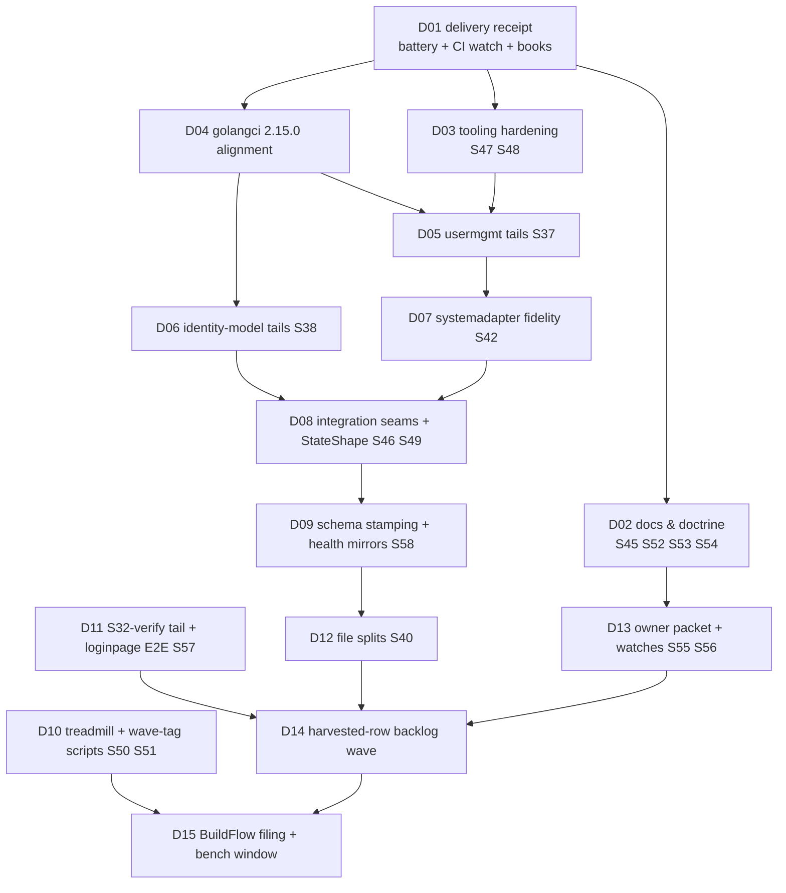

# SUPERB plan: Lane D completion — code backlog, tooling, and the delivery receipt

**Created:** 2026-10-25 06:20 CEST · **Trigger:** "GET SHIT DONE — comprehensive plan first" (round 2)
**Scope:** EVERYTHING still open after the 2026-10-24/25 execution wave — the master plan's
open Lane D milestones, its S27/S28 close-out, and the TODO rows opened or carried since.
**Predecessors:** [2026-10-24 05-36 master plan](2026-10-24_05-36_SUPERB-master-plan-docs-eviction-delivery-and-backlog-burn-down.md)
(evidence + original sizing; Lanes 0/A/B/C executed — see its Appendix D and the
[2026-10-25 05-50 session receipt](../status/archived/2026-10-25_05-50_master-plan-execution-lanes-a-c-and-d-wave_status.md)).
This plan **supersedes the master plan for execution order of the remaining items**; the
master plan keeps its evidence and receipts.

**State at planning time:** tree clean; usermgmt/identity-model sibling work landed and green
(one stale test fixed); 4 commits pushed through both pre-push gates (train strict 0/0/0);
load falling. Docs corpus: 205 files / 29.8k lines; tail = 1 (the session receipt).

---

## 1. What remains (measured inventory)

| Bucket | Items | Source |
| --- | --- | --- |
| Code fidelity | S37 (usermgmt ×6), S38 (identity-model ×7), S42 (systemadapter ×3), S49 (StateShape), S58 (schema stamping + health mirrors), S32-verify tail (UP/UV honesty) | master plan Lane D + harvest rows |
| Consumer/docs surface | S45 (EventHandler docs + idm README), S46 (integration seams), S54 (v5 migration plan), S57 (loginpage E2E + golden) | master plan Lane D |
| Tooling & repeat-cost | S47 (bump-dep lint), S48 (templ fmt→codegen), S50 (treadmill script), S51 (wave-tag.sh), S52 (preflight mandate) | master plan Lane D |
| Delivery close-out | S27 (TODO harvest), S28 (full battery + receipt), Appendix D update, CHANGELOG receipts (S35/S41/S44), CI-green watch on the pushed HEAD | master plan Lane C/D |
| Decisions & watches | S53 (credential memo), S55 (owner packet D1–D17+), S56 (watch table), golangci 2.15.0 alignment, BuildFlow nix-fmt filing, bench-spike quiet window | TODO rows |
| Harvested-row backlog | loginpage AutoRedirect follow-through, dashboardui 09-48 tails, art-dupl round-3, root-declutter tails, skill-maintenance gates, tooling canaries (a–g), upstream ask drafts, RequireSession decision, sweep-plan M18/M20/M21, loginpage coverage re-pin | TODO rows opened 2026-10-24/25 |

Nothing outside these buckets is open. Owner-gated-only items (billing S00, T12/T13, D-votes,
PapDashboard send, DataStar Tier-4 demand) stay parked — S55 packages them for ONE decision pass.

## 2. Pareto decomposition

### 2.1 The 1% that delivers ~51%

**One milestone · ~90 min · D01: the delivery receipt (S28 + Appendix D + CHANGELOG receipts + CI-green watch).**
Why: ~35 commits of fixes/evictions from the last two sessions are pushed but UNRECEIPTED and
CI-unverified; until the battery is green and the books match, everything else this plan adds
sits on unproven ground. This closes the loop the master plan's own guardrail #11 exists for.

### 2.2 The 4% that delivers ~64%

**+4 milestones · ~5h cumulative: D01 + D02 (docs/doctrine deliverables: S45+S52+S53+S54) +
D03 (tooling hardening: S47+S48) + D04 (golangci 2.15.0 alignment).**
Why: the docs/doctrine items are the highest customer/agent-value-per-minute work left (the
v5 migration plan is an operator-requested deliverable; the preflight mandate kills a repeat
cost class), and the two tooling items each mechanize a CI-red class that already bit twice.

### 2.3 The 20% that delivers ~80%

**+7 milestones · ~13h cumulative: the code-fidelity wave (D05 S37, D06 S38, D07 S42,
D08 S46+S49, D09 S58, D10 S50+S51, D11 S32-verify + S57).**
Why: consumer-facing correctness (TenantDeleted cascade, rebuild-drain survival, declarative
authz fidelity, credential dedup memo feeding OQ28, counter persistence proof, seam tests)
plus the two scripts that turn the upstream treadmill and the tag rhythm into one command.

### 2.4 The remaining 80% to 100%

**+4 blocks · ~11h: D12 file splits (S40), D13 owner packaging (S55+S56), D14 harvested-row
backlog (10 rows), D15 BuildFlow filing + bench-spike window.**
Why each cannot be skipped: splits pay the maintainability bar the review set (350-line
checklist); the packet is every owner decision in one read; the harvested rows are this
repo's honest debt ledger; the BuildFlow filing unblocks the pre-commit hook class.

## 3. Anti-Verschlimmbesserung guardrails

1. One milestone in flight; module-scoped test run + `go vet` before each commit (gotcha 2).
2. Published-module code changes get CHANGELOG receipts in the SAME commit (no train needed —
   they ride the next one, per gotcha 8).
3. No gate weakened, no formatter added, no version bumps inside this plan (the train is a
   separate owner-gated session; gotcha 38).
4. Daemon discipline: chain `fmt → add → commit` in ONE call; never rebase a daemon commit —
   amend HEAD only.
5. Docs growth bumps `docs/CORPUS_BASELINE` in the same commit (ratchet).
6. The sibling session's usermgmt/identity-model work is CREDITED, never re-fixed; re-view
   each file:line immediately before editing (master plan risk #6).
7. Every milestone ends with its verify command green or the milestone stays open — no
   "should work".

## 4. Milestones (30–100 min each), priority-sorted

Impact: C/H/M/L · Value: Co consumers · Ag agents · Hu owner · CI build trust.

| ID | Milestone | Impact | Effort | Value | Verify |
| --- | --- | --- | ---: | --- | --- |
| D01 | Delivery receipt: S28 battery (`.#test`, `.#lint`, `.#coverage-gate`, `.#check-modules`) + CI-green watch on pushed HEAD + master-plan Appendix D reconciliation + CHANGELOG receipts S35/S41/S44 + S27 TODO harvest | **C** | 100m | Co/CI/Hu | 4× rc=0 + CI green |
| D02 | Docs & doctrine: S45 (EventHandler + idm README) + S52 (train-preflight mandate: runbook + AGENTS row) + S53 (credential 4× memo) + S54 (v5 migration plan, `docs/migrations/` shape) | H | 100m | Co/Ag | docs gates + links |
| D03 | Tooling hardening: S47 (`bump-dep --lint` leg + fixture) + S48 (templ fmt→templ generate chain in `.buildflow.yml`) | H | 90m | CI | fixture self-tests green |
| D04 | golangci-lint 2.15.0 alignment: CI action pin up + `ignoreSigs` for the errorfamily constructor class (kills the local/CI split brain) | H | 45m | CI | `nix run .#lint` == CI verdict |
| D05 | S37 usermgmt tails (a–f): TenantDeleted cascade, rebuild-drain keep-host, cookie Max-Age×SessionTTL, lockout eviction, MySQL doc truth, empty-store fallback warning | H | 100m | Co | `.#test-usermgmt` |
| D06 | S38 identity-model tails (a–g): GenerateUserID ordering, ParseTenantID/ParseBotID, Exists/IsActive split, g2-guard under custom model, NotConfigured family, accessor copies, internal NewUserID uses | H | 100m | Co | `.#test-identity-model` |
| D07 | S42 systemadapter fidelity: Enforce ladder alignment, audit Action vocabulary, ActorID in declarative audit | H | 90m | Co | declarative suite |
| D08 | S46 integration seams (DocsHandler mount, RecorderChain proof) + S49 StateShape round-trip audit (SQL+codec test) | H | 100m | Co | `.#test-integration_test` |
| D09 | S58: `WithSchemaVersion(1)` on the 29 constructors + delete health status mirrors (root require bump to the carrying tag) | H | 90m | Co | idm+health suites |
| D10 | S50 `check-upstream-treadmill.sh` (per-repo prefix map) + S51 `wave-tag.sh` (dry-run→push→refresh→sweep→re-tag) | M | 100m | Ag | fixture self-tests |
| D11 | S32-verify tail (UP/UV reload honesty proof) + S57 loginpage Playwright E2E + full-page render golden | M | 100m | Co | e2e suite + golden |
| D12 | S40 file splits: setup/config.go, systemadapter/declarations.go, usermgmt/service_core.go, dashboardui/layout.go (assets), e2e/server/main.go | M | 100m | Hu | build + large-files gate |
| D13 | S55 owner packet (D1–D17 + upstream asks + PapDashboard + datastar-demo + E005 + GCL debt) + S56 watch table (buildcache, fleet asks, scorecard, catalog consumers) | M | 100m | Hu | packet doc + links |
| D14 | Harvested-row backlog wave: loginpage AutoRedirect, dashboardui 09-48 tails, art-dupl r3, root-declutter, skill gates, tooling canaries (a–g), upstream drafts, RequireSession decision, sweep-plan tails, loginpage coverage re-pin | M | 100m/batch | Co/Ag | per-row verify |
| D15 | BuildFlow nix-fmt source verification + upstream filing (verify-before-filing gates) + bench-spike at load < 6 | L | 60m | CI | issue link + bench rc |

**Total: 15 milestones · ≈14.9 h of estimated focused work.**

## 5. Micro-breakdown (≤12 min each — first two tiers expanded; Lane-D rows reference the master plan's t-tables)

| ID | Task | Min | V |
| --- | --- | ---: | --- |
| 1.1 | `gh run list/watch` the pushed HEAD; triage any red job | 10 | CI green |
| 1.2 | `nix run .#test` (race battery, all modules) | 12 | rc=0 |
| 1.3 | `nix run .#lint` (expect only the documented 12 wrapcheck FPs until D04) | 10 | verdict logged |
| 1.4 | `nix run .#coverage-gate` (re-pin floors only on measured deltas) | 12 | 15/15 |
| 1.5 | `nix run .#check-modules` end-to-end | 12 | rc=0 |
| 1.6 | CHANGELOG receipts: S35, S41, S44 entries | 12 | entries exist |
| 1.7 | Master plan Appendix D: mark S05/S13/S14/S15/S16/S21/S22/S23-verified/S24/S25/S26/S29/S31/S33/S34/S35/S41/S43/S44 DONE with commit refs | 12 | table current |
| 1.8 | S27 harvest: strike executed TODO rows with receipts; dedupe; `check-todo-hygiene` | 12 | rc=0 |
| 2.1 | usermgmt/README § EventHandler: callback contract + payload types + audit-trail relation | 12 | docs gate |
| 2.2 | identity-model README: "when do I import this directly" section | 10 | docs gate |
| 2.3 | Release playbook §: train-preflight mandated before every wave + AGENTS gate row | 10 | grep proves |
| 2.4 | Credential memo: 4 field-set tables + usage map + boundary roles (read-only, feeds OQ28) | 12 | memo linked |
| 2.5 | S54 v5 plan: outline from `docs/migrations/v4-to-v5.md` conventions + usermgmt wiring gap section | 12 | outline |
| 2.6 | S54 v5 plan: Track A codemod acceptance criteria + Track B journal-compat criteria | 12 | file done |
| 3.1 | `bump-dep.sh`: add `--lint` (hermetic golangci per bumped module after sweep) | 12 | flag works |
| 3.2 | Extend `scripts/selftests/test-bump-dep.sh` with a lint-leg fixture case | 10 | self-test green |
| 3.3 | `.buildflow.yml`: templ-generate leg after templ-fmt (or `.templ` exclusion) — decide + apply | 12 | staged `.templ` proof |
| 3.4 | Scratch `.templ` edit through the hook: codegen-drift stays green | 10 | rc=0 |
| 4.1 | `.github/workflows/ci.yml`: golangci-lint-action 2.14.0 → 2.15.0 | 8 | actionlint |
| 4.2 | `.golangci.yml` wrapcheck `ignoreSigs` for `event.New*/Wrap*/Newf` constructors | 10 | 12 FPs → 0 |
| 4.3 | Re-run `nix run .#lint`: verdict == CI verdict | 8 | parity logged |
| 5.x–15.x | Execute per the master plan's t37/t38/t42/t46/t49/t58/t50/t51/t57/t40 micro tables + §6 batch list below | — | per-table |

**D14 batch list (10–12 min each):** (a) loginpage `AuthPrefix` validation + NoWebAuthn
semantics decision memo; (b) dashboardui UTF-8 rune-safety + PathEscape + data-base-path;
(c) art-dupl accept-baseline gate decision + 2 deferred extractions; (d) root biome.json
prove-or-remove + root-file allowlist gate; (e) skill-claims drift gate; (f) tidy-sweep.sh;
(g) verify-tag poison canary; (h) skip_steps canary; (i) coverage fail-loud; (j) toolchain
runbook page; (k) codespell pass; (l) upstream ask drafts batch; (m) RequireSession
export-or-document; (n) sweep-plan M18 guide recipes + conversion test.

## 6. Execution graph

Critical path: `D01 → D04 → D05 → D07 → D08 → D09 → D12 → D14` (~9 h). D02/D03/D10/D11/D13
parallelize off D01; D15 is the tail (needs the bench quiet window anyway).

## 7. Owner gates

| Gate | Question | Fallback |
| --- | --- | --- |
| Q1 | golangci direction: up-pin CI to 2.15.0 (recommended — forward, kills the split brain) or down-pin the flake? | ship D04 with the recommendation and the flake pin unchanged (split brain stays documented) |
| Q2 | v5 migration plan shape: `docs/migrations/system-metaengine.md` now (recommended) or defer to the v5 window? | the researched outline lands either way; only the "operator-ready" polish waits |
| Q3 | bench-spike: accept another deferral if no load < 6 window appears this cycle? | stays a standing row; the gate refuses honestly (twice-quiet rule) |

## 8. Success metrics

| Metric | Before | Target |
| --- | --- | --- |
| Open TODO rows | ~45 | ≤ 25 (owner-gated rows collapse into the D13 packet) |
| CHANGELOG receipts owed | 3 (S35/S41/S44) | 0 |
| Master-plan milestones open | 24 | ≤ 8 (remainder = owner-gated/upstream) |
| CI on pushed HEAD | unwatched | green, watched to terminal |
| Repeat-cost classes (bump-dep lint gap, templ drift, treadmill, tag rhythm) | 4 open | 0–1 |

## 9. Rollback

Every milestone is a self-contained commit (or daemon-amendable series) — `git revert` per
milestone. Docs growth rides the corpus ratchet with same-commit baseline bumps. No tag, no
push-of-tags, no history rewrite anywhere in this plan.
