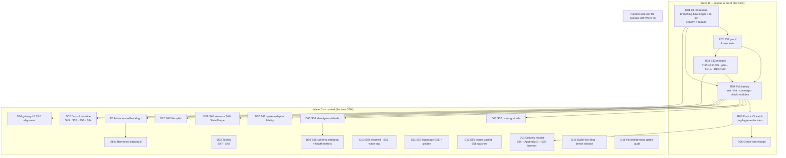

# SUPERB plan v2: CI rescue, S32 proof, and the full ≤12-minute breakdown

> **SUPERSEDED 2026-10-25 (execution order of the remaining milestones) by**
> [`2026-10-25_10-42_SUPERB-wave-d-completion-code-fidelity-to-closure-pareto-plan.md`](2026-10-25_10-42_SUPERB-wave-d-completion-code-fidelity-to-closure-pareto-plan.md)
> — Wave R + D01/D03/D04 are CLOSED under this file (receipts: the 10-15 green-tree
> report, `dacae5c2`/`b51a4a33`/`ae3b80dd`); the 10-42 plan re-derives the Pareto
> for the remainder and owns execution order from here. This file stays
> authoritative for the Wave R evidence and the R-micro-task receipts.

**Created:** 2026-10-25 08:05 CET · **Trigger:** "figure out the 1%/4%/20%, comprehensive plan, then ≤12 min tasks, commit + push"
**Supersedes:** [`2026-10-25_06-20_SUPERB-lane-d-completion-and-delivery-receipt-pareto-plan.md`](2026-10-25_06-20_SUPERB-lane-d-completion-and-delivery-receipt-pareto-plan.md) **for execution order and for the micro-task granularity**. The 06-20 file keeps the per-milestone scope text for D01–D15 and its owner-gate section; this file is authoritative for what runs first and for the ≤12 min breakdown of *every* milestone.
**Predecessors:** [2026-10-24 05-36 master plan](2026-10-24_05-36_SUPERB-master-plan-docs-eviction-delivery-and-backlog-burn-down.md) (original sizing + evidence), [07-43 S32 session report](../status/archived/2026-10-25_07-43_credential-use-sign-counter-persistence_status.md) (the red-state evidence this plan starts from).

---

## 0. Why v2 exists (what changed in the last 90 minutes)

The 06-20 plan was written against a *clean, pushing, green* tree. Three things changed:

1. **Master CI is RED.** Run `40167243876` (HEAD `4690e2bc`): `checks`, `lint (.)`, `test`,
   `module-architecture`, `lint (identity-model)` failed; `architecture-gate` skipped. Causes:
   - `checks` → `check-domain-counts` drift from the new event/command (fixed locally, unverified in CI).
   - `lint (identity-model)` → `gocyclo` 34 on `FoldUser` (fixed locally: helpers extracted; 0 issues).
   - `test` → the webauthn module's own tests did not compile against the new `FinishLogin`
     signature (fixed locally: 2 call sites; suite green).
   - `lint (.)` → **44 findings in the ROOT module**, authored by a concurrent session
     (`err113` 11, `varnamelen` 13, `wsl_v5` 9, `gci` 3, `golines` 2, `nolintlint` 2,
     `recvcheck` 2, `revive` 1, `modernize` 1). **Not this plan's code, but this plan's problem**:
     nothing can be called green while it stands.
2. **Three modules were tagged on that red tree** — `identity-model/v4.14.0`, `usermgmt/v4.15.0`,
   `usermgmt/webauthn/v4.13.0`. Importers are unaffected (tests are not compiled by consumers),
   but the tags' CI is red and a release-train receipt claims more than the tree proved.
3. **`branching-flow` is red again**: `+47 added, −32 removed, ~107 modified, =22 unchanged`
   (179 findings vs the 168 pinned). ~10 adds are the new credential bools/twins; ≥2 are the
   concurrent session's `EXPLICIT_PANIC`; the rest is anchor drift across the eviction + root rewrites.

Everything else in the 06-20 plan still stands, and its measured inventory (section 1 there) is
carried here verbatim in scope: nothing was added to or removed from the backlog.

**State at planning time:** tree clean; **3 commits ahead of `origin/master` and unpushed**;
docs corpus 30,416 lines / 208 files; tail = 2 reports; load falling.

---

## 1. Pareto decomposition (re-derived against the red state)

### 1.1 The 1% that delivers ~51%

**One milestone · R01 (60 min): turn the four red causes green and re-pin the ratchet.**
Rationale: every other item in either plan is *unverifiable* while CI is red — a fix that lands on
a red tree cannot be distinguished from noise, and a tag that outran a compiling suite is exactly
the class the release playbook exists to prevent. 60 minutes buys back the ability to trust every
subsequent "verify: rc=0".

### 1.2 The 4% that delivers ~64%

**+3 milestones · ~4 h: R01 + R02 (S32 proof: the four missing tests) + R04 (the full battery).**
Rationale: the feature is written but only *module*-green. The remaining proof (fold purity,
counter table, provider flag round-trip, declarative fold) is what turns "it compiles" into "it
cannot regress"; the battery is what turns "modules green" into "repository green".

### 1.3 The 20% that delivers ~80%

**+6 milestones · ~10 h: R03 (S32 receipts) + R05 (push + CI watch + tag decision) + D01
(delivery receipt/S28) + D04 (golangci 2.15.0 alignment) + D02 (docs/doctrine: S45+S52+S53+S54)
+ D03 (tooling: S47+S48).**
Rationale: receipts make the delivery honest; the golangci alignment removes the local-vs-CI
split brain that produced this session's false confidence; the doctrine deliverables are the
highest consumer/agent value per minute left (v5 migration plan is operator-requested; the
credential memo is the input to OQ28); the two tooling items each mechanize a CI-red class that
has already bitten twice.

### 1.4 The remaining 80% → 100%

**D05–D16 · ~15 h.** Code fidelity (usermgmt/identity-model/systemadapter tails, StateShape,
schema stamping, integration seams), the two repeat-cost scripts, file splits, the owner packet,
the harvested-row backlog, the BuildFlow filing + bench window, and the parked/demand-gated audit.
Each is carried from the 06-20 plan without re-scoping; the reason none can be dropped is in that
file's §2.4 (maintainability bar, owner decisions in one read, honest debt ledger, pre-commit hook class).

---

## 2. Anti-Verschlimmbesserung guardrails (unchanged, still binding)

1. **One milestone in flight.** Module-scoped `build` + `vet` + `lint` + `test` after each edit,
   not at the end (gotcha 2: `go build` does not compile `_test.go`).
2. **Do not re-fix another session's code.** The root `golangci-lint` findings belong to the
   session that authored them: report + coordinate (R01e), never silently rewrite.
3. **No gate weakened, no formatter added, no version bumps inside this plan** (gotcha 38).
4. **Ratchet discipline:** docs growth bumps `docs/CORPUS_BASELINE`; archiving lowers
   `docs/status/TAIL_BASELINE`; a re-pin of `branching-flow` carries a dated ledger row in
   `docs/analysis/triage-decisions.md` (never a bare binary blob diff).
5. **Receipts in the same commit** as the change for published-module code (CHANGELOG) — the
   modules ride the next train; this plan does not cut tags.
6. **Verify line or it stays open.** No "should work"; each milestone names the command whose
   `rc=0` closes it.
7. **Re-base every relative link after a move** — the archive tool exists because hand-running
   broke links twice.

---

## 3. Milestones (30–100 min), priority-sorted

Impact: **C** critical · **H** high · **M** medium · **L** low.
Value: **Co** consumers · **Ag** agents · **Hu** owner · **CI** build/trust.

| ID | Milestone | Impact | Effort | Value | Depends | Verify |
| --- | --- | --- | ---: | --- | --- | --- |
| **R01** | **CI-red rescue:** adjudicate the 47 branching-flow adds + dated ledger row + re-pin; confirm the four committed repairs (fold helpers, webauthn call sites, domain counts, schema/decoder/fold registers); file the root-lint findings to their authoring session | **C** | 60m | CI | — | `check-branching-flow` rc=0 + `check-domain-counts` OK |
| **R02** | **S32 proof:** fold test (apply + unknown-credential + **purity**), `CounterRegressed`/`ApplyUse` table, provider flag round-trip, declarative fold-to-view test | **C** | 90m | Co | R01 | 4 new tests + 3 module suites |
| **R03** | **S32 receipts:** root CHANGELOG (new event kind + catalog content), master-plan S32 `**DONE**` row with hash, `CURRENT_FOCUS` next-thread rewrite, usermgmt README event/command table, WebAuthn flow guide note, pre-upgrade migration note | H | 60m | Co/Ag | R02 | `check-docs-links` + `check-status-rows` |
| **R04** | **Full battery:** `.#test` (race, 29 modules), `.#lint`, `.#coverage-gate` (15), `.#check-modules` (55 stages) — one run, receipts recorded | **C** | 100m | CI | R02 | 4× rc=0 |
| **R05** | **Delivery:** push the range through both strict pre-push gates, `gh run watch` to terminal, tag-hygiene decision executed (retract / patch-release / leave-and-document) | **C** | 45m | CI/Hu | R04 | CI green + tag table |
| **R06** | **Receipt refresh:** supersede the 07-43 report with a green-tree receipt (what was red, what proved it green, what remains) | M | 30m | Ag | R05 | report committed + tail within ratchet |
| **D01** | Delivery receipt: S28 battery receipt + master-plan Appendix D reconciliation + CHANGELOG receipts (S35/S41/S44) + S27 TODO harvest | C | 100m | Co/CI/Hu | R05 | 4× rc=0 + CI green |
| **D04** | golangci-lint 2.15.0 alignment: CI action pin up + `ignoreSigs` for the errorfamily constructors (kills the local/CI split brain) | H | 45m | CI | R01 | `nix run .#lint` == CI verdict |
| **D02** | Docs & doctrine: S45 (EventHandler + identity-model README) + S52 (train-preflight mandate) + S53 (credential 4× memo) + S54 (v5 migration plan) | H | 100m | Co/Ag | R03 | docs gates + links |
| **D03** | Tooling hardening: S47 (`bump-dep --lint` leg + fixture) + S48 (templ fmt→generate chain) | H | 90m | CI | — | fixture self-tests |
| **D05** | S37 usermgmt tails (a–f): TenantDeleted cascade, rebuild-drain keep-host, cookie Max-Age×SessionTTL, lockout eviction, MySQL doc truth, empty-store fallback warning | H | 100m | Co | R04 | `.#test-usermgmt` |
| **D06** | S38 identity-model tails (a–g): GenerateUserID ordering, ParseTenantID/ParseBotID, Exists/IsActive split, g2-guard under custom model, NotConfigured family, accessor copies, internal NewUserID uses | H | 100m | Co | R04 | `.#test-identity-model` |
| **D07** | S42 systemadapter fidelity: Enforce ladder, audit Action vocabulary, ActorID in declarative audit | H | 90m | Co | R04 | declarative suite |
| **D08** | S46 integration seams (DocsHandler mount, RecorderChain) + S49 StateShape round-trip audit (SQL + codec) | H | 100m | Co | R04 | `.#test-integration_test` |
| **D09** | S58: `WithSchemaVersion(1)` on 29 constructors + delete health status mirrors (root require bump) | H | 90m | Co | D06 | idm + health suites |
| **D10** | S50 `check-upstream-treadmill.sh` + S51 `wave-tag.sh` (dry-run→push→refresh→sweep→re-tag) | M | 100m | Ag | — | fixture self-tests |
| **D11** | S57 loginpage Playwright WebAuthn E2E + full-page render golden | M | 90m | Co | — | e2e suite + golden |
| **D12** | S40 file splits: `setup/config.go`, `systemadapter/declarations.go`, `usermgmt/service_core.go`, `dashboardui/layout.go`, `e2e/server/main.go` | M | 100m | Hu | R04 | build + large-files gate |
| **D13** | S55 owner packet (D1–D17 + upstream asks + PapDashboard + datastar-demo + E005 + GCL debt) + S56 watch table | M | 100m | Hu | — | packet doc + links |
| **D14a** | Harvested backlog I: loginpage AutoRedirect follow-through, dashboardui 09-48 tails, root-declutter tails, sweep-plan M18/M20/M21 | M | 100m | Co/Ag | R04 | per-row verify |
| **D14b** | Harvested backlog II: art-dupl round-3, skill-maintenance gates, tooling canaries (a–g), upstream ask drafts | M | 100m | Ag | D14a | per-row verify |
| **D15** | BuildFlow `nix-fmt` source verification + upstream filing + bench-spike at load < 6 | L | 60m | CI | — | issue link + bench rc |
| **D16** | Parked/demand-gated audit: billing S00 gate, DataStar Tier-4, `ReadLastN` upstream, SidebarNav revisit, BuildFlow go-version re-enable, cqrs-lint fleet swap, `check-cqrs-lint` CI wiring, GCL follow-through — one verdict per row, no code | M | 45m | Hu | — | one-line verdict each |

Total: ~24 h 15 m across 23 milestones; the first two tiers (R01–R05) are ~5 h 45 m.

---

## 4. Micro-tasks (≤12 min each) — complete, every milestone covered

`V` = the check performed inside that micro-task.

### 4.1 Wave R — rescue & proof (R01–R06)

| ID | Task | Min | V |
| --- | --- | ---: | --- |
| r01.1 | `branching-flow all . --format sarif …` to `/tmp` and diff vs the pinned baseline by `(rule,file,line,message)` | 10 | added/removed lists printed |
| r01.2 | Classify each add: mine (BOOL_BLIND/mixin) vs foreign (EXPLICIT_PANIC) vs anchor shift | 8 | three labelled buckets |
| r01.3 | Write the dated `2026-10-25` row in `docs/analysis/triage-decisions.md` naming every bucket + standing verdict | 10 | row present |
| r01.4 | Re-pin `docs/analysis/branching-flow-baseline.sarif` (`jq -c .`), commit with the row | 6 | file minified + committed |
| r01.5 | Confirm the four committed repairs: `check-domain-counts.sh`, `golangci-lint` in identity-model, webauthn `go test`, systemadapter `go test` | 12 | all rc=0 |
| r01.6 | File the 44 root-lint findings to their authoring session (message + exact rule counts) | 6 | message sent/recorded |
| r02.1 | Fold test: `CredentialUsed` applies to the named credential | 8 | test green |
| r02.2 | Fold test: unknown credential → corruption error | 6 | test green |
| r02.3 | Fold test: **purity** — input `UserState.Credentials` unchanged after a rejected/unknown use | 8 | test green |
| r02.4 | Table test for `CounterRegressed` (0→0, 0→5, 5→5, 5→1, 5→0) | 8 | 5 cases green |
| r02.5 | Table test for `ApplyUse` (counter + UP/UV/BS applied, slices not aliased) | 8 | test green |
| r02.6 | Provider round-trip test: `fromWebAuthnCredential` → `toWebAuthnCredential` preserves UP/UV/BS/counter/aaguid/transports | 10 | test green |
| r02.7 | Declarative fold test: `CredentialUsed` lifts `UserView.Credentials[].SignCount` | 10 | test green |
| r02.8 | Run identity-model + usermgmt + webauthn + systemadapter suites `-count=1` | 12 | 4× ok |
| r03.1 | Root `CHANGELOG.md` `### Added` entry: `CredentialUsed` event + catalog content change | 8 | entry present |
| r03.2 | Master plan S32 row → `**DONE**` with commit hash + verification line | 6 | row updated |
| r03.3 | `CURRENT_FOCUS.md`: S32 done; name the next thread (D01 or D04) | 8 | file updated |
| r03.4 | usermgmt README event/command table: 25 events / 21 commands + `CredentialUsed` row | 8 | table matches source |
| r03.5 | Guide note: WebAuthn flow records the assertion state; pre-upgrade credentials start with UP/UV false | 8 | guide updated |
| r03.6 | Docs gates: `check-docs-links`, `check-domain-counts`, `check-status-rows` | 10 | 3× OK |
| r04.1 | `nix run .#test` (race, all modules) | 12+ | rc=0 (repeat if >12 m) |
| r04.2 | `nix run .#lint` | 10 | rc=0 |
| r04.3 | `nix run .#coverage-gate` | 12+ | 15/15 |
| r04.4 | `nix run .#check-modules -- --report` | 12+ | 55/55 rc=0 |
| r04.5 | Record the four receipts in the report/plan Appendix | 6 | receipts written |
| r05.1 | `git push` through both pre-push gates (train strict + drift strict) | 10 | push accepted |
| r05.2 | `gh run watch <id> --exit-status`; on red, name job + triage hint | 12 | terminal verdict |
| r05.3 | Tag hygiene: list the 3 tags + their CI conclusions; apply the owner decision | 10 | tag table recorded |
| r05.4 | Verify `origin/master..HEAD` is 0 after push | 4 | count 0 |
| r06.1 | Write the green-tree receipt report (supersede 07-43) | 12 | file written |
| r06.2 | Bump `TAIL_BASELINE`/`CORPUS_BASELINE` for the report in the same change | 6 | both ratchets green |

### 4.2 Wave D — carried milestones (one row per deliverable, ≤12 min granularity)

| ID | Task | Min | V |
| --- | --- | ---: | --- |
| d01.1 | Reconcile master-plan Appendix D against the pushed range (commit list → milestone map) | 12 | table complete |
| d01.2 | CHANGELOG receipts for S35/S41/S44 (three modules) | 12 | 3 entries |
| d01.3 | S27 harvest: every unexecuted plan item → TODO_LIST row with a verify command | 12 | `check-todo-hygiene` |
| d01.4 | S28 battery receipt written into the plan + status report | 10 | receipt present |
| d02.1 | S45a: usermgmt README `EventHandler` section (contract + payload types + audit relationship) | 12 | section present |
| d02.2 | S45b: identity-model README review + fixes | 10 | review diff |
| d02.3 | S52: train-preflight mandate in the release playbook + AGENTS quick-ref row | 10 | `check-docs-links` |
| d02.4 | S53: credential 4× memo (field-set table + usage map + keep/consolidate recommendation) | 12 | memo committed |
| d02.5 | S54a: v5 migration plan skeleton (Track A/B, rollback, compatibility matrix) | 12 | file present |
| d02.6 | S54b: v5 plan review + links from ROADMAP/AGENTS | 10 | links resolve |
| d03.1 | S47: add `--lint` leg to `bump-dep` verify (hermetic golangci per bumped module) | 10 | script diff |
| d03.2 | S47: fixture self-test asserting the leg runs (planted exhaustruct failure) | 12 | self-test red→green |
| d03.3 | S48: `.buildflow.yml` templ-fmt → templ-generate chain (or exclude `.templ` from repair) | 10 | config diff |
| d03.4 | S48: prove on a staged `.templ` edit that the regen lands in the same run | 12 | `git status` proof |
| d04.1 | Decide + apply the pin direction (CI → 2.15.0 **or** flake → 2.14.0) | 10 | one diff |
| d04.2 | If 2.15.0: `ignoreSigs` entries for `errorfamily.New*/Wrap*` and re-run | 12 | 0 issues local+CI |
| d04.3 | Record the verdict in AGENTS quick-ref (which version is authoritative) | 8 | row updated |
| d05.1 | S37a: TenantDeleted cascade (memberships/sessions cleaned) + test | 12 | test green |
| d05.2 | S37b: rebuild-drain keeps the host alive + test | 12 | test green |
| d05.3 | S37c: cookie `Max-Age` from `SessionTTL` + test | 10 | test green |
| d05.4 | S37d: lockout map eviction (bounded) + test | 12 | test green |
| d05.5 | S37e+f: MySQL doc truth + empty-store fallback warning | 10 | docs + test |
| d06.1 | S38a: `GenerateUserID` ordering + test | 10 | test green |
| d06.2 | S38b: `ParseTenantID`/`ParseBotID` + tests | 10 | tests green |
| d06.3 | S38c: `Exists`/`IsActive` split (impossible states) | 12 | compile + tests |
| d06.4 | S38d: g2-guard under a custom model + test | 12 | test green |
| d06.5 | S38e: `NotConfigured` error family + tests | 10 | tests green |
| d06.6 | S38f+g: accessor copies + internal `NewUserID` uses | 12 | lint + tests |
| d07.1 | S42a: Enforce ladder alignment with the service path + test | 12 | declarative test |
| d07.2 | S42b: audit Action vocabulary parity + test | 12 | test green |
| d07.3 | S42c: ActorID carried into declarative audit entries + test | 12 | test green |
| d08.1 | S46a: DocsHandler/DocsPath end-to-end mount test | 12 | test green |
| d08.2 | S46b: `RecorderChain(Recorder(svc), auditPlugin)` proof | 12 | test green |
| d08.3 | S49a: SQL snapshot store `StateShape` round-trip test | 12 | test green |
| d08.4 | S49b: codec path round-trip; file upstream if the stamp drops | 12 | verdict recorded |
| d09.1 | S58a: `WithSchemaVersion(1)` on the 29 constructors (mechanical) | 12 | compile + tests |
| d09.2 | S58b: delete health status mirrors + root require bump | 12 | health suite |
| d09.3 | S58c: CHANGELOG receipts (identity-model + health) | 10 | entries present |
| d10.1 | S50: per-repo prefix map + sweep script skeleton | 12 | script runs |
| d10.2 | S50: fixture self-test (offline) | 12 | self-test green |
| d10.3 | S51: `wave-tag.sh` dry-run mode | 12 | dry-run output |
| d10.4 | S51: push→refresh→sweep→re-tag cascade + fixture self-test | 12 | self-test green |
| d11.1 | S57a: Playwright WebAuthn virtual authenticator harness | 12 | spec runs |
| d11.2 | S57b: registration + login E2E through the rendered page | 12 | spec green |
| d11.3 | S57c: full-page render golden (stable IDs, nonce-insensitive) | 12 | golden committed |
| d12.1 | Split `setup/config.go` by concern | 12 | build + tests |
| d12.2 | Split `systemadapter/declarations.go` (query/fold files) | 12 | build + tests |
| d12.3 | Split `usermgmt/service_core.go` | 12 | build + tests |
| d12.4 | Split `dashboardui/layout.go` assets + `e2e/server/main.go` | 12 | build + tests |
| d13.1 | S55 packet: collect D1–D17 with recommendations | 12 | packet section |
| d13.2 | S55 packet: upstream asks + PapDashboard + datastar-demo + E005 + GCL debt | 12 | packet section |
| d13.3 | S56 watch table (buildcache, fleet asks, scorecard, catalog consumers) | 10 | table present |
| d14.1 | loginpage AutoRedirect follow-through (NoWebAuthn asymmetry, `AuthPrefix` validation, guide, FEATURES) | 12 | `.#test-loginpage` |
| d14.2 | dashboardui tails a: UTF-8 rune-safe `truncate`/`initials` + `url.PathEscape` | 12 | `.#test-dashboardui` |
| d14.3 | dashboardui tails b: `data-base-path` hook + audit cursor streaming | 12 | tests green |
| d14.4 | dashboardui tails c: neighbour early-stop + snapshot 404/500 split + boost guard | 12 | tests green |
| d14.5 | root-declutter: `biome.json` prove-or-remove + root allowlist gate sketch | 12 | verdict recorded |
| d14.6 | sweep-plan M18/M20/M21 (guides, cross-links, README rows, RequestFilter test) | 12 | `.#test-root` |
| d14.7 | art-dupl r3: accept-baseline gate decision + 2 deferred extractions | 12 | `check-branching-flow` |
| d14.8 | skill-maintenance gates a: `check-skill-claims.sh` skeleton | 12 | script + fixture |
| d14.9 | skill-maintenance gates b: snippet compile gate + README split-brain scan | 12 | gate runs |
| d14.10 | tooling canaries a–c: tidy-sweep, verify-tag poison, skip_steps canary | 12 | scripts + self-tests |
| d14.11 | tooling canaries d–g: coverage fail-loud, toolchain runbook, codespell, single-source thresholds | 12 | each present |
| d14.12 | upstream drafts batch (P15 classifier, event.New encoding, cqrs-lint forms, go-output note, BuildFlow) | 12 | drafts present |
| d15.1 | Verify the BuildFlow `nix-fmt` loop at source (`buildflow history --last-error`) | 12 | root cause named |
| d15.2 | File upstream per verify-before-filing (repro + expected behavior) | 12 | issue link |
| d15.3 | bench-spike at load < 6; re-pin only if idle and the change owns the bench path | 12 | rc=0 or documented refusal |
| d16.1 | One verdict per parked row (billing, DataStar, ReadLastN, SidebarNav, BuildFlow, cqrs-lint, CI wiring, GCL) | 12 | 8 verdicts |
| d16.2 | Promote/unpark exactly the rows the verdicts allow; leave the rest with their gate | 10 | TODO diff |

---

## 5. Execution graph

---

## 6. Owner gates and kill criteria

- **Owner gates (do not execute without a verdict):** billing S00 demand/MoR, `ReadLastN` upstream
  ask content, SidebarNav criterion (2), cqrs-lint fleet swap, `check-cqrs-lint` CI wiring,
  BuildFlow `go-version-auto-configure` re-enable, tag retraction (R05.3), audit-log placement of
  `CredentialUsed` (the 07-43 report's Q3).
- **Kill criteria for this plan:** if R04 cannot reach 55/55 after two attempts, stop and report
  the failing stages instead of proceeding into Wave D (a red tree invalidates every downstream
  "verify"); if the root-lint findings cannot be attributed to a session, escalate rather than
  rewrite another agent's code.
- **Done when:** CI green on a pushed HEAD, master-plan Appendix D reconciled, every TODO_LIST row
  either executed or carrying a dated verdict, and the four ratchets (tail, corpus, branching-flow,
  domain counts) green in the same run.

---

## 7. Rollback

Every milestone is a commit. A milestone that proves wrong is reverted as a unit (`git revert`
of that commit), never partially; a ratchet re-pin is reverted together with its ledger row, since
a baseline without an adjudication is exactly the blind spot the gate exists to prevent.

## 8. Execution receipt (Wave R + D01, 2026-10-25)

| Milestone | Verdict | Evidence |
| --- | --- | --- |
| R01 | DONE (split across sessions) | branching-flow re-pinned twice, both pure transposes with dated ledger rows (168→179 at `bebd56d6`; 179→179 at `a5183fff`); root lint 44→0; root coverage 88.1→91.8% |
| R02 | DONE | 4 proof tests + the real DomainConfig-registration bug they exposed (usermgmt v4.16.0) |
| R03 | DONE | `59487eb8` + `d0faae0f` (CHANGELOG, CURRENT_FOCUS, usermgmt README, provider guide) |
| R04 | DONE | `.#test` rc=0 · `.#lint` rc=0 (2.15.0, 15 modules) · `.#coverage-gate` PASS · `.#check-modules` 55/55 — at `a5183fff` |
| R05 | DONE | pushed `cde4e417..a5183fff` through strict gates; CI run `40179492715` all-jobs-success; tag table in the 10-15 receipt |
| R06 | DONE | `docs/status/2026-10-25_10-15_green-tree-receipt_status.md` (09-45 archived; baselines moved in-commit) |
| D04 | DONE (pulled forward) | `bcc64baa` — 189 wrapcheck FPs (the sanctioned errorfamily layer) ignored via `ignore-package-globs` in 15 configs; CI pin → v2.15.0; 3 stale nolints removed |
| D01 | DONE (this commit) | Appendix D reconciled (7 rows); CHANGELOG receipts S35/S41/S44; S27 harvest (S39 + docs-truth quartet rows); this receipt |

**Kill-criteria status:** never triggered — R04 reached 55/55 on the first post-D04 run. Wave D (D02, D03, D05–D16) remains, tracked by §3/§4.2 and TODO_LIST.
