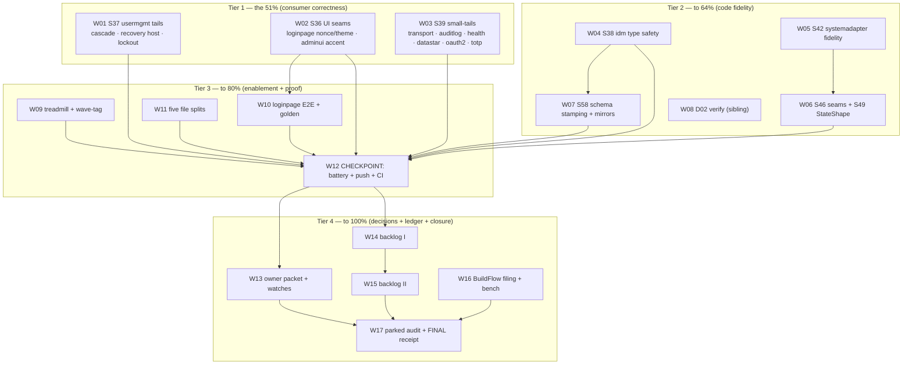

# SUPERB plan: Wave D completion — code fidelity to closure

**Created:** 2026-10-25 10:42 CEST · **Trigger:** "comprehensive plan first — 1%/4%/20% Pareto, ALL TODOS, 30–100min milestones, ≤12min micro-tasks, table views, execution graph" (round 28)
**Supersedes:** [`2026-10-25_08-05_SUPERB-ci-rescue-s32-proof-and-full-micro-breakdown-pareto-plan.md`](2026-10-25_08-05_SUPERB-ci-rescue-s32-proof-and-full-micro-breakdown-pareto-plan.md) **for execution order** of the remaining Wave D milestones (that file's Wave R + D01/D03/D04 are CLOSED; the 06-20 file keeps per-milestone scope text; the 10-24 master plan keeps the S-item t-tables and Appendix D).
**Predecessor receipt:** [`../status/2026-10-25_10-37_wave-d-resume-d01-d03-landed-d05-in-analysis_status.md`](../status/archived/2026-10-25_10-37_wave-d-resume-d01-d03-landed-d05-in-analysis_status.md) (session state, D05 analysis, owner-verdict defaults applied: parallel-continue · fixed-expiry lockout · S36/S39 in scope).
**Scope:** EVERY open `TODO_LIST.md` row plus the remaining 08-05 milestones — executed here, routed to the owner packet (W13), or left parked with a dated verdict (W16). Nothing dropped (§7 coverage table).

**State at planning:** tree green on pushed `a5183fff` (CI `40179492715`); this session added `b51a4a33` (S27 harvest), `ae3b80dd` (D03), `fcabed62` (round-27 receipt) — unpushed. A sibling session is executing D02 (docs lanes) in the same tree; disjoint file sets + immediate commits + `git log --stat` reconciliation at checkpoints (owner-ratified parallel mode). Load ~20 (bench-spike stays gated on < 6).

---

## 1. Pareto decomposition (re-derived against the measured remainder)

### 1.1 The 1% that delivers ~51%

**Three milestones · ~4.2 h · W01+W02+W03 — the consumer-correctness triad.**
Every remaining defect a CONSUMER can hit today, all verified open in source
2026-10-25: a deleted tenant's members KEEP their authorization (S37a — `es_casbin_projection.go:111` calls `RemoveAllRolesForUser(tenantStreamID)`, which removes nothing); a failed projection rebuild leaves the service with zero live projections (S37b); lockouts re-extend indefinitely under probing and `EvictStale`'s doc lies (S37d); the Option-B login page renders nonce-less scripts — dead under the recommended CSP — and loses SSR theming (S36); adminui splices `AccentColor` unvalidated into a `<style>` and answers partial-render errors 200 (S36); transport can deliver an event twice across the replay/live seam, `NewEventBridge(nil)` panics on first mapped event, `MappedEventTypes` returns map order, oauth2 accepts an empty `sub`, totp accepts a negative `Window` as a huge skew (S39). These are the product; everything else is enablement.

### 1.2 The 4% that delivers ~64%

**+4 milestones · ~7 h cumulative · W04–W07 (D06–D09) + W08 (D02 verify).**
The rest of the code-fidelity wave: identity-model type-safety tails (W04 — ordering, strict parses, Exists/IsActive, g2-guard, NotConfigured family, accessor copies), systemadapter declarative fidelity (W05 — the Enforce ladder that silently WIDENS permissions on migration, audit vocabulary drift, dropped ActorID), consumer seam proofs (W06 — DocsHandler mount, RecorderChain, StateShape round-trip), and schema-version stamping before v2 events can ever exist (W07 — upcasting cannot be added retroactively). W08 verifies the sibling's D02 receipts so the books stay honest.

### 1.3 The 20% that delivers ~80%

**+3 milestones + checkpoint · ~5 h cumulative · W09–W12.**
The repeat-cost killers and proofs: upstream-treadmill + wave-tag as one command each (W09), the loginpage WebAuthn E2E + render golden (W10 — the only browser-level proof the login flow has), the five file splits past the 350-line bar (W11), and the FIRST full battery+push checkpoint (W12) so W01–W11 reach consumers green instead of piling up unpushed.

### 1.4 The remaining 80% to 100%

**+5 milestones · ~8 h · W13–W17.**
The owner packet + watches (W13 — every owner-gated decision in one read), the harvested-backlog waves (W14/W15 — this repo's honest debt ledger, incl. tooling canaries and upstream ask drafts), the BuildFlow nix-fmt filing + bench window (W16), and the parked-row audit + FINAL battery + receipt + focus rewrite (W17). None skippable: the packet is one decision pass for the owner; the backlog rows are verified-open findings; the filing unblocks the pre-commit class; the audit is the plan's own "done when".

---

## 2. Anti-Verschlimmbesserung guardrails (binding)

1. **No gate weakened, no formatter added, no version bump inside a wave** — trains are separate sessions (gotcha 38). Published-module code changes get CHANGELOG receipts in the SAME commit (rides the next train, gotcha 8).
2. **Concourse with the sibling:** disjoint file sets; commit the moment gates pass (daemon windows are real — twice proven this session); never rebase a daemon commit; reconcile with `git log --stat` at each checkpoint; credit, never re-fix.
3. **Baselines move with their cause:** corpus baseline measured AFTER mutations in the same commit; tail stays ≤2 (archive ritual); branching-flow re-pins only with a dated ledger row.
4. **Verdicts from unpiped rc** (`PIPESTATUS[0]` if piped) — a truncated tail is not a verdict (twice-proven class).
5. **Gates by hand with `--no-verify`** (BuildFlow pre-commit nix-fmt loop, D15 territory) — the release-train pre-push gates are NEVER skipped.
6. **Fix at root cause; surgical edits; re-view each `file:line` immediately before editing** (Lane-D findings may have been fixed by intervening sessions — 3 of 6 S37 tails already were).
7. **Kill criteria:** if W12's battery cannot reach 4× rc=0 in two attempts, STOP and report failing stages — a red tree invalidates every downstream "verify".

---

## 3. Milestones (30–100 min), sorted by importance/impact/effort/value

Impact: **C** critical · **H** high · **M** medium · **L** low. Value: **Co** consumers · **Ag** agents · **Hu** owner · **CI** build trust.

| ID | Milestone | Impact | Effort | Value | Depends | Verify |
| --- | --- | --- | ---: | --- | --- | --- |
| **W01** | **D05 finish (S37):** TenantDeleted domain cascade (`Policies()` scan + `RemoveAllRolesInDomain` per member + hierarchy edges; service_tenant stops swallowing dispatch errors) · rebuild recovery-host (no zero-projection state) · lockout fixed-expiry + EvictStale truth · empty-store fallback warning · cookie Max-Age pin · usermgmt CHANGELOG | **C** | 100m | Co | — | `nix run .#test-usermgmt` + new tests |
| **W02** | **S36 UI seams:** loginpage `buildPageData` populates Nonce/Theme for `r != nil` (Option B parity) · adminui AccentColor validated against the shared grammar · partial-render errors → non-200 · CHANGELOGs both modules | **H** | 60m | Co | — | `.#test-loginpage` + `.#test-adminui` + goldens |
| **W03** | **S39 module small-tails:** transport replay/live ID dedup + unknown-cursor semantics · auditlog shutdown story · health `Recorder(nil)` + status wording · datastar nil guard + `MappedEventTypes` sort · oauth2 empty-`sub` reject + OIDC nonce · totp negative-Window clamp · receipts | **H** | 90m | Co | — | module suites |
| **W04** | **D06 (S38 a–g):** `GenerateUserID` → `brandid.NewID` ordering · strict `ParseTenantID`/`ParseBotID` · Exists/IsActive split · g2-guard under custom model · `NotConfigured` → permanent family · accessor copies · kill internal deprecated `NewUserID` · idm CHANGELOG | **H** | 100m | Co | — | `.#test-identity-model` |
| **W05** | **D07 (S42):** declarative Enforce ladder aligned with (or honestly documented vs) legacy Casbin grants · audit Action vocabulary parity (`usermgmt.AuditAction*`) · ActorID carried into declarative audit · systemadapter CHANGELOG | **H** | 90m | Co | — | declarative suite |
| **W06** | **D08 (S46+S49):** DocsHandler/DocsPath end-to-end mount test · `RecorderChain(Recorder(svc), auditPlugin)` proof · `StateShape` round-trip (SQL snapshot + codec; file upstream if the stamp drops) | **H** | 100m | Co | — | `.#test-integration_test` |
| **W07** | **D09 (S58):** `WithSchemaVersion(1)` on the 29 constructors (21 idm + e2e/demo sites) · delete health status mirrors + root require bump + integration_test half · receipts | **H** | 90m | Co | W04 | idm + health suites |
| **W08** | **D02 verification (sibling):** S45 EventHandler section + idm README · S52 mandate row · S53 credential memo · S54 v5 skeleton — presence + docs gates + AGENTS truth-pass | M | 30m | Ag | sibling done | docs gates rc=0 |
| **W09** | **D10 (S50+S51):** `check-upstream-treadmill.sh` (per-repo prefix map) + `wave-tag.sh` (dry-run→push→refresh→sweep→re-tag) with offline fixture self-tests, wired flake + check-modules | M | 100m | Ag | — | self-tests green |
| **W10** | **D11 (S57):** Playwright WebAuthn virtual-authator E2E (register + login through the rendered page) + full-page render golden (stable IDs, nonce-insensitive) | M | 90m | Co | W02 | e2e suite + golden |
| **W11** | **D12 (S40):** split `setup/config.go` (1186), `systemadapter/declarations.go` (609), `usermgmt/service_core.go` (576), `dashboardui/layout.go` (518→assets), `e2e/server/main.go` (487) | M | 100m | Hu | — | build + `check-large-files` + suites |
| **W12** | **Checkpoint 1:** full battery (test · lint · coverage-gate · check-modules incl. both new self-tests) + PUSH through strict pre-push gates + CI watch + `.#verify-remote-tags` | **C** | 60m | CI | W01–W11 | 4× rc=0 + CI green + ahead 0 |
| **W13** | **D13 (S55+S56):** owner packet — D1–D17 answered-or-recommended + upstream asks + PapDashboard + datastar-demo + E005 + cqrs-lint tag + GCL debt; S56 watch table (buildcache, fleet asks, scorecard, catalog consumers) | M | 100m | Hu | W12 | packet + `check-docs-links` + corpus bump |
| **W14** | **D14a backlog I:** loginpage AutoRedirect follow-through (NoWebAuthn asymmetry memo, `AuthPrefix` validation, guide, FEATURES) · dashboardui 09-48 tails (rune-safe truncate/initials, PathEscape, data-base-path, audit streaming, neighbour early-stop, snapshot 404/500, boost guard) · root-declutter (biome.json prove-or-remove, allowlist sketch) · sweep-plan M18/M20/M21 · RequireSession export-or-document | M | 100m | Co/Ag | W12 | per-row verify |
| **W15** | **D14b backlog II:** art-dupl r3 accept-baseline + 2 extractions · `check-skill-claims.sh` skeleton · snippet compile gate + README split-brain scan · tooling canaries a–g · upstream ask drafts batch | M | 100m | Ag | W14 | per-row verify |
| **W16** | **D15:** BuildFlow nix-fmt loop source-verified (`buildflow history --step nix-fmt --last-error`) + upstream filing per verify-before-filing · bench-spike ONLY at load < 6 (honest refusal otherwise) | L | 60m | CI | — | issue link + bench verdict |
| **W17** | **D16 + closure:** 8 parked-row verdicts (billing S00, DataStar Tier-4, ReadLastN, SidebarNav, BuildFlow BF1, cqrs-lint fleet swap, check-cqrs-lint CI, GCL) · TODO promote/unpark · FINAL battery + push + CI watch · final receipt (supersede 10-37; archive ritual; baselines) · CURRENT_FOCUS rewrite — **→ receipt: [`docs/status/archived/2026-10-27_01-30_round-35-w14-w15-landed-ci-battery-of-record-8-verdicts-parked-rows-held-gates-named_status.md`](../status/archived/2026-10-27_01-30_round-35-w14-w15-landed-ci-battery-of-record-8-verdicts-parked-rows-held-gates-named_status.md) (+ the round-36 continuation/self-critique)** | M | 100m | Hu | W13–W16 | 4× rc=0 + receipt + tail ≤2 |

**Total: 17 milestones · ≈15.5 h focused.** Checkpoint rule: W12 is hard; if the sibling's tree interleaves, reconcile books before pushing (guardrail 2).

---

## 4. Micro-tasks (≤12 min each) — complete, every milestone covered

`V` = the check performed inside the micro-task.

| ID | Task | Min | V |
| --- | --- | ---: | --- |
| w01.1 | S37a: enumerate domain subjects in the casbin projection via its own `Policies()` view | 12 | subject list |
| w01.2 | S37a: `RemoveAllRolesInDomain` per member + role-hierarchy edges on `TenantDeleted` | 12 | cascade test green |
| w01.3 | S37a: `service_tenant.go` removal loop stops swallowing dispatch errors (audit + log) | 10 | test |
| w01.4 | S37b: recovery-host on Reset/create failure (service never left with zero live projections) | 12 | stub-Reset test |
| w01.5 | S37d: `EvictStale` sweeps zero-attempt `attempts` entries (fix the doc lie) | 8 | eviction test |
| w01.6 | S37d: `RecordFailure` fixed expiry — no re-extend of an active lock (owner verdict 2026-10-25) | 8 | expiry test |
| w01.7 | S37f: empty-store journal fallback warning at the (re-located) site | 8 | warning test |
| w01.8 | S37c: cookie `Max-Age` × `SessionTTL` pin test (behavior already correct) | 8 | header test |
| w01.9 | usermgmt CHANGELOG receipts + `.#test-usermgmt` | 12 | rc=0 |
| w02.1 | loginpage: populate Nonce/Theme inside `buildPageData`'s `r != nil` block | 8 | render test |
| w02.2 | loginpage: golden/nonce-suite updates if output shifted | 8 | goldens |
| w02.3 | adminui: AccentColor validated with the shared grammar (dashboardui parity) | 12 | accept/reject test |
| w02.4 | adminui: partial-render errors answer non-200 | 8 | test |
| w02.5 | CHANGELOGs both modules + suites | 10 | rc=0 |
| w03.1 | transport: ID dedup at the replay/live seam | 12 | no-dup test |
| w03.2 | transport: unknown-cursor semantics documented or probed | 8 | decision + test |
| w03.3 | auditlog: shutdown story for the mounted viewer | 10 | test/doc |
| w03.4 | health: `Recorder(nil)` reject + unknown-status wording | 8 | test |
| w03.5 | datastar: `NewEventBridge(nil)` guard + `MappedEventTypes` sort | 8 | test |
| w03.6 | oauth2: empty `sub` rejection + OIDC nonce | 12 | tests |
| w03.7 | totp: negative `Window` clamp | 8 | test |
| w03.8 | receipts + module suites | 12 | rc=0 |
| w04.1 | S38a: `GenerateUserID` → `brandid.NewID` (keep ULID ordering) | 8 | ordering test |
| w04.2 | S38b: strict `ParseTenantID`/`ParseBotID`; folds reject ambiguous forms | 12 | tests |
| w04.3 | S38c: `Exists()`/`IsActive` split per state struct | 10 | compile + tests |
| w04.4 | S38d: `NewAuthz` must not seed `g2` under a custom model | 8 | test |
| w04.5 | S38e: `NotConfigured` → permanent family | 6 | test |
| w04.6 | S38f: command accessors return copies | 10 | mutation test |
| w04.7 | S38g: kill internal deprecated `NewUserID` uses | 8 | grep clean |
| w04.8 | idm CHANGELOG + `.#test-identity-model` | 12 | rc=0 |
| w05.1 | S42a: diff the declarative Enforce ladder vs legacy Casbin grants (table) | 12 | table |
| w05.2 | S42b: align the ladder (or document the divergence) | 12 | declarative test |
| w05.3 | S42b: audit Action vocabulary parity | 10 | golden |
| w05.4 | S42c: ActorID into declarative audit entries | 10 | test |
| w05.5 | systemadapter CHANGELOG + declarative suite | 12 | rc=0 |
| w06.1 | S46a: DocsHandler/DocsPath end-to-end mount test | 12 | test green |
| w06.2 | S46b: `RecorderChain(Recorder, auditPlugin)` chain proof | 12 | test green |
| w06.3 | S49a: SQL snapshot store `StateShape` round-trip test | 12 | test green |
| w06.4 | S49b: codec path round-trip; file upstream if the stamp drops | 12 | verdict recorded |
| w06.5 | integration_test suite green | 12 | rc=0 |
| w07.1 | S58a: stamp `WithSchemaVersion(1)` on the 21 identity-model constructors | 12 | tests |
| w07.2 | S58b: stamp the 8 e2e/demo event sites | 8 | build |
| w07.3 | S58c: delete health status mirrors + root require bump | 10 | health suite |
| w07.4 | S58d: integration_test half + CHANGELOG receipts (idm + health) | 12 | rc=0 |
| w08.1 | Sibling D02 receipts presence: S45 section, S52 row, S53 memo, S54 skeleton | 8 | checklist |
| w08.2 | Docs gates: links + freshness + corpus + tail ratchets | 10 | rc=0 |
| w08.3 | AGENTS quick-ref truth-pass on the sibling's rows | 10 | diff review |
| w09.1 | S50: per-repo prefix map (config data) | 10 | map |
| w09.2 | S50: implement `check-upstream-treadmill.sh` + offline fixture self-test | 12 | self-test green |
| w09.3 | S51: `wave-tag.sh` dry-run mode | 12 | dry-run output |
| w09.4 | S51: push→refresh→sweep→re-tag cascade + ≥6-case self-test | 12 | self-test green |
| w09.5 | flake apps + check-modules wiring | 12 | `.#check-modules` |
| w10.1 | Playwright WebAuthn virtual-authenticator harness | 12 | spec runs |
| w10.2 | Registration + login E2E through the rendered page | 12 | spec green |
| w10.3 | Full-page render golden (stable IDs, nonce-insensitive) | 12 | golden committed |
| w11.1 | Split `setup/config.go` by concern | 12 | build + tests |
| w11.2 | Split `systemadapter/declarations.go` (query/fold files) | 12 | build |
| w11.3 | Split `usermgmt/service_core.go` | 12 | build |
| w11.4 | `dashboardui/layout.go` assets refile + `e2e/server/main.go` | 12 | build + goldens |
| w11.5 | Full test + lint over touched modules | 12 | rc=0 |
| w12.1 | Battery: `.#test` · `.#lint` · `.#coverage-gate` · `.#check-modules -- --report` | 12+ | 4× rc=0 |
| w12.2 | `git push` through both strict pre-push gates | 10 | push accepted |
| w12.3 | `gh run watch <id> --exit-status` + `.#verify-remote-tags` + ahead 0 | 12 | terminal green |
| w13.1 | S55: D1–D8 answered or recommended | 12 | packet section |
| w13.2 | S55: D9–D17 answered or recommended | 12 | packet section |
| w13.3 | S55: upstream asks + PapDashboard + datastar-demo + E005 + cqrs-lint tag + GCL | 12 | packet section |
| w13.4 | S56: watch table (buildcache, fleet asks, scorecard, catalog consumers) | 10 | table |
| w13.5 | Links + corpus baseline bump in the same commit | 8 | gates rc=0 |
| w14.1 | loginpage AutoRedirect: NoWebAuthn asymmetry memo + `AuthPrefix` validation + guide + FEATURES | 12 | `.#test-loginpage` |
| w14.2 | dashboardui tails a: UTF-8 rune-safe `truncate`/`initials` + `url.PathEscape` | 12 | `.#test-dashboardui` |
| w14.3 | dashboardui tails b: `data-base-path` hook + audit cursor streaming | 12 | tests green |
| w14.4 | dashboardui tails c: neighbour early-stop + snapshot 404/500 + boost guard | 12 | tests green |
| w14.5 | root-declutter: `biome.json` prove-or-remove + root allowlist gate sketch | 12 | verdict |
| w14.6 | sweep-plan M18/M20/M21 + RequireSession export-or-document | 12 | `.#test-root` |
| w15.1 | art-dupl r3: accept-baseline gate decision + the 2 deferred extractions | 12 | `.#check-branching-flow` |
| w15.2 | `check-skill-claims.sh` skeleton + fixture | 12 | script + fixture |
| w15.3 | Skill-snippet compile gate + module-README split-brain scan | 12 | gate runs |
| w15.4 | Tooling canaries a–c: tidy-sweep, verify-tag poison, skip_steps canary | 12 | scripts + self-tests |
| w15.5 | Tooling canaries d–g: coverage fail-loud, toolchain runbook, codespell, single-source thresholds | 12 | each present |
| w15.6 | Upstream ask drafts batch (P15, event.New encoding, cqrs-lint forms, go-output, BuildFlow) | 12 | drafts present |
| w16.1 | BuildFlow nix-fmt loop: `buildflow history --step nix-fmt --last-error` root-cause | 12 | root cause named |
| w16.2 | File upstream per verify-before-filing (repro + expected behavior) | 12 | issue link |
| w16.3 | bench-spike at load < 6; refuse honestly otherwise (twice-quiet rule) | 12 | rc or refusal |
| w17.1 | One dated verdict per parked row (8 rows) | 12 | 8 verdicts |
| w17.2 | TODO promote/unpark exactly what verdicts allow + `check-todo-hygiene` | 10 | rc=0 |
| w17.3 | FINAL battery (4 gates) | 12+ | rc=0 |
| w17.4 | Push + CI watch + ahead 0 | 12 | terminal green |
| w17.5 | Final receipt (supersede 10-37, archive ritual, TAIL stays ≤2, corpus after mutations) | 12 | ratchets green |
| w17.6 | CURRENT_FOCUS rewrite (Wave D done; next thread named) | 8 | file current |

**Total: 84 micro-tasks · ≈13.9 h sum + milestone verify overhead ≈ 15.5 h.**

---

## 5. Execution graph

Critical path: `W01 → W12 → W14 → W15 → W17` (~7.5 h). W02+W03 front-load with W01 (disjoint modules — the sibling is on docs only). W04→W07 is the only code chain.

---

## 6. Owner gates (defaults recorded 2026-10-25; override any time)

| Gate | Default in force | Override |
| --- | --- | --- |
| Concurrency vs the sibling D02 session | **parallel, disjoint files** (guardrail 2) | "pause" stops code waves until they finish |
| Lockout re-extension (S37d) | **fixed expiry** — a lock expires `Duration` after the ORIGINAL lock; probes during lock do not extend | "keep re-extend" shrinks w01.6 to the EvictStale fix |
| S36/S39 scope | **execute in this wave** (verified open) | "park" returns them to TODO with dated verdicts |
| D1–D17 + parked rows | recommendations in W13/W16; decisions never executed without a verdict | answer inline in the packet |

## 7. Coverage — every open TODO_LIST row routed (0 orphans)

| TODO group | Routed to | | TODO group | Routed to |
| --- | --- | --- | --- | --- |
| P1 Wave-D pointer + S36/S39 detail rows | W01–W03 | | loginpage AutoRedirect / test depth | W14 / W10 |
| usermgmt tails (S37) · idm tails (S38) | W01 / W04 | | dashboardui 09-48 tails · art-dupl r3 | W14 / W15 |
| systemadapter (S42) · seams + StateShape | W05 / W06 | | root-declutter · skill gates · canaries · upstream drafts | W14 / W15 / W15 / W15 |
| `WithSchemaVersion` (S58) · health rider | W07 / W07 | | treadmill · wave-tag · bump-dep lint ✅ · templ chain ✅ | W09 / W09 / DONE / DONE |
| EventHandler (S45) · idm README · S52–S54 | W08 (sibling) | | credential memo · v5 plan | W08 (sibling) |
| battery remainder (bench-spike) | W16 | | RequireSession decision | W14 |
| ReadLastN · upstream filings · crush-config lessons · T12/T13 · GCL · E005 · cqrs-lint tag+swap+CI · PapDashboard · datastar-demo · D1–D17 | **W13 packet (owner)** | | sync N5/N4 watches · catalog cross-repo · fleet-ask watches | W13 (watches/parked) |
| SidebarNav · BuildFlow BF1 · DataStar Tier-4 · billing S00 · scorecard · README-TOC · buildcache | **W16 verdicts** | | V007 cluster 1 · appkit adoption · ProjectionLayer removal · v5 auto-upgrade · templ ep-4 re-pin | **parked, v5-window** (verdict restated in W17) |

## 8. Rollback

Every milestone is a commit; a wrong milestone reverts as a unit (`git revert`), baselines together with their cause. Ratchet re-pins revert together with their ledger rows.

**Done when:** W17's battery is 4× rc=0 on a pushed green HEAD, every TODO row is executed or carries a dated verdict/pointer, the four ratchets (tail, corpus, branching-flow, domain counts) are green in the same run, and the final receipt supersedes the 10-37 report.
