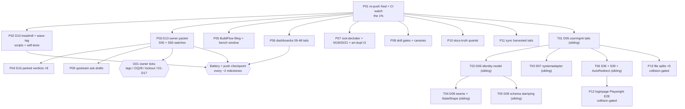

# SUPERB plan v3: red-master re-push, parallel Wave D lanes, and the remaining-backlog burn-down

**Created:** 2026-10-25 10:43 CET · **Trigger:** "figure out the 1%/4%/20%, comprehensive plan, ≤12 min tasks, commit + push" (round 3)
**Supersedes:** [`2026-10-25_08-05_SUPERB-ci-rescue-s32-proof-and-full-micro-breakdown-pareto-plan.md`](2026-10-25_08-05_SUPERB-ci-rescue-s32-proof-and-full-micro-breakdown-pareto-plan.md) **for execution order and lane assignment**. The 08-05 file keeps its Wave R + D01 evidence (§8 execution receipt) and the 06-20 file keeps per-milestone scope text.
**Sibling-lane micro-breakdown:** the 10-37 report's §f items 1–13 are the AUTHORIZED task list for the sibling lane (T01–T06 below) — deliberately NOT duplicated here; two divergent copies of one lane is a split brain.
**Predecessors:** [10-24 master plan](2026-10-24_05-36_SUPERB-master-plan-docs-eviction-delivery-and-backlog-burn-down.md) (S-item detail + Appendix D execution log), [10-36 lane-split receipt](../status/2026-10-25_10-36_wave-r-closure-lane-split-d04-d01-d02_status.md), [10-37 sibling resume report](../status/2026-10-25_10-37_wave-d-resume-d01-d03-landed-d05-in-analysis_status.md).

---

## 0. Why v3 exists (state delta since 08-05, 2.5 hours)

1. **Wave R + D01–D04 are CLOSED** (08-05 §8): CI was terminal-green at `a5183fff` (`40179492715`), receipts written and archived.
2. **Master is RED again right now** — run `40181238507` on `65665920` failed `checks`: shellcheck SC2164 on the sibling's new `test-check-templ-codegen-staged.sh:48`. **The fix already exists locally** (`ae3b80dd`, unpushed) — the red is purely an unpushed-heal.
3. **Two sessions share this tree.** The sibling session closed D03 (S47+S48), analyzed D05 (3 of 6 sub-items already fixed by intervening sessions; 4 genuinely open, with file:line evidence), and is paused awaiting owner. Their §g.1: "a plain continue = parallel on disjoint files". This plan makes the lane assignment deterministic (§3) so D10/D13/D14/D15/D16 — which BOTH sessions listed — cannot be executed twice.
4. **The 08-05 Wave D inventory dropped S36/S39 by omission** (the sibling verified both still open in source; they are in the sibling lane).

**State at planning time:** tree clean at `fcabed62` (2 ahead of origin: `ae3b80dd` D03 close-out + `fcabed62` receipt); CI `40181238507` red on the pushed `65665920`; load ~20; docs corpus 31,075 lines / 213 files; tail = 2 live reports.

---

## 1. Pareto decomposition (re-derived against the red + the two-session state)

### 1.1 The 1% that delivers ~51%

**P01 (15 min): push the healed range and watch CI to terminal green.**
The SC2164 fix sits unpushed (`ae3b80dd`); master's red invalidates every downstream
"verify: rc=0" this plan would produce — the same class the 08-05 plan's R01 existed
for. The plan's own commit+push (guardrail 6) is the vehicle; nothing else starts
before CI is green.

### 1.2 The 4% that delivers ~64%

**+P02 (~100 min): D10 — the two operational scripts (S50 treadmill sweep, S51 wave-tag).**
Mechanizes the two highest-frequency operational failure classes still unscripted:
the upstream-lag check that silently failed through a bad awk (2026-10-12) and the
5-step tag cascade that raced the daemon/TTL three times in one day (2026-10-13).
Both get offline fixture self-tests and flake-app + check-modules/CI wiring —
the repo's standard gate shape.

### 1.3 The 20% that delivers ~80%

**+P03 (D13 owner packet + S56 watches) + P04 (D16 parked-row verdicts) + P05 (D15
BuildFlow filing + bench window) + the sibling lane T01–T06 (tracked, not mine).**
The packet is the multiplier: ~10 owner-gated rows are waiting on decisions this
repo cannot make itself (tag ratification, OQ28, D1–D17, upstream asks) — one
well-evidenced document converts all of them from "blocked" to "one yes away".
D16 gives every parked row a dated verdict (or names its gate). D15 closes the
4-week-old broken-pre-commit class at its source. The sibling lane carries the
consumer-facing code-fidelity wave (D05–D09 + S36 + S39 ≈ 10 h, already analyzed
to file:line granularity).

### 1.4 The remaining 80% → 100%

My D14 subsets (P06 dashboardui 09-48 tails; P07 root-declutter + sweep-tails +
art-dupl r3; P08 skill gates + tooling canaries; P09 upstream ask drafts),
P10 (docs-truth quartet), P11 (sync harvested tails), then the collision-gated
D11/D12 (loginpage E2E, file splits — wait for the sibling's S36/D05 to land),
and the standing watches (§4.3). Owner-gated rows (billing S00, DataStar Tier-4,
cqrs-lint swap…) execute only on owner ticks produced by P03/P04.

---

## 2. Guardrails (binding; 1–7 carried from 08-05, 8–10 new)

1. One milestone in flight; module-scoped build+vet+lint+test after each edit (gotcha 2).
2. Never rewrite another session's code — the sibling lane's files are theirs; report + coordinate.
3. No gate weakened, no formatter added, no version bumps inside this plan.
4. Ratchet discipline: docs growth bumps `CORPUS_BASELINE` **before committing** (run the corpus gate first — violated once already this morning); archiving lowers `TAIL_BASELINE`; every branching-flow re-pin carries its dated ledger row.
5. Receipts in the same commit for published-module code.
6. Verify line or it stays open; commit + push at every milestone boundary (the push is part of the verify).
7. Re-base links through the archive tool, never by hand.
8. **Lane discipline:** disjoint file sets (§3). `git add` by explicit path list — never `-A` on this shared tree. Stage → commit immediately; the daemon's capture window is seconds (proven 4× today).
9. **No duplication of the sibling's §f 1–13** — reference it; this plan owns only the lane assignment.
10. **Battery + push checkpoint** after every ~2 of my milestones: quick legs (`.#test` module-scoped, `.#lint`, `.#check-modules`) then push + `gh run watch --exit-status`.

---

## 3. Milestones (15–100 min), priority-sorted, lane-tagged

Impact: **C** critical · **H** high · **M** medium · **L** low. Lane: **me** = this session · **sib** = sibling session (tracked) · **owner**.

| ID | Lane | Milestone | Impact | Effort | Value | Depends | Verify |
| --- | --- | --- | --- | ---: | --- | --- | --- |
| **P01** | me | **Re-push the healed range** (`ae3b80dd` SC2164 fix + `fcabed62` + this plan) through strict gates; watch CI to terminal green | **C** | 15m | CI | — | CI green + ahead-count 0 |
| **P02** | me | **D10 scripts:** S50 `check-upstream-treadmill.sh` (per-repo prefix map, loud-failure semantics, `scripts/testdata/` exclusion, tag-cache reuse) + S51 `wave-tag.sh` (dry-run default: verify-tag → push → train `--refresh-cache` → bump-dep sweep → carrier re-tag) + both fixture self-tests + flake/check-modules/CI wiring | H | 100m | CI/Ag | P01 | 2 self-tests red→green |
| **P03** | me | **D13 owner packet (S55):** D1–D17 with recommendations + upstream asks (treefmt-nix#545, GCL, cqrs-lint E005) + PapDashboard + datastar-demo + E005 + GCL debt + S56 watch table (buildcache, scorecard, catalog consumers, templ fix adoption) | H | 100m | Hu | P01 | packet + `check-docs-links` + corpus bump |
| **P04** | me | **D16 parked-row verdicts:** billing S00, DataStar Tier-4, ReadLastN, SidebarNav, BuildFlow re-enable, cqrs-lint swap, `check-cqrs-lint` CI, GCL debt — one dated verdict (or named gate) per row; promote nothing without the gate | M | 45m | Hu | P03 | TODO diff + hygiene gate |
| **P05** | me | **D15 BuildFlow:** verify the `nix-fmt` loop at source (`buildflow history --step nix-fmt --last-error`), file upstream per verify-before-filing, bench-spike ONLY at load < 6 | M | 60m | CI | P01 | issue link + bench rc or honest refusal |
| **P06** | me | **D14 dashboardui 09-48 tails:** UTF-8 rune-safe truncate/initials, `url.PathEscape`, `data-base-path` hook, audit cursor streaming, neighbor early-stop + O(journal) cap, snapshot 404/500 split, boost guard, page-size selector, browser smoke | M | 100m | Co | P01 | `.#test-dashboardui` |
| **P07** | me | **D14 root-declutter + sweep-tails + art-dupl r3:** biome.json prove-or-remove, root allowlist gate sketch, sweep-plan M18/M20/M21, art-dupl accept-baseline gate decision | M | 90m | Ag | P01 | per-row verify |
| **P08** | me | **D14 skill gates + tooling canaries:** `check-skill-claims.sh` skeleton, snippet compile gate, README split-brain scan, canaries a–g (tidy-sweep, verify-tag poison, skip_steps, coverage fail-loud, toolchain runbook, codespell, single-source thresholds) | M | 100m | Ag | P01 | each gate/self-test |
| **P09** | me | **D14 upstream ask drafts (owner-gated sends):** P15 GCL classifier, `event.New` encoding, cqrs-lint suppression forms, go-output note, BuildFlow | M | 60m | Hu | P03 | drafts in `docs/drafts/` |
| **P10** | me | **Docs-truth quartet (S22/S24/S25/S26):** VERSIONING/DOMAIN_LANGUAGE claim-by-claim, dashboardui↔root co-change re-measure, modularization PROPOSAL cite-or-supersede, two-repo-by-audience memo (or no-verdict memo) linked from ROADMAP | M | 60m | Hu/Co | P01 | gates + memo link |
| **P11** | me | **Sync harvested tails:** e2e `DB_VERSION` 1→2 IndexedDB migration spec, node-level worker-boot/DB-upgrade smoke, cursor monotonicity guard, `Family.IsZero()` adoption, guide batch-cost/timeout + CSP notes | M | 60m | Co | P01 | sync JS suite + guide gates |
| **T01** | sib | D05/S37 usermgmt tails (their 10-37 §f 1–6: cascade via `RemoveAllRolesInDomain`, recovery host, lockout truth + the §g.2 semantics call, empty-store warning, Max-Age pin, CHANGELOGs) | H | 100m | Co | P01 | `.#test-usermgmt` |
| **T02** | sib | D06/S38 identity-model tails (§f 7) | H | 100m | Co | T01 | `.#test-identity-model` + lint |
| **T03** | sib | D07/S42 systemadapter fidelity (§f 8) | H | 90m | Co | T01 | declarative suite |
| **T04** | sib | D08/S46 seams + S49 StateShape (§f 9–10) | H | 100m | Co | T02 | `.#test-integration_test` |
| **T05** | sib | D09/S58 schema stamping + health mirrors (§f 11) | H | 90m | Co | T02 | `.#test-health` + idm |
| **T06** | sib | S36 loginpage/adminui truth + S39 module small-tails (§f 12–13) — includes loginpage AutoRedirect follow-through (D14.1) | H | 100m | Co | T01 | module suites + goldens |
| **P12** | me | D11 loginpage Playwright WebAuthn E2E + full-page golden (**collision-gated**: after T06 lands) | M | 90m | Co | T06 | e2e suite + golden |
| **P13** | me | D12 file splits ×5 (**collision-gated**: `usermgmt/service_core.go` after T01; the rest any time — but batched here) | M | 100m | Hu | T01 | build + large-files gate |
| G01 | owner | Tick the P03 packet: tag ratification, OQ28 (S53 memo default or CredentialView embed), lockout §g.2, D1–D17, lane-split ratification, upstream-ask sends | **C** | — | Hu | P03 | owner verdicts |

Totals: my lane ≈ 11 h 20 m; sibling lane ≈ 9 h 40 m (tracked); owner gates unblock ~10 rows.

---

## 4. Micro-tasks (≤12 min each)

### 4.1 My lane, fully broken down

| ID | Task | Min | V |
| --- | --- | ---: | --- |
| p01.1 | `git push` (heal + this plan) through both strict gates | 5 | push accepted |
| p01.2 | `gh run watch <id> --exit-status`; triage any red to terminal green | 10 | green verdict |
| p02.1 | S50: enumerate upstream repos from all go.mod requires (skip testdata/vendor); build the prefix map | 12 | map printed |
| p02.2 | S50: script core — one ls-remote per repo (TRAIN_TAG_CACHE reuse), latest-tag-per-prefix resolution, loud failure on empty/parse errors | 12 | dry run on real tree |
| p02.3 | S50: verdict semantics (advisory table + `--strict-lag N` exit 1; unknown-module = error) | 10 | seeded-lag fixture red |
| p02.4 | S50: offline fixture self-test (fake tree + seeded tag cache, 6 cases incl. the sqliteengine prefix trap + bad-awk-class loudness) | 12 | self-test green |
| p02.5 | S51: `wave-tag.sh` dry-run default (verify-tag --dry-run → show plan, write nothing) | 12 | dry-run output |
| p02.6 | S51: execute mode (tag --push → train --refresh-cache → bump-dep sweep → carrier re-tag cascade), refuse on any red leg | 12 | stubbed cascade order |
| p02.7 | S51: offline fixture self-test (stub subcommands, assert order + flags + refusal) | 12 | ≥6 cases green |
| p02.8 | Wire both: flake apps + check-modules stages + CI steps + AGENTS quick-ref rows | 12 | check-modules green |
| p03.1 | S55: collect D1–D17 from `docs/proposals/*owner-decision*` + current statuses; write recommendation per row | 12 | section done |
| p03.2 | S55: upstream asks section (treefmt-nix#545 watch, GCL F22/gates, cqrs-lint E005, go-output, BuildFlow) | 12 | section done |
| p03.3 | S55: PapDashboard reply status + datastar-demo KEEP evidence + E005 + GCL debt | 12 | section done |
| p03.4 | S56: watch table (buildcache %, scorecard timing, catalog cross-repo consumers, templ >v0.3.1070 fix adoption, bench window) | 10 | table done |
| p03.5 | Corpus gate + bump in-commit; links green | 8 | gates green |
| p04.1–4 | One verdict per parked row ×8 (billing, DataStar, ReadLastN, SidebarNav, BuildFlow, cqrs-lint swap, CI wiring, GCL) — 2 rows per micro-task | 4×12 | TODO diff |
| p05.1 | `buildflow history --step nix-fmt --last-error` → name the root cause at source | 12 | cause named |
| p05.2 | Draft + file upstream (repro, expected, actual) per verify-before-filing | 12 | issue link |
| p05.3 | bench-spike at load < 6 (refuse honestly otherwise; re-pin only if this change owns the bench path) | 12 | rc=0 or refusal |
| p06.1 | rune-safe truncate/initials + tests | 12 | suite green |
| p06.2 | `url.PathEscape` on name segments + test | 10 | suite green |
| p06.3 | `data-base-path` hook (script selector) + test | 12 | suite green |
| p06.4 | audit export cursor streaming (head-read → cursor) + test | 12 | suite green |
| p06.5 | neighbor early-stop + tail cap + test | 12 | suite green |
| p06.6 | snapshot 404/500 split + boost-inheritance guard + tests | 12 | suite green |
| p06.7 | page-size off-menu option + browser smoke | 12 | suite green |
| p07.1 | biome.json prove-or-remove (verdict + action) | 12 | verdict row |
| p07.2 | root allowlist gate sketch (not enforcement) | 12 | script + fixture |
| p07.3 | sweep-plan M18 (SSE/frontend-sync guide recipes) | 12 | guide diff |
| p07.4 | sweep-plan M20/M21 (README rows, cross-links, RequestFilter test) | 12 | `.#test-root` |
| p07.5 | art-dupl r3: accept-baseline gate decision + 2 deferred extractions | 12 | `check-branching-flow` |
| p08.1 | `check-skill-claims.sh` skeleton + fixture | 12 | self-test |
| p08.2 | skill-snippet compile gate (README/skill code fences) | 12 | gate green |
| p08.3 | module-README split-brain scan | 12 | report |
| p08.4 | canaries a–c (tidy-sweep, verify-tag poison, skip_steps) | 12 | scripts+self-tests |
| p08.5 | canaries d–g (coverage fail-loud, toolchain runbook, codespell, single-source thresholds) | 12 | each present |
| p09.1–5 | one draft per upstream ask ×5 | 5×12 | drafts in docs/drafts/ |
| p10.1 | S22: VERSIONING.md claim-by-claim vs code | 12 | verdict list |
| p10.2 | S22: DOMAIN_LANGUAGE.md same | 12 | verdict list |
| p10.3 | S24: correct co-change measurement command + one run | 12 | number + cmd |
| p10.4 | S25: modularization PROPOSAL cite-or-supersede | 10 | link |
| p10.5 | S26: two-repo memo (or no-verdict memo) + ROADMAP link | 12 | memo |
| p11.1 | e2e DB_VERSION 1→2 migration spec | 12 | spec green |
| p11.2 | node worker-boot/DB-upgrade smoke | 12 | smoke green |
| p11.3 | cursor monotonicity guard + test | 12 | test green |
| p11.4 | `Family.IsZero()` adoption + guide notes (batch-cost, CSP) | 12 | suites + links |

### 4.2 Sibling lane

**Authoritative micro-breakdown = the 10-37 report §f items 1–13** (each already ≤ ~30 min with a verify command and file:line anchors). This plan tracks only the T01–T06 assignment and their verify gates (§3).

### 4.3 Standing watches (no code; re-check at battery checkpoints)

| Watch | Trigger | Row |
| --- | --- | --- |
| bench-spike quiet window | load < 6 twice-quiet | battery remainder row |
| treefmt-nix#545 | upstream response | fleet asks row |
| templ > v0.3.1070 fix adoption | first release after 10-05 | templ-components tail row |
| catalog cross-repo consumers | go-appkit train | catalog row |
| quarterly README claim-sweep | ~2027-01-17 | ritual row |
| README TOC decision | ~2026-11-17 | row |
| health train rider (status mirrors + RecorderChain proof) | next health tag | samber/do row |
| sync N5 streamId form | go-cqrs-lite id branding publish | sync watches row |
| buildcache % | before every battery | hardware row |
| scorecard timing | next low-load window | env row |

---

## 5. Execution graph

---

## 6. Owner gates (do not execute without a verdict)

Carried: tag retraction (recommend leave-and-document — 10-15 receipt §g.1), OQ28 credential consolidation (S53 memo default: wire goldens, keep 4 structs), lockout re-extension semantics (sibling §g.2 — recommend fixed expiry), minor-version ratifications (ratified as-documented, flagged in the v5 plan).
New: lane-split ratification (this plan's §3 assignment), upstream-ask sends (P09 drafts → owner approval per row), billing S00 demand/MoR (standing), cqrs-lint fleet swap + CI wiring (standing).

## 7. Kill criteria, done-when, coverage

- **Kill criteria:** if CI cannot go green within two pushes, stop and report the failing stage (a red tree invalidates every downstream verify); if a lane collision is detected (sibling files changing under a P-milestone), stop that milestone and re-coordinate — never merge-race.
- **Done when:** CI green on a pushed HEAD; every open TODO row either executed, carrying a dated verdict, or named as an owner/watch gate; the four ratchets green in one run; the sibling lane T01–T06 receipted (theirs); P01–P13 receipted (mine); CURRENT_FOCUS rewritten at Wave D completion.
- **Coverage (every open TODO row → owner):** P1 code-fidelity row → T01–T06 · ReadLastN → P04 · catalog → watch · samber/do → watch (filings → P09/P03) · sync watches → P11 + watch · GCL F22 → P03/P09 · cqrs-lint rebuild → P04/owner · battery remainder → P05/checkpoints · fleet asks → P03 watch · CI wiring → P04/owner · SidebarNav → P04 · BuildFlow re-enable → P04 · DataStar Tier-4 → P04 · GCL doc-only → P09 · loginpage test-depth → T06/P12 · bump-dep lint leg + templ chain → DONE (D03, rows struck in this commit) · StateShape → T04 · treadmill + wave-tag → P02 · integration_test seams → T04 · claim-sweep/TOC/scorecard → watches · M18/20/21 → P07 · BuildFlow filing → P05 · AutoRedirect → T06 · dashboardui 09-48 → P06 · art-dupl r3 → P07 · S39 → T06 · docs-truth quartet → P10 · root-declutter → P07 · skill gates + canaries + upstream drafts → P08/P09 · Stripe → owner · system+metaengine plan → DONE-shape (S54 skeleton; full plan stays v5-window) · V007/appkit/ProjectionLayer/v5 workstream → v5-window watches · E005 + CI strict gate → P03/owner · GCL cross-repo debt → P03 · tooling micro-batch remainder → P08 · buildcache → watch · datastar-demo + PapDashboard → P03 · templ-components tail → watch · WithSchemaVersion → T05.

## 8. Rollback

Every milestone is a commit; revert as a unit. A ratchet re-pin reverts with its ledger row; a baseline bump reverts with the docs change that caused it; P02's scripts are additive (wiring revert = remove the stage/step rows); nothing in my lane mutates published-module code except P06/P11 (each with tests + CHANGELOG receipts in the same commit).
