# SUPERB plan: round 45 — samber/do × health closure, decision batch, backlog burn-down

**Created:** 2026-10-31 00:36 CET · **Trigger:** round-45 instruction (verbatim class: "comprehensive plan first — 1%/4%/20% Pareto, ALL TODOS, 30–100min milestones, ≤12min micro-tasks, table views, execution graph, .md + mermaid/d2").
**Plan of record for:** the round-2 samber/do × health review follow-through ([`../research/2026-10-30_samber-do-v2-health-checks-deep-review-round-2.md`](../research/2026-10-30_samber-do-v2-health-checks-deep-review-round-2.md), verdict 9/10) + the status-report §f 50-item list + every still-open `TODO_LIST.md` row.
**Relationship to prior plans:** the 2026-10-25 Wave-D plan (`2026-10-25_10-42_SUPERB-wave-d-completion-...`) REMAINS the execution detail for its still-open milestones (W01–W05, W07+); this plan layers the NEW session findings on top and routes rather than re-transcribes (§4 pointer rows). It supersedes nothing wholesale.
**Scope contract:** EVERY open TODO row + every session finding is either executed here, routed to the owner decision batch (M01), or parked with a dated verdict (M26). Nothing dropped — §7 coverage table proves it.

**State at planning (2026-10-31 00:36):** master clean at `c49eaf3a` (+ daemon round-45 commits: round-2 report, CORPUS_BASELINE repair, status report + round-43 archive pass). All session gates green (corpus 35401, tail 3/3, links 919, freshness, treefmt). Tests green under `-race`: health 100.0%, auditlog 100.0%, samber-do-demo, integration seams. health **v4.14.0 shipped 2026-10-28** (carries the RecorderChain deprecation-forward, nil-provider panic, `projection_unknown_status` honesty — receipt `b79e2b50`), which obsoletes one status-report item (§6 errata).

---

## 1. Pareto decomposition

### 1.1 The 1% that delivers ~51%

**Three milestones · ~3¼ h · M01+M02+M03 — decisions, the coherence fix, and the consumer-correctness seams.**

One owner decision batch (M01: T12 scope+namespace, `RecorderChain` fate, T13, `InvokeAs` filing, erraudit strict-gate policy) unblocks roughly a third of the open backlog — every wire-visible rename, doc migration, and gate posture waits on it. M02 executes the round-2 review's TOP finding (T12: two error-code namespaces for the same projection-health event; alerting on code strings must match two prefixes today, and root itself mixes three styles). M03 is the only remaining work where a CONSUMER hits broken behavior directly: a login page whose inline scripts die under the recommended nonce CSP, and adminui splicing raw accent color into `<style>` while answering partial-render failures with 200. Everything else is enablement; these are the product.

### 1.2 The 4% that delivers ~64%

**+4 milestones · ~4 h cumulative · M04–M07.**

The doc-truth pack (M04: six files where documentation teaches or claims something the code doesn't do — deprecated chain form in two READMEs, gotcha-37/demo-comment pattern drift, the constant-200 `/health` disclosure, the missing round-2 citation), the S39 module small-tails remainder (M05: transport dedup, auditlog shutdown, datastar nil guard, oauth2 `sub`, totp window — every one a small consumer-facing sharp edge), the go-health-dashboard family bump (M06: the only health-family version lag, treadmill-verified), and the failure-mode test pack (M07: the demo's resilience story has zero failure-path tests — every demo test pins a pass path).

### 1.3 The 20% that delivers ~80%

**+7 milestones · ~7¾ h cumulative · M08–M14.**

The repeat-cost killers and coherence closures: T13 drained to a verdict (M08), the wire-format map that ends the seven-surface vocabulary drift (M09), `bump-dep --lint` default-on with collision warning (M10 — mechanizes away the 2026-10-12 master-red class *and* the 2026-10-27 actor collision), the check-modules default-vs-`--report` parity fix (M11 — a local green currently does NOT verify 20+ gates), the erraudit strict sweep as durable tooling (M12), RFC 7807 error-context rendering (M13 — machine context is invisible to API clients today), and the HARVEST/truth pass (M14) that moves this plan's findings into the living backlog so nothing is entombed.

### 1.4 The remaining 80% to 100%

**+13 milestones · ~20 h · M15–M27.**

CI/guard hardening (M15–M18: README badge resolver, no-permanently-red-PR guard + architecture-gate decision fixtures, shared-tree branch guard, dependabot-alert watch), the verification-gap pack (M19: coverage-gate CI-shape self-test + StateShape codec close-out), the upstream filings pack under verify-before-filing gates (M20), delivery prep (M21: next-train release-notes draft + the templ-fmt→regen chain), the loginpage E2E + dashboardui tails (M22), the two big Wave-D code milestones already micro-planned (M23 identity-model D06, M24 systemadapter D07 — pointer rows, no re-transcription), the skill/quarterly ritual batch (M25), the parked-row audit with dated verdicts (M26), and the final battery + push + receipt (M27). None skippable for "100%": the coverage table in §7 is the proof of completion.

---

## 2. Anti-verschlimmbesserung guardrails (binding)

1. **No gate weakened, no formatter added, no version bump inside a code wave** — trains are separate sessions (gotcha 38). Published-module changes get CHANGELOG receipts in the SAME commit (gotcha 8).
2. **Trains stay downstream of M01** — T12 is wire-visible; it executes ONLY after the namespace decision, never "temporarily" on both prefixes.
3. **Baselines move with their cause:** corpus baseline measured AFTER mutations, same commit; tail stays ≤3 (archive ritual pairs with any new status report).
4. **Verdicts from unpiped rc** (`PIPESTATUS[0]` if piped) — a truncated tail is not a verdict.
5. **Fix at root cause; re-view each `file:line` immediately before editing** — intervening sessions may have fixed findings first (three of six S37 tails already were, per the 10-42 precedent).
6. **Pointer rows over re-transcription:** where the 10-42 plan already micro-plans a milestone (w01.–w17.), execute THERE and tick there — two micro-tables for the same work is a split brain.
7. **Kill criteria:** if a milestone cannot reach its verify in two attempts, STOP and record the blocker in the plan's errata — a half-green milestone invalidates everything downstream of it.
8. **The daemon is real:** commit the moment gates pass; `git log --stat` before assuming attribution.

---

## 3. Milestones (30–100 min), sorted by importance/impact/effort/value

Impact: **C** critical · **H** high · **M** medium · **L** low. Value: **Co** consumers · **Ag** agents · **Hu** owner · **CI** build trust. "10-42 ref" = already micro-planned in the Wave-D plan §4.

| ID | Milestone | Impact | Effort | Value | Depends | Verify |
| --- | --- | --- | ---: | --- | --- | --- |
| **M01** | **Owner decision batch (one read, five verdicts):** T12 scope (pair vs all-prefixes) + survivor namespace · `RecorderChain` fate (migrate docs vs undeprecate) · T13 (won't-fix vs `MarkDraining`) · `InvokeAs` filing (upstream issue vs internal rule) · erraudit strict-gate policy (blocking vs advisory). Recommendation defaults recorded in §8 so execution proceeds on defaults, 10-42 precedent | **C** | 45m | Hu | — | decisions recorded in `docs/decisions/` or TODO ticks |
| **M02** | **T12 execution:** enumerate every wire-visible projection-health code string (root readiness + health bridge) · rename per M01 · tests + docs grep · root+health CHANGELOG receipts (wire-visible!) | **C** | 90m | Co | M01 | `.#test-root`-class + `.#test-health` + erraudit-inventory |
| **M03** | **S36 UI seams** (10-42 W02): loginpage `buildPageData` Nonce/Theme parity · adminui AccentColor validation + partial-render non-200 | **C** | 60m | Co | — | `.#test-loginpage` + `.#test-adminui` + goldens |
| **M04** | **Round-2 doc-truth pack:** auditlog README + health README chain form (per M01) · gotcha-37 parenthetical · demo `main.go:8` comment · setup README DisableService constant-200 clause · AGENTS.md round-2 citation · round-2 report outcome-note errata (v4.14.0 shipped) | **H** | 45m | Ag | M01 (chain form only) | links + freshness + corpus gates |
| **M05** | **S39 module small-tails remainder** (10-42 W03, minus the landed health half): transport dedup + cursor semantics · auditlog shutdown · datastar guard+sort · oauth2 `sub`/nonce · totp window | **H** | 90m | Co | — | six module suites |
| **M06** | **go-health-dashboard v0.12.2 family wave:** changelog read → bump sweep → hermetic tidy/build/vet → class-set gate if drifted → suites + treadmill re-run | **M** | 60m | Co | — | `.#test-health` + `.#check-css-bundle-classes` (if UI touched) + treadmill |
| **M07** | **Failure-mode test pack:** `Recorder(nil)` panic-vs-error verdict recorded · demo failed-critical → `/readyz` 503 test · setup DisableService constant-200 pin test | **H** | 45m | Co | M01 (verdict) | demo + setup suites |
| **M08** | **T13 execution-or-closure:** won't-fix → dated verdict; or `Bundle.MarkDraining()` + healthHandler honor + Run-path call + tests | **M** | 45m | Co | M01 | setup suite |
| **M09** | **Wire-format map:** `docs/guides/health-surfaces.md` — all 7 surfaces (path, auth, schema, status vocabulary, drain-awareness) + vocabulary mapping column + cross-links from three READMEs | **M** | 60m | Co | M02 (codes final) | links + freshness gates |
| **M10** | **`bump-dep` defaults:** `--lint` default-on (`--no-lint` opt-out) · concurrent-sweep collision warning · self-test fixtures + check-modules wiring · AGENTS row | **H** | 90m | CI | — | self-tests green |
| **M11** | **check-modules parity:** default path vs `--report` stage-list diff → report-then-fail default (recommended) or parity self-test | **H** | 60m | CI | — | `.#check-modules` default green + self-test |
| **M12** | **erraudit strict sweep as tooling** (per M01 policy): `erraudit-inventory.sh` strict mode + candidate-count guard + self-test + flake app + check-modules/CI wiring | **M** | 90m | CI | M01 | 29/29 sweep rc=0 + self-test |
| **M13** | **Error-context rendering:** `errorfamily.ErrorContext()` into the RFC 7807 body (form_key, max_body_size, user_id visible) + codemod `fatalf` ExitCode mapping | **H** | 90m | Co | — | root suite + new tests |
| **M14** | **HARVEST + TODO truth pass:** remove landed row 70 (receipt `b79e2b50`) · close row 75(d) landed half · round-2 harvest block (executed in this session's TODO edit; M14 = the remainder) · hygiene gates | **H** | 45m | Ag | — | `.#check-todo-hygiene` + corpus |
| **M15** | **README badge resolver gate (`check-readme-badges`):** resolve shields `.json` + HTTP status, fail on no-tags/non-2xx/sunset host + offline fixture self-test + check-modules/CI | **M** | 60m | CI | — | self-test green |
| **M16** | **No-permanently-red PR gate + architecture-gate fixtures:** assert every `pull_request` job's `secrets.*` satisfiable or skip explicit · secret present/absent fixtures · arch-gate probe self-test | **M** | 60m | CI | — | fixture self-tests |
| **M17** | **Shared-tree branch guard:** `preflight-tree-check.sh` expected-branch assertion (warn-only default) + sibling-sweep `/tmp` warning + fixture self-test + session-start runbook line | **M** | 45m | Ag | — | fixture proves warn/silent |
| **M18** | **Dependabot-alert watch:** decide app-vs-cadence (M26 verdict may fold here) · `check-dependabot-alerts` app skeleton (API + advisory local, strict weekly) or runbook cadence row | **M** | 45m | CI | — | app dry-run or runbook row exists |
| **M19** | **Coverage CI-shape self-test + StateShape close-out:** fixture reproducing the CI step's exact shape · codec round-trip verify → flip or keep the s49 verdict assertion | **M** | 60m | CI | — | `test-check-coverage-threshold.sh` green |
| **M20** | **Upstream filings pack (verify-before-filing):** `InvokeAs` repro refreshed on v2.1.0 · go-health RegisterRoutes caveat · erraudit trio (config file, `--modules` hint, `generic_return` callback exemption) · `ReadLastN` · drafts batch (row 77) — drafts under `docs/proposals/upstream/` before any filing | **M** | 90m | Ag | M01 (InvokeAs) | drafts exist + gates passed |
| **M21** | **Delivery prep:** next-train release-notes draft from module CHANGELOGs (loginpage `NoWebAuthn` + dashboardui W14) under `docs/proposals/` · templ-fmt→regen chain fix (same-run leg or formatter exclusion) | **M** | 60m | Hu | — | draft + templ drift check green |
| **M22** | **Loginpage E2E + dashboardui tails:** WebAuthn ceremony E2E + full-page render golden (10-42 W10) · page-size selector off-menu option · browser-level smoke (row 73) | **M** | 100m | Co | — | Playwright green |
| **M23** | **D06 identity-model type-safety tails** (10-42 W04): ordering, strict parses, Exists/IsActive, g2-guard, NotConfigured family, accessor copies, deprecated-internal kill | **H** | 100m | Co | — | `.#test-identity-model` |
| **M24** | **D07 systemadapter declarative fidelity** (10-42 W05): Enforce ladder, audit Action parity, ActorID carried | **H** | 90m | Co | — | declarative suite |
| **M25** | **Skill/quarterly batch:** `go-error-modernization` skill update (generic_return class) + fleet sweep · README↔FEATURES quarterly ritual scheduling · authored skill evals run | **L** | 90m | Ag | — | gates + eval logs |
| **M26** | **Parked-row audit with dated verdicts:** stripe S00 gate · V007 criterion · appkit ADR-0052 · E005 filing · cqrs-lint CI gate · GCL cross-repo debt · buildcache watch · ProjectionLayer · datastar-demo · templ micro · PapDashboard · v5 auto-upgrade · scorecard variance · `RequireSession` export · README TOC — every row gets `STAYS PARKED (reason/date)` or a promotion | **L** | 90m | Hu | — | TODO_LIST verdicts in place |
| **M27** | **FINAL battery + push + receipt:** `.#check-modules --report` (69 stages) · `.#test` · `.#coverage-gate` · `.#lint` · erraudit strict · corpus/tail/links/freshness · commit + push · status report | **C** | 100m | CI | all | all rc=0 |

---

## 4. Micro-tasks (≤12 min each) — complete, every milestone covered

`V` = the check performed inside the micro-task. Pointer rows (marked ▶) execute in the referenced plan's own micro-table to avoid split-brain transcription.

| ID | Task | Min | V |
| --- | --- | ---: | --- |
| m01.1 | Read round-2 report §7/§10 + this plan §8 (decision context refreshed) | 10 | notes in decision doc |
| m01.2 | Decide T12 scope: projection-health pair only, or all root prefixes (`projection.*` / `cqrshtmx.readiness.*` / `cqrshtmx.sse.*`); name the survivor namespace | 12 | decision line |
| m01.3 | Decide `RecorderChain` fate: migrate docs to `gohealth.ChainRecorders` (recommended) or undeprecate the bridge alias | 8 | decision line |
| m01.4 | Decide T13: close won't-fix (RunWithAppkit = production drain path) or build `Bundle.MarkDraining()` | 8 | decision line |
| m01.5 | Decide `InvokeAs` interface-scan filing: samber/do upstream issue vs internal rule only | 8 | decision line |
| m01.6 | Decide erraudit strict-sweep gate policy: blocking in check-modules/CI vs advisory app only | 8 | decision line |
| m02.1 | Grep `errorfamily.New*(` across `readiness.go`, `projection_readiness.go`, `health/probe.go`, `app.go` — enumerate every wire-visible code string into a table | 12 | enumeration table |
| m02.2 | Write old→new mapping into the decision record (per m01.2) | 10 | mapping approved |
| m02.3 | Rename root codes (`projection_readiness.go`, `readiness.go`) | 8 | compiles |
| m02.4 | Rename health bridge codes (`health/probe.go` `checkError`) | 8 | compiles |
| m02.5 | Update tests asserting code strings (root readiness tests, health `TestCheckError_*`) | 12 | suites green |
| m02.6 | Grep docs for old codes (`rg 'cqrshtmx.health.|projection.failed|projection.draining' docs/ guides/ README*`) — update hits | 12 | grep zero |
| m02.7 | root + health CHANGELOG `[Unreleased]` receipts (wire-visible rule) | 10 | receipts present |
| m02.8 | `.#test` root+health legs + erraudit-inventory on both modules | 12 | rc=0 |
| m02.9 | Corpus bump + links/freshness gates (docs changed) | 8 | gates green |
| m03.1 | ▶ Execute 10-42 §4 **w02.1–w02.5** verbatim (loginpage nonce/theme; adminui accent + partial-render; goldens; CHANGELOGs) | 60 | 10-42 verify column |
| m04.1 | auditlog README chain example → decided form | 6 | fence matches decision |
| m04.2 | health README surface-map row 3 → decided form | 6 | table row matches |
| m04.3 | gotcha 37 parenthetical → actual pattern (type-keyed `do.As` + single-satisfier rule + concrete-seam override) | 8 | text matches code |
| m04.4 | `examples/samber-do-demo/main.go:8` package comment → alias-pattern wording (drop "ProvideNamed") | 4 | comment matches code |
| m04.5 | setup README `DisableService` row + `config.go` doc: constant-200 `/health` clause (empty HealthChecks) | 8 | doc truth |
| m04.6 | AGENTS.md health bullet: cite the round-2 report beside the 2026-10-08 one | 4 | bullet updated |
| m04.7 | round-2 report outcome-note errata: v4.14.0 shipped 2026-10-28 (receipt `b79e2b50`) — "next health train" language corrected | 6 | annotation appended |
| m04.8 | links + freshness + corpus gates | 4 | gates green |
| m05.1 | ▶ Execute 10-42 §4 **w03.1–w03.3, w03.5–w03.8** (transport dedup + cursor, auditlog shutdown, datastar guard/sort, oauth2 sub/nonce, totp window) — w03.4's unknown-status half is DONE (v4.14.0); its `Recorder(nil)` half moves to M07 | 90 | 10-42 verify column |
| m06.1 | Read go-health-dashboard v0.12.2 changelog + diff (no blind bumps) | 8 | delta understood |
| m06.2 | `bump-dep` sweep: health + samber-do-demo + integration_test pins | 12 | sweep clean |
| m06.3 | Hermetic tidy + build + vet per touched module | 12 | rc=0 ×3 |
| m06.4 | If dashboard classes drifted: `.#check-css-bundle-classes` + golden diff (regenerate only after line-by-line confirm) | 12 | gate green |
| m06.5 | health/demo/integration_test suites `-race` | 12 | rc=0 |
| m06.6 | CHANGELOG dependency receipt + `.#check-upstream-treadmill` re-run | 8 | aligned |
| m07.1 | Record `Recorder(nil)` verdict: keep documented panic vs `(recorder, error)` (breaking) — one decision line | 8 | verdict recorded |
| m07.2 | Demo: force a critical projection into `failed` (fake provider or projection kill) in a test container | 12 | repro test |
| m07.3 | Assert `/readyz` 503 + dashboard renders the fail verdict (the failure-path pin) | 12 | test green |
| m07.4 | setup: `DisableService` + empty `HealthChecks` constant-200 pin test | 8 | test green |
| m07.5 | demo + setup suites `-race` | 6 | rc=0 |
| m08.1 | If won't-fix: dated verdict on TODO T13 + verify setup README drain-posture wording already covers plain `Run` | 8 | verdict in place |
| m08.2 | If `MarkDraining`: Bundle field + `healthHandler` honor + `RunHandler` ctx.Done call + tests | 30 | drain test |
| m08.3 | setup CHANGELOG receipt (if code changed) + suite | 8 | rc=0 |
| m09.1 | Enumerate the 7 surfaces from source (root app/readiness/projection_status, setup mount/appkit, health module, dashboardui handlers, demo) | 12 | inventory |
| m09.2 | Write `docs/guides/health-surfaces.md`: path, auth, schema, vocabulary, drain-awareness per surface | 20 | doc exists |
| m09.3 | Vocabulary mapping column: `ok/fail/degraded` ↔ `pass/warn/fail` ↔ dashboardui five states ↔ appkit | 10 | table complete |
| m09.4 | Cross-link from health README + setup README + root README guides list | 8 | links resolve |
| m09.5 | `App.HealthHandler` vocabulary note (why it differs: dispatcher-presence only) | 6 | note in map |
| m09.6 | links + freshness + corpus gates | 6 | gates green |
| m10.1 | Read `scripts/tools/bump-dep.sh` flag flow | 10 | understanding |
| m10.2 | Flip `--lint` default-on; add `--no-lint` opt-out | 12 | flag matrix tested |
| m10.3 | Collision warning: fresh `/tmp/bump-dep-*.log` mtime + live PID check at start | 12 | warning fires |
| m10.4 | Self-test fixtures: lint-invoked assertion + collision warning assertion | 12 | fixtures green |
| m10.5 | Wire self-tests into `scripts/selftests/` + check-modules stage | 12 | stage green |
| m10.6 | Full bump-dep self-test suite | 8 | rc=0 |
| m10.7 | AGENTS quick-reference bump-dep row update | 6 | row matches |
| m11.1 | Diff default vs `--report` stage arrays in the check-modules flake app | 12 | diff list |
| m11.2 | Choose shape: default = report-then-fail (recommended; kills gotcha-40-local) vs parity-only self-test | 8 | decision |
| m11.3 | Implement chosen shape | 12 | app builds |
| m11.4 | Self-test asserting the two stage lists are identical | 12 | self-test green |
| m11.5 | Full default-path `.#check-modules` run | 12 | rc=0 |
| m12.1 | `erraudit-inventory.sh` strict mode: per-module `--max --disable generic_return` sweep | 12 | sweep script |
| m12.2 | Expected-candidate-count guard (fail-loud on zero candidates — the silent-pass class) | 10 | guard fires |
| m12.3 | Self-test fixtures in `scripts/selftests/test-erraudit-inventory.sh` | 12 | fixtures green |
| m12.4 | Flake app `.#check-erraudit-strict` | 8 | app runs |
| m12.5 | Wire into check-modules (+ CI iff M01.6 = blocking) | 10 | stage/CI green |
| m12.6 | Full 29-module strict sweep | 12 | 29/29 rc=0 |
| m12.7 | AGENTS quick-reference erraudit row update | 6 | row matches |
| m13.1 | Read `structured_error.go` problem-details extraction (`:109` request-ID site) | 8 | understanding |
| m13.2 | Render `ErrorContext()` entries into the problem-details body | 12 | shape test |
| m13.3 | Tests: form_key / max_body_size / user_id visible to API clients | 12 | tests green |
| m13.4 | Codemod CLI `fatalf` maps `errorfamily.ExitCode` (Rejection vs Infrastructure) | 8 | exit test |
| m13.5 | CHANGELOG `[Unreleased]` receipt | 6 | receipt present |
| m13.6 | Root suite + lint + erraudit on touched files | 10 | rc=0 |
| m14.1 | Remove TODO_LIST row 70 (seam tests LANDED: `s46_s49_seams_test.go`, receipt `b79e2b50`) | 4 | row gone |
| m14.2 | Close row 75(d) landed half (unknown-status wording, v4.14.0); reword `Recorder(nil)` half to the M07 verdict | 6 | row matches truth |
| m14.3 | Dedupe rows 67 ≡ 87 (bump-dep lint) into ONE row pointing at M10 | 8 | single row |
| m14.4 | `.#check-todo-hygiene` + corpus bump | 8 | gates green |
| m14.5 | CHANGELOG `[Unreleased]` harvest receipt (plan + list truth pass) | 6 | receipt present |
| m15.1 | `scripts/checks/check-readme-badges.sh`: shields `.json` resolver + HTTP status pass | 12 | resolver runs |
| m15.2 | Offline fixture self-test (`scripts/selftests/`) | 12 | fixtures green |
| m15.3 | Flake app `.#check-readme-badges` | 8 | app runs |
| m15.4 | check-modules + CI wiring | 10 | stage green |
| m15.5 | AGENTS quick-reference row | 8 | row matches |
| m16.1 | Scan `.github/workflows`: every `pull_request` job's `secrets.*` satisfiable-or-explicit-skip | 12 | scan script |
| m16.2 | Fixtures: secret-present vs secret-absent paths | 12 | both proven |
| m16.3 | `architecture-gate-preflight` probe self-test | 10 | probe verified |
| m16.4 | Wire + AGENTS row | 10 | stage green |
| m17.1 | `preflight-tree-check.sh`: `PREFLIGHT_EXPECTED_BRANCH` assertion (warn-only default) | 12 | warn fires |
| m17.2 | Sibling-sweep warning: fresh `/tmp/bump-dep-*.log` + PID | 8 | warning fires |
| m17.3 | Fixture self-test: mismatched branch warns, matching silent | 10 | self-test green |
| m17.4 | Session-start runbook line | 6 | runbook updated |
| m18.1 | Decide app-vs-cadence (fold M26 verdict if taken there) | 8 | decision |
| m18.2 | `check-dependabot-alerts` app skeleton (API + GH_TOKEN, advisory local) OR runbook cadence row | 12 | skeleton runs |
| m18.3 | Manifest-path trap note (alerts naming go.mods without the require) in the output | 10 | note printed |
| m19.1 | Fixture: temp module dir + real profile + cwd=repo-root, run EXACTLY the CI step's shape | 12 | rc=0 proven |
| m19.2 | Wire into `scripts/selftests/test-check-coverage-threshold.sh` | 10 | self-test green |
| m19.3 | Verify SQL snapshot codec + StateShape stamp (s49 assertion flip-or-keep) | 12 | verdict dated |
| m19.4 | If codec drops the stamp: upstream ask joins M20 pack | 8 | ask drafted |
| m20.1 | Verify-before-filing: refresh the `InvokeAs` repro against v2.1.0 (round-2 verified mechanism — rerun 200×2) | 12 | repro reproduces |
| m20.2 | go-health RegisterRoutes method-less caveat: verify against current README, draft issue text | 10 | draft exists |
| m20.3 | erraudit trio drafts (config file / `--modules` hint / callback-bound generic exemption) | 12 | drafts exist |
| m20.4 | `ReadLastN` upstream ask (S55 packet U2 pending) — draft refresh | 8 | draft exists |
| m20.5 | Row-77 drafts batch (GCL classifier, `event.New` encoding, cqrs-lint forms, go-output note, BuildFlow items, journal newest-N) | 12 | drafts exist |
| m20.6 | File per M01.5 verdict; gh issue URLs recorded in TODO rows | 12 | filed or parked |
| m21.1 | Assemble release-notes draft from module CHANGELOGs under `docs/proposals/` | 12 | draft exists |
| m21.2 | Verify every named module delta has a CHANGELOG receipt | 8 | receipt check |
| m21.3 | templ chain: templ-generate leg after templ-fmt (same run) OR exclude `.templ` from repair set | 12 | drift check green ×2 |
| m21.4 | Verify the chosen chain on a templ touch | 8 | no drift |
| m22.1 | ▶ Execute 10-42 §4 **w10.\*** (WebAuthn ceremony E2E + render golden) | 60 | 10-42 verify |
| m22.2 | dashboardui page-size selector off-menu option | 12 | test |
| m22.3 | dashboardui browser-level smoke | 12 | Playwright green |
| m23.1 | ▶ Execute 10-42 §3 **W04** with its §4 **w04.\*** micro-table | 100 | 10-42 verify |
| m24.1 | ▶ Execute 10-42 §3 **W05** with its §4 **w05.\*** micro-table | 90 | 10-42 verify |
| m25.1 | `go-error-modernization` skill: generic_return/`--max` class + suppression mechanics | 12 | skill updated |
| m25.2 | Fleet sweep for the `--max` trap (sibling repos) | 12 | sweep notes |
| m25.3 | README↔FEATURES quarterly sweep scheduled (next due ~2027-01-17) — calendar/TODO tick | 8 | scheduled |
| m25.4 | Authored skill evals run + description optimization pass (row 76 remainder) | 12 | eval logs |
| m26.1 | Stripe S00 gate re-check (demand artifact + MoR decision) → dated verdict | 10 | verdict |
| m26.2 | V007 criterion re-check (declarative Hydrator upstream?) → dated verdict | 8 | verdict |
| m26.3 | Appkit ADR-0052 + cqrs-lint CI gate + E005 filing → dated verdicts (S55 D6 chain status) | 12 | verdicts |
| m26.4 | GCL cross-repo debt + buildcache watch + ProjectionLayer + datastar-demo → dated verdicts | 12 | verdicts |
| m26.5 | templ micro (loginpage coverage re-pin, quiet window) + PapDashboard + v5 auto-upgrade + scorecard + RequireSession + README TOC → dated verdicts | 12 | verdicts |
| m27.1 | `nix run .#check-modules --report` (69 stages, the honest set — M11 may collapse this) | 12 | rc=0 |
| m27.2 | `.#test` + `.#coverage-gate` (quiet-window discipline; bench-spike only if load < 6) | 12 | rc=0 |
| m27.3 | `.#lint` + erraudit strict sweep (M12 tooling) | 12 | rc=0 |
| m27.4 | Docs gates (corpus/tail/links/freshness/todo-hygiene) + commit + push (pre-push release-train strict) | 12 | pushed green |
| m27.5 | Status report + HARVEST tick + CURRENT_FOCUS rewrite | 12 | report exists |

---

## 5. Execution graph

```mermaid
flowchart TD
    M01{{"M01 · Owner decision batch (5 verdicts)"}}
    M01 -->|"T12 scope + namespace"| M02["M02 · T12 execution (wire rename)"]
    M01 -->|"chain fate"| M04["M04 · Round-2 doc-truth pack"]
    M01 -->|"T13 verdict"| M08["M08 · T13 exec-or-close"]
    M01 -->|"InvokeAs filing"| M20["M20 · Upstream filings pack"]
    M01 -->|"erraudit policy"| M12["M12 · erraudit strict tooling"]
    M02 --> M09["M09 · Wire-format map (7 surfaces)"]
    M04 --> M14["M14 · HARVEST + TODO truth pass"]
    M07["M07 · Failure-mode test pack"] -.->|"Recorder(nil) verdict"| M14
    M05["M05 · S39 remainder (10-42 w03.*)"]
    M03["M03 · S36 UI seams (10-42 w02.*)"]
    M06["M06 · dashboard v0.12.2 wave"]
    M10["M10 · bump-dep defaults"]
    M11["M11 · check-modules parity"]
    M13["M13 · RFC 7807 error context"]
    M15["M15 · README badge gate"]
    M16["M16 · no-red-PR gate"]
    M17["M17 · branch guard"]
    M18["M18 · dependabot watch"]
    M19["M19 · coverage self-test + StateShape"]
    M21["M21 · release notes + templ chain"]
    M22["M22 · loginpage E2E + dashboardui"]
    M23["M23 · D06 identity-model (10-42 W04)"]
    M24["M24 · D07 systemadapter (10-42 W05)"]
    M25["M25 · skill/quarterly batch"]
    M26["M26 · parked audit"]
    M27["M27 · FINAL battery + push + receipt"]
    M02 --> M27
    M03 --> M27
    M04 --> M27
    M05 --> M27
    M06 --> M27
    M07 --> M27
    M08 --> M27
    M09 --> M27
    M10 --> M27
    M11 --> M27
    M12 --> M27
    M13 --> M27
    M14 --> M27
    M15 --> M27
    M16 --> M27
    M17 --> M27
    M18 --> M27
    M19 --> M27
    M20 --> M27
    M21 --> M27
    M22 --> M27
    M23 --> M27
    M24 --> M27
    M25 --> M27
    M26 --> M27
```

Ordering rule: M01 first (everything waits on a verdict); then M02→M09 (coherence), M03/M05 (consumer seams) in parallel lanes; M27 last. M14 runs EARLY (truth pass keeps the backlog honest for every later tick).

---

## 6. Errata — stale claims corrected at planning time (verified against source 2026-10-31)

1. **TODO_LIST row 70 ("integration_test consumer-level seam tests … now unblocked") is DONE, not open:** both halves landed in `integration_test/s46_s49_seams_test.go` (DocsHandler session-gated mount; `ChainRecorders(Recorder(svc), auditPlugin)` chain proof with the detailed-interface pin; S49 SQL StateShape verdict pinned) — daemon commits `dbfdcbd5`/`fa494397`, receipt `b79e2b50`. Removed in M14.
2. **TODO_LIST row 75(d) is HALF-DONE:** the unknown-status honest wording shipped in health **v4.14.0** (2026-10-28, `TestCheckError_UnknownStatusWordedHonestly`); the `Recorder(nil)` half survives as the panic-vs-error decision (M07).
3. **My 2026-10-30 status report §f item 2 ("cut the next health train") is obsolete:** the train sailed — health v4.14.0 published 2026-10-28 carrying the deprecation-forward, the v0.8.1 pin, and the honesty wording; `integration_test/go.mod` already pins `health/v4 v4.14.0` + `go-health v0.8.1`, so the CI `GOWORK=off` graduation is DONE, not pending.
4. **TODO_LIST rows 67 and 87 are the same task** (bump-dep lint default): merged into M10; row dedupe executes in M14.
5. **TODO_LIST row 43 (post-change verification battery) appears truncated mid-sentence** in the file ("…`.#test-" at line end) — likely daemon/normalizer damage. M14 verifies and repairs the row rather than trusting it.
6. **Round-2 report §2 item 3 said the deprecated alias "rides the next health train"** — it RODE IT (v4.14.0); the report's outcome note gets the errata annotation in M04 (append-only).

---

## 7. Coverage table — every open TODO source is routed

| Source | Items | Routed to |
| --- | --- | --- |
| Round-2 review §10 (F1-F6 + roadmap) | 6 | M01 (3 decisions), M02 (T12), M04 (docs), M06 (bump), M07 (tests), M12 (analyzer→M01.6 policy; doanalyzerv2 binary stays owner-gated in M26) |
| Status report §f (50 items) | 50 | M02/M04/M06/M07/M08/M09/M14 (execution), M15-M21 (CI/tooling), M20 (upstream), M26 (watch-only rows: 32/43/47/48 marked "—"), M27 (verification) |
| TODO_LIST P1 (rows 21-23) | 3 | M03 (S36), M23/M24 (Wave D), 10-42 plan (execution order of record) |
| TODO_LIST P2 (rows 27-95) | ~25 rows | M05 (S39), M10 (bump-dep ×2 merged), M11 (parity), M12+M01.6 (erraudit), M13 (error-context), M14 (row 70/75), M15-M19 (CI/guards), M20 (filings), M21 (release notes/templ), M22 (loginpage/dashboardui), M25 (skills/quarterly), M18+M26 (dependabot) |
| TODO_LIST P3 (rows 99-117) | ~15 rows | M26 (dated verdicts; nothing executed without its gate) |
| TODO_LIST decisions D1-D17 | 13 open | M01 (the five this session names) + M26 (the rest stay awaiting with the S55/packets as source) |
| 10-42 Wave-D plan (W01-W17 open remainder) | 10 | pointer rows M03/M05/M22/M23/M24 + M27 (battery); W01 (S37) and W07+ (schema stamping) remain IN THAT PLAN's order — they join the next execution session on its own trigger, not silently dropped |

---

## 8. The five M01 decisions, with recommendation defaults (owner-verdict-defaults precedent applies)

| # | Decision | Recommendation | Default if unanswered |
| --- | --- | --- | --- |
| 1 | T12 scope + survivor | Widen to ALL root+bridge health/readiness codes; survivor: `cqrshtmx.<domain>.<event>` (one namespace, domain-segmented) | Execute on recommendation at next train slot |
| 2 | `RecorderChain` fate | Migrate the two READMEs to `gohealth.ChainRecorders`; keep the deprecated alias (source compat already published in v4.14.0) | Migrate docs |
| 3 | T13 | Close won't-fix: `RunWithAppkit` is the documented production drain path; plain `Run` keeps lb-refusal semantics | Close with dated verdict |
| 4 | `InvokeAs` filing | File upstream (repro verified twice; map-order scan is a resolution-contract bug worth reporting) | File with the refreshed repro |
| 5 | erraudit strict gate | Advisory flake app FIRST (linter-building skill warns against gating on full strictness), blocking only after a green advisory month | Advisory app + self-test |

**Done when:** M27's battery is 5× rc=0 on a pushed commit and every §7 row maps to a landed receipt, an owner tick, or a dated parked verdict.
