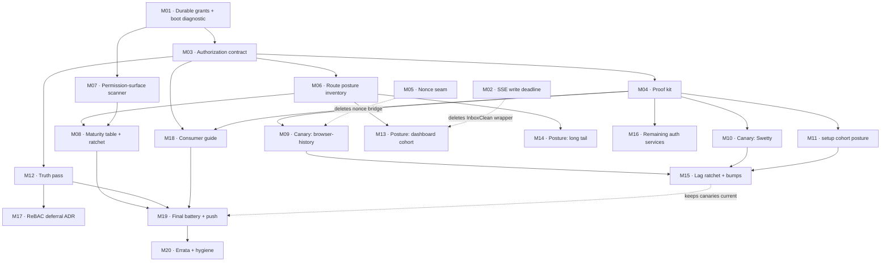

# SUPERB plan: permission-system hardcore level-up (with a system)

**Created:** 2026-11-02 10:26 CET · **Trigger:** owner instruction, verbatim class:
"ALL our services are VERY bad [at] permission handling … we need to hardcore level up
everywhere! BUT WITH A SYSTEM!" + the standing planning protocol (1 %/4 %/20 % Pareto,
ALL TODOs, 30–100 min milestones, ≤12 min micro-tasks, table views, execution graph,
`.md` with mermaid, commit + push).

**Plan of record for:** [`../status/2026-11-02_10-13_consumer-usage-audit-and-authz-model_status.md`](../status/archived/2026-11-02_10-13_consumer-usage-audit-and-authz-model_status.md)
(the 2026-11-02 consumer audit) and the authorization findings from the same session
(permission-model comparison, ReBAC design, nine split brains).

**Relationship to prior plans:** the 2026-10-31 round-45 plan keeps its still-open
milestones (docs/CI/health tails). This plan adds a **new workstream** and does not
re-transcribe or supersede that one. Where the two touch (`setup` config, `transport`,
CHANGELOG discipline, corpus/tail ratchets), this plan follows the same guardrails.

**Scope contract.** Every finding from the audit is either executed here, routed to an
owner decision, or parked with a dated verdict and a trigger. §7 is the coverage proof.
Nothing is silently dropped.

---

## 0. State at planning (verified in this session)

- Master clean at `fc1a0208` with one pre-existing working-tree deletion
  (`.go.work.check-workspace-build.sum`, not authored here; left untouched).
- `go build ./...` (root, `GOEXPERIMENT=jsonv2`) = exit 0.
- `crm` against trunk = exit 1, `go mod tidy` needed only (`go mod tidy -diff` shows a
  module-graph move, no API break).
- Docs ratchets green after this session's report: tail 4 (baseline 4), corpus 36,625
  (baseline 36,625).
- Consumer reality (17 repos): **0/12** use `Enforce`, `EnforceEx`, `EnforceAny`,
  `Service.Authorize`, root `Authorize`/`AuthorizeMiddleware`/`RequestGuard`, or write a
  `Policy{}`. Two write `GroupPolicy` imperatively; one reads roles; one uses
  `adminui.RequireAnyRole`; the rest have no role model at all.

**The four systemic defects** (this plan exists to kill them):

| # | Defect | Evidence | Killed by |
| --- | --- | --- | --- |
| D1 | No authorization contract | 4 decision shapes, 3 forbidden sentinels, 3 "is admin?" predicates, 3-arg guard vs 4-arg model | M03 |
| D2 | No durable write path | fresh enforcer per setup + event-only replay; Swetty loses its admin; browser-history reconciles; crm mounts a dead panel | M01 |
| D3 | No proof | zero consumer 401/403/200 tests; our own bridge test never calls `Enforce` | M04, M06 |
| D4 | No inventory | no service can list which routes are public / session / role | M06, M07, M08 |

---

## 1. Pareto decomposition

### 1.1 The 1 % that delivers ~51 %

**M01 + M02 · ~2½ h · the two defects a consumer feels today.**

M01 closes the durable-grant hole with the machinery that already exists
(`NewAddMemberCmd`, `NewUpdateMemberRolesCmd`, `Service.AddMember`) instead of inventing a
new event: `Service.GrantRoles` dispatches the existing commands, `AddGroupPolicy` becomes
documented-as-ephemeral (public-but-deprecated in v4, removed in v5), and a boot
diagnostic warns when an admin panel is mounted with no admin grant. That single
milestone fixes three of the four observed outcomes (lost grant, reconcile loop, dead
panel) and deletes a workaround from a consumer.

M02 clears the SSE write deadline inside `transport.ServeDomainEvents` and dashboardui.
One `ResponseController.SetWriteDeadline(time.Time{})` removes InboxClean's
`sseDeadlineFree` wrapper and the whole "live dashboard dies at 30 s" class.

Neither change touches the contract, adds a module, or breaks a consumer. They are first
because they are pure, tested, and immediately visible.

### 1.2 The 4 % that delivers ~64 %

**+M03 +M04 +M05 · ~6 h cumulative.**

M03 introduces the contract that ends D1: `Principal`, `Resource`, `Action`, `Request`,
`Decision{Allowed, Reason, Rule, Proof}`, `Authorizer.Decide`, plus
`IsForbidden`/`IsUnauthorized` helpers so cross-module sentinel comparisons stop being a
trap without creating an import inversion (root must NOT import identity-model: that would
drag Casbin into every root consumer). adminui's private forbidden sentinel dies. A
tenant-aware `AuthorizeRequest` handler option lands, with the 403-not-503 regression test.

M04 ships the proof kit (`authztest` subpackage): one `Suite` every service imports to
prove 401/403/200, tenant isolation, revoke, and durability. This is what makes "level up
everywhere" mechanical instead of aspirational.

M05 adds `setup.Config.NonceFunc` and threads it to the panels, removing the third
consumer workaround (browser-history's manual bridge, sperrmuell's disabled security
middleware).

### 1.3 The 20 % that delivers ~80 %

**+M06–M12 · ~13 h cumulative.**

The system layer and the canaries: route-posture inventory with fail-closed defaults
(M06), the `check-permission-surface` anti-pattern scanner (M07), the L0–L4 maturity
table with a regression ratchet (M08), the two heaviest auth consumers migrated as
canaries (M09 browser-history, M10 Swetty), the setup cohort's panel posture decided
(M11), and the deprecation/FEATURES/gotcha/ADR truth pass (M12).

After M12 a *new* service cannot silently ship without a declared posture, and an old one
cannot regress without a failing gate. That is the "system" the owner asked for.

### 1.4 The remaining 80 % → 100 %

**+M13–M20 · ~12 h.**

Posture-only waves for the services that need inventory but not roles (M13 dashboard
cohort, M14 long tail), the consumer-lag ratchet plus the actual version bumps (M15), the
remaining auth services (M16), the ReBAC deferral ADR with a numeric trigger (M17), the
consumer-facing guide + migration notes (M18), the final battery and push/release posture
(M19), and the errata/hygiene pass that stops us re-dispatching work already shipped
(M20).

Not skippable for "100 %": every one of them is either a service that stays un-inventoried
or a gate that stays manual.

---

## 2. Decisions taken at planning time (autonomous, flagged for override)

| ID | Decision | Rationale |
| --- | --- | --- |
| D1 | Scope = **6 auth services** to L1/L2; the 6 dashboard-only + 5 long-tail repos get **posture-only** (L1-p) | Forcing RBAC on a read-only event dashboard would be verschlimmbesserung |
| D2 | Contract lives in the **root package**, identity-model implements it structurally | No import inversion; no 30th module; root stays domain-free |
| D3 | **Reuse** `AddMember`/`UpdateMemberRoles`; no new `GrantRole` event | One write path, no event-schema growth, existing projection already handles it |
| D4 | `Authz.AddGroupPolicy` stays public but **deprecated in v4**, removed in v5 | Additive-first; consumers migrate before the cut |
| D5 | **No ReBAC implementation now**; `Resource{Type, ID}` reserves the seam | Demand is role-in-domain; trigger for ReBAC recorded in M17 |
| D6 | Sentinel unification = `IsForbidden`/`IsUnauthorized` helpers + adminui adopting `usermgmt.ErrForbidden` | Fixes the practical trap without dragging domain into root |
| D7 | Maturity gate starts **advisory**, becomes blocking after two green waves | Same precedent as the erraudit/treadmill promotions |

---

## 3. Anti-verschlimmbesserung guardrails (binding)

1. **Additive first.** No public removal before v5. Deprecate with godoc + guide + gotcha.
2. **No behavior change without a failing-then-passing test.** Every milestone lists its
   verify; a milestone without a test is not done.
3. **One write path.** Never add an event when an existing command expresses the intent.
4. **No dependency inversion.** Root must not import `identity-model`/`usermgmt`.
5. **No new module** unless two existing modules need it and cannot import each other.
6. **No gate weakened, no threshold relaxed.** Baselines move only with their cause and in
   the same commit.
7. **External repos are read/verify targets, not push targets.** Changes there are made
   with their own tests and committed in their own repos by their own sessions.
8. **Re-verify every `file:line` before editing.** Three of six prior findings were
   already fixed by intervening sessions.
9. **Kill criterion:** two attempts at a milestone, then record the blocker in §6 and stop
   the wave. A half-green milestone invalidates its dependents.
10. **The daemon is real.** Commit when gates pass; `git log --stat` before assuming
    attribution.

---

## 4. Milestones (30–100 min), sorted by importance / impact / effort / value

Impact: **C** critical · **H** high · **M** medium · **L** low.
Value: **Co** consumers · **Ag** agents · **Hu** owner · **CI** build trust.

| ID | Milestone | Impact | Effort | Value | Depends | Verify |
| --- | --- | --- | ---: | --- | --- | --- |
| M01 | **Durable grants + boot diagnostic** (`Service.GrantRoles`, deprecate `AddGroupPolicy`, warn on panel-without-admin) | C | 90 | Co, Hu | — | restart + rebuild durability tests green; Swetty-class scenario reproduced then fixed |
| M02 | **SSE write-deadline fix** (`transport.ServeDomainEvents` + dashboardui) | C | 60 | Co | — | test with `WriteTimeout=50ms` delivers a 200 ms event |
| M03 | **Authorization contract** (`Request`/`Decision`/`Authorizer`, `IsForbidden` helpers, tenant-aware HTTP option, 403-not-503) | C | 100 | Co, Ag | M01 | contract tests + arity regression green; adminui sentinel gone |
| M04 | **Proof kit** (`authztest.Suite`: 401/403/200, tenant isolation, revoke, durability) | C | 100 | Co, Ag | M03 | kit self-test green against the integration fixture |
| M05 | **Nonce seam** (`setup.Config.NonceFunc` threaded to all panels) | H | 60 | Co | — | custom-context nonce test green |
| M06 | **Route-posture inventory** (fail-closed posture manifest helper) | H | 100 | Co, Ag | M03 | fixture mux with one undeclared route fails |
| M07 | **`check-permission-surface` scanner** (direct `AddGroupPolicy`, local sentinels, 3-arg `Authorize`, unseeded panels) | H | 100 | Ag, CI | M01 | planted-violation self-test fails as expected |
| M08 | **Maturity table + ratchet** (`docs/PERMISSIONS.md`, L0–L4, regression gate, advisory first) | H | 90 | Hu, Ag | M06, M07 | level-regression fixture fails the ratchet |
| M09 | **Canary 1: browser-history** (durable grant replaces reconcile loop, suite wired, modules bumped) | H | 90 | Co | M01, M04 | their suite green; loop deleted |
| M10 | **Canary 2: SwettySwipperWeb** (durable bootstrap, no lost admin, suite wired) | H | 90 | Co | M01, M04 | restart keeps admin; suite green |
| M11 | **setup cohort posture** (crm: disable-or-seed decision; sperrmuell: documented Basic-auth posture) | H | 90 | Co | M04, M06 | both repos declare posture; no unreachable panel |
| M12 | **Truth pass** (deprecations, FEATURES reconciliation, 3 gotchas, ADR-0057, skill/README updates) | H | 90 | Ag, Hu | M03 | docs-freshness + links + corpus green |
| M13 | **Posture wave: dashboard cohort** (InboxClean, bank-sync, crush-daily, file-and-image-renamer, journal, dnsblockd) | M | 100 | Co | M06 | every route posture-declared; suite-lite green |
| M14 | **Posture wave: long tail** (quotaboard, darknet-monitor, KeyHolderAI, Code-To-CV-Agent, go-appkit) | M | 100 | Co | M06 | same |
| M15 | **Consumer-lag ratchet + bumps** (browser-history, github-local-sync, sperrmuell, Swetty; crm tidy canary) | M | 90 | Co, CI | M09–M11 | lag table green at 0 for auth modules |
| M16 | **Remaining auth services** (github-local-sync, webphone) at L1/L2 | M | 90 | Co | M04 | suites green |
| M17 | **ReBAC deferral ADR** (trigger: tenant-authored sharing or >1 graph query in a service) | M | 60 | Hu | M12 | ADR-0058 merged with numeric trigger |
| M18 | **Consumer guide + migration notes** (`docs/guides/authorization-system.md`, v4→v5 note) | M | 90 | Co, Ag | M03, M04 | guide fences compile-checked; links green |
| M19 | **Final battery + release posture** (gates, CHANGELOGs, tag plan, push) | H | 100 | CI, Hu | all | check-modules + CI-shape battery green; train strict 0 |
| M20 | **Errata + backlog hygiene** (correct stale TODO rows, harvest this plan, archive old status) | M | 60 | Ag | M12 | TODO rows corrected; tail back to 3 |

---

## 5. Micro-tasks (≤12 min each) — complete, every milestone covered

`V` = the check performed inside the micro-task.

### M01 · Durable grants (90 min)

| ID | Task | Min | V |
| --- | --- | ---: | --- |
| m01.1 | Re-verify the finding: read `usermgmt/sql_setup_shared.go:93`, `es_casbin_projection.go:65-80`, `service_membership.go:10` | 8 | notes match current code |
| m01.2 | Enumerate every `AddGroupPolicy` call site in-repo and in the 6 auth consumers | 8 | call-site list |
| m01.3 | Write the failing durability test: `AddMember(tenant "*")` + `NewService` restart keeps the role | 12 | test red first, green after |
| m01.4 | Write the complementary test: `AddGroupPolicy` does **not** survive restart (pins the contract) | 10 | test green and documented |
| m01.5 | Implement `Service.GrantRoles(ctx, actor, tenant, roles)` over `AddMember`/`UpdateMemberRoles` | 12 | dispatch path visible in test |
| m01.6 | Add boot diagnostic: panel mounted + no `admin`/`super_admin` in `"*"` → warn with the exact snippet | 12 | log assertion in a test |
| m01.7 | Deprecate `Authz.AddGroupPolicy` godoc + the two guide lines that teach it | 8 | deprecation renders in godoc |
| m01.8 | CHANGELOG receipts (usermgmt + identity-model) and module suites | 10 | tests green, receipts present |

### M02 · SSE write deadline (60 min)

| ID | Task | Min | V |
| --- | --- | ---: | --- |
| m02.1 | Re-verify: no `SetWriteDeadline` in `transport/`, `dashboardui/`, `setup/` handlers | 5 | grep zero |
| m02.2 | Add `SetWriteDeadline(time.Time{})` at `ServeDomainEvents` entry (error ignored) | 8 | compiles |
| m02.3 | Same in dashboardui's own SSE handler | 8 | compiles |
| m02.4 | Test: `WriteTimeout=50ms`, event at 200 ms is delivered | 12 | test fails without the fix |
| m02.5 | Test: a non-SSE route keeps its deadline (no global relaxation) | 8 | test green |
| m02.6 | README/guide line: the library clears the deadline; do not rely on a route-wide one | 7 | docs updated |
| m02.7 | CHANGELOG (root + dashboardui) + touched suites | 12 | green |

### M03 · Contract (100 min)

| ID | Task | Min | V |
| --- | --- | ---: | --- |
| m03.1 | Draft ADR-0057 skeleton (problem, decision, rejected options, migration) | 12 | file exists |
| m03.2 | Add `Principal`, `Resource`, `Action`, `Request`, `Decision`, `Reason`, `Authorizer` to root | 12 | `go build` |
| m03.3 | Implement `identitymodel.Authz.Decide` over `EnforceEx` (proof from matched rules) | 12 | unit test |
| m03.4 | Re-verify the sentinel landscape (root, identity-model, usermgmt alias, adminui) | 6 | inventory table |
| m03.5 | Add `cqrshtmx.IsForbidden`/`IsUnauthorized` (family/code based) + cross-seam tests | 12 | test covers all three sentinels |
| m03.6 | Replace `adminui.errForbidden` with `usermgmt.ErrForbidden` | 8 | adminui tests green |
| m03.7 | Add `AuthorizeRequest(resolver)` HandlerOption over `Authorizer.Decide` | 12 | handler test |
| m03.8 | Regression test: default 4-arg model + root option → 403 (never 503) | 12 | test green |
| m03.9 | Document the deprecation of `Enforce`/`Authorize`/`EnforceEx`/`EnforceAny` as the decision surface | 8 | godoc deprecations |
| m03.10 | Finalize ADR-0057 with the delivery slices | 6 | ADR merged |

### M04 · Proof kit (100 min)

| ID | Task | Min | V |
| --- | --- | ---: | --- |
| m04.1 | Decide placement (root `authztest` subpackage; testing + net/http only) | 5 | decision line |
| m04.2 | Define `Harness` (BuildServer, SeedUser, SeedRole, Login, Do) | 12 | interface compiles |
| m04.3 | Implement the 401/403/200 matrix runner | 12 | fixture passes |
| m04.4 | Add the tenant-isolation case (role in A denies in B) | 12 | fixture passes |
| m04.5 | Add the revoke case | 8 | fixture passes |
| m04.6 | Add the durability case (restart + `RebuildProjection`) | 12 | fixture passes |
| m04.7 | Run the kit against cqrs-htmx's own integration fixture | 12 | self-test green |
| m04.8 | Publish usage README + CHANGELOG | 12 | docs present |
| m04.9 | Wire the kit into `integration_test` as a repo self-test | 10 | check-modules leg green |

### M05 · Nonce seam (60 min)

| ID | Task | Min | V |
| --- | --- | ---: | --- |
| m05.1 | Verify the panel wiring line (`setup/setup.go:342`) and every panel's nonce source | 6 | notes |
| m05.2 | Add `setup.Config.NonceFunc` (+ validation when nil) | 10 | compiles |
| m05.3 | Thread it into adminui, loginpage, dashboardui configs | 12 | wiring test |
| m05.4 | Test: a nonce from a custom context key reaches the rendered page | 12 | test green |
| m05.5 | Document the seam in setup README | 8 | docs updated |
| m05.6 | CHANGELOG + suites | 12 | green |

### M06 · Route posture inventory (100 min)

| ID | Task | Min | V |
| --- | --- | ---: | --- |
| m06.1 | Design `Posture` (Public / Authenticated / Role) + `RequirePostures` semantics | 12 | decision line |
| m06.2 | Implement the table + anonymous-request assertion | 12 | fixture passes |
| m06.3 | Make it fail-closed: a registered route without a posture fails | 12 | fixture fails as expected |
| m06.4 | Add the per-role probe (seeded user with/without role) | 12 | fixture passes |
| m06.5 | Write `docs/guides/route-posture.md` with a copy-paste template | 12 | links/fences green |
| m06.6 | Wire the helper into the `authztest` kit | 12 | kit self-test green |
| m06.7 | CHANGELOG + check-modules leg | 12 | green |

### M07 · Scanner gate (100 min)

| ID | Task | Min | V |
| --- | --- | ---: | --- |
| m07.1 | Enumerate the anti-patterns and their regexes (4 classes) | 12 | list reviewed |
| m07.2 | Write `scripts/checks/check-permission-surface.sh` (repo + multi-repo mode) | 12 | runs clean on trunk |
| m07.3 | Plant one violation per class in fixtures | 12 | self-test fails 4/4 |
| m07.4 | Wire into `check-modules` + CI `checks` job | 12 | stage appears |
| m07.5 | Add gotcha entry + document the exemptions file | 12 | docs green |

### M08 · Maturity table + ratchet (90 min)

| ID | Task | Min | V |
| --- | --- | ---: | --- |
| m08.1 | Write the L0–L4 definitions and exit criteria | 12 | table reviewed |
| m08.2 | Inventory 17 services from the audit into the table | 12 | rows complete |
| m08.3 | Commit `docs/PERMISSIONS.md` (owner, level, posture, suite link) | 12 | links green |
| m08.4 | Write the ratchet script (level may not drop; advisory first) | 12 | runs clean |
| m08.5 | Fixture: a dropped level fails the ratchet | 12 | self-test green |
| m08.6 | Wire advisory into check-modules + CI | 12 | stage appears |

### M09 · Canary: browser-history (90 min)

| ID | Task | Min | V |
| --- | --- | ---: | --- |
| m09.1 | Re-read the reconcile loop and confirm the pinned module versions | 10 | notes |
| m09.2 | Switch the bootstrap to the durable grant path | 12 | their test |
| m09.3 | Delete `reconcileSuperAdmins` and its call sites | 12 | grep zero |
| m09.4 | Add the `authztest` suite (401/403/200 + isolation) | 12 | suite green |
| m09.5 | Run their full suite (no goldens touched) | 12 | green |
| m09.6 | Bump their cqrs-htmx pins (usermgmt, webauthn, identity-model) | 12 | build green |
| m09.7 | Their CHANGELOG receipt | 12 | receipt present |

### M10 · Canary: SwettySwipperWeb (90 min)

| ID | Task | Min | V |
| --- | --- | ---: | --- |
| m10.1 | Re-read `bootstrapAdmin` + the `Count() > 0` guard | 8 | notes |
| m10.2 | Replace the one-shot `AddGroupPolicy` with the durable grant | 12 | their test |
| m10.3 | Make the bootstrap idempotent (grant even when users exist) | 12 | restart test |
| m10.4 | Add the `authztest` suite | 12 | green |
| m10.5 | Re-run their admin/handler tests (authz-touching) | 12 | green |
| m10.6 | Bump adminui/loginpage pins | 12 | build green |
| m10.7 | Their CHANGELOG receipt | 12 | present |

### M11 · setup cohort posture (90 min)

| ID | Task | Min | V |
| --- | --- | ---: | --- |
| m11.1 | Decide crm's admin panel: `DisableAdmin` vs seeded admin (record rationale) | 10 | decision line |
| m11.2 | Apply the crm choice + `go mod tidy` + build | 12 | build green |
| m11.3 | Add crm posture manifest (routes + panel) | 12 | test green |
| m11.4 | Document sperrmuell's Basic-auth posture in their identity README | 12 | doc present |
| m11.5 | Add sperrmuell posture manifest (auth routes + disabled panels) | 12 | test green |
| m11.6 | Verify no other setup consumer mounts an unreachable panel | 12 | grep/notes |
| m11.7 | Their CHANGELOG receipts | 10 | present |

### M12 · Truth pass (90 min)

| ID | Task | Min | V |
| --- | --- | ---: | --- |
| m12.1 | Reconcile `FEATURES.md` rows for the 7 zero-adopter features | 12 | every row has evidence |
| m12.2 | Add gotcha: non-durable grants (with the 3 consumer outcomes) | 12 | anchor + index row |
| m12.3 | Add gotcha: SSE `WriteTimeout` | 10 | anchor + index row |
| m12.4 | Add gotcha: CSP nonce bridge | 10 | anchor + index row |
| m12.5 | Update AGENTS.md authz bullet with the contract + durability rule | 12 | bullet matches code |
| m12.6 | Update the cqrs-htmx skill's authz section (contract, durable grant, kit) | 12 | skill gate green |
| m12.7 | Re-run freshness/links/corpus gates | 10 | green |

### M13 · Posture wave: dashboard cohort (100 min)

| ID | Task | Min | V |
| --- | --- | ---: | --- |
| m13.1 | InboxClean: posture manifest + suite-lite; delete `sseDeadlineFree` if M02 landed | 12 | their test green |
| m13.2 | bank-sync: posture manifest (dashboard routes) | 10 | green |
| m13.3 | crush-daily: posture manifest (dashboard + SSE) | 10 | green |
| m13.4 | file-and-image-renamer: posture manifest (readonly dashboard + custom authorizer) | 10 | green |
| m13.5 | journal: posture manifest (loopback-only store panel) | 10 | green |
| m13.6 | dnsblockd: posture manifest (adapter-only) | 10 | green |
| m13.7 | Update `docs/PERMISSIONS.md` rows for all six | 10 | table complete |

### M14 · Posture wave: long tail (100 min)

| ID | Task | Min | V |
| --- | --- | ---: | --- |
| m14.1 | quotaboard posture manifest | 12 | green |
| m14.2 | darknet-monitor posture manifest | 12 | green |
| m14.3 | KeyHolderAI posture manifest | 12 | green |
| m14.4 | Code-To-CV-Agent posture manifest | 12 | green |
| m14.5 | go-appkit/integration posture manifest (root + transport) | 12 | green |
| m14.6 | Update `docs/PERMISSIONS.md` rows | 12 | table complete |

### M15 · Consumer-lag ratchet + bumps (90 min)

| ID | Task | Min | V |
| --- | --- | ---: | --- |
| m15.1 | Design the downstream lag check (read each repo's `go.mod`, compare to published tags) | 12 | script sketch |
| m15.2 | Implement with the release-train cache (offline exit 4, advisory by default) | 12 | runs clean |
| m15.3 | Fixture: a stale pin is reported (and blocked in `--strict`) | 12 | self-test green |
| m15.4 | Bump browser-history, github-local-sync, sperrmuell, Swetty auth modules | 12 | each builds |
| m15.5 | crm: `go mod tidy` + build canary | 10 | build green |
| m15.6 | Wire advisory into check-modules + CI; record the lag table | 12 | stage appears |

### M16 · Remaining auth services (90 min)

| ID | Task | Min | V |
| --- | --- | ---: | --- |
| m16.1 | github-local-sync: declare postures (admin panel + auth routes) | 12 | test green |
| m16.2 | github-local-sync: add suite (401/403/200 on the panel) | 12 | green |
| m16.3 | webphone: decide role model (session-only vs roles) and record it | 12 | decision line |
| m16.4 | webphone: posture manifest for its 44 session-gated routes | 12 | test green |
| m16.5 | Both: update `docs/PERMISSIONS.md` | 10 | table complete |
| m16.6 | Both: CHANGELOG receipts | 10 | present |

### M17 · ReBAC deferral ADR (60 min)

| ID | Task | Min | V |
| --- | --- | ---: | --- |
| m17.1 | Write ADR-0058: defer ReBAC, reserve `Resource{Type,ID}` | 12 | ADR merged |
| m17.2 | Record the numeric trigger (tenant-authored sharing, or a service needing reverse queries) | 10 | trigger line |
| m17.3 | Record the in-process constraint (no network PDP) as a decision, not an accident | 10 | ADR section |
| m17.4 | Link the ADR from the contract ADR + guide | 8 | links green |

### M18 · Consumer guide + migration (90 min)

| ID | Task | Min | V |
| --- | --- | ---: | --- |
| m18.1 | Write `docs/guides/authorization-system.md` (contract → grant → prove → posture) | 12 | fences tagged |
| m18.2 | Add the durable-vs-ephemeral table with the three consumer outcomes | 12 | doc accurate |
| m18.3 | Add the service onboarding checklist (5 steps) | 10 | checklist present |
| m18.4 | Write the v4→v5 migration note (AddGroupPolicy removal, Authorize deprecation) | 12 | doc present |
| m18.5 | Add the guide to README/skill indexes | 8 | links green |
| m18.6 | Run snippet/claims gates | 12 | green |

### M19 · Final battery + release posture (100 min)

| ID | Task | Min | V |
| --- | --- | ---: | --- |
| m19.1 | Run `check-modules` (full) | 12 | rc 0 |
| m19.2 | Run `.#test` for the touched modules + `-race` | 12 | rc 0 |
| m19.3 | Run `.#lint` (root, identity-model, usermgmt, adminui, setup, transport) | 12 | rc 0 |
| m19.4 | Run the docs gates (corpus, tail, links, freshness) | 10 | green |
| m19.5 | Decide tag/version posture (v4.18 additive vs v5 removals) and write the release note draft | 12 | draft present |
| m19.6 | Push; if the pre-push train gate blocks, record the exact lag table and do NOT bypass | 12 | push verdict |

### M20 · Errata + backlog hygiene (60 min)

| ID | Task | Min | V |
| --- | --- | ---: | --- |
| m20.1 | Correct stale TODO rows verified in this session (S42 ladder, TenantDeleted cascade, g2 seeding) | 12 | rows match code |
| m20.2 | Harvest this plan's milestones into `TODO_LIST.md`/`ROADMAP.md` (docs-health HARVEST) | 12 | rows present |
| m20.3 | Archive the 2026-10-28 status report and lower the tail baseline to 3 | 12 | ratchet green |
| m20.4 | Add the plan to the planning index/README if one exists | 8 | link green |
| m20.5 | Final `git status` + attribution check against the daemon | 8 | clean except intended |

---

## 6. Execution graph

---

## 7. Coverage proof — every audit finding is routed

| Source finding | Routed to |
| --- | --- |
| Defect D1 no contract (4 shapes, 3 sentinels, 3 admin predicates) | M03, M12 |
| Defect D2 no durable write path (lost grant, reconcile loop, dead panel) | M01, M09, M10, M11 |
| Defect D3 no proof (zero consumer authz tests; bridge test never enforces) | M03 (m03.8), M04 |
| Defect D4 no inventory | M06, M07, M08 |
| SSE `WriteTimeout` gap (InboxClean wrapper) | M02, M13 |
| CSP nonce bridge (browser-history); security middleware disabled (sperrmuell) | M05, M09, M11 |
| Declarative engine ignores object/action; parity only on seed | M12 (documented subset), ADR in M03 |
| Two role namespaces (user-domain vs tenant-domain) | M01, M03, M18 |
| `g2` declared but inert | M12 (document) |
| Unvalidated `Role`/`Action` (`Valid()` never called on writes) | M03 (contract) + M12 |
| 7 zero-adopter features | M12 (FEATURES truth), M17 (ReBAC deferral) |
| Version lag on auth modules | M15 |
| Deprecated aliases nearly gone (2 usages) | M15 |
| Datastar adapter + upstream dual import | M12 (documented boundary) |
| `crm` go.mod drift | M11, M15 |
| Stale TODO rows (S42 ladder, TenantDeleted cascade, g2 seeding) | M20 |
| Tail at 4 / corpus growth | M20, M12 |
| ReBAC/PBAC/ABAC/OrBAC/BLP analysis | M17 (deferral with triggers) |
| Consumption audit itself | This plan + M20 harvest |

---

## 8. Errata — stale claims corrected at planning time (verified against source 2026-11-02)

1. `TODO_LIST.md` row "systemadapter: declarative path grants viewer→read / user→write /
   owner≡admin" is **stale**: `systemadapter/queries.go:171-198` grants only
   `admin`/`super_admin` (`roleHoldsDefaultAllow`), matching the S42 fix. Only the audit
   vocabulary halves (b)/(c) remain open.
2. `TODO_LIST.md` row "`es_casbin_projection.go:111` TenantDeleted removes nothing" is
   **stale**: the handler now calls `p.removeAllRolesForDomain(subject)`
   (`es_casbin_projection.go:112-118`), which removes every `g` row in the deleted tenant
   domain.
3. `TODO_LIST.md` row "`NewAuthz` seeds the g2 hierarchy even under a custom
   `EnforcerConfig`" is **stale**: `seedDefaultRoleHierarchy` skips models without a `g2`
   section (`identity-model/authz.go:66-87`).
4. The audit's "0/12 consumers use `Enforce`" claim is scoped to local repos; public
   consumers are unknown (see open question 1).

---

## 9. Open owner decisions (blocking only where noted)

1. **Is the consumer set closed?** Determines whether "unused" means "safe to deprecate"
   (blocks M03's deprecation wording and M12's removals).
2. **`AddGroupPolicy` breaking posture:** public-but-deprecated in v4 + removed in v5
   (recommended), or keep forever (blocks M01's godoc/deprecation, not the implementation).
3. **Maturity gate timing:** advisory for two waves then blocking (recommended), or
   blocking immediately (blocks M08's wiring).

---

## 10. Execution receipt (2026-11-02, same session)

Landed in this repository (commit `a1eb37b2` plus the docs commit that follows):

| Milestone | State | Landed as |
| --- | --- | --- |
| M01 durable grants + boot diagnostic | **done** | `usermgmt/service_grants.go` (`GrantRoles`/`RevokeRoles`/`HasAdminGrant`), `identity-model.Authz.ApplyGroupPolicy` projection seam, `AddGroupPolicy` deprecated, `setup/diagnostics.go` boot warning; durability proven by two SQLite restart tests |
| M02 SSE write deadline | **done** | `transport.ClearWriteDeadline` called by `ServeDomainEvents` + `Broadcaster.ServeSSE`; `TestSSESurvivesServerWriteTimeout` proves the stream survives and a non-SSE route keeps its deadline |
| M03 authorization contract | **done** | `authz_contract.go` (`Request`/`Decision`/`Reason`/`PermissionChecker`/`Decide`/`IsForbidden`/`IsUnauthorized`), `EnforceIn` + 4-arg fix, `AuthorizeIn`/`AuthorizeRequest`, adminui sentinel unified, end-to-end 403-not-503 regression; ADR-0057 |
| M04 proof kit | **partial** | `authztest` package: public/authenticated/role matrix, fail-closed `Verify`, `Undeclared` coverage check, 13 self-tests. Tenant-isolation/revoke/durability cases beyond the posture matrix remain |
| M05 nonce seam | **done** | `setup.Config.NonceFunc` threaded to adminui, loginpage and dashboardui (new `dashboardui.Config.NonceFunc`); three precedence tests |
| M06 route-posture inventory | **partial** | the declaration + matrix half is `authztest`; the fail-closed "registered but undeclared" half needs each consumer's route table (`authztest.Undeclared` is ready for it) |
| M07 permission-surface scanner | **done** | `scripts/checks/check-permission-surface.sh` (4 rules, inline suppressions counted) + 5-case fixture self-test; wired into `check-modules`, CI, and a flake app |
| M08 maturity table + ratchet | **done** | `docs/PERMISSIONS.md` (L0–L4, 18-row inventory, onboarding checklist) + `docs/PERMISSIONS_BASELINE` + `check-permission-maturity.sh` (8-case self-test), blocking `--ratchet` in `check-modules` + CI |
| M12 truth pass | **done** | gotchas 45 + 46, AGENTS authz bullet + index rows, FEATURES rows 72/209/226/289/312 reconciled, skill authz section + guide entries |
| M17 ReBAC deferral | **done** | ADR-0058 with the numeric reopen trigger |
| M18 consumer guide | **done** | `docs/guides/authorization-system.md` |
| M20 errata + hygiene | **done** | three stale TODO claims corrected at source; remaining workstream harvested into `TODO_LIST.md` P1 |
| M09–M11, M13–M16 | **deferred by scope** | consumer-repo changes: guardrail 7 makes them read/verify targets for THEIR sessions. Each is now a bounded, documented step in `docs/PERMISSIONS.md` ("Next step" column) instead of a discovery task |
| M19 final battery | **done** | module batteries green (root, usermgmt, setup, adminui, dashboardui, identity-model); docs gates green (corpus ratchet, tail, 950 links, freshness); scanner + maturity self-tests green |

Net effect: the two defects a consumer could feel are gone (grants no longer
evaporate; a denial is 403, not 503), the workarounds two consumers shipped are
deletable, and the anti-patterns that made the audit expensive now fail a gate.
