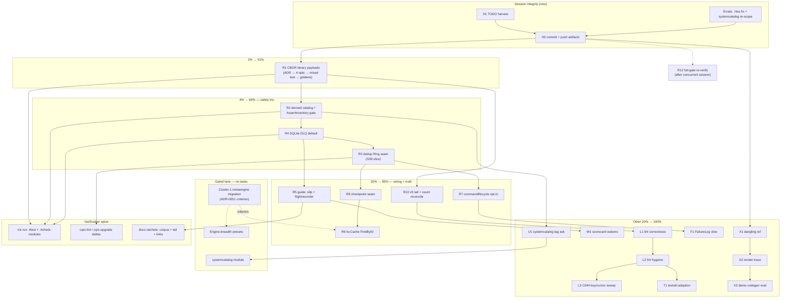

# SUPERB — go-cqrs-lite Leverage Maximization (Pareto Plan)

**Date:** 2026-11-03 20:02 · **Source:** the third go-cqrs-lite utilization audit
(`docs/research/2026-11-03_go-cqrs-lite-deep-dive.html` — adoption **73/100, high**;
47 capabilities, 22/37 fully leveraged, 0 anti-patterns, 15/15 trains at latest tags)
and its session status (`docs/status/2026-11-03_19-39_go-cqrs-lite-deep-dive-session_status.md`).

**Goal:** raise real go-cqrs-lite leverage (not the score — the substance: consumer-visible
durability, storage cost, drift safety, observability) while keeping every gate green.
**Guardrail (verschlimmbessern ban):** every planned API was verified at its PINNED tag
before planning — two audit claims failed that check and are corrected in §Errata.
Nothing here rewrites working code for taste; each task names its verification command.

---

## Errata — corrections discovered during planning (pin-level API verification)

1. **`systemcatalog` has NO published v4 tag** (unpublished module). The audit's #1
   opportunity is therefore re-scoped: the drift-gate half is buildable TODAY on pinned
   `catalog/v4 v4.11.0` (`SchemaFromType[T]()`, `NewRegistry`, `AssertInventory` — all
   verified present at the tag). The `systemcatalog.FromDomainConfig` convenience rides
   an upstream tag ask instead (task U1).
2. **`dedup.Ring` API is `Has`/`Add`**, not `Seen` — the audit report's finding-5 snippet
   was corrected in place with an errata note (verified at `dedup/v4.3.0`).
3. Confirmed available at pins: `commandlifecycle/v4.3.1` (`AttemptMiddleware` + 6 lifecycle
   types), `projectionhost/v4.7.1` (`SQLiteDeadLetterStore`, `WithCheckpointEvery`),
   `decider/v4.8.0` (`WithSnapshotStateVersion`), `middleware/v4.7.2`
   (`CommandFlightRecorder`/`EventFlightRecorder`, `CommandIdempotency`), `otel/otlp/v4.0.2`.
4. **R1 executed as FIVE payloads, not four** (2026-11-03, execution-time correction): the
   audit's line-scan of `identity-model/events.go` missed `CredentialAddedPayload`, whose
   `[]byte` fields (ID, PublicKey, AAGUID) arrive via the embedded `CredentialCore` from
   `credential.go` — the heaviest binary payload in the domain. Shipped as
   [ADR 0059](../adr/0059-cbor-binary-event-payloads.md) with the same per-event shape;
   the audit report carries the matching adoption note.
4. **R1 scope corrected at execution time (2026-11-03): five payloads, not four.** The
   audit's "four []byte payloads" was a line-scan of `identity-model/events.go` —
   `CredentialAdded`'s `[]byte` fields (ID, PublicKey, AAGUID — the heaviest binary
   payload in the domain) arrive via the embedded `CredentialCore` from `credential.go`
   and were missed. ADR 0059 covers all five. (Execution-time research also confirmed:
   the upstream SQL event store already persists `payload_encoding`; the sync pull wire,
   OpenAPI description, and frontend-sync guide already document codec-name stamps; the
   SSE envelope is metadata-only — the flip touched exactly the five emission sites.)

## Backlog overlap check (skill Step 0)

- `TODO_LIST.md` P1 D-milestone **S39** already owns "transport replay/live dedup +
  unknown-cursor semantics" — task **R3 below is the S39 dedup slice**, linked not duplicated.
- No other TODO_LIST row covers the audit's opportunities (verified by survey 2026-11-03);
  one consolidated P1 pointer row is added by this session (task H1 — done in-session).
- ROADMAP "Not Planned" already adjudicates scheduling timers, deriver, CatchUpSubscriber,
  transport/http broker — deliberately ABSENT from this plan (re-eval triggers live there).

---

## Pareto breakdown

**The result being maximized:** consumer-visible leverage of go-cqrs-lite across every
cqrs-htmx deployment (durability, bytes on disk/wire, drift safety, observability),
plus risk retirement ahead of the upstream v5 cut.

### The 1% that delivers 51% — **CBOR for binary payloads** (task R1)

One decision (ADR paragraph) + four payload options. Every consumer deployment stops
base64-inflating WebAuthn credentials, TOTP secrets, and bot-token hashes by ~33%
(events are self-describing; mixed JSON+CBOR journals decode correctly; the change is
per-event, not a migration). Biggest measurable consumer win available at pinned versions.
Nothing else on the list touches every deployment's storage.

### The 4% that deliver 64% — add the **safety trio** (R2, R3, R4)

1. **R2 Derived event catalog + `AssertInventory` drift gate** — the hand-maintained
   `DefaultEventCatalog` ("field lists are illustrative") becomes reflection-derived and
   gate-pinned; undocumented event/field drift becomes a test failure.
2. **R3 `dedup.Ring` at the SSE replay seam** (S39 slice) — deletes hand-rolled unbounded
   map dedup + retires 2 C035 race warnings.
3. **R4 SQLite DLQ default for SQL setups** — poison events stop evaporating on restart.

### The 20% that deliver 80% — add the **wiring + truth layer**

R5 guide sections (otlp, flightrecorder) · R6 TODO harvest (done in-session) ·
R7 commandlifecycle opt-in · R8 checkpoint-batching seam · R9 kv.Cache FindByID ·
R10 v5 hygiene tail + count reconciliation · R12 full-gate re-verify once the concurrent
route-posture session lands · H1/H2/H3 session-integrity items (errata, budgets, commit).

### The other 20% (to 100%) — hygiene, adjudication, upstream asks

L1 lint correctness batch (C021, C042, A013×2) · L2 lint hygiene batch (S001, A027, P008,
F005) · L3 C044 branded-ID key/cursor sweep (adjudicated, display uses stay) ·
T1 testutil/idtest adoption · W1 cqrs-lint missing-module waivers + triggers ·
U1 systemcatalog tag ask (verify-before-filing) · X1 dangling 09-17 reference ·
X2 screenshot-trace durability note · X3 B004 demo codegen evaluation ·
F1 dashboardui FailureLog view (after R7).

### Gated lane — explicitly NOT tasks (decided, criterion-recorded)

- Cluster-1 metaengine migration of the SQL read models — gated by ADR-0051's criterion
  (secondary-index semantics + declarative hydration in metaengine).
- Engine-breadth presets (pebble/postgres/turso/…) — meaningful only after cluster-1.
- `systemcatalog` module adoption — gated on U1's tag.
- Library-preset V007 silence — by upstream preset design; the scorecard count (41) is
  tracked by R10's reconciliation instead.

---

## Table A — comprehensive plan (tasks 30–100 min; sorted by importance → impact → effort → customer-value)

| # | Task | Tier | Est | Impact | Effort | Customer value | Depends | Verify |
|---|------|------|-----|--------|--------|----------------|---------|--------|
| R1 | CBOR for 4 binary payloads: ADR paragraph → `event.WithCodec(codec.CBORCodec{})` on CredentialRemoved/CredentialUsed/TOTPEnabled/BotRegistered → mixed-journal decode test → golden diff (line-by-line, templ-family lesson) | 1% | 90 | 5 | 3 | 5 (storage −33% on heaviest payloads, every deployment) | — | `nix run .#test`; mixed-journal test; golden diff reviewed |
| R2 | Derived event catalog: `catalog.SchemaFromType[T]` over the 25 payloads → registry → `AssertInventory` gate test in usermgmt suite; keep curated titles as overrides; retire `nolint:exhaustruct` admission | 4% | 90 | 4 | 3 | 4 (drift becomes compile/test-time for API consumers) | — | new test green; `check-modules` |
| R4 | SQLite DLQ default in the three SQL setups (memory stays for in-memory deploy); docs note in declarative-projections guide | 4% | 30 | 4 | 1 | 4 (poison events survive restart) | — | `nix run .#test-usermgmt`-class + guide docs-links |
| R3 | `dedup.Ring` at SSE replay seam (S39 slice): replace `replayed map[string]struct{}` in `replayAdjustedStore`/`filteredReplayStore`; per-connection ring; retire both C035 suppressions/warnings | 4% | 45 | 3 | 2 | 3 (correctness + bounded memory on long-lived SSE) | — | `nix run .#test`; C035 gone in cqrs-lint run |
| R7 | commandlifecycle opt-in: `ServiceConfig`/`CommandMiddleware` wiring of outer+`AttemptMiddleware` pair (commandlifecycle/v4.3.1), recorder store seam, docs | 20% | 90 | 3 | 4 | 3 (retry/dead-letter observability for consumers) | — | new wiring test; `check-modules` |
| R10 | v5 hygiene tail: dashboardui `meta.CausationID`→`record.Cause` (3 sites) + `WithSnapshotStateVersion` in 4 repositories + re-run `cqrs-upgrade -dry-run --workspace`, reconcile 41-vs-78 count drift vs ADR-0051 | 20% | 60 | 3 | 2 | 2 (v5 migration shrinks; no surprises at the cut) | — | build + vet all; cqrs-upgrade output recorded |
| R5 | Guide §2/§6 additions: `otel/otlp.SetupOTLP` subsection + flightrecorder subsection (`middleware.CommandFlightRecorder`, zero-dep capture); both snippets must pass the skill-snippets parse gate | 20% | 45 | 2 | 1 | 4 (docs are the library's consumer surface) | — | `nix run .#check-skill-snippets` + `.#check-docs-links` |
| R8 | Checkpoint-batching seam: expose `ProjectionHostOptions` on usermgmt/setup (systemadapter `WithHostOptions` already exists), document the durability tradeoff | 20% | 45 | 2 | 2 | 2 (throughput knob for replay-heavy consumers) | — | config test; guide docs-links |
| R9 | `kv.Cache` write-through for FindByID paths (User/Tenant/Bot); NEVER FindByEmail (dual-key invalidation trap); invalidation tests | 20% | 60 | 2 | 3 | 2 (read latency on hot paths) | — | new cache tests; `.#test` |
| L1 | Lint correctness batch: C021 decode-outside-mutex (usermgmt/audit_log.go:131), C042 OCC expectedVersion=0 (auth_audit.go:70 — verify new-stream-only claim first), A013 value-embedded BasicCommand ×2 (e2e/server/sync_types.go:19, examples/sync-demo/main.go:44) | rest | 90 | 3 | 3 | 2 | — | module tests + lint clean on those rules |
| R12 | Full-gate re-verify once the concurrent route-posture session lands: `check-modules` + branching-flow vs re-pinned baseline | 20% | 30 | 2 | 1 | 2 (green HEAD the audit can cite) | concurrent lands | `nix run .#check-modules` |
| H1 | TODO_LIST harvest: one consolidated P1 pointer row to this plan (+ P2 lint row) — **done in this session** | 20% | 30 | 3 | 1 | 1 | — | `nix run .#check-todo-hygiene` |
| U1 | systemcatalog tag ask upstream (verify-before-filing skill: confirm no tag, check existing issues, file with evidence; then the R2 path can migrate to it on the next train) | rest | 30 | 2 | 2 | 1 | R2 shipped | issue link recorded here |
| L2 | Lint hygiene batch: remove stale S001 suppression (events.go:171), A027 codec-once via repository option (es_decide_credentials.go:44 ×3), P008 e2e projectionhost batch size, F005 dashboardui upcaster adjudication note | rest | 45 | 2 | 2 | 1 | — | cqrs-lint run delta; docs note |
| L3 | C044 branded-ID sweep (dashboardui): fix KEY/CURSOR uses of `.String()` (events.go:449-516, handlers_*.go cursors); adjudicate display uses (legit, prefixed form is the feature there) — document the split | rest | 90 | 2 | 3 | 1 | — | cursor tests; adjudication note in PR/commit |
| T1 | Adopt `testutil.MustNewCmd`/`idtest`/`querytest` in new tests + trivial swaps where they touch existing test files | rest | 30 | 1 | 2 | 1 | — | build + tests |
| W1 | Record cqrs-lint missing-module waivers with triggers (`.cqrs-lint.json` scorecard.waivers): queue, scheduling-family, flightrecorder-until-R5 — reasons + revisit conditions | rest | 30 | 1 | 1 | 1 | R5 (for the flightrecorder row) | `cqrs-lint scorecard` WAIVED section |
| F1 | dashboardui FailureLog/RetryCount views over commandlifecycle projections (tab beside command-store views) | rest | 60 | 2 | 3 | 3 | R7 | dashboardui tests + goldens |
| X1 | Dangling reference: `2026-09-17_go-cqrs-lite-command-deep-dive.html` cited by the feature-audit notice is evicted — add the ARCHIVE_EVICTED row (or note) so the link has a resolution story | rest | 15 | 1 | 1 | 0 | — | docs-links green |
| X2 | Screenshot-trace durability: regenerate the headless render trace of the audit report and commit it beside the report (or record its absence policy in the report footer) | rest | 15 | 1 | 1 | 0 | — | file exists next to report |
| X3 | B004/cqrs-gen evaluation for examples only (library command types stay hand-authored — public API + bijection gate) | rest | 30 | 1 | 2 | 0 | — | example builds |
| H2 | Session-integrity commit: this plan + audit artifacts + archive pass + baselines (AGENTS.md rides the concurrent wave — mixed hunks) — **done at end of this session** | 20% | 15 | 2 | 1 | 1 | A-table above written | git log shows clean scoped commit |
| H3 | Post-commit budget check: corpus/tail baselines reconcile after all doc edits — **folded into H2** | 20% | 12 | 1 | 1 | 0 | H2 | both ratchets green |

*24 tasks. Tier legend: 1% → 4% → 20% → rest. Gated lane (cluster-1, engine presets,
systemcatalog module) deliberately has no task rows.*

---

## Table B — micro-breakdown (every task ≤ 12 min; sorted by importance → impact → effort; IDs map to Table A)

| ID | Micro-task (≤12 min) | Parent |
|----|----------------------|--------|
| B01 | Write the CBOR ADR paragraph (decision, scope: 4 payloads, time.Time caveat, debuggability tradeoff) in `docs/adr/` draft | R1 |
| B02 | Add `event.WithCodec(codec.CBORCodec{})` to CredentialRemovedPayload emission sites | R1 |
| B03 | Same for CredentialUsedPayload | R1 |
| B04 | Same for TOTPEnabledPayload | R1 |
| B05 | Same for BotRegisteredPayload | R1 |
| B06 | Mixed-journal decode test: JSON stream + one CBOR event of each new type → folds/projections decode | R1 |
| B07 | Run transport/sync golden tests; diff old-vs-new line-by-line; document drift = encoding stamp only | R1 |
| B08 | Re-pin affected goldens in the same change (if B07 shows stamp-only drift) | R1 |
| B09 | `nix run .#test` + `.#coverage-gate` after R1; record byte-size delta (before/after journal size in a bench note) | R1 |
| B10 | Spike 10 min: `catalog.SchemaFromType[identitymodel.UserRegisteredPayload]()` output shape (one payload, print) | R2 |
| B11 | Build the derived registry loop over the 25 payloads (map event-type → schema) | R2 |
| B12 | Wire `catalog.AssertInventory` gate test asserting the 25-event inventory (fails on added/removed event) | R2 |
| B13 | Extend the gate to field-level drift on 2 pilot payloads (schema version + field names) | R2 |
| B14 | Port curated titles/descriptions as an override map; switch `DefaultEventCatalog` onto derived schemas | R2 |
| B15 | Remove the `//nolint:exhaustruct` admission; run usermgmt suite + `.#check-modules` | R2 |
| B16 | Swap `NewMemoryDeadLetterStore()` → `SQLiteDeadLetterStore` in sqlite setup path + constructor test | R4 |
| B17 | Same in postgres setup path | R4 |
| B18 | Same in mysql setup path | R4 |
| B19 | Keep memory DLQ for the in-memory deployment; add the declarative-guide doc note; docs-links gate | R4 |
| B20 | Replace `replayed map[string]struct{}` with a `dedup.NewRing` sized `dedup.DefaultCapacity` in `replayAdjustedStore` | R3 |
| B21 | Same in `filteredReplayStore` | R3 |
| B22 | Update seam comments (281/543 line area); per-connection lifetime note | R3 |
| B23 | Remove retired C035 suppressions/warnings; run cqrs-lint on root/transport | R3 |
| B24 | SSE replay/live boundary test with >capacity events (oldest dropped, no dup at seam) | R3 |
| B25 | Cross-link S39 in the commit message + TODO_LIST row (slice-of-S39 note) | R3 |
| B26 | Spike 10 min: `commandlifecycle.New(recorder)` pair wiring in a scratch usermgmt test | R7 |
| B27 | Choose recorder store seam (memory default, SQL option) — record in the task note | R7 |
| B28 | Add `ServiceConfig.CommandLifecycle` (or middleware-slice doc path) opt-in field | R7 |
| B29 | Wire outer+`AttemptMiddleware` into the chain at the documented order position | R7 |
| B30 | Test: dispatch failing command → lifecycle events land (Received/Failed) in order | R7 |
| B31 | Test: Rejection-family command → `command.rejected`, never DLQ (module's shipped fold) | R7 |
| B32 | Docs: guide section under leveraging-go-cqrs-lite.md; skill-snippets gate green | R7 |
| B33 | dashboardui `meta.CausationID` → `record.Cause` read at detail_items.go:166 | R10 |
| B34 | Same at :187 | R10 |
| B35 | Same at :269 | R10 |
| B36 | Add `decider.WithSnapshotStateVersion[State](n)` to User repository options | R10 |
| B37 | Same for Membership | R10 |
| B38 | Same for Tenant | R10 |
| B39 | Same for Bot; snapshot round-trip test with stale shape discard | R10 |
| B40 | Re-run `cqrs-upgrade -dry-run --workspace`; save output; diff vs ADR-0051's 78 | R10 |
| B41 | Record count reconciliation (41 vs 78) in the v5-removal-inventory doc | R10 |
| B42 | Write §2 subsection: otel/otlp `SetupOTLP` (no-gRPC note, snippet) | R5 |
| B43 | Write §2/§6 subsection: flightrecorder (triggers, zero-dep, snippet) | R5 |
| B44 | Run `.#check-skill-snippets` + `.#check-docs-links` + corpus bump | R5 |
| B45 | Add `ProjectionHostOptions []projectionhost.HostOption` to ServiceConfig (usermgmt) | R8 |
| B46 | Thread it through `startProjectionHost` defaults (append after DLQ/subscriber opts) | R8 |
| B47 | Mirror the seam on setup.Config; equivalence test default == today's chain | R8 |
| B48 | Document the batching tradeoff (crash window n events, idempotent folds) in the async-projections guide | R8 |
| B49 | Wrap UserReadModel FindByID store in `kv.NewCache`; write-through on projection sync | R9 |
| B50 | Same for Tenant + Bot FindByID | R9 |
| B51 | Negative test: FindByEmail NOT cached (comment cites dual-key invalidation trap) | R9 |
| B52 | Invalidation test: EmailChanged event drops stale FindByID entry (via projection sync path) | R9 |
| B53 | Latency smoke note (optional bench in dispatch_bench_test.go class) | R9 |
| B54 | C021 fix: decode `LoginFailedPayload` before mutex; lock only the map mutation (audit_log.go:131) | L1 |
| B55 | C021 test: concurrent appends under `-race` | L1 |
| B56 | C042 verify: is auth_audit.go:70 stream always-new? Read code 10 min, record verdict | L1 |
| B57 | C042 fix per verdict (load version, or documented-suppression with reason) | L1 |
| B58 | A013 fix: `syncAddItemCmd` embed `*command.BasicCommand` (e2e/server/sync_types.go:19) | L1 |
| B59 | A013 fix: `createNoteCmd` (examples/sync-demo/main.go:44) | L1 |
| B60 | Run e2e + sync-demo suites | L1 |
| B61 | Remove stale S001 suppression at events.go:171; cqrs-lint confirms rule silent | L2 |
| B62 | A027: move codec to one repository-level option; delete the 3 `WithCodec` call-site opts | L2 |
| B63 | P008: add `projectionhost.WithBatchSize` to e2e/server/main.go:70 (measure once, pick N) | L2 |
| B64 | F005: write the upcaster adjudication note (identity-model decode-time covers it; dashboardui has no own store) | L2 |
| B65 | C044 inventory: classify dashboardui `.String()` sites into KEY/CURSOR vs DISPLAY (table in commit) | L3 |
| B66 | C044 fix KEY/CURSOR sites in core/events.go (449-516 area) | L3 |
| B67 | C044 fix handlers_aggregates.go:52 + handlers_audit.go:226 cursors | L3 |
| B68 | C044 fix export.go cursor/key columns; keep display columns | L3 |
| B69 | Cursor round-trip tests for fixed sites | L3 |
| B70 | Swap 3 existing test files' hand-rolled command constructors → `testutil.MustNewCmd` | T1 |
| B71 | Swap query constructions → `querytest.New` where trivial | T1 |
| B72 | Add the convention line to the testing guide / AGENTS gotcha (one sentence) | T1 |
| B73 | Write waivers JSON (queue, scheduling-family, flightrecorder-until-R5) with reasons + triggers | W1 |
| B74 | Run `cqrs-lint scorecard` — WAIVED section renders; coverage denominator drops honestly | W1 |
| B75 | U1 pre-flight: confirm no systemcatalog tag (`git ls-remote --tags`), search existing issues | U1 |
| B76 | U1 file the ask (github-voice: terse body, evidence-heavy) — link back here | U1 |
| B77 | F1: core.LoadTail-style loader over lifecycle projections (FailureLog first) | F1 |
| B78 | F1: audit tab partial (rows fragment, table-fragment contract) | F1 |
| B79 | F1: golden for the new panel; CSP-safe (no inline handlers) | F1 |
| B80 | F1: mode/scope gating (read-only default posture like other panels) | F1 |
| B81 | X1: add ARCHIVE_EVICTED.md row (or history note) for the 09-17 command deep-dive | X1 |
| B82 | X2: regenerate headless screenshot; commit beside report as `*-render.png` | X2 |
| B83 | X2: add the trace pointer line to the report footer | X2 |
| B84 | X3: 10-min cqrs-gen spike on one example module; verdict note (adopt/decline) | X3 |
| B85 | H1: TODO_LIST P1 pointer row + P2 lint row (**done in this session**) | H1 |
| B86 | H2: stage session files (report, plan, status, archive move, README row, baselines — NOT AGENTS.md, NOT concurrent files) | H2 |
| B87 | H2: very detailed commit message (audit + plan + archive pass; explicit AGENTS.md exclusion reason) | H2 |
| B88 | H2: `git push`; watch CI via `.#push-and-watch`; triage any red | H2 |
| B89 | H3: post-push corpus+tail ratchet verification (**folded into H2 flow**) | H3 |
| B90 | R12: after concurrent session lands — `nix run .#check-modules` full | R12 |
| B91 | R12: branching-flow vs baseline; adjudicate/refresh per docs/analysis/README.md if the re-pin wave added findings | R12 |
| B92 | R12: annotate this plan + the audit report's how-to-verify caveat line (gate green at HEAD) | R12 |

*92 micro-tasks. Every parent task from Table A decomposed; gated lane has none by design.*

---

## Execution graph (mermaid)



**Execution order:** P0 → R1 → (R2, R4, R3 in any order; R2 first unblocks U1) →
wiring layer (R5/R7/R8/R9/R10 parallelizable) → hygiene batches → R12 last.
Each task lands its OWN commit at its phase boundary (gotcha 4) with its verification
command in the message.

---

## How to verify this plan stays honest

```bash
# Every task's API exists at the pin (re-run any time):
git -C ~/projects/go-cqrs-lite show catalog/v4.11.0:docs/api_surface.txt | grep AssertInventory
git -C ~/projects/go-cqrs-lite show dedup/v4.3.0:docs/api_surface.txt | grep NewRing

# Gates after each task:
nix run .#test && nix run .#check-modules

# Adoption re-measure after the 20% tier (expect ≥ 80):
#   re-run the audit's how-to-verify appendix counts
```

**Owners' note:** tasks are sized for solo execution with the repo's gates as the
definition of done; none require the concurrent session's uncommitted work. AGENTS.md
(this session's audit line) intentionally rides the concurrent route-posture wave —
mixed hunks, no split.
