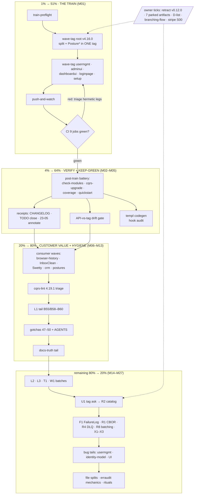

# SUPERB — Round-46 tail: train-to-green, verification wave, and the full backlog ranked (Pareto plan)

**Written:** 2026-11-05 03:11 CET · **Trigger:** owner directive (Pareto breakdown, comprehensive plan 30–100 min tasks, fine breakdown ≤12 min, table views, execution graph, commit + push).
**Inputs (Step 0, read before ranking):** `TODO_LIST.md` (82 open checkboxes; trued by docs-health round-46 on 11-04 + the 2026-11-05 open-PR session; hygiene gate green), the three newest reports (`2026-11-04_18-52` round-46, `2026-11-04_23-05` root-split sync, `2026-11-05_02-47` PR-landing + train-remaining), `CURRENT_FOCUS.md` (round 46 permission thread), `ROADMAP.md` OQ set, the owner D-list (D1–D17).
**Verification basis:** the backlog was trued TODAY (round-46 truth pass + the 02-47 session's P1 rewrite); every ranked row below was spot-checked against its named evidence path during those two passes. Errata found during ranking: sweep-6's templ-components family (v1.27.0) ALREADY LANDED (go.mod-verified) — its remaining TODO text is stale on that half; noted in §Errata.

**Head at plan time:** `1d8c8b68` (master = origin, tree clean, zero open PRs). **CI state:** 9 jobs red — all the documented hermetic/templ-train classes; the single blocking root cause is `cqrshtmx.Posture*` living only on HEAD (newest root tag v4.15.0). The repo is in a hooks-effectively-disabled window (`--no-verify` per commit) until the train lands.

---

## 1. Pareto breakdown

### The 1% that delivers 51% — THE RELEASE TRAIN (M01)

One wave (`train-preflight` → `wave-tag -- . v4.16.0` + 5 family tags → `push-and-watch`) un-reds 9 CI jobs, ends the `--no-verify` window, starts the L4 maturity wave-count, unblocks every post-train verification leg, and closes the top TODO P1 row. Every other task in this plan is either downstream of it or independent-but-lower-value. **Nothing else on this list is worth doing before it.**

### The 4% that delivers 64% — TRAIN + KEEP-GREEN (M01–M05)

The train, the post-train verification battery on the merged split (CI green + `check-modules` aggregate + `cqrs-upgrade` + coverage + quickstart-vs-tag), the receipts that close the loop (CHANGELOG, TODO, superseded-report annotation), and the two mechanical trap-fixes that make the green STICK: the API-vs-tag drift gate (the class that let `Posture*` sit untagged for two days) and the templ codegen hook audit (a hook that regenerates pinned artifacts despite a logged skip is a train-poisoning machine).

### The 20% that delivers 80% — TRAIN + KEEP-GREEN + CUSTOMER VALUE (M01–M13)

Adds the authorization consumer waves (browser-history, InboxClean, SwettySwipperWeb, crm + two posture declarations — the durable-grants migration reaching real applications; the actual customer value of the whole round-46 authorization thread), the cqrs-lint 4.19.1 triage (local gate red on 8 modules since 11-03), the gotcha write-ups (47/48 + the three new trap candidates), the L1 lint-correctness tail, and the docs-truth tail (AGENTS push-claim, archived-research conventions, guide owning-package notes).

### The remaining 80% of tasks → the last 20% of result (M14–M27 + owner parking lot)

The leverage-plan batches (L2/L3/T1/W1/U1/F1/R1/R4/R8/X), the medium bug tails (usermgmt, identity-model, UI), file-size splits, erraudit promotion mechanics, recurring rituals and watches. Real value, all gated on nothing but their own turn — none of it moves the needle while CI is red. Owner-gated items (retraction, parked artifacts, D-list, stripe S00, daemon policy) are parked in §5 — schedulable only by owner tick.

---

## 2. Execution graph

**Sequencing rule:** no D-tier task starts while a C-tier task is open, no C-tier while B-tier is red, no B-tier before the train is green. One thread at a time (`CURRENT_FOCUS` ground rule 1).

---

## 3. Comprehensive plan — medium tasks (30–100 min each, ALL TODOs covered)

Sorted by importance/impact/effort/customer-value. Tier: P1/P2 = the 1%/4%, P3 = the 20%, P4 = the rest. ⏸ = owner-gated precursor.

| ID  | Task (30–100 min)                                                                                                                                                                                                                       | Tier | Impact | Effort | Customer value | Verify |
| --- | --------------------------------------------------------------------------------------------------------------------------------------------------------------------------------------------------------------------------------------- | ---- | ------ | ------ | -------------- | ------ |
| M01 | **Release train**: `train-preflight` → `wave-tag -- . v4.16.0` (split + `Posture*` in one tag) → family tags usermgmt v4.19.0, adminui v4.14.0, dashboardui v4.15.0, loginpage v4.14.0, setup v4.17.0 → `push-and-watch` → `verify-remote-tags`. ⏸ owner GO (02-47 §g1) | P1   | 10 | 90 min | CI green = trust in every published pin; ends the `--no-verify` window | 9 red CI jobs green; `verify-remote-tags` 100% |
| M02 | **Post-train verification battery** on the merged split: `check-modules` aggregate, `cqrs-upgrade` (5 gap modules scan green), `coverage-gate`, `check-readme-quickstart` vs TAGGED v4.16.0, css-bundle-classes, check-templates, commit-without-`--no-verify` proof | P2   | 9  | 90 min | The PR-#40 test-plan box that was merged open — closed with receipts instead of skipped | every leg green or documented-red |
| M03 | **Close-the-loop receipts**: CHANGELOG entries for #40, #39, `1d261b7f`, merge-order decision note; TODO P1 closure; annotate `2026-11-04_23-05` superseded sections | P2   | 7  | 40 min | History that doesn't lie to the next session | todo-hygiene + docs gates green |
| M04 | **API-vs-tag drift gate**: per-module `GOWORK=off go build` as a named `check-modules` + CI leg (surfaces BuildFlow's `test-compile` shape) — mechanically kills the `Posture*`-untagged class | P2   | 8  | 90 min | Consumers never inherit untagged-API breakage | new gate + fixture self-test green |
| M05 | **templ codegen hook audit**: reproduce `_templ.go` regeneration despite `templ-generate: skipped`; fix the skip_steps/pipeline split brain or hard-block codegen from the fast lane | P2   | 8  | 45 min | No committer ships a train-poisoning artifact by accident | hook run leaves `_templ.go` untouched |
| M06 | **Consumer wave 1 — browser-history**: delete `reconcileSuperAdmins` → `GrantRoles`; wire `authztest.Suite`; delete the reconcile loop; own repo, own tests | P3   | 8  | 60 min | Durable admin grants survive restart (their live bug) | their suite green |
| M07 | **Consumer wave 2 — InboxClean**: delete `sseDeadlineFree` (library fix shipped); bump dashboardui pin | P3   | 6  | 30 min | One less local fork of SSE deadline logic | their suite green |
| M08 | **Consumer wave 3 — SwettySwipperWeb**: durable idempotent bootstrap via `GrantRoles`; strip local replaces | P3   | 6  | 60 min | Idempotent re-deploys without grant duplication | their suite green |
| M09 | **Consumer wave 4 — crm + postures**: seed admin via `GrantRoles` or `DisableAdmin`; declare postures for github-local-sync + webphone; correct `docs/PERMISSIONS.md` `?` rows | P3   | 7  | 75 min | The L4 posture inventory becomes complete | `authztest.Undeclared` green per repo |
| M10 | **cqrs-lint 4.19.1 triage** (8 red modules): rules diff old-vs-new; per-module fix-forward vs reasoned suppression vs hold; the usermgmt upstream-catalog decision (R2 follow-up) | P3   | 7  | 100 min | Local gate trustworthy again (red gates train no one) | `nix run .#check-cqrs-lint` green or held-with-receipts |
| M11 | **Gotchas 47–50**: 47 `BUILDFLOW_MAX_CONCURRENCY=1` under load; 48 phantom Tailwind token; 49 workflow-scope merges (SSH local-merge path); 50 `--no-verify` windows + the gotcha-3 pipe-status amendment; AGENTS index rows | P3   | 6  | 45 min | Every one of these bit ≥1 session this week | `grep -c 'gotcha-' docs/gotchas.md` = 50 |
| M12 | **L1 tail**: B55 concurrent audit-log `-race` test; B58/B59 A013 `BasicCommand` value-embeds (e2e/server, sync-demo); B60 both suites; commit L1 complete | P3   | 6  | 90 min | Closes the leverage plan's lint-correctness lane | suites + lint green |
| M13 | **Docs-truth tail**: AGENTS "push can never be greener than CI" coverage annotation; `docs/research/archived/` convention + in-file blockquote; route-posture guide owning-package sentence; skill doc package-map verify; pre-split-layout guide grep; lychee excludes for the two archived dirs | P3   | 5  | 60 min | Docs stop over-claiming gate coverage | docs gates green |
| M14 | **L2 batch** (B61–B64): remove stale S001 suppression; A027 codec-once repository option (retire 3 `WithCodec` sites); P008 `projectionhost.WithBatchSize` in e2e; F005 upcaster adjudication note | P4   | 5  | 75 min | Leverage plan progress; cleaner suppression hygiene | cqrs-lint advisory shrinks |
| M15 | **L3 batch** (B65–B69): C044 KEY/CURSOR-vs-DISPLAY inventory; fix dashboardui key/cursor `.String()` sites; cursor round-trip tests | P4   | 5  | 100 min | Gotcha-25's next victim class made impossible | `check-streamid-identity` + new tests green |
| M16 | **T1 + W1** (B70–B74): `testutil.MustNewCmd` + querytest swaps; testing-guide convention line; `.cqrs-lint.json` scorecard waivers with triggers | P4   | 4  | 90 min | Test authoring friction down; scorecard honest | suites green |
| M17 | **U1 systemcatalog tag ask**: verify no tag, search issues, file; R2 derived-catalog scaffold note (blocked until tagged) | P4   | 5  | 60 min | Unblocks R2 (retires hand-maintained catalog) | upstream issue URL |
| M18 | **F1 dashboardui FailureLog** (B77–B80): commandlifecycle opt-in wiring + FailureLog/RetryCount views + tests + docs | P4   | 5  | 100 min | Failed commands visible/retryable in the dashboard | dashboardui suite green |
| M19 | **R1 CBOR first slice** (ADR-0059): per-event `WithCodec` for the four `[]byte` payloads; mixed-journal test; golden diff; bench note | P4   | 5  | 100 min | ~33% storage cut on the heaviest payloads | goldens + mixed-journal test green |
| M20 | **R4 + R8**: SQLite DLQ default for the three SQL setups; checkpoint-batching seam | P4   | 4  | 90 min | Poisoned events stop vanishing in SQL setups | DLQ tests green |
| M21 | **X1–X3**: ARCHIVE_EVICTED row for the evicted 09-23 templ audit; headless render trace beside the audit report; cqrs-gen spike verdict (examples only) | P4   | 3  | 50 min | Audit provenance complete | files exist |
| M22 | **usermgmt medium tails**: tenant-delete error swallow; `RebuildProjection` 30s-drain zero-projection hazard; cookie Max-Age vs `SessionTTL`; lockout zero-attempt eviction; `sql_event_store.go` MySQL doc; empty-store fallback warning | P4   | 5  | 100 min | Four real behavior bugs + two doc lies fixed | usermgmt suite green |
| M23 | **identity-model type-safety tails**: `GenerateUserID` time-ordering; strict `ParseTenantID`/`ParseBotID`; `Exists()` semantics split; `NotConfigured` family reclass; accessor slice copies; internal `NewUserID` uses | P4   | 4  | 100 min | The gotcha-25 next-victim class shrinks at the source | identity-model suite green |
| M24 | **UI tails**: loginpage `NewPageData` Nonce/Theme; adminui AccentColor shared grammar + partial-render-200; setup `LoginRedirect` follows `AdminPath`; `config.go` split slice 1 | P4   | 4  | 100 min | Consumers embedding panels get working CSP + themes | loginpage/adminui suites green |
| M25 | **File-size splits**: `systemadapter/declarations.go` 609; `usermgmt/service_core.go` 576; `dashboardui/layout.go` 518 (assets); `e2e/server/main.go` 487 | P4   | 3  | 100 min | The 350-line checklist bar stops bleeding | file-size-check clean |
| M26 | **erraudit mechanics**: strict re-baseline (TOTAL moved?); promotion-watch check (green month?); `nolint-audit` CI wiring; upstream erraudit asks (config file, `--modules` hint, `generic_return` exemptions) | P4   | 4  | 60 min | The 303-finding burn-down becomes mechanical | inventory rc + watch note |
| M27 | **Rituals + watches sweep**: coverage-shape self-test (round-36 §d1); release-notes pre-stage; quarterly README↔FEATURES sweep; worktree prune (`cqrs-htmx-root-split`, `/tmp/cqrs-branch`); dependabot cadence decision; `interrogate` PATH; BuildFlow state-DB VACUUM; TS node-types lane; go-work-paths waiver decision | P4   | 3  | 90 min | The noise classes stop costing every session | each item closed or scheduled |

**Totals:** 27 tasks ≈ 34.6 h. P1 1.5 h · P2 5.25 h · P3 9.25 h · P4 18.6 h.

---

## 4. Fine breakdown — ≤12 min each (ALL TODOs; ~150 tasks)

Column Order = execution order within the parent. Every task is one sitting, verifiable, ≤12 min.

| ID | Task (≤12 min) | Parent | Ord |
| -- | -------------- | ------ | --- |
| F001 | `nix run .#train-preflight` (S52 mandatory; record verdicts) | M01 | 1 |
| F002 | `wave-tag -- . v4.16.0` dry-run output review (guards, strict gate) | M01 | 2 |
| F003 | `wave-tag -- . v4.16.0 --execute` (root carries split + Posture*) | M01 | 3 |
| F004 | `wave-tag -- usermgmt v4.19.0 --execute` | M01 | 4 |
| F005 | `wave-tag -- adminui v4.14.0 --execute` | M01 | 5 |
| F006 | `wave-tag -- dashboardui v4.15.0 --execute` | M01 | 6 |
| F007 | `wave-tag -- loginpage v4.14.0 --execute` | M01 | 7 |
| F008 | `wave-tag -- setup v4.17.0 --execute` (+carrier re-tags as reported) | M01 | 8 |
| F009 | `push-and-watch` start; failed-job triage table | M01 | 9 |
| F010 | CI verdict: all 9 red jobs green? document any survivor | M01 | 10 |
| F011 | `verify-remote-tags` (peeled-ref audit for the 6 new tags) | M01 | 11 |
| F012 | TODO P1 row closure with receipts | M01 | 12 |
| F013 | `check-modules` aggregate on merged+tagged tree; triage | M02 | 1 |
| F014 | `cqrs-upgrade -dry-run`: the 5 gap modules scan green | M02 | 2 |
| F015 | `coverage-gate` (15 modules; thresholds post-split) | M02 | 3 |
| F016 | `check-readme-quickstart` against TAGGED v4.16.0 | M02 | 4 |
| F017 | `check-css-bundle-classes` + `check-templates` | M02 | 5 |
| F018 | Commit without `--no-verify` (hook window closed — proof) | M02 | 6 |
| F019 | bench-path check (no re-pin; serve.go isn't the pinned bench) | M02 | 7 |
| F020 | PR-#40 aggregate-battery receipt comment on the TODO row | M02 | 8 |
| F021 | CHANGELOG: #40 root-split merge entry | M03 | 1 |
| F022 | CHANGELOG: #39 + `1d261b7f` + merge-order decision note | M03 | 2 |
| F023 | Annotate `2026-11-04_23-05` superseded sections (inline) | M03 | 3 |
| F024 | Annotate round-46 report corpus-number shift (02-47 §f42) | M03 | 4 |
| F025 | Design drift gate: reuse `test-compile` shape as named leg | M04 | 1 |
| F026 | `scripts/checks/check-hermetic-drift.sh` skeleton (per-module GOWORK=off build) | M04 | 2 |
| F027 | Wire flake app | M04 | 3 |
| F028 | Fixture self-test (planted untagged-API violation) | M04 | 4 |
| F029 | check-modules + CI wiring | M04 | 5 |
| F030 | AGENTS row + gate table entry | M04 | 6 |
| F031 | Reproduce hook regenerating `_templ.go` (v0.3.1114) despite skip | M05 | 1 |
| F032 | Root-cause: skip_steps vs executing pipeline split brain | M05 | 2 |
| F033 | Fix (skip scope or hard codegen block) + re-verify | M05 | 3 |
| F034 | Gotcha amendment if a new trap shape emerged | M05 | 4 |
| F035 | browser-history: read `reconcileSuperAdmins` site | M06 | 1 |
| F036 | browser-history: `GrantRoles` migration edit | M06 | 2 |
| F037 | browser-history: `authztest.Suite` wiring | M06 | 3 |
| F038 | browser-history: delete reconcile loop | M06 | 4 |
| F039 | browser-history: suite green + commit | M06 | 5 |
| F040 | InboxClean: delete `sseDeadlineFree` | M07 | 1 |
| F041 | InboxClean: dashboardui pin bump + suite | M07 | 2 |
| F042 | InboxClean: commit | M07 | 3 |
| F043 | Swetty: durable idempotent bootstrap via `GrantRoles` | M08 | 1 |
| F044 | Swetty: strip local family replaces | M08 | 2 |
| F045 | Swetty: suite + `authztest` | M08 | 3 |
| F046 | Swetty: commit/push | M08 | 4 |
| F047 | crm: seed admin (`GrantRoles` or `DisableAdmin`) | M09 | 1 |
| F048 | crm: suite | M09 | 2 |
| F049 | github-local-sync: declare postures | M09 | 3 |
| F050 | webphone: declare postures | M09 | 4 |
| F051 | `docs/PERMISSIONS.md`: correct remaining `?` rows | M09 | 5 |
| F052 | `cqrs-lint version` + rules diff 4.16.1→4.19.1 | M10 | 1 |
| F053 | Findings inventory across the 8 red modules | M10 | 2 |
| F054 | usermgmt decision: upstream-catalog wiring vs suppression | M10 | 3 |
| F055 | root + identity-model adjudication | M10 | 4 |
| F056 | adminui + loginpage + dashboardui adjudication | M10 | 5 |
| F057 | datastar + systemadapter adjudication | M10 | 6 |
| F058 | Reasoned suppressions with triggers | M10 | 7 |
| F059 | AGENTS gate-state truth row | M10 | 8 |
| F060 | Gotcha 47: `BUILDFLOW_MAX_CONCURRENCY=1` under load>30 | M11 | 1 |
| F061 | Gotcha 48: phantom Tailwind token | M11 | 2 |
| F062 | Gotcha 49: workflow-scope merges → SSH local-merge path | M11 | 3 |
| F063 | Gotcha 50: `--no-verify` windows + gotcha-3 pipe amendment | M11 | 4 |
| F064 | AGENTS gotcha index rows 47–50 | M11 | 5 |
| F065 | B55: concurrent audit-log `-race` test | M12 | 1 |
| F066 | B58: `syncAddItemCmd` embed fix (e2e/server/sync_types.go:19) | M12 | 2 |
| F067 | B59: `createNoteCmd` embed fix (examples/sync-demo/main.go:44) | M12 | 3 |
| F068 | B60a: e2e suite | M12 | 4 |
| F069 | B60b: sync-demo suite + L1-complete commit | M12 | 5 |
| F070 | AGENTS push-claim coverage annotation | M13 | 1 |
| F071 | research-archived convention line + in-file blockquote | M13 | 2 |
| F072 | Route-posture guide: owning-package sentence | M13 | 3 |
| F073 | Skill-claims + skill-snippets on the merged split | M13 | 4 |
| F074 | Grep guides for pre-split root-layout descriptions | M13 | 5 |
| F075 | lychee excludes: the two archived dirs | M13 | 6 |
| F076 | B61: remove stale S001 suppression (events.go:171) | M14 | 1 |
| F077 | B62: A027 codec-once repository option | M14 | 2 |
| F078 | B63: P008 `WithBatchSize` in e2e/server | M14 | 3 |
| F079 | B64: F005 upcaster adjudication note | M14 | 4 |
| F080 | L2 suites + commit | M14 | 5 |
| F081 | B65: C044 KEY/CURSOR-vs-DISPLAY inventory | M15 | 1 |
| F082 | B66: first dashboardui key/cursor fix batch | M15 | 2 |
| F083 | B67: second fix batch | M15 | 3 |
| F084 | B68: third fix batch | M15 | 4 |
| F085 | B69: cursor round-trip tests | M15 | 5 |
| F086 | L3 suite + commit | M15 | 6 |
| F087 | B70: `testutil.MustNewCmd` | M16 | 1 |
| F088 | B71: querytest swaps | M16 | 2 |
| F089 | B72: testing-guide convention line | M16 | 3 |
| F090 | B73–B74: scorecard waivers with triggers | M16 | 4 |
| F091 | T1/W1 suites + commit | M16 | 5 |
| F092 | U1a: verify systemcatalog has no tag | M17 | 1 |
| F093 | U1b: search existing issues | M17 | 2 |
| F094 | U1c: file the tag ask | M17 | 3 |
| F095 | R2 scaffold note (blocked-until-tagged) | M17 | 4 |
| F096 | F1a: commandlifecycle opt-in wiring | M18 | 1 |
| F097 | F1b: FailureLog view | M18 | 2 |
| F098 | F1c: RetryCount view | M18 | 3 |
| F099 | F1d: dashboard tests | M18 | 4 |
| F100 | F1e: dashboard docs + commit | M18 | 5 |
| F101 | R1a: ADR-0059 conformance check + event list | M19 | 1 |
| F102 | R1b: per-event `WithCodec` | M19 | 2 |
| F103 | R1c: mixed-journal decode test | M19 | 3 |
| F104 | R1d: golden diff + storage delta | M19 | 4 |
| F105 | R1e: bench note + commit | M19 | 5 |
| F106 | R4a: SQLite DLQ default (setup 1 of 3) | M20 | 1 |
| F107 | R4b: setup 2 of 3 | M20 | 2 |
| F108 | R4c: setup 3 of 3 | M20 | 3 |
| F109 | R8: checkpoint-batching seam | M20 | 4 |
| F110 | R4/R8 tests + commit | M20 | 5 |
| F111 | X1: ARCHIVE_EVICTED row (09-23 templ audit) | M21 | 1 |
| F112 | X2: headless render trace beside the audit report | M21 | 2 |
| F113 | X3: cqrs-gen spike verdict | M21 | 3 |
| F114 | X-batch commit | M21 | 4 |
| F115 | usermgmt a: tenant-delete error swallow | M22 | 1 |
| F116 | usermgmt b: `RebuildProjection` drain hazard | M22 | 2 |
| F117 | usermgmt c: cookie Max-Age vs `SessionTTL` | M22 | 3 |
| F118 | usermgmt d: lockout zero-attempt eviction | M22 | 4 |
| F119 | usermgmt e: MySQL doc + empty-store warning | M22 | 5 |
| F120 | usermgmt tails tests + commit | M22 | 6 |
| F121 | idm a: `GenerateUserID` ordering | M23 | 1 |
| F122 | idm b: strict `ParseTenantID`/`ParseBotID` | M23 | 2 |
| F123 | idm c: `Exists()` semantics split | M23 | 3 |
| F124 | idm d: `NotConfigured` family reclass | M23 | 4 |
| F125 | idm e: accessor slice copies | M23 | 5 |
| F126 | idm f: internal `NewUserID` uses | M23 | 6 |
| F127 | idm tests + commit | M23 | 7 |
| F128 | loginpage: `NewPageData` Nonce/Theme | M24 | 1 |
| F129 | adminui: AccentColor shared grammar | M24 | 2 |
| F130 | adminui: partial-render-200 fix | M24 | 3 |
| F131 | setup: `LoginRedirect` follows `AdminPath` | M24 | 4 |
| F132 | setup: `config.go` split slice 1 | M24 | 5 |
| F133 | UI tails suites + commit | M24 | 6 |
| F134 | split `systemadapter/declarations.go` (609) | M25 | 1 |
| F135 | split `usermgmt/service_core.go` (576) | M25 | 2 |
| F136 | refile `dashboardui/layout.go` assets (518) | M25 | 3 |
| F137 | split `e2e/server/main.go` (487) | M25 | 4 |
| F138 | file-size-check verify | M25 | 5 |
| F139 | erraudit strict re-baseline (TOTAL moved?) | M26 | 1 |
| F140 | promotion-watch check (green month?) | M26 | 2 |
| F141 | `nolint-audit` CI wiring | M26 | 3 |
| F142 | upstream erraudit asks draft (3 items) | M26 | 4 |
| F143 | coverage-shape self-test (CI-shape happy path) | M27 | 1 |
| F144 | release-notes pre-stage draft | M27 | 2 |
| F145 | quarterly README↔FEATURES sweep (due ~2027-01-17 — early check) | M27 | 3 |
| F146 | worktree prune (root-split + /tmp/cqrs-branch) | M27 | 4 |
| F147 | dependabot cadence decision (app vs runbook row) | M27 | 5 |
| F148 | `interrogate` PATH + BuildFlow state-DB VACUUM | M27 | 6 |
| F149 | TS node-types lane + go-work-paths waiver decision | M27 | 7 |
| F150 | zero-open-queue final check (PRs/issues/alerts) | M27 | 8 |

**Fine totals:** 150 tasks ≈ 27.5 h of executable slices (the medium plan's ~34.6 h includes integration, triage and verification overhead between slices).

---

## 5. Owner parking lot (NOT schedulable without a tick)

| Item | Where asked | Default if silent |
| ---- | ----------- | ----------------- |
| Release train GO (M01 precursor) | 02-47 §g1, CURRENT_FOCUS done-when | hold |
| Retract samber-do-auditlog v0.12.0 | carried ask #4 (blocks hooks too) | hold |
| 7 parked `2026-0*` artifacts evict-or-keep | ARCHIVE_EVICTED § Pending | hold |
| Branching-flow baseline tick (R12) | round-37 §g2 (+5 findings) | hold |
| Zero-CI window cause (billing?) | 02-47 §g2 | unexplained |
| Workflow-file PR landing path (token scope vs SSH) | 02-47 §g3 | SSH local-merge (recorded) |
| Daemon policy incl. push authority | ROADMAP OQ20 | accept + amend-with-fetch |
| D1–D17 owner decisions | TODO_LIST footer table | per-row defaults |
| Stripe S00 (demand artifact + MoR) | P3 row | parked |
| Corpus-ratchet posture (a/b/c) | round-46 §g3 | accept drift |
| GCL gates + cqrs-lint fleet swap | S55 packet | hold |

---

## 6. Errata + verification notes (Step 0 honesty)

1. **Sweep-6 templ half is DONE** (templ-components v1.27.0 family pinned; go.mod-verified 2026-11-05) — the TODO row's remaining text (go-sse v0.7.0, go-health v0.9.0 tails) needs re-derivation before execution; folded into M01's bump-dep sweeps + F150 queue check.
2. **The `docs/readme-table-of-contents` merge row** stays open (dormant local branch) — not schedulable as a task until the owner picks direction; parked with the D-list.
3. **PR-#40 aggregate-battery box** was merged open (02-47 §d2) — M02/F013–F020 exist to close it with receipts; the plan treats that as debt, not a choice.
4. Rows NOT re-derived line-by-line during ranking (trusted from today's two truth passes): the watch-rows (SidebarNav, DataStar T4, BF1, appkit, V007) — each carries its own dated W17 verdict; they are represented in M27/parking-lot, not re-adjudicated here.
5. **Ghost-system audit of the merged split** (02-47 §c7) is deliberately NOT a task here — it belongs to the next `brutal-self-review` run over the split, not a Pareto wave.

## 7. Plan-of-record pointers

- Active thread: `CURRENT_FOCUS.md` (round 46 — done when CI green + grants exercised in `integration_test` + every admin/dashboard route postured).
- Leverage plan: `docs/planning/2026-11-03_20-02_SUPERB-gocqrslite-leverage-maximization-pareto-plan.md` (M14–M21 here execute its remainder).
- Authorization plan: `docs/planning/2026-11-02_10-26_SUPERB-permission-system-hardcore-levelup-pareto-plan.md` (M06–M09 are its consumer waves).
- This plan supersedes nothing; it sequences what those plans + TODO_LIST already own.
