# SUPERB — Fleet Libs Audit Follow-Through (Pareto Plan)

**Date:** 2026-11-06 00:37 · **Author:** Crush · **Status:** plan of record for the audit-derived backlog
**Inputs:** [fleet audit](../review/libs/index.html) (19 reports) · [delivery + self-review status](../status/archived/2026-11-06_00-27_fleet-libs-utilization-audit-delivery-and-self-review.md) · [go-cqrs-lite plan of record](2026-11-03_20-02_SUPERB-gocqrslite-leverage-maximization-pareto-plan.md) (R-lane owner — linked, not duplicated) · `TODO_LIST.md` (living backlog)

**Scope:** ALL todos from this session's audit + self-review. Standing rows owned elsewhere (authorization workstream, CI-catalog lane, Stripe S00-parked, DataStar demand-gated) are LINKED, not re-dispatched. Do not verschlimmbessern: every change leaves the repo verifiably no worse.

## Errata — corrections discovered during Step 0 (verified, not remembered)

1. **systemcatalog is PUBLISHED.** The audit (and AGENTS.md) claimed "UNPUBLISHED — tag ask". Verified 2026-11-06 via `git ls-remote --tags origin` on go-cqrs-lite: `systemcatalog/v4.0.0` exists, peels correctly (`03500b5a` → `d372c42`). **R2 is unblocked.** Audit files corrected same-change (go-cqrs-lite.md, AGENTS.md).
2. **TODO_LIST row 27 lists R1 (CBOR) as still open — stale.** ADR-0059 is Accepted and the 11-03 plan's own errata records R1 executed as five payloads. Annotation task A14 closes this.
3. **TODO_LIST rows 86 (README badges), 88 (PR secrets), 96 (CVE watch) are already done** per AGENTS gate receipts (Round-45 M15/M16/M18). Not re-dispatched; A14 annotates them for the docs-health lane.
4. **CI residual red is exactly one upstream blocker** (go-cqrs-lite catalog release carrying regenerated templ; their active session) — TODO row 21. Watch task A25, nothing actionable in-tree.
5. **A4's go-etag "lag" is an artifact — closed as not-actionable (2026-11-06, resuming session).** The audit read the go-etag repo's root `v0.7.0` tag as lagging the consumed pins. Verified: that tag releases only the repo-root module, which the upstream README declares "Deprecated alias shim for the server package; removed in v1.0.0" — NOT the consumed submodules. No `server/v0.7.0` or `entitytag/v0.7.0` submodule tags exist; `go-etag/server@v0.6.1` + `go-etag/entitytag@v0.6.1` are the latest. `check-upstream-treadmill` (the mechanical lag gate, 20 repos · 78 prefixes) reports worst lag **0** — A4's own verification bar is already met with no change. The bump sweep's R18 pre-flight correctly refused (`entitytag@v0.7.0` 404 on the proxy) before touching anything.

## Overlap check (skill Step 0)

- R2/R4/R7/R8/F1/L1/X1–X3: **owned by the 2026-11-03 plan** — sequenced here with their original IDs, executed against that plan's verification bars.
- Error-context rendering (A27) = TODO row 71, linked.
- Headless render trace: X2 (go-cqrs-lite report) and this audit's index share one decision (A17).
- Everything else (A2, A3, A8, A9, A11, A12, A16, A18–A24, A26) is NEW from the fleet audit — harvested to TODO_LIST in A15.

## Pareto breakdown

### The 1% that delivers 51% — **R2: derived event catalog** (A1, now unblocked)

One task deletes the hand-maintained 25-event list, adds a compile/test-time drift gate, retires the F032 lint disables in two modules (their recorded trigger), and closes the audit's #1 missed opportunity (impact×ease 16).

### The 4% that deliver 64% — **the honesty trio + the data-loss fix** (A2, A3, A5, A4)

SSE drops stop being silent (A2); the health dashboard renders correctly under the repo's own recommended nonce-CSP (A3); poison events survive restarts (A5 = R4); the fleet's only version lag closes (A4).

### The 20% that deliver 80% — **wiring + dogfood + API-value layer** (A6–A16 minus A25)

Command-fate observability end-to-end (A6=R7, A7=F1), the library's own partial-render helpers get dogfooded (A8), recommended chains inherit stack validation (A9), audience-aware error details (A11), classified error logging (A12), the L1 lint/test tail (A13), engine breadth (A16), plus the hygiene enablers (A14, A15) and the render lane (A17).

### The other 20% (to 100%) — stretch, gated, and docs-hygiene (A18–A27)

Codec adjuncts behind decisions (A18–A20), charts (A21), appkit hooks (A22), operator docs (A23, A24), the upstream-gated CI closer (A25), the archive round (A26), and the existing error-context row (A27).

## Table A — comprehensive plan (tasks 30–100 min; sorted by importance → impact → effort → customer-value)

| ID | Task (with verification bar) | Tier | min | Imp | Eff | CV | Depends on |
| --- | --- | --- | --- | --- | --- | --- | --- |
| A1 | **R2 derived event catalog**: bump `systemcatalog/v4.0.0` → derive `DefaultEventCatalog` (25 payloads) with curated-title overrides → `AssertInventory` drift-gate test → remove F032 disables (usermgmt, systemadapter) → guide note. Verify: usermgmt suite + `check-cqrs-lint` + check-modules | 1% | 90 | 5 | 3 | 5 | systemcatalog tag ✓ |
| A2 | **SSE drop observability**: `WithOnDrop` seam on root Broadcaster (log + optional metric) + `BroadcasterHealth` surfaced in adminui sync indicator + dashboardui. Verify: drop-hook test + health-count test | 4% | 60 | 4 | 2 | 4 | — |
| A3 | **Health-dashboard CSP nonce**: thread `WithNonce`/`WithNonceExtractor` through `health.NewDashboard`. Verify: nonce-CSP integration test | 4% | 45 | 3 | 1 | 3 | — |
| A5 | **R4 SQLite DLQ default** in the three SQL setups (memory stays default for in-memory). Verify: restart-with-poison-event test + guide note | 4% | 30 | 4 | 1 | 4 | — |
| A4 | **go-etag v0.7.0 bump wave** (chore-only gap, verified 11 commits). Verify: treadmill 0-lag + CHANGELOG receipt | 4% | 30 | 3 | 1 | 2 | — |
| A6 | **R7 commandlifecycle opt-in**: outer+`AttemptMiddleware` pair on `ServiceConfig.CommandMiddleware` seam, recorder store, docs. Verify: wiring test | 20% | 90 | 3 | 4 | 3 | — |
| A7 | **F1 dashboardui FailureLog/RetryCount views** (command-fates tab beside command-store views). Verify: dashboardui tests + goldens | 20% | 60 | 3 | 3 | 3 | A6 |
| A8 | **Partial-render dogfood showcase**: `RenderPartialOrFull` + `OOBHTML` + `RenderIf` page in examples/basic. Verify: example build+tests + README | 20% | 60 | 3 | 2 | 3 | — |
| A11 | **Audience-aware SafeDetail**: ADR paragraph → audience filter in `httperr.SafeDetail` → RFC 9457 body carries operator-only detail safely. Verify: user-vs-operator detail tests | 20% | 90 | 3 | 4 | 3 | — |
| A9 | **Recommended chains via `httputil.NewMiddlewareStack`** (inherit recovery-first + duplicate-name validation). Verify: behavior-equivalence test (identical headers) | 20% | 45 | 2 | 2 | 2 | — |
| A10 | **R8 checkpoint-batching seam**: expose `ProjectionHostOptions` (`WithCheckpointEvery/Interval`) on usermgmt/setup. Verify: config test + guide | 20% | 45 | 2 | 2 | 2 | — |
| A12 | **Classified error logging**: `errorfamily.LogErrorContext` at middleware error paths (family→level). Verify: level-mapping test + bench suppression intact | 20% | 45 | 2 | 2 | 2 | — |
| A13 | **L1 tail**: B55 `-race` audit-log test; A013 value-embeds ×2 (e2e/server, sync-demo); both suites green. Verify: module suites | 20% | 60 | 2 | 3 | 2 | — |
| A16 | **Engine-breadth presets** in systemadapter (pebble/bbolt/postgres/duckdb/turso behind options). Verify: preset tests + docs | 20% | 60 | 2 | 3 | 2 | — |
| A27 | **Error-context rendering** (TODO row 71): `ErrorContext()` into problem-details body; `ExitCode` into upgrade-CLI fatalf. Verify: body tests | 20% | 60 | 2 | 2 | 3 | — |
| A15 | **Audit harvest**: consolidated TODO_LIST row + routing. Verify: TODO-hygiene gate | 20% | 30 | 2 | 1 | 1 | plan approved |
| A14 | **Docs truth pass**: annotate TODO rows 27 (R1 done), 86/88/96 (done) — errata ledger. Verify: TODO-hygiene gate | 20% | 30 | 2 | 1 | 1 | — |
| A17 | **Render verification lane**: sanctioned browser path decision (owner question) + screenshot traces for index.html + the go-cqrs-lite report (X2). Verify: traces in-repo | 20% | 30 | 2 | 1 | 1 | owner answer (g.1) |
| A18 | **codec AutoDetect honest sync stamps**: ADR-0056 contract check → adopt or record N/A. Verify: decision record + (if adopt) stamp tests | rest | 45 | 2 | 2 | 2 | — |
| A21 | **templ charts panel** (dashboardui event-throughput) — first charts consumer. Verify: goldens + CSS bundle rebuild | rest | 90 | 2 | 4 | 2 | — |
| A19 | **codec Diagnose in dashboardui payload inspector** (CBOR → diagnostic notation). Verify: render test | rest | 45 | 2 | 2 | 2 | — |
| A22 | **appkit lifecycle-hook forwarding** in setup (unified drain story). Verify: shutdown-order test | rest | 45 | 2 | 2 | 1 | — |
| A20 | **codec EncodePooled bench spike** — adopt only if median wins. Verify: bench-spike gate record | rest | 30 | 1 | 2 | 1 | — |
| A24 | **Upgrade-CLI atomic-write** at `cmd/cqrs-htmx-upgrade/rewrite.go:91`. Verify: fingerprint-failure test | rest | 30 | 1 | 1 | 1 | — |
| A23 | **Systemd readiness docs note** (go-daemon sd_notify helpers) in production-readiness guide. Verify: docs-links gate | rest | 30 | 1 | 1 | 1 | — |
| A25 | **Catalog-release watch + CI un-red**: when go-cqrs-lite's catalog release ships → bump integration_test + examples/catalog-demo → CI green. Verify: CI run | rest | 30 | 3 | 1 | 3 | upstream release |
| A26 | **Docs-health archive round prep** (2–3 oldest status reports + baselines). Verify: tail ratchet drops | rest | 30 | 1 | 1 | 1 | — |

**Totals:** 27 tasks · 1,305 min ≈ 21.75 h · deps: A7→A6, A25→upstream, A17→owner.

## Table B — micro-breakdown (every task ≤ 12 min; sorted to match Table A; IDs map to parents)

| ID | Task | min | → |
| --- | --- | --- | --- |
| B01 | bump-dep systemcatalog v4.0.0 + tidy | 12 | A1 |
| B02 | read systemcatalog API (FromDomainConfig/SchemaFromType), record signatures | 12 | A1 |
| B03 | map 13 User payloads → schema entries | 12 | A1 |
| B04 | map 3 Membership + 4 Tenant payloads | 12 | A1 |
| B05 | map 2 Bot + 3 auth-audit payloads | 12 | A1 |
| B06 | wire DefaultEventCatalog to derived registry + title overrides | 12 | A1 |
| B07 | AssertInventory drift-gate test | 12 | A1 |
| B08 | remove F032 disable (usermgmt) + cqrs-lint run | 12 | A1 |
| B09 | remove F032 disable (systemadapter) + cqrs-lint run | 12 | A1 |
| B10 | event-catalog guide paragraph | 12 | A1 |
| B11 | verify: usermgmt suite + check-cqrs-lint + check-modules leg | 12 | A1 |
| B12 | WithOnDrop option seam on root Broadcaster | 12 | A2 |
| B13 | drop log line (subscriber count + event id) | 12 | A2 |
| B14 | optional metric hook wiring | 12 | A2 |
| B15 | BroadcasterHealth → adminui sync indicator data | 12 | A2 |
| B16 | BroadcasterHealth → dashboardui overview card | 12 | A2 |
| B17 | tests: drop-hook fired + health counts | 12 | A2 |
| B18 | health.NewDashboard nonce option signature | 12 | A3 |
| B19 | thread nonce into dashboard Config | 12 | A3 |
| B20 | CSP nonce integration test | 12 | A3 |
| B21 | health README consumer-map row | 12 | A3 |
| B22 | bump-dep go-etag v0.7.0 sweep | 12 | A4 |
| B23 | treadmill 0-lag verify + CHANGELOG receipt | 12 | A4 |
| B24 | SQLite DLQ default in 3 SQL setups | 12 | A5 |
| B25 | declarative-projections guide note | 12 | A5 |
| B26 | restart-with-poison-event test | 12 | A5 |
| B27 | read commandlifecycle/v4.3.1 API (outer+AttemptMiddleware) | 12 | A6 |
| B28 | ServiceConfig.CommandMiddleware wiring design | 12 | A6 |
| B29 | recorder store seam wiring | 12 | A6 |
| B30 | opt-in flag + guide docs | 12 | A6 |
| B31 | wiring test | 12 | A6 |
| B32 | CHANGELOG + module-suite verify | 12 | A6 |
| B33 | dashboardui command-fates route + nav | 12 | A7 |
| B34 | FailureLog view + query | 12 | A7 |
| B35 | RetryCount view | 12 | A7 |
| B36 | goldens (+CSS rebuild if classes changed) | 12 | A7 |
| B37 | dashboardui README adoption row | 12 | A7 |
| B38 | RenderPartialOrFull page (examples/basic) | 12 | A8 |
| B39 | OOBHTML demo block | 12 | A8 |
| B40 | RenderIf custom-predicate demo | 12 | A8 |
| B41 | example README + skill doc mention | 12 | A8 |
| B42 | verify: example build + tests | 12 | A8 |
| B43 | rebuild RecommendedSecurityMiddleware via MiddlewareStack | 12 | A9 |
| B44 | naming/validation assertion test | 12 | A9 |
| B45 | behavior-equivalence test (identical headers) | 12 | A9 |
| B46 | CHANGELOG receipt | 6 | A9 |
| B47 | expose ProjectionHostOptions on usermgmt/setup | 12 | A10 |
| B48 | WithCheckpointEvery/Interval docs | 12 | A10 |
| B49 | config test | 12 | A10 |
| B50 | durability-tradeoff guide note | 12 | A10 |
| B51 | Audience ADR paragraph draft | 12 | A11 |
| B52 | SafeDetail audience-filter design | 12 | A11 |
| B53 | httperr integration | 12 | A11 |
| B54 | tests: user vs operator detail | 12 | A11 |
| B55 | RFC 9457 body test | 12 | A11 |
| B56 | docs + CHANGELOG | 12 | A11 |
| B57 | LogErrorContext at middleware error paths | 12 | A12 |
| B58 | family→level mapping test | 12 | A12 |
| B59 | bench log-suppression check intact | 12 | A12 |
| B60 | concurrent audit-log -race test | 12 | A13 |
| B61 | A013 fix e2e/server sync_types.go:19 | 12 | A13 |
| B62 | A013 fix examples/sync-demo main.go:44 | 12 | A13 |
| B63 | e2e + sync-demo suite runs | 12 | A13 |
| B64 | receipts in CHANGELOG | 6 | A13 |
| B65 | annotate TODO rows 86/88/96 (done) | 12 | A14 |
| B66 | annotate TODO row 27 R1-done + U1-resolved | 12 | A14 |
| B67 | write consolidated TODO_LIST P1 row | 12 | A15 |
| B68 | TODO-hygiene gate green | 12 | A15 |
| B69 | systemadapter engine-preset options design | 12 | A16 |
| B70 | pebble + bbolt preset wiring | 12 | A16 |
| B71 | postgres + duckdb + turso preset wiring | 12 | A16 |
| B72 | docs + example flag | 12 | A16 |
| B73 | preset tests | 12 | A16 |
| B74 | record sanctioned render-path decision | 12 | A17 |
| B75 | screenshot traces (index + deep-dive) if path exists | 12 | A17 |
| B76 | read ADR-0056 stamp contract | 12 | A18 |
| B77 | verify AutoDetect vs opaque behavior | 12 | A18 |
| B78 | adopt-or-N/A decision record | 12 | A18 |
| B79 | payload-inspector hook | 12 | A19 |
| B80 | CBOR→diagnostic render + test | 12 | A19 |
| B81 | json/opaque fallback | 12 | A19 |
| B82 | encode-path bench-spike setup | 12 | A20 |
| B83 | run + record baseline comparison | 12 | A20 |
| B84 | adopt-or-drop decision | 6 | A20 |
| B85 | templ-components charts API read | 12 | A21 |
| B86 | event-throughput data query | 12 | A21 |
| B87 | panel + route | 12 | A21 |
| B88 | chart render + CSP check | 12 | A21 |
| B89 | goldens + CSS bundle rebuild | 12 | A21 |
| B90 | dashboardui README adoption row | 12 | A21 |
| B91 | drain-hook forwarding design | 12 | A22 |
| B92 | setup wiring | 12 | A22 |
| B93 | shutdown-order test | 12 | A22 |
| B94 | docs note | 6 | A22 |
| B95 | production-readiness sd_notify section | 12 | A23 |
| B96 | docs-links gate | 6 | A23 |
| B97 | atomic-write at rewrite.go:91 | 12 | A24 |
| B98 | fingerprint-failure test | 12 | A24 |
| B99 | check go-cqrs-lite catalog release state | 6 | A25 |
| B100 | bump integration_test + catalog-demo when shipped | 12 | A25 |
| B101 | CI green verify + TODO row 21 closure | 12 | A25 |
| B102 | archive-pass spec (2–3 oldest reports) | 12 | A26 |
| B103 | run archive + baselines + manifest | 12 | A26 |
| B104 | ErrorContext extraction (structured_error.go) | 12 | A27 |
| B105 | problem-details body extension | 12 | A27 |
| B106 | body tests | 12 | A27 |
| B107 | docs + TODO row 71 receipt | 12 | A27 |

**Totals:** 107 micro tasks · every one ≤ 12 min · execution order within parents respects dependencies (B27→B31 before B33+, etc.).

## Execution graph (mermaid)

```mermaid
flowchart TD
    subgraph T1["1% — 51%"]
        A1["A1 R2 derived catalog<br/>(systemcatalog v4.0.0 ✓)"]
    end
    subgraph T4["4% — 64%"]
        A2["A2 SSE drop observability"]
        A3["A3 dashboard CSP nonce"]
        A5["A5 R4 SQLite DLQ default"]
        A4["A4 go-etag v0.7.0 bump"]
    end
    subgraph T20["20% — 80%"]
        A6["A6 R7 commandlifecycle"]
        A7["A7 F1 FailureLog views"]
        A8["A8 partial-render showcase"]
        A11["A11 Audience SafeDetail"]
        A9["A9 MiddlewareStack chains"]
        A10["A10 R8 checkpoint batching"]
        A12["A12 classified logging"]
        A13["A13 L1 lint/test tail"]
        A16["A16 engine presets"]
        A27["A27 error-context body"]
        A15["A15 harvest"]
        A14["A14 docs truth pass"]
        A17["A17 render lane (gated)"]
    end
    subgraph TR["other 20% — to 100%"]
        A18["A18 AutoDetect decision"]
        A21["A21 charts panel"]
        A19["A19 Diagnose inspector"]
        A22["A22 appkit hooks"]
        A20["A20 pooling bench"]
        A24["A24 upgrade atomic-write"]
        A23["A23 systemd docs"]
        A25["A25 catalog watch (upstream-gated)"]
        A26["A26 archive round"]
    end
    A6 --> A7
    A1 --> B_gate["F032 disables retire"]
    OWN["Owner: render path (g.1)"] -.-> A17
    UP["Upstream: catalog release"] -.-> A25
    A15 --> TODO["TODO_LIST.md (living)"]
```



## Verification

```bash
nix run .#test                                   # per-module suites after each wave
nix run .#check-cqrs-lint                        # A1: F032 disables gone, 14/14 green
nix run .#check-upstream-treadmill               # A4: 0-lag
nix run .#check-modules                          # aggregate after waves 1-2
bash scripts/checks/check-todo-hygiene.sh        # A14/A15
nix run .#train-preflight                        # before any tag-bearing wave
```

**Execution rule:** waves in tier order (A1 → A2/A3/A5/A4 → 20%-lane → rest); commit at phase boundaries (gotcha 4); never tag with uncommitted go.mod edits (gotcha 5); BUILDFLOW_MAX_CONCURRENCY=1 on the first commit attempt under load (gotcha 51).

## §12 Execution log (truth pass, 2026-11-06 23:0x CET)

The original tables above are the frozen plan; this section is the measured outcome. Statuses verified against CHANGELOG receipts, tests, and gates — not memory.

**DONE (18):** A1 (`usermgmt.ArchitectureCatalog()` from the one spec table + F032 disable removed — usermgmt CHANGELOG), A2 (all three legs: root `DropStats`/`NewBroadcaster` option + dashboardui overview card + adminui `Config.SSEHubStats` cards + setup auto-wiring — receipts in root/dashboardui/adminui CHANGELOGs), A3 (`health.NewDashboard` nonce forwarding — root CHANGELOG), A7 (command-fates panel), A8 (examples/basic partial-render showcase), A9 (`RecommendedSecurityStack`), A11 (audience-aware `SafeDetailFor`), A12 (classified dispatch-error logging), A13 (`-race` + embeds, pre-landed by siblings, receipted), A14/A15 (TODO truth pass + harvest — TODO rows carry the annotations, hygiene gate green), A16 (engine-breadth presets + bbolt e2e), A18 (N/A recorded as ADR-0056 Amendment 2 — the heuristic's own contract forbids adoption), A19 (`codec.Diagnose` EDN fallback in the payload inspector), A20 (bench spike: pooled median WINS 245.8 vs 259.3 ns/op but DROP verdict — no cqrs-htmx-owned call site; upstream ask (g) instead), A21 (event-throughput charts panel), A22 (appkit lifecycle-hook forwarding + B93 order test + B94 docs), A23 (systemd readiness §9 in production-readiness guide), A24 (upgrade-CLI atomic write + fingerprint-failure test), A26 (docs-health archive round COMPLETE 22:03; corpus/tail trued).

**NOT ACTIONABLE (1):** A4 — the go-etag "lag" was an artifact (erratum 5 above): `v0.7.0` tags only the deprecated repo-root shim; the consumed `server`/`entitytag` submodules are at latest, treadmill worst-lag 0. The audit files (`docs/review/libs/index.html` + `go-etag.md`) were corrected 2026-11-06 to say so.

**STILL OPEN (3, tracked in TODO_LIST row 34):** A5 (R4 SQLite DLQ default), A6 (R7 commandlifecycle opt-in + dashboardui FailureLog views beyond A7), A10 (R8 checkpoint batching).

**GATED (2):** A25 (CI un-red — waits on go-cqrs-lite's catalog release; TODO row 51(b)), A17 (render-verification lane — owner question §g.2 of the 22-42 status report).
