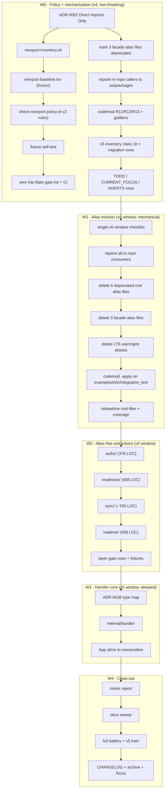

# SUPERB — Direct Imports Only: evict the re-export façade, burn the root package down

**Written:** 2026-11-06 07:16 · **Owner:** Lars · **Status:** accepted — W0 DELIVERED 2026-11-06 (v4, non-breaking);
W1–W4 gated on the single v5 window and not started
**Driver (owner, 2026-11-06):** "I kind of hate re-exports. People should import the code as
directly as possible. Only refactoring + deprecated aliases may temporarily be okay."

Related: [ADR-0047](../adr/0047-re-export-layer-retirement-plan.md) (the old retirement plan),
[docs/guides/v5-removal-inventory.md](../guides/v5-removal-inventory.md),
[module-extraction decision memo](../modularization/2026-10-24_module-extraction-decision-memo.md),
[CURRENT_FOCUS.md](../../CURRENT_FOCUS.md).

---

## 0. Verdict in one paragraph

The repo is not too modular at the module level (29 modules, 2026-10-18 re-assessment: zero
merges/splits needed) — it is **too fat at the package level** and it **enshrined re-exports as
the design**. Root holds 53 production files / 7,594 LOC (re-measured 09:35 the same day: 54 / 8,547 — see §1.2), of which **718 LOC across 9 files is
pure aliasing**, and the three newest alias files (`htmx_reexport.go`, `httperr_reexport.go`,
`eventcatalog_reexport.go`) say in their own header *"they are not deprecated"* — i.e. the
compatibility bridge shipped as the supported surface. That is the thing to kill. Because the
library is published at v4, an alias-free move of an exported symbol is a breaking change, so
**the program has exactly one breaking cut (v5) and everything before it must be monotone**
(policy, gates, deprecation markers, codemod rules — all non-breaking). After v5, no alias file
may ever exist again; the gate in W0 is what makes that monotone instead of aspirational.

---

## 1. Evidence — what we are actually paying for

### 1.1 Re-export inventory (measured 2026-11-06)

| Layer                                           | Files | LOC   | Alias decls | Deprecated?          | Honest verdict                       |
| ----------------------------------------------- | ----- | ----- | ----------- | -------------------- | ------------------------------------ |
| Root → `htmx`                                   | 1     | 137   | 35          | **no** (by design)   | permanent façade — policy violation  |
| Root → `httperr`                                | 1     | 163   | 42          | **no**               | permanent façade — policy violation  |
| Root → `eventcatalog`                           | 1     | 36    | 5           | **no**               | permanent façade — policy violation  |
| Root → `httputil` / `go-sse` (csrf, ratelimit, server_timing, security, sse_event, sse_store) | 6 | 382 | 57 | yes (15/12/9/6/13/2 markers) | correctly dated, delete in v5 |
| `usermgmt` → `identity-model`                   | 22    | —     | 176         | yes                  | correctly dated, delete in v5        |
| **Total**                                       | **31**| **718** | **~315**  |                      | **~9.5% of root LOC is aliasing**    |

### 1.2 Root package clusters (measured, non-test)

| Cluster                | Files | LOC   | In-module deps of the cluster        | Extraction blocker                       |
| ---------------------- | ----- | ----- | ------------------------------------ | ---------------------------------------- |
| handler/app core       | 7     | ~1,800 | everything                          | `HandlerOption`/`handlerConfig` are the public seam |
| options + rendering    | 10    | 1,385 | `htmx`, `internal/hx`, core options  | depends on `HandlerOption`               |
| middleware + context   | 9     | 1,310 | `context`, `authz`, `httperr`        | used by `App.Middleware()`               |
| sync protocol          | 5     | 1,045 | `App`, `commandRegistry`, `handler`  | `App.SyncPushHandler` only               |
| authz contract+posture | 3     | 633   | **none** (stdlib + errorfamily)      | nothing — cleanest seam in the tree      |
| realtime (sse)         | 6     | 581   | `App` (AfterDispatch), `httperr`     | Broadcaster's hook seam                  |
| readiness/projections  | 3     | 408   | `internal/hx`, errorfamily, etag     | none                                     |
| deprecated aliases     | 6     | 382   | none                                 | ADR-0047 already decided                 |
| new-style aliases      | 3     | 336   | none                                 | policy decision (this plan)              |
| leaf leftovers         | 3     | ~150  | none                                 | too small for a boundary (FM#8)          |

**Re-measured 2026-11-06 09:35:** 54 production `.go` files / 8,547 LOC
(`ls *.go | grep -v _test | grep -v _templ`, then `wc -l`). Two drifts in this section:
the cluster column already sums to ~8,030, so §0's (and `TODO_LIST.md`'s) 7,594
understates root even at planning time; and the +517 since then is the dispatch-gate
wave (`authz_dispatch.go`, landed 07:44, after this measurement). Prefer the command
to the prose number.

### 1.3 The three findings that matter

1. **`htmx_reexport.go:15-19` literally documents the anti-pattern**: "The root package keeps
   these aliases as its supported surface; they are not deprecated." Direct-import users and
   façade users coexist forever, so the façade never dies.
2. **`authz_contract.go` (301 LOC) imports only stdlib + errorfamily** yet sits at the *top* of
   the dependency stack. Consequence: `identity-model` cannot declare the contract, so the
   compile-time assertion that `Authz.Check` satisfies `PermissionChecker` has to live in
   `usermgmt` — a split brain that exists *only* because of where the file sits.
3. **`health/probe.go` imports the root package only for `ProjectionStatus*` vocabulary**
   (`health/probe.go:16-22,165`). Root owning those constants forces an upward edge that a
   400-LOC, dependency-free home would delete.

---

## 2. The constraint that shapes the whole plan

| Fact                                     | Consequence                                                        |
| ---------------------------------------- | ------------------------------------------------------------------ |
| Library published at `…/v4`              | aliasing removal or symbol relocation **is** a breaking change     |
| v5 window already exists and is planned  | put **every** breaking move inside it; never open a second window  |
| `cmd/cqrs-htmx-upgrade` already exists    | alias deletion is mechanically scriptable — aliases need not be permanent |
| `v5-removal-inventory.md` already exists  | the checklist is written; this plan adds classes, not machinery    |
| `.githooks/pre-push` + `check-modules`    | a policy without a gate is decoration — W0 ships the gate first    |

**Therefore:** W0 is the only wave allowed to touch master as non-breaking work. W1–W3 are the
v5 cut, sequenced behind W0 so that the codemod and the gate both exist *before* a single symbol
moves. That ordering is what prevents the 2026-11-02 pattern (split + permanent aliases) from
repeating.

---

## 3. Pareto

### 3.1 The 1% that delivers 51%

**One sentence in an ADR + one gate script.** "A cross-package alias must be `// Deprecated:`
and name its removal class; no new alias file may be created; consumers import the owning
package." Everything downstream is downhill: the gate stops the regression, the ADR stops the
argument. Cost ≈ 4 hours. Without it, every future extraction re-creates the façade and the root
never shrinks.

### 3.2 The 4% that delivers 64%

**Delete the 718 LOC / ~315 alias declarations in the single v5 window, codemod-driven.**
No new design, no new package, no new module — pure subtraction of the thing the owner objects
to. Cost ≈ 2–3 days (mostly consumer repointing + fixtures).

### 3.3 The 20% that delivers 80%

**The four alias-free extractions** in payoff order: `authz` (376 LOC, zero blocker),
readiness/projections (408 LOC, deletes an upward edge), `sync` (≈700 of 1,045), `realtime`
(458). Each one removes a *concept* from the root, not just lines. Cost ≈ 1.5–2 weeks.

### 3.4 The remaining 20% to reach 100%

The `HandlerOption`/`handlerConfig`/`App` core (≈1,800 LOC) into `internal/handler` with root as
a thin, façade-free composition surface; plus close-out (docs, CHANGELOG, gates re-baselined,
train, metric report). This is the only genuinely risky wave and it is deliberately last.

---

## 4. Waves

### W0 — Policy + mechanization (v4, non-breaking, shippable today)

- ADR-0062 **Direct Imports Only**: no permanent cross-package alias; deprecation + codemod +
  one breaking window is the only sanctioned bridge. Exemptions must be argued in the ADR.
- `scripts/tools/reexport-inventory.sh` — machine inventory (file, decl, target package,
  deprecation state, line) so the baseline cannot rot.
- `scripts/checks/reexport-baseline.tsv` — frozen snapshot (one row per alias file + decl count).
- `scripts/checks/check-reexport-policy.sh` — three rules:
  1. **no new** alias file (baseline diff),
  2. every cross-package alias carries `// Deprecated:` naming the direct import,
  3. every alias file is listed in a removal class (ADR-0047 or v5-removal-inventory).
- `scripts/selftests/test-check-reexport-policy.sh` — one planted failure per rule + clean case.
- Wire `reexport-policy` + self-test into the gate list at `flake.nix:1240-1306` and CI.
- Mark the three façade files deprecated (removal class 1b), repoint every *in-repo* caller to
  the subpackage directly — root keeps zero internal uses of its own aliases.
- Extend `cmd/cqrs-htmx-upgrade` to derive rules for those three files (R11 htmx, R12 httperr,
  R13 eventcatalog) with golden consumer fixtures.
- Documentation: `v5-removal-inventory.md` class 1b, `docs/migrations/v4-to-v5.md` rows,
  TODO_LIST row, CURRENT_FOCUS line, AGENTS.md "Key Patterns" line.

### W1 — Alias eviction (v5 window, mechanical)

Delete the 9 root alias files (718 LOC) and the 176 `usermgmt` aliases across 26 files; repoint
every consumer in-repo; retire `api_surface_compat_test.go`'s façade pins (they exist only to
protect aliases); run the codemod against `examples/`, `e2e/`, `integration_test/` and the
golden consumer fixture; re-baseline coverage, root-files, docs claims.

### W2 — Alias-free extractions (v5 window)

| Order | Package            | Moves                                                                 | New edges to declare          |
| ----- | ------------------ | --------------------------------------------------------------------- | ----------------------------- |
| 1     | `authz/`           | `authz_contract.go` (301) + `route_posture.go` (75)                    | root→authz; identity-model may adopt the contract (ADR-0062 §decision) |
| 2     | `readiness/`       | `readiness.go`, `projection_readiness.go`, `projection_status_handler.go` (408) | root→readiness; `health` may drop its root→ edge for the status vocabulary |
| 3     | `sync/`            | `sync_pull.go`, `sync_serve.go`, `sync_embed.go`, `sync_openapi.go` + `sync/*.js` | `App.SyncPushHandler` becomes a 1-file method delegating to `sync.PushHandler(deps)` |
| 4     | `realtime/`        | `sse_broadcaster.go`, `sse_drop_stats.go`, `ack.go`, `event_store_sse.go` | `transport/` keeps the domain-event surface; the hook seam moves to `realtime` |

Every package gets: a `check-module-layers.sh` row (and fixture cases), its tests moved with it
(gotcha 48), its golden/ETag pins moved with the tests, and **no alias file in root**.

### W3 — Handler core (v5 window, deepest)

`HandlerOption`, `handlerConfig`, the option pipeline, `App` → `internal/handler`; root exports
only what root owns. ADR-0038 is the vehicle; it must be updated with the concrete type map
before a single file moves.

### W4 — Close-out

Metric report (root files/LOC before/after, alias count = 0), CHANGELOG, README + skill claim
updates, `check-modules` re-baselines, v5 family train, archive this plan.

---

## 5. Task tables

Legend: **Imp** = impact (1–5), **Eff** = effort in minutes, **CV** = customer value (1–5),
**Order** = execution order.

### 5.1 Coarse tasks (30–100 min each)

| ID    | Task                                                                                       | Imp | Eff | CV | Order |
| ----- | ------------------------------------------------------------------------------------------ | --- | --- | -- | ----- |
| W0.1  | Write ADR-0062 (policy, rationale, exemptions, one-window rule) and index it               | 5   | 90  | 3  | 1     |
| W0.2  | `scripts/tools/reexport-inventory.sh` — machine inventory of every alias decl              | 5   | 60  | 3  | 2     |
| W0.3  | Freeze `scripts/checks/reexport-baseline.tsv` from W0.2 output                              | 5   | 30  | 2  | 3     |
| W0.4  | `scripts/checks/check-reexport-policy.sh` with the three rules                             | 5   | 100 | 3  | 4     |
| W0.5  | `scripts/selftests/test-check-reexport-policy.sh` (one planted failure per rule)           | 4   | 60  | 2  | 5     |
| W0.6  | Wire `reexport-policy` + self-test into `flake.nix:1240-1306` and CI `checks` job           | 4   | 30  | 2  | 6     |
| W0.7  | Mark `htmx_reexport.go` / `httperr_reexport.go` / `eventcatalog_reexport.go` deprecated     | 5   | 45  | 4  | 7     |
| W0.8  | Repoint all in-repo callers to the subpackages (root keeps zero self-alias use)             | 4   | 90  | 3  | 8     |
| W0.9  | Extend `cqrs-htmx-upgrade` with R11/R12/R13 + golden fixtures                              | 5   | 100 | 4  | 9     |
| W0.10 | `v5-removal-inventory.md` class 1b + `docs/migrations/v4-to-v5.md` per-symbol rows         | 4   | 60  | 4  | 10    |
| W0.11 | TODO_LIST row, CURRENT_FOCUS line, AGENTS.md "Key Patterns" entry                          | 3   | 30  | 2  | 11    |
| W1.1  | v5 branch/window decision + module-path bump checklist (single window, no second cut)      | 5   | 60  | 3  | 12    |
| W1.2  | Repoint every in-repo consumer of the 9 root alias files to direct imports                 | 5   | 100 | 4  | 13    |
| W1.3  | Delete the 6 deprecated root alias files (382 LOC)                                         | 5   | 45  | 4  | 14    |
| W1.4  | Delete the 3 façade alias files (336 LOC) + retire `api_surface_compat_test.go` pins       | 5   | 60  | 4  | 15    |
| W1.5  | Delete 176 `usermgmt` → `identity-model` aliases across 26 files                           | 5   | 100 | 4  | 16    |
| W1.6  | Codemod `-apply` run against `examples/`, `e2e/`, `integration_test/` + fixture consumer   | 4   | 90  | 4  | 17    |
| W1.7  | Re-baseline coverage thresholds, root-files baseline, docs claims                          | 3   | 45  | 2  | 18    |
| W2.1  | Extract `authz/` (contract + posture); root `authz.go` imports it                          | 5   | 100 | 4  | 19    |
| W2.2  | Decide + record readiness home (root subpackage vs `projections/v4` module)                | 4   | 30  | 3  | 20    |
| W2.3  | Extract `readiness/` (408 LOC) and repoint `health/`                                       | 4   | 90  | 4  | 21    |
| W2.4  | Extract `sync/` (4 files + JS assets); slim `App.SyncPushHandler` to a delegating method    | 5   | 100 | 4  | 22    |
| W2.5  | Extract `realtime/` (4 files) with the AfterDispatch hook seam                             | 4   | 90  | 3  | 23    |
| W2.6  | Layer-gate rows + fixture cases for all four new packages                                  | 4   | 60  | 2  | 24    |
| W3.1  | Update ADR-0038 with the concrete `internal/handler` type map                              | 5   | 90  | 3  | 25    |
| W3.2  | Move `HandlerOption`/`handlerConfig`/option pipeline into `internal/handler`                | 5   | 100 | 3  | 26    |
| W3.3  | Slim `App` to a façade-free composition surface; fix every call site                       | 5   | 100 | 3  | 27    |
| W4.1  | Before/after metric report (files, LOC, alias count, import depth)                         | 3   | 45  | 3  | 28    |
| W4.2  | Docs sweep: README, skill, guides, migration guide final pass                              | 4   | 90  | 4  | 29    |
| W4.3  | Full battery (`check-modules`, coverage, lint, erraudit, branching-flow) + v5 train         | 5   | 100 | 4  | 30    |
| W4.4  | CHANGELOG + archive this plan + update CURRENT_FOCUS                                       | 3   | 30  | 2  | 31    |

### 5.2 Fine tasks (≤12 min each)

| ID       | Task                                                                                     | Imp | Eff | CV | Order |
| -------- | ---------------------------------------------------------------------------------------- | --- | --- | -- | ----- |
| W0.1.1   | Draft ADR-0062 context + decision paragraphs                                             | 5   | 12  | 3  | 1     |
| W0.1.2   | Add consequences + exemption rules + reopen trigger                                      | 5   | 10  | 3  | 2     |
| W0.1.3   | Add `0062` row to `docs/adr/INDEX.md`                                                    | 3   | 5   | 1  | 3     |
| W0.2.1   | Write the inventory parser (go/ast, aliases only)                                        | 5   | 12  | 3  | 4     |
| W0.2.2   | Emit TSV: file, decl, target path, target name, deprecated?, removal class               | 5   | 10  | 3  | 5     |
| W0.2.3   | Run it, review all 31 files / ~315 decls by hand                                         | 4   | 12  | 3  | 6     |
| W0.3.1   | Freeze the TSV as `reexport-baseline.tsv` with a header + generated-at line              | 5   | 8   | 2  | 7     |
| W0.3.2   | Document the bump-in-same-commit rule in the file header                                 | 3   | 5   | 1  | 8     |
| W0.4.1   | Rule 1: no new alias file vs baseline (path diff)                                        | 5   | 12  | 3  | 9     |
| W0.4.2   | Rule 2: every cross-package alias must carry `// Deprecated:`                            | 5   | 12  | 3  | 10    |
| W0.4.3   | Rule 3: every alias file must be in a removal class                                      | 4   | 10  | 3  | 11    |
| W0.4.4   | `--strict` and advisory modes + exit codes + `CI=true` behaviour                         | 3   | 8   | 2  | 12    |
| W0.5.1   | Fixture: clean tree passes                                                               | 4   | 8   | 2  | 13    |
| W0.5.2   | Fixture: new alias file fails                                                            | 4   | 8   | 2  | 14    |
| W0.5.3   | Fixture: non-deprecated alias fails                                                      | 4   | 8   | 2  | 15    |
| W0.5.4   | Fixture: unclassified alias file fails                                                   | 4   | 8   | 2  | 16    |
| W0.6.1   | Add the two stages to the `flake.nix` gate list                                          | 4   | 8   | 2  | 17    |
| W0.6.2   | Add the same stages to the CI `checks` job                                               | 4   | 8   | 2  | 18    |
| W0.6.3   | Run `nix run .#check-modules` and confirm both stages appear green                       | 3   | 12  | 2  | 19    |
| W0.7.1   | Add `// Deprecated:` to each `htmx_reexport.go` decl (35)                                 | 5   | 12  | 4  | 20    |
| W0.7.2   | Same for `httperr_reexport.go` (42)                                                       | 5   | 12  | 4  | 21    |
| W0.7.3   | Same for `eventcatalog_reexport.go` (5)                                                   | 5   | 6   | 4  | 22    |
| W0.7.4   | Replace the "they are not deprecated" header paragraphs                                   | 4   | 6   | 3  | 23    |
| W0.8.1   | Repoint root production callers to `htmx.*`                                                | 4   | 12  | 3  | 24    |
| W0.8.2   | Repoint root production callers to `httperr.*`                                             | 4   | 12  | 3  | 25    |
| W0.8.3   | Repoint root production callers to `eventcatalog.*`                                        | 4   | 8   | 3  | 26    |
| W0.8.4   | Repoint root tests; delete now-dead in-package alias tests                                 | 3   | 12  | 2  | 27    |
| W0.9.1   | Register R11/R12/R13 targets in `derive.go`                                                | 5   | 12  | 4  | 28    |
| W0.9.2   | Golden fixture: `htmx` alias → direct import rewrite                                       | 5   | 12  | 4  | 29    |
| W0.9.3   | Golden fixture: `httperr` alias → direct import rewrite                                    | 5   | 12  | 4  | 30    |
| W0.9.4   | Golden fixture: `eventcatalog` alias → direct import rewrite                               | 5   | 10  | 4  | 31    |
| W0.9.5   | Dry-run against `examples/` and confirm zero false rewrites                                | 4   | 12  | 4  | 32    |
| W0.10.1  | Add removal class 1b to `v5-removal-inventory.md`                                          | 4   | 10  | 4  | 33    |
| W0.10.2  | Add the per-symbol rows to `docs/migrations/v4-to-v5.md`                                   | 4   | 12  | 4  | 34    |
| W0.10.3  | Update `docs/migrations/v4-to-v5.md` TL;DR table                                           | 3   | 6   | 3  | 35    |
| W0.11.1  | Add the TODO_LIST P-row (one row, bounded)                                                 | 3   | 6   | 2  | 36    |
| W0.11.2  | Add the CURRENT_FOCUS bullet                                                              | 3   | 6   | 2  | 37    |
| W0.11.3  | Add the AGENTS.md "Key Patterns" line                                                     | 3   | 6   | 2  | 38    |
| W1.1.1   | Confirm the v5 window is the only window; write the checklist                              | 5   | 12  | 3  | 39    |
| W1.1.2   | Verify no in-repo consumer depends on `/v4` paths outside go.work                          | 4   | 12  | 3  | 40    |
| W1.2.1   | Repoint `adminui/` (9 files)                                                               | 5   | 12  | 4  | 41    |
| W1.2.2   | Repoint `dashboardui/` (6 files)                                                           | 5   | 12  | 4  | 42    |
| W1.2.3   | Repoint `setup/`, `loginpage/`, `datastar/`, `systemadapter/`                              | 5   | 12  | 4  | 43    |
| W1.2.4   | Repoint `examples/` (13 demos) and `e2e/`                                                  | 4   | 12  | 4  | 44    |
| W1.3.1   | Delete csrf/ratelimit/server_timing re-exports                                             | 5   | 8   | 4  | 45    |
| W1.3.2   | Delete `security.go` deprecated aliases (keep domain-aware middleware)                     | 5   | 8   | 4  | 46    |
| W1.3.3   | Delete `sse_event.go` / `sse_store.go` aliases (keep coupled types)                        | 5   | 8   | 4  | 47    |
| W1.4.1   | Delete `htmx_reexport.go`                                                                  | 5   | 8   | 4  | 48    |
| W1.4.2   | Delete `httperr_reexport.go`                                                               | 5   | 8   | 4  | 49    |
| W1.4.3   | Delete `eventcatalog_reexport.go`                                                          | 5   | 6   | 4  | 50    |
| W1.4.4   | Retire the alias half of `api_surface_compat_test.go`                                      | 4   | 12  | 3  | 51    |
| W1.5.1   | Delete the 12 `es_*.go` alias files                                                        | 5   | 12  | 4  | 52    |
| W1.5.2   | Delete the 10 remaining alias files (authz_types, credential, email, errors, …)             | 5   | 12  | 4  | 53    |
| W1.5.3   | Keep constructor wrappers; verify `usermgmt.New*` still compiles                           | 5   | 12  | 4  | 54    |
| W1.6.1   | Run codemod dry-run on `integration_test/`, write the report                               | 4   | 12  | 4  | 55    |
| W1.6.2   | `-apply` on the fixture consumer, diff the output against goldens                          | 4   | 12  | 4  | 56    |
| W1.7.1   | Rebaseline `root-files.baseline` (9 files leave root)                                      | 3   | 8   | 2  | 57    |
| W1.7.2   | Rebaseline coverage thresholds for the shrunk root                                         | 3   | 10  | 2  | 58    |
| W2.1.1   | Move `authz_contract.go` + `route_posture.go` + their tests into `authz/`                  | 5   | 12  | 4  | 59    |
| W2.1.2   | Repoint root `authz.go`, `authztest`, `adminui`, `dashboardui`, `setup`                    | 5   | 12  | 4  | 60    |
| W2.1.3   | Add the `authz` row to the layer gate + one fixture case                                   | 4   | 12  | 3  | 61    |
| W2.2.1   | Measure `health/` root usage after W2.1; choose subpackage vs module                       | 4   | 12  | 3  | 62    |
| W2.2.2   | Record the decision in ADR-0062 §decision                                                  | 4   | 8   | 3  | 63    |
| W2.3.1   | Move the three readiness files + tests into `readiness/`                                   | 4   | 12  | 4  | 64    |
| W2.3.2   | Repoint root, `health/`, `examples/samber-do-demo`                                         | 4   | 12  | 4  | 65    |
| W2.3.3   | Move the ETag/JSON goldens with the tests (byte pins follow the package)                   | 4   | 10  | 3  | 66    |
| W2.4.1   | Move pull/serve/embed/openapi + JS assets into `sync/`                                     | 5   | 12  | 4  | 67    |
| W2.4.2   | Introduce `sync.PushHandler(deps)` and reduce `App.SyncPushHandler` to a delegate          | 5   | 12  | 4  | 68    |
| W2.4.3   | Move the sync golden envelope pins + `sync/jstests` wiring                                 | 4   | 12  | 3  | 69    |
| W2.5.1   | Move broadcaster + drop stats into `realtime/`                                             | 4   | 12  | 3  | 70    |
| W2.5.2   | Move `ack.go` + `event_store_sse.go`; declare the AfterDispatch hook seam                  | 4   | 12  | 3  | 71    |
| W2.6.1   | Add the four layer-gate rows                                                               | 4   | 8   | 2  | 72    |
| W2.6.2   | Add one planted-violation fixture per new row                                              | 4   | 12  | 2  | 73    |
| W3.1.1   | Map every `handlerConfig` field to its new owner                                           | 5   | 12  | 3  | 74    |
| W3.1.2   | Write the migration order (options → config → App) into ADR-0038                           | 5   | 12  | 3  | 75    |
| W3.2.1   | Move `HandlerOption`/`handlerConfig` behind `internal/handler`                             | 5   | 12  | 3  | 76    |
| W3.2.2   | Move the option implementations file by file, keeping tests green                           | 5   | 12  | 3  | 77    |
| W3.3.1   | Slim `App` to composition only; delete the compensating shims                              | 5   | 12  | 3  | 78    |
| W3.3.2   | Verify zero remaining root→root alias uses and zero internal cycles                        | 5   | 10  | 3  | 79    |
| W4.1.1   | Produce the before/after metric table                                                      | 3   | 12  | 3  | 80    |
| W4.2.1   | README + skill claim sweep                                                                 | 4   | 12  | 4  | 81    |
| W4.2.2   | Guide sweep (`docs/guides/*`, `docs/migrations/*`)                                         | 4   | 12  | 4  | 82    |
| W4.3.1   | `nix run .#check-modules` full aggregate                                                   | 5   | 12  | 4  | 83    |
| W4.3.2   | `.#coverage-gate`, `.#lint`, `.#check-erraudit-strict`, `.#check-branching-flow`            | 5   | 12  | 4  | 84    |
| W4.4.1   | CHANGELOG entry + plan archive row                                                         | 3   | 8   | 2  | 85    |
| W4.4.2   | Rewrite CURRENT_FOCUS to the post-v5 thread                                                | 3   | 8   | 2  | 86    |

---

## 6. Execution graph

---

## 7. Verification per wave

| Wave | Commands that must be green                                                              |
| ---- | ---------------------------------------------------------------------------------------- |
| W0   | `bash scripts/selftests/test-check-reexport-policy.sh`, `nix run .#check-modules`, `nix run .#check-cqrs-lint`, `go run ./cmd/cqrs-htmx-upgrade ./...` (dry-run) |
| W1   | `nix run .#build`, `nix run .#test`, `bash scripts/checks/check-module-isolation.sh`, `nix run .#coverage-gate`, `nix run .#check-docs-links`, `nix run .#check-skill-claims` |
| W2   | per-module `.#test`, `nix run .#check-module-layers` + self-test, `nix run .#check-readme-quickstart` |
| W3   | full `.#check-modules` aggregate, `.#check-erraudit-strict`, `.#check-branching-flow`     |
| W4   | `.#train-preflight` then `.#wave-tag` per module, `.#push-and-watch`                      |

---

## 8. Risks and guardrails (anti-verschlimmbesserung)

| Risk                                                              | Guardrail                                                                                     |
| ----------------------------------------------------------------- | --------------------------------------------------------------------------------------------- |
| Opening a second breaking window later                             | ADR-0062: exactly one window per major; exemptions must name their release                     |
| Deleting an alias whose target is *not* a pure re-export           | ADR-0047 "symbols that STAY" list is authoritative; `Broadcaster`, `JournalSSEStore`, `ServeSSE`, `EventToSSEMapper`, `CSRFProtect`, `OOBHTML`, `RecoveryMiddleware`/`LoggingMiddleware`/`ContextEnrichmentMiddleware` are NOT aliases |
| Moving tests without their goldens (gotcha 24/48)                  | every move task's DoD includes "goldens moved and byte-identical"                              |
| Stale CSS/asset embeds after a module move (gotcha: bundle classes) | W2 `sync`/`realtime` moves re-run `.#check-css-bundles` where bundles exist                    |
| Gate becomes another unchecked ratchet                             | the policy gate ships WITH its self-test in the same commit (check-modules parity)             |
| `health` cycle when readiness moves                                | W2.2 decides *before* W2.3 moves a single file; a `projections/v4` module is the fallback      |
| Docs claims drifting (skill/README)                                | `.#check-skill-claims`, `.#check-readme-splitbrain`, `.#check-docs-freshness` in W4           |
| Tree-wide `nix fmt` clobbering another session (gotcha 53)         | scope formatting to owned paths; run the collision probe first                                 |
| Pre-push hook red on a docs commit (gotcha 50)                     | never `--no-verify`; fix the leg that reds and re-push. **Verified 2026-11-06:** a host git rewrite (`url./home/lars/projects/go-appkit.insteadof https://github.com/larsartmann/go-appkit`) hijacks the gate's `…/go-appkit.git` ls-remote into a nonexistent local path, so `check-version-drift --strict` reports 4 phantom missing tags and blocks EVERY push while `git ls-remote https://…/go-appkit` (no `.git`) still works and hides the cause. Confirm with `GIT_CONFIG_GLOBAL=/dev/null bash scripts/checks/check-version-drift.sh --strict` (green: 900 requires, 0 missing); push with the same env override. Fix the rewrite itself in the host config when convenient |

---

## 9. Open decisions (resolved at the stated task, not before)

| #  | Decision                                                        | Resolved in |
| -- | --------------------------------------------------------------- | ----------- |
| 1  | Are `authz`/`readiness`/`sync`/`realtime` subpackages or modules? | W2.2 (per package, gate-2 evidence decides) |
| 2  | Does `identity-model` adopt the `authz` contract (kills the usermgmt-only assertion)? | W2.1 |
| 3  | Does `Broadcaster` keep the `AfterDispatchHook` edge or does the hook move? | W2.5 |
| 4  | Is `HandlerOption` staying exported (facade-free) or moving to `internal/handler` entirely? | W3.1 |

---

## 10. What we deliberately do NOT do

- **No new alias file, ever.** A move ships with repointed consumers, not a shim.
- **No second breaking window.** v5 is the cut; anything that cannot ride it waits for v6.
- **No repository split.** The 2026-10-24 memo's verdict stands; this is a package-level problem.
- **No merging of modules.** `usermgmt`/`identity-model`/`health`/`auditlog` are correctly split;
  alias removal is a hygiene fix, not a merge argument.
- **No `payload.go` / `idempotency.go` packages.** 39 and 44 LOC with no independent consumer is
  FM#8 (over-modularization) territory; they stay until a real seam appears.

---

## 11. Execution log

### W0 — landed 2026-11-06 (non-breaking, on v4)

Delivered: ADR-0062 + index row; `scripts/checks/reexport_scanner.go` (go/ast
inventory, `--files` summary mode); `scripts/checks/reexport-baseline.tsv`
(frozen: 47 alias files, 413 declarations); `scripts/checks/check-reexport-policy.sh`
(3 rules, advisory by default, `--strict` in `check-modules` + CI);
`scripts/selftests/test-check-reexport-policy.sh` (13 cases, one planted
failure per rule); `// Deprecated:` on all 77 exported façade aliases plus
plain-language replacement headers; root production code repointed to
`htmx.*`/`httperr.*`/`eventcatalog.*` (47 sites across 15 files) and the 7
unexported plumbing aliases deleted, so root has ZERO self-use of its own
façades; codemod rules R11/R12/R13 (derived, plus a unified
`defaultQualFor` derivation that also fixed a latent empty-qualifier bug for
any target path missing from the old hardcoded table); v5-removal-inventory
class 1b; a per-layer v4→v5 migration section.

**Wrong in this plan's evidence table** (recorded so W2 does not assume it):
`authz_contract.go` does NOT import only stdlib + errorfamily *in effect* — it
references five `httperr` symbols (`CodeUnauthorized`, `CodeForbidden`,
`ErrEnforcerNil`, `ErrForbidden`, `ErrUnauthorized`) as same-package
identifiers, which is exactly why the move looked dependency-free. Those are
now explicit `httperr.` references in the same file, so the extraction in W2.1
will carry a real `authz → httperr → htmx → internal/hx` edge. If
`identity-model` is to own the contract (open decision 2), the denial
vocabulary must move too — that is the decision W2.1 actually has to make.

### Deliberate non-scope of W0

The `exempt:pending` rows in the baseline (`authztest`, `dashboardui/core_bridge.go`,
`datastar/patch.go`, `health/probe.go`, `usermgmt/sql_event_store.go`) are
candidate re-export layers that W0 froze instead of deprecating: they are
consumer-facing convenience surfaces whose replacement is a real design change,
and deprecating them as a drive-by would have been a Verschlimmbesserung. The
gate forbids them from growing; W1 decides each one.

### W0 completion pass — 2026-11-06 (second session)

W0 shipped with four honesty gaps. All four are now closed, and two of them were worse
than the first session reported.

**1. The doc sweep was twice the reported size.** The report said 33 markdown occurrences
still taught a deprecated alias. The measurement was wrong because `rg` skips hidden
directories by default, and the project skill lives in `.agents/`. Actual: **51**. The
old→new mapping was not hand-written — it was derived from the alias declarations
themselves (`^	(Old) = (pkg)\.(New)$` inside the three façade files), so a doc cannot
acquire a spelling the code does not have. `htmx.Version`, `htmx.CDNScriptTag`,
`htmx.ExtensionNames` and friends came out of that derivation, not from memory.

**2. A blind substitution produced self-referential nonsense, and it was caught.** Five
sites contrasted old vs new (the form "write `htmx.ScriptHandler`, not
`cqrshtmx.HTMXScriptHandler`"); a mechanical rewrite collapsed both sides to the same
symbol. Those five are hand-restored.
The residual claim is now checkable: **10 occurrences remain in living docs, every one
either a labelled contrast ("write X, not the deprecated Y"), an explicitly-labelled
"deprecated root alias" mapping note, or a frozen `CHANGELOG` history entry.** Zero
unlabelled teaching of a removed spelling.

**3. Root's own tests still used the façades.** 25 `_test.go` files, 196 edits. Done by
running **the codemod on this repo** (`go run ./cmd/cqrs-htmx-upgrade -apply <test files>`),
which is the only honest test of a consumer migration tool. Two files were deliberately
excluded: `api_surface_compat_test.go` (the compile-time pin — repointing it would delete
the safety net it exists to be) and `cmd/cqrs-htmx-upgrade/upgrade_test.go` (it asserts
the old→new rewrite; rewriting the fixture destroys the test). Note the codemod's own
dry-run had said `849 files, 352 edits, 6 manual findings` — scoping to root tests made it
`29 files, 196 edits, 0 manual`, which is the correct unit of work for W0. The other
modules stay for W1 (B2), where the repoint and the v5 delete happen together.

**4. Documented class names did not match the mechanism.** ADR-0062's exemption table said
`exempt:internal-target`; `check-reexport-policy.sh` accepts `exempt:internal`. The gate is
the single source of truth, so the ADR was corrected and now says so explicitly. The
baseline header also claimed 418 declarations against a measured 413 — corrected.

Also corrected in this pass: the README's layering paragraph still asserted "`cqrshtmx`
remains the supported surface", which ADR-0062 supersedes; the README quick start was
using `cqrshtmx.HTMXScriptHandler()` and therefore needed the `htmx` import added for the
`check-readme-quickstart` gate to compile it.

**Verification actually run in this pass** (the first session's report listed these as
"not run"):

| Command | Result |
| --- | --- |
| `check-reexport-policy.sh --strict` | green, 47 files / 413 decls |
| `test-check-reexport-policy.sh` | 13/13 |
| `check-skill-snippets.sh` | 43 fences parse, 29 signature fences skipped |
| `check-skill-claims.sh` | 218 symbols resolve |
| `check-docs-links.sh` | 1398 links OK |
| `check-readme-quickstart.sh` | compiles in a throwaway consumer module (GOWORK=off) |
| `go build ./...` / `go vet ./...` | clean |
| `go test ./... -count=1` (root module) | 9 packages ok |
| `golangci-lint run --new-from-rev=origin/master ./` | 0 issues |

**What dogfooding the codemod actually caught.** Applying R11–R13 to root's own
tests left exactly 21 `gci` findings and nothing else — because the codemod adds an
import spec when it needs one but does not ORDER the import block. A consumer running
`golangci-lint` would have hit that on the first commit after migrating, so the
migration guide now says so explicitly and the rule table finally lists R11/R12/R13
(it had stopped at R10). That is the whole argument for running a migration tool on
its own repository: the defect was in the consumer experience, not in the rewrite.

A note on the corpus baseline: it was bumped three times this session because the tree is
shared — part of the growth measured here is a concurrent session's status report, not W0.
The number in `docs/CORPUS_BASELINE` is the sum; the attribution is this paragraph.

**Pre-existing, NOT caused by W0** (recorded so the next session does not chase it): a full
`golangci-lint run ./` on the root module reports 33 issues (27 `wsl_v5`, 3 `nlreturn`, 2
`tagliatelle`, 1 `exhaustruct_v5`) in test files untouched by this work. `--new-from-rev`
against either `origin/master` or the pre-W0 plan commit returns 0, which is what proves
W0 introduced none of them. The LSP also still advertises 79 `deprecatedComment` warnings
that the real linter does not reproduce — stale LSP parse, ignore it.

### Still open after W0 (deliberately)

- ~~**Push.** The branch is ahead of `origin/master`, a stale host git rewrite makes `git push` fail on tag resolution, and the range also contains another session's unrelated commits.~~ done at `ffa50a92` — pushed fast-forward `d0f181e2..ffa50a92` to `origin/master` (31 commits).
  The pre-push hook's CI-parity legs (release-train strict + version-drift `--strict`) were green
  at push time, and both workstreams' commits went out together. The stale host rewrite named here
  did not block THIS push (the session log shows a plain `git push` from `git sync` succeeding);
  `GIT_CONFIG_GLOBAL=/dev/null` stays the fallback.
- **The aggregate battery: RUN, and red for reasons that predate W0.** `nix run .#check-modules`
  = 92 stages, 9 failed (`corpus-budget-ratchet`, `module-isolation`, `module-isolation-examples`,
  `release-train`, `route-postures`, `route-postures-self-test`, `streamid-identity`,
  `train-consumers-hermetic`, `workspace-build`). Each was re-run in a throwaway `git worktree`
  at `03426bd2` — the commit immediately BEFORE this session's first change — and **seven of
  the nine fail there identically**, so they are not W0's:
  - five are one root cause, the **tag gap** (gotcha 30): `setup/` and friends require the
    published `cqrs-htmx/v4 v4.16.0`, but another session's landed-but-untagged `DropStats` /
    `NewDropStats` and `adminui.NavEntry` / `ExtraNav` / `DashboardURL` are only on the
    workspace tree, so every hermetic build of `setup` fails with `undefined: cqrshtmx.DropStats`;
  - `workspace-build` is the upstream `go-cqrs-lite/catalog/v4@v4.12.0` templ-generator
    breakage (`templ.JoinURLErrs` / `templ.ResolveAttributeValue` removed) — the same class as
    the samber-do-auditlog v0.12.2 incident, new instance;
  - `streamid-identity` is one unpinned `StreamID().String()` at
    `dashboardui/core/command_fates.go:198` (gotcha 25 class).
  The ninth, `corpus-budget-ratchet`, WAS mine (this section's own growth) and is closed by
  bumping `docs/CORPUS_BASELINE` in the same commit, as the gate demands.
  `.#check-cqrs-lint` was then run too: **red in `dashboardui` and `systemadapter`** — both
  were committed to by other sessions today (the gate was 14/14 green on 2026-11-05), and
  neither module is touched by W0. Still unrun as a set: `.#coverage-gate` and
  `.#check-erraudit-strict` (both would fail on the same tag gap for the modules they cover).
  `.#check-branching-flow` DID run inside the composite: PASS.
- **The five `exempt:pending` files** stay frozen (see above), and **W1–W4** wait for the v5
  window.
