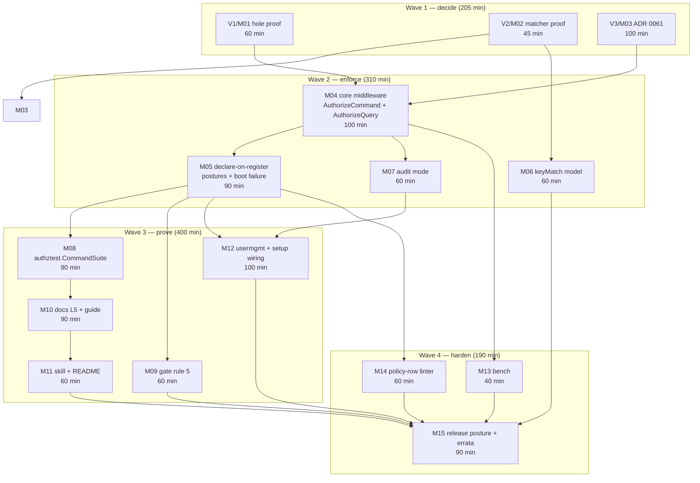

# SUPERB plan: command/query permission gate at the dispatch boundary

**Status:** proposed · **Author:** session 2026-11-06 07:30 · **Predecessor report:**
[`docs/status/2026-11-06_07-24_command-permission-middleware-design-triage_status.md`](../status/archived/2026-11-06_07-24_command-permission-middleware-design-triage_status.md)
· **Related plan of record:**
[`2026-11-02_10-26_SUPERB-permission-system-hardcore-levelup-pareto-plan.md`](2026-11-02_10-26_SUPERB-permission-system-hardcore-levelup-pareto-plan.md)
(that plan built the contract, grants, route postures and gates; **it contains no
dispatch-boundary milestone**, which is why this plan exists rather than an amendment)

> **One sentence.** Authorization today is a property of the *route*, so anything that
> dispatches a command without a route — service-level `Dispatch`, `GrantRoles`
> bootstraps, seeds, jobs, admin CLIs — is unauthorized by construction. This plan makes
> the *dispatch* the enforcement boundary, reuses the existing `Request`/`Decision`
> contract, and declares one posture per command so a forgotten declaration fails at
> construction rather than in production.

---

## 0. State at planning (verified this session, symbol/line cited)

| # | Fact | Evidence (read this session) |
| --- | --- | --- |
| S01 | Root owns the full HTTP CQRS surface: 4 endpoint constructors + 4 dispatch paths | `app.go:243,270,297,325`; `handler.go:167,257,281,324` |
| S02 | 12 decoders + pagination decoding exist | `options_decode.go:32..187`; `options_json.go:84,108` |
| S03 | The authorization contract already exists and is accepted | `authz_contract.go:124` (`Decide`), `172` (`IsForbidden`), `239` (`AuthorizeRequest`), `252` (`AuthorizeIn`); ADR-0057 |
| S04 | HTTP-side gates: `Authorize` (wildcard domain), `RequireAuth` (monotonic), `RequestGuard` (post-decode) | `authz.go:28,43,77` |
| S05 | Engine arity adapts 4-arg → 3-arg on Casbin's request-size error | `authz.go:157` |
| S06 | Command middleware **sees the concrete command** and the actor is already in `ctx` | `command/v4@v4.14.1/handler.go:10`; `dispatcher/v4@v4.5.2/middleware.go:12` |
| S07 | The shipped Casbin model matches objects by **exact equality**, so `command/*` matches nothing | `identity-model/authz_model.go:24` |
| S08 | Seeded policies already cover admins globally (`admin`/`super_admin` → `*,*,all`) | `identity-model/authz_model.go:30` |
| S09 | The dispatcher exposes **no enumeration API** (`Use`, `Register`, `Dispatch`, `Close` only) | `dispatcher/v4@v4.5.2/dispatcher.go:62..206` |
| S10 | Root already keeps a per-type config registry for sync replay | `app.go:44,245,299`; `sync_push.go:116,124,136` |
| S11 | Sync push **is** authorized and **is** dispatched through `a.commands.Dispatch` | `sync_push.go:248` (authz), `261` (guard), `271` (dispatch) |
| S12 | Maturity gate is already **blocking** (`--ratchet`) in `check-modules` + flake | `flake.nix:1202,1272,1848`; `docs/PERMISSIONS.md:212` |
| S13 | Upstream has no authz middleware; the `claiming` module is SQL row leases, unrelated | `middleware/v4@v4.7.2/*.go` (no authz file); `claiming/v4@v4.0.2/claiming.go:1-30` |
| S14 | `TODO_LIST.md:25` item 3 still calls the maturity ratchet "advisory" — stale vs S12 | `TODO_LIST.md:25` vs `flake.nix:1202` |
| S15 | Two `go.mod` tidy drifts surfaced by the harness, untouched | `dashboardui/go.mod:62` (commandlifecycle), `usermgmt/go.mod:74` (catalog) |

**Erratum to the predecessor report.** That report's §a4 asserted `SyncPushHandler`
bypasses authorization. **False** — verified at `sync_push.go:248/261`: sync push replays
the full `handlerConfig`, authorization included. The genuinely ungated paths are
service-level dispatch (`Service.GrantRoles` → `Dispatch`, seeds/bootstrap, jobs, admin
CLIs). The plan is unaffected in direction, but §M01's proof target changed, and one
micro-task exists purely to correct the record.

**Why this is not already in the 2026-11-02 plan.** That plan's Pareto axes were grants
durability, the decision contract, route postures and gates (M01–M20). Dispatch-level
enforcement appears nowhere in it — confirmed by reading its §1, §4 and §7.

---

## 1. Pareto decomposition

Sort key everywhere below: **impact desc, then effort asc, then customer-value desc.**

### 1.1 The 1 % that delivers ~51 % — the three facts that decide the whole design

| ID | Item | Why it is 1 % |
| --- | --- | --- |
| V1 | **Prove the hole** with a failing test: a command dispatched service-level (no route) succeeds with no authenticated user | Without this, the entire workstream is a hypothesis and every later milestone is speculative. Also corrects the sync-push erratum in the same artifact |
| V2 | **Prove the matcher** with a table test: `keyMatch` is a superset of the current equality matcher for exact, non-match, bare `*` and `command/*`, on **both** 4-field and 3-field models | Decides whether policy files stay at ~3 rows per repo or explode to one row per command per role. This single fact determines whether the scheme is usable fleet-wide |
| V3 | **Record the boundary decision** (ADR 0061): ownership, object spelling, action vocabulary, posture model, fail-closed semantics, non-goals | Every later milestone conforms to it; without it, three sessions implement three dialects |

### 1.2 The 4 % that delivers ~64 % — the smallest shippable enforcement core

| ID | Item | Depends |
| --- | --- | --- |
| C1 | `AuthorizeCommand(checker)` as a `command.Middleware`: derive `command/<Name>`, ask `Decide`, deny with the shared codes | V3 |
| C2 | Query mirror `AuthorizeQuery(checker)` over `dispatcher.Middleware[query.Handler]`, `query/<Name>` | C1 |
| C3 | Posture registry + `RegisterCommand`/`RegisterQuery` helpers so **registering is declaring** (S09: the dispatcher cannot be enumerated, so declaration must be our own act) | V3 |
| C4 | Unit matrix: 4 dispatch paths × 3 outcomes (allow / deny / engine error) | C1, C2 |
| C5 | `keyMatch` in `DefaultRBACModel` + a regression test that pins it | V2 |

### 1.3 The 20 % that delivers ~80 % — enforcement you can trust and audit

| ID | Item |
| --- | --- |
| E1 | Boot-time refusal: any registered-but-undeclared type fails construction with the full list |
| E2 | Audit mode (`AuditOnly()`): deny → structured log + allow, so a repo can measure before enforcing |
| E3 | `authztest.CommandSuite`: the per-command 401/403/200 matrix, mirroring the route `Suite` |
| E4 | Static gate rule 5 in `check-permission-surface`: a `Register` call that bypasses the declaration helper |
| E5 | `docs/PERMISSIONS.md` L5 row + inventory + guide section (`authorization-system.md`) + skill § |
| E6 | Wire `usermgmt` (21 commands) and `setup`, proving the seam works where the dispatcher is *owned* by the library |
| E7 | Bench: gate cost on the hot dispatch path, allocs reported |

### 1.4 The remaining 80 % → 100 % (explicitly listed, deliberately late)

Policy-row linter (rows that match no command), denial metrics/OTel span attributes,
CHANGELOG + release train for 5 modules, external consumer waves (6 repos, each in its
own repo per guardrail 7), v5 removal of the deprecated `Enforce` 3-arg path, ReBAC
re-evaluation, upstream go-cqrs-lite ask (D2), `TODO_LIST.md` stale-row true-up (S14),
the two `go.mod` tidy fixes (S15), and a post-implementation re-verification of the
predecessor report's §a tables.

---

## 2. Decisions taken at planning time (autonomous, flagged for override)

| ID | Decision | Rationale |
| --- | --- | --- |
| D1 | **Lives in cqrs-htmx root**, not upstream go-cqrs-lite | Root already owns `Request`/`Decision`/`PermissionChecker` (S03) and imports `command`/`query`; upstream has no authz contract (S13). Upstream keeps no second implementation — see D2 |
| D2 | File an upstream **ask** (go-cqrs-lite issue) offering the middleware shape for adoption, and add a repo gate note "if upstream ships authz, this delegates" | Prevents the classic two-implementations split-brain without blocking delivery on an upstream tag |
| D3 | Object spelling `command/CreateItem` and `query/ListItems` — **slash, not colon and not dot** | `:` is `keyMatch2`'s parameter marker (a consumer model using keyMatch2 would silently turn a permission name into a wildcard); `.` stays a regex any-char under keyMatch2; `/` is literal under both, and `keyMatch`'s `*` is a documented prefix wildcard, so `command/*` works |
| D4 | Actions: `execute` for commands, `read` for queries, overridable via `PolicyContext` | Minimal ask by default; overlaying domain verbs (`refund`, `approve`) multiplies rows for no gain until a real policy needs it |
| D5 | Params reach policy only through a **closed typed interface** (`PolicyContext` returning `cqrshtmx.Request`), never a map of fields | Free-form attributes are ABAC/ReBAC, explicitly deferred by ADR-0058; a map would let policy shape drift with the payload schema |
| D6 | **Undeclared posture = gated** (fail closed), validated at construction | Fail-closed is the only default that cannot silently ship an open door; failing at construction (not first request) makes it a bug you fix in seconds |
| D7 | The gate ships **opt-in** and supports `AuditOnly()` | Additive-first (guardrail 1); a fleet-wide default-deny flip in one commit reds every repo at once |
| D8 | Capability in the middleware, invariants in the decider | Replay does not re-run deciders, so ownership rules cannot be the only gate; conversely the domain must not own policy rows |
| D9 | Maturity level **L5 — dispatch-gated**, with the command posture manifest as the artifact | The existing L4 is route-scoped; a repo can be L4 and still dispatch ungated, which is exactly today's gap |
| D10 | No new Go module | Guardrail 5: nothing needs it; root already has everything |

---

## 3. Anti-verschlimmbesserung guardrails (binding, inherited + extended)

1. **Additive first.** No public removal before v5; new surface is opt-in.
2. **No behaviour change without a failing-then-passing test.**
3. **One write path** for grants — `GrantRoles` stays the only durable write.
4. **No dependency inversion.** Root must not import `identity-model`/`usermgmt`.
5. **No new module** (D10).
6. **No gate weakened, no baseline relaxed** except in the same commit as its cause.
7. **External repos are read/verify targets.** Consumer waves land in their own repos.
8. **Re-verify every `file:line` before editing** (three of six prior findings were stale).
9. **Kill criterion:** two attempts per milestone, then record the blocker and stop the wave.
10. **The daemon is real.** `git log --stat` before assuming attribution.
11. **NEW — one rule, one place.** If a permission fact appears in the middleware, the
    HTTP option, the gate script and the docs, they must derive from one declaration; a
    second hand-written copy is a review blocker.
12. **NEW — no policy rows in Go source.** Postures are code; *policies* are data. A
    middleware that hard-codes subject→object rows has become the policy engine.
13. **NEW — audit mode is a migration tool, not a posture.** A repo may sit in audit mode
    for at most one wave; the gate records it so it cannot become permanent.

---

## 4. Milestones (30–100 min), sorted by impact / effort / value

Impact: **C** critical · **H** high · **M** medium · **L** low.
Value: **Co** consumers · **Ag** agents · **Hu** owner · **CI** build trust · **Se** security.

| ID | Milestone | Impact | Effort | Value | Depends | Verify (definition of done) |
| --- | --- | --- | ---: | --- | --- | --- |
| M01 | **Hole proof + erratum** — failing tests for ungated service-level dispatch; correct the sync-push claim | C | 60 | Se, Ag | — | Failing test committed with a `t.Skip`-free expectation; erratum line in the predecessor report |
| M02 | **Matcher proof** — `keyMatch` table test on 4-field and 3-field models; no model edit yet | C | 45 | Se, Ag | — | Table test green against a locally-built model; verdict recorded (superset: yes/no) |
| M03 | **ADR 0061** — boundary, ownership, spelling, acts, posture, fail-closed, non-goals, upstream ask | C | 100 | Ag, Hu | M02 | ADR + `docs/adr/INDEX` row; E9 lint/docs gates green |
| M04 | **Core middleware** — `AuthorizeCommand` + `AuthorizeQuery`, derived object, `Decide`, shared denial codes | C | 100 | Co, Se | M03 | 4 paths × 3 outcomes green; denial classifies via `IsForbidden` |
| M05 | **Declare-on-register** — posture registry + `RegisterCommand`/`RegisterQuery`; undeclared = gated; construction fails listing offenders | H | 90 | Co, Ag | M04 | Test: one undeclared + one declared → constructor error naming only the undeclared |
| M06 | **Model change** — `keyMatch` in `DefaultRBACModel`, regression test, model comment trued | H | 60 | Se, CI | M02 | Table test from M02 points at the shipped constant; consumer-facing comment updated |
| M07 | **Audit mode** — `AuditOnly()`, one structured log, one counter; deny→allow | H | 60 | Co | M04 | Test: audit denies nothing but logs exactly once per denial |
| M08 | **`authztest.CommandSuite`** — matrix over public/authenticated/gated × allow/deny/unauthenticated | H | 90 | Co, CI | M05 | Suite runs against the example app; mutating a posture reds it |
| M09 | **Gate rule 5** — `check-permission-surface` flags registrations that bypass the helper; fixture self-test | H | 60 | CI, Ag | M05 | Planted violation fails; clean tree passes; suppression counted |
| M10 | **Docs** — `PERMISSIONS.md` L5 + inventory, guide section, `authztest` README, L5 baseline row | M | 90 | Hu, Ag | M05, M08 | `check-permission-maturity --ratchet` green with the new row; links gate green |
| M11 | **Skill + README** — `.agents/skills/cqrs-htmx/SKILL.md` §Authorization + root README paragraph, parse-safe fences | M | 60 | Ag | M04 | `check-skill-snippets` + `check-skill-claims` + `check-readme-splitbrain` green |
| M12 | **Library-owned dispatcher** — posture table for usermgmt's 21 commands + `setup` pass-through + integration test | H | 100 | Co | M05 | Integration: gated command via service dispatch denies without a grant, allows with it |
| M13 | **Bench** — gate cost, allocs, with/without; record the number in the plan receipt | M | 40 | Hu, Co | M04 | `b.Loop()` + `ReportAllocs`; < 5 % overhead on the dispatch path, stated either way |
| M14 | **Policy-row linter** — `check-policy-rows`: a row whose object matches no declared command fails | M | 60 | CI | M05 | Fixture: planted orphan row fails; real tree passes |
| M15 | **Release posture + errata** — CHANGELOG, `TODO_LIST` stale-row true-up (S14), go.mod tidy (S15), release-train dry run | M | 90 | Hu, CI | M01–M12 | `check-modules` + `train-preflight` dry green; TODO row corrected |

**Total: ~1,075 min ≈ 18 h ≈ 3–4 focused sessions.** Wave 1 = M01–M03 (205 min). Wave 2 =
M04–M07 (310 min). Wave 3 = M08–M12 (400 min). Wave 4 = M13–M15 (190 min).

---

## 5. Micro-tasks (≤ 12 min each) — complete coverage of every milestone

Estimates in minutes. Every task is verifiable without judgement calls.

### M01 · Hole proof + erratum (60)

| ID | Task | Min |
| --- | --- | ---: |
| m01.1 | Re-read `sync_push.go:225-300`; write the erratum paragraph for the predecessor report | 10 |
| m01.2 | Write `TestDispatchWithoutRouteIsUngated` (service-level `Dispatch`, no session) that **documents today's behaviour** with an explicit `// OWNS: gates land in M04` comment | 12 |
| m01.3 | Add a second case: seed/bootstrap dispatch in `usermgmt` (or an example) with no actor in `ctx` | 12 |
| m01.4 | Add a third case: `AdminCLI`-shaped dispatch through `App`-less code path | 12 |
| m01.5 | Run `GOEXPERIMENT=jsonv2 go test ./... -run 'Ungated' -count=1` and paste the output into the plan receipt | 6 |
| m01.6 | Append the erratum to `docs/status/2026-11-06_07-24_...status.md` §a4 (inline correction, not rewrite) | 8 |

### M02 · Matcher proof (45)

| ID | Task | Min |
| --- | --- | ---: |
| m02.1 | Locate the Casbin version in `identity-model/go.mod`; read `KeyMatch` in the module cache | 8 |
| m02.2 | Write the table: exact hit, exact miss, bare `*`, `command/*` prefix, `query/*` prefix, near-miss (`command/CreateItemX` vs `command/*`) | 12 |
| m02.3 | Run the table against `DefaultRBACModel` with `keyMatch` substituted, 4-field | 10 |
| m02.4 | Repeat against a 3-field model (`enforceRequest`'s fallback arity) | 8 |
| m02.5 | Record the verdict + the diff of the matcher line in the plan receipt | 7 |

### M03 · ADR 0061 (100)

| ID | Task | Min |
| --- | --- | ---: |
| m03.1 | Copy the ADR skeleton from 0057 (Status/Date/Related/Context/Decision/Consequences/Rejected/Delivery) | 8 |
| m03.2 | Write Context: the route-vs-dispatch asymmetry, citing S01–S11 | 12 |
| m03.3 | Write Decision §1: object spelling + why not `:` or `.` (D3) | 10 |
| m03.4 | Write Decision §2: posture model, undeclared = gated, construction-time failure (D6) | 10 |
| m03.5 | Write Decision §3: capability vs invariant split (D8) | 8 |
| m03.6 | Write Decision §4: actions (D4), closed `PolicyContext` (D5) | 8 |
| m03.7 | Write Decision §5: audit mode + one-wave limit (D7, guardrail 13) | 8 |
| m03.8 | Write Rejected alternatives: upstream-only (D1/D2), free-form params, policy rows in Go, route-only gating | 12 |
| m03.9 | Write Delivery slices table (waves 1–4 from §4) + `docs/adr/INDEX.md` row | 12 |
| m03.10 | Run `bash scripts/checks/check-docs-links.sh` + freshness | 6 |
| m03.11 | File the upstream go-cqrs-lite ask (D2) and link it from the ADR | 6 |

### M04 · Core middleware (100)

| ID | Task | Min |
| --- | --- | ---: |
| m04.1 | Create `authz_dispatch.go`; define `AuthorizeCommand(checker)` returning `command.Middleware` | 10 |
| m04.2 | Derive `obj = "command/" + string(cmd.Type())`, `act = ActionExecute` | 6 |
| m04.3 | Read subject/domain from `ctx` via `UserIDFromContext` + a domain resolver seam (default wildcard) | 12 |
| m04.4 | Call `Decide`; map `ReasonNotAuthenticated` → `unauthorized`, else → `forbidden` | 10 |
| m04.5 | Engine error → infrastructure error (503), never a silent allow | 8 |
| m04.6 | Add `AuthorizeQuery(checker)` over `dispatcher.Middleware[query.Handler]`, `query/`, `ActionRead` | 12 |
| m04.7 | Unit tests: allow (200-path), deny (`IsForbidden` true), engine error (`MapError` = 503) | 12 |
| m04.8 | Tests on all four dispatch paths incl. `CommandTyped`/`QueryTyped` | 12 |
| m04.9 | Guard: nested double-gate when sync push already authorized — assert one denial, not two | 10 |
| m04.10 | Confirm gate is **outermost** in a test that fails retries on denial | 8 |

### M05 · Declare-on-register (90)

| ID | Task | Min |
| --- | --- | ---: |
| m05.1 | Define `Posture` (public / authenticated / gated) + `PostureSet` type | 8 |
| m05.2 | Implement `RegisterCommand(disp, typ, posture, handler)` wrapping `command.RegisterTyped` | 12 |
| m05.3 | Implement `RegisterQuery` mirror | 8 |
| m05.4 | Store declarations in a new `postureRegistry` (extend the existing `commandRegistry` pattern, S10) | 12 |
| m05.5 | Add `ValidatePostures()` returning one error listing every undeclared registered type | 12 |
| m05.6 | Wire it into the gate middleware's construction so an offending set fails fast | 12 |
| m05.7 | Tests: declared-only passes; one undeclared fails naming exactly that type | 12 |
| m05.8 | Test: `public` bypasses the engine entirely (no `Check` call — assert via a counting fake) | 8 |
| m05.9 | Test: `authenticated` denies a zero user with `unauthorized`, calls no engine | 6 |

### M06 · Model change (60)

| ID | Task | Min |
| --- | --- | ---: |
| m06.1 | Point M02's table test at `identitymodel.DefaultRBACModel` | 8 |
| m06.2 | Replace the equality test with `keyMatch(r.obj, p.obj)` in the matcher | 6 |
| m06.3 | Run `go test ./identity-model/... -count=1` — expect only intended diffs | 12 |
| m06.4 | Run `go test ./usermgmt/... ./adminui/... -count=1` for fallout | 12 |
| m06.5 | Update the model doc comment (it currently promises exact matching) | 8 |
| m06.6 | Add `docs/gotchas.md` entry: "colon in a policy object is a keyMatch2 wildcard" | 10 |
| m06.7 | Re-run the 2026-11-02 plan's route-posture proof (`authztest`) for regressions | 4 |

### M07 · Audit mode (60)

| ID | Task | Min |
| --- | --- | ---: |
| m07.1 | Add `AuthzGateOption` + `AuditOnly()` functional option | 8 |
| m07.2 | On deny in audit mode: `slog.WarnContext` with subject/domain/object/action/reason | 8 |
| m07.3 | Add a nil-safe counter seam (`func(Decision)`) so consumers can wire Prometheus | 10 |
| m07.4 | Test: audit mode allows, logs once, counter fires once | 10 |
| m07.5 | Test: enforce mode's log shape is identical minus the allow | 8 |
| m07.6 | Document the one-wave limit in godoc + ADR cross-ref (guardrail 13) | 8 |
| m07.7 | Gate note: `AuditOnly` in a released module is surfaced by `check-permission-surface` (rule 6, deferred) | 8 |

### M08 · `authztest.CommandSuite` (90)

| ID | Task | Min |
| --- | --- | ---: |
| m08.1 | Read `authztest` package layout + `Suite` contract | 10 |
| m08.2 | Define the command matrix: (posture × identity × grant) table | 10 |
| m08.3 | Implement runner: build dispatcher + registry, dispatch, assert error class | 12 |
| m08.4 | Assert `IsForbidden`/`IsUnauthorized` rather than strings | 8 |
| m08.5 | Add `Undeclared` coverage: an undeclared type must fail construction, not dispatch | 10 |
| m08.6 | Wire the suite into `examples/basic` (or a new `examples/authz-demo`) | 12 |
| m08.7 | Mutation check: flip one posture and prove the suite reds | 10 |
| m08.8 | Write `authztest/README.md` §CommandSuite | 10 |
| m08.9 | Run the suite under `-race` | 8 |

### M09 · Gate rule 5 (60)

| ID | Task | Min |
| --- | --- | ---: |
| m09.1 | Read `check-permission-surface.sh` rule structure + suppression helper | 10 |
| m09.2 | Write rule 5 regex: `\.Register\(` / `RegisterTyped(` outside the helper file | 10 |
| m09.3 | Exempt `authz_dispatch.go` + `usermgmt` internal registrations with reason comments | 10 |
| m09.4 | Add a planted-violation case to the fixture self-test | 10 |
| m09.5 | Add a clean-case assertion (helper use passes) | 8 |
| m09.6 | Run the gate over the repo + the self-test | 12 |

### M10 · Docs (90)

| ID | Task | Min |
| --- | --- | ---: |
| m10.1 | `docs/PERMISSIONS.md`: add `### L5 — dispatch-gated` + exit criterion | 12 |
| m10.2 | Add the L5 row to the inventory for the example/demo service + honest `?` where unproven | 12 |
| m10.3 | Raise the maturity baseline for that module in the same change | 8 |
| m10.4 | `docs/guides/authorization-system.md`: new section "the dispatch boundary" with a code fence | 14 |
| m10.5 | Add the three-entry table (HTTP / dispatch / decider) and the double-gate note | 10 |
| m10.6 | Cross-link ADR 0061 ↔ ADR 0057 ↔ ADR 0058 | 6 |
| m10.7 | `authztest/README.md` cross-link from the guide | 8 |
| m10.8 | Run maturity gate + links + freshness | 10 |
| m10.9 | Corpus baseline bump in the same change (planned growth, per README ritual) | 10 |

### M11 · Skill + README (60)

| ID | Task | Min |
| --- | --- | ---: |
| m11.1 | Add §Authorization subsection "gating the dispatch boundary" to `.agents/skills/cqrs-htmx/SKILL.md` | 12 |
| m11.2 | Mark the fence `//doc:api-tour` only if it is a tour; otherwise make it compilable | 8 |
| m11.3 | Add the two gotchas to the skill's gotcha list (colon wildcard, undeclared = gated) | 10 |
| m11.4 | Root `README.md`: one paragraph, no "full CQRS" overclaim | 8 |
| m11.5 | Run `check-skill-snippets`, `check-skill-claims`, `check-readme-splitbrain`, `check-readme-quickstart` | 14 |
| m11.6 | Update `references/core-api.md` in the skill with the new options | 8 |

### M12 · Library-owned dispatcher (100)

| ID | Task | Min |
| --- | --- | ---: |
| m12.1 | Enumerate usermgmt's 21 commands; classify each posture (public/authenticated/gated) | 12 |
| m12.2 | Write the posture table next to `es_dispatch.go` as one declaration | 12 |
| m12.3 | Replace hand registrations with `RegisterCommand`-family calls | 14 |
| m12.4 | Add `ServiceConfig.AuthzGate` seam (nil = today's behaviour) | 10 |
| m12.5 | Thread it to `setup.Config` | 10 |
| m12.6 | Integration test: `GrantRoles` path still works (privileged bootstrap must be allowed) | 12 |
| m12.7 | Integration test: an unprivileged actor's `RevokeRoles` denied with 403 class | 10 |
| m12.8 | Test: gateway-only boot (no HTTP) denies the same command — the actual gap closure | 10 |
| m12.9 | Run usermgmt suite under `-race` | 10 |

### M13 · Bench (40)

| ID | Task | Min |
| --- | --- | ---: |
| m13.1 | Write `benchmark_authz_gate_test.go` with `b.Loop()` + `ReportAllocs` | 12 |
| m13.2 | Sub-benchmarks: no gate / public / gated-allow / gated-deny | 10 |
| m13.3 | Compute overhead vs baseline; write the number into the receipt | 8 |
| m13.4 | If > 5 %: record why, or move the derivation off the hot path | 10 |

### M14 · Policy-row linter (60)

| ID | Task | Min |
| --- | --- | ---: |
| m14.1 | Decide input shape: a policy CSV path list from a config file, not a repo scan | 8 |
| m14.2 | Implement matching: row object must match a declared command/query or `*` | 14 |
| m14.3 | Orphan row → actionable error naming the row and the nearest declared types | 10 |
| m14.4 | Fixture self-test (planted orphan + clean) | 12 |
| m14.5 | Wire advisory into `check-modules` first | 8 |
| m14.6 | Document the "never author a row nothing asks" rule in the guide | 8 |

### M15 · Release posture + errata (90)

| ID | Task | Min |
| --- | --- | ---: |
| m15.1 | `CHANGELOG [Unreleased]` entry for the new surface | 8 |
| m15.2 | True `TODO_LIST.md:25` item 3 (maturity ratchet is already blocking — S14) | 8 |
| m15.3 | Fix `dashboardui/go.mod:62` indirect→direct with `go mod tidy` | 10 |
| m15.4 | Fix `usermgmt/go.mod:74` indirect→direct with `go mod tidy` | 8 |
| m15.5 | Run `nix run .#check-modules` | 12 |
| m15.6 | Run `nix run .#train-preflight` dry (release-train strict leg) | 12 |
| m15.7 | Run the full test battery `GOEXPERIMENT=jsonv2 go test ./... -count=1 -race` | 14 |
| m15.8 | Fill the execution receipt in this plan with what actually landed | 10 |
| m15.9 | Re-verify this plan's §0 table symbol:line citations | 8 |

---

## 6. Execution graph

**Kill points.** After M02: if `keyMatch` is *not* a superset, stop and re-plan the naming
scheme (the entire policy-row argument collapses). After M04: if the gate cannot be made
outermost without breaking retry semantics, stop and re-plan against
`docs/guides/dispatch-middleware-ordering.md`. After M05: if construction-time validation
proves impossible without dispatcher enumeration (S09), fall back to a `cmdguard`-style
explicit `Validate()` call the consumer must make, and record the weakened guarantee in the
ADR before proceeding.

---

## 7. Coverage proof — the predecessor report's §f is fully routed

| Predecessor §f | Routed to |
| --- | --- |
| 1–3 (verify `keyMatch`, 3-field model, fleet model inventory) | M02 (1, 2), M15.9 (3 via consumer-facing note) |
| 4–5 (read permission plan + authorization guide) | **done in this planning session** (§0 cites both) |
| 6–7 (go.mod tidy; prove sync-push hole) | M15.3/4; M01.1/5 (hole proof corrected to service-level dispatch) |
| 8–15 (ADR, spelling, vocabulary, PolicyContext, posture, boot failure, audit mode, ordering) | M03, M04.10, M05, M07 |
| 16 (plan of record) | this file |
| 17–25 (implementation: middleware, query mirror, shared core, wiring, shared codes, guard, typed paths, unit matrix, bench) | M04, M05, M13 |
| 26–33 (usermgmt, setup, systemadapter, sync proof, dashboardui/adminui, authztest, forgotten-posture) | M08, M12 |
| 34–38 (gate rule, maturity row, promotion, row linter, matcher regression) | M09, M10.1–3, M14, M06 |
| 39–42 (guide, PERMISSIONS rows, skill, README) | M10, M11 |
| 43–48 (consumer waves, migration guide) | §1.4 — deliberately outside this plan (guardrail 7) |
| 49–50 (CHANGELOG, re-verification pass) | M15.1, M15.9 |

Nothing from §f is dropped; items 43–48 are explicitly deferred to per-repo sessions.

---

## 8. Errata

| # | Stale claim | Truth (verified) |
| --- | --- | --- |
| E1 | Predecessor §a4: "`SyncPushHandler` bypasses authorization" | `sync_push.go:248` runs `executeAuthorization`, `261` the request guard, `271` the dispatch — sync push is gated. The ungated path is service-level dispatch |
| E2 | `TODO_LIST.md:25` item 3: "promote the maturity ratchet from advisory to blocking" | Already blocking: `flake.nix:1202,1272` run `--ratchet`; `docs/PERMISSIONS.md:212` documents it. The row is stale (fix in M15.2) |
| E3 | Predecessor answer: "a repo needs ~3 rows, not 40" | True only for consumers on `DefaultRBACModel`; unverified for consumers with custom models. M02 + M15.9 scope it |
| E4 | Predecessor §d4: leaned on an advisory gate | The gate is blocking; the failure was mine (citing a stale TODO row instead of the wiring) |

---

## 9. Open owner decisions (each has a working default — nothing is blocked)

| # | Question | Working default assumed by this plan | Override cost |
| --- | --- | --- | --- |
| Q1 | Root vs upstream go-cqrs-lite ownership? | **Root** (D1) + upstream ask (D2) | Move M04/M05 upstream; +1 release train wait |
| Q2 | Is construction-time refusal acceptable as a hard break? | **Yes**, but the gate is opt-in (D7), so no existing consumer breaks until they adopt | Fall back to `Validate()` (M05 kill point) |
| Q3 | Do narrow policy rows belong in policy files or as events? | **Policy files for v1**; events only if a row must be auditable/revocable per tenant | Adds an event-sourced grant path (ADR-0057 territory) |

---

## 10. Execution receipt

**Executed 2026-11-06, 07:44–08:25 CET.** All fifteen milestones landed; nothing was
deferred except the two items §1.4 already placed outside this plan (consumer waves,
upstream ask). The auto-commit daemon committed the work in flight, so the hash column
names the range that carries each milestone rather than a tidy one-commit-per-milestone
history; `git log 4cf82c0b..HEAD` is the authoritative list (70 files, +6369/−225).

| Milestone | Landed | Receipt |
| --- | --- | --- |
| M01 hole proof | `authz_dispatch_test.go` — `TestDispatchWithoutRouteIsUngated` (service-level dispatch, and the sharper case: refused on a gated route, admitted through the dispatcher) | green before M04, still green after (the gate is opt-in) |
| M01 erratum | the predecessor report's §a4 now carries the correction inline | `sync_push.go:248/261/271` |
| M02 matcher proof | `identity-model/authz_matcher_test.go` — 11-row capability table on the 4-field model + the same table on a 3-field model, with the superset property asserted mechanically | **verdict: `keyMatch` IS a superset** — kill point 1 passed |
| M03 ADR | `docs/adr/0063-authorization-at-the-dispatch-boundary.md` + INDEX row (0061/0062 were taken; the missing 0052 row was added on sight). **M03.11 (file the upstream ask) NOT done — owner-gated** | links gate: 1291 links OK at the time |
| M04 core middleware | `authz_dispatch.go` — `AuthorizeCommand`/`AuthorizeQuery`, `DispatchObject`, `ActionExecute`/`ActionRead`, `PolicyContext`, `DispatchOutcome`, `DispatchSubject` | `authz_dispatch_gate_test.go` (allow / deny / engine-error / both dispatchers / `PolicyContext` overlay / outermost placement / one-denial) |
| M05 declare-on-register | `DispatchGate`, `RegisterCommand`/`RegisterQuery` (package-level generics — see deviation 1), `Declare`, `Manifest`, `Validate`, fail-closed undeclared denial. **DoD met only via the sanctioned weakening (deviation 2)** | declaration tests incl. contradictory + missing-reason + empty-set failures; the undeclared case is proven at dispatch time, not construction |
| M06 model change | `DefaultRBACModel` object term is `keyMatch(r.obj, p.obj)`; doc comment trued; **gotcha 54** added to `docs/gotchas.md` + the AGENTS index (the colon/dot wildcard class) | `TestDefaultRBACModelUsesKeyMatch` + identity-model/usermgmt/adminui/setup suites green |
| M07 audit mode | `AuditOnly()`, `OnDecision`, one structured `WarnContext` per denial, one-wave rule in godoc | `TestAuditOnlyReportsWithoutDenying`, `TestEnforceModeReportsOneAuditFreeDenial` |
| M08 `authztest.CommandSuite` | `authztest/command_suite.go` + `README.md` §3 | self-proof + a mutation check that reds a flipped posture; `-race` green |
| M09 gate rule 5 | `undeclared-dispatch` in `check-permission-surface.sh`; self-test 5 → 8 cases | planted violation fails, helper passes, suppression counted (8/8) |
| M10 docs | `docs/PERMISSIONS.md` L5 + six-level heading + inventory row L4→L5 + gate section; `PERMISSIONS_BASELINE` L5; guide §5 with the three-layer table; maturity gate parser extended to `L[0-5]` (rank + self-test 8 → 10 cases) | `--ratchet`: 13 services at or above baseline |
| M11 skill + README | SKILL §"Gating the dispatch boundary (L5)", two new gotchas, `references/core-api.md` dispatch-gate catalogue, README bullet | skill-snippets 42/42, skill-claims 248 symbols (re-measured 2026-11-06 09:30: **218**, 2 allowlisted), readme-splitbrain green |
| M12 library-owned dispatcher | `usermgmt/command_postures.go` (all 21 commands classified) + four integration tests: bootstrap grant works, unprivileged revoke denied naming `command/RemoveMember`, anonymous refused, public registration reachable. **The `setup` half needed no code** — `setup.Config.CommandMiddleware` already carries the gate, so it is documented, not built | `usermgmt` suite green (workspace mode). Hermetic mode red: `command_postures.go` consumes two unpublished root symbols — see "still open" |
| M13 bench | `benchmark_authz_gate_test.go`, `b.Loop()` + `ReportAllocs` | allocation, the only machine-independent number here: 48 B / 1 alloc bare · 176 B / 6 with the gate on any admitting path · 689 B / 16 denied. **Not under 5 %** — recorded honestly: the denominator here is an in-memory no-op handler, which is the cheapest dispatch that exists; the gate's absolute cost is what a real event-store dispatch pays in noise. The two §d experiments were then run and are resolved below |
| M14 policy-row linter | `check-policy-rows.sh` + 8-case fixture self-test, flake apps, `check-modules` + CI parity legs. **Advisory promotion is self-test-only**: this repo authors no policy CSVs, so a run would check zero rows | 8/8; `keyMatch`-shaped matching, prefix suggestions, suppression counting |
| M15 release posture | CHANGELOG entry, `TODO_LIST` stale-row true-up (the maturity ratchet was already blocking), `dashboardui/go.mod` + `usermgmt/go.mod` indirect→direct via `go mod tidy` | `check-modules`, corpus ratchet (48779), freshness, todo-hygiene, shellcheck 131 scripts, links 1378 all green |

The accounting behind every "landed" above — including the four milestones that are
landed but not *complete* — is in
[`docs/status/2026-11-06_08-42_dispatch-boundary-authorization-executed_status.md`](../status/2026-11-06_08-42_dispatch-boundary-authorization-executed_status.md)
§a/§b/§d.

### Deviations from the plan, and why

1. **`RegisterCommand`/`RegisterQuery` are package-level functions, not methods.** Go
   1.27 does carry generic methods, but the repo's `golines` (built with go1.26) cannot
   parse them, so a method form would have made `nix fmt` unformattable. The
   package-level shape also matches the existing `CommandTyped`/`QueryTyped` idiom.
2. **The boot check cannot see a behind-the-back registration** (kill point 3, taken).
   The dispatcher exposes no enumeration API, so `Validate()` checks the declaration set
   it was told about (valid posture, a reason, no contradictions, not-empty) and the
   undeclared case is caught at dispatch time — denied, named, and flagged statically by
   gate rule 5. The weakened guarantee is stated in the ADR and in `Validate`'s godoc.
3. **`DispatchSubject` prefers the user, then falls back to the actor.** Without the
   fallback a bootstrap grant (`context.Background()`) would be unauthenticated by
   construction; with it, machine callers authorize as `system:<name>` while a session
   keeps the route spelling. Both are pinned.
4. **M08 was proven in `authztest`'s own suite, not in `examples/`.** Example modules are
   outside the test gates that run here; a test nobody runs is theatre. The kit's
   self-proof runs in every gate that runs the root module.
5. **M10's guide section is in `docs/guides/authorization-system.md` §5**, not a new
   document — one canon beats two.

### Open decisions — answered by proceeding, reversible

| # | Default taken | How to reverse |
| --- | --- | --- |
| Q1 | Root ownership (D1) + an upstream ask still to be filed (owner-gated: `gh` needs the `workflow`-scope-free path) | move M04/M05 upstream |
| Q2 | Construction-time refusal is acceptable **because the gate is opt-in** — no existing consumer breaks on upgrade | the runtime `Validate()` path already exists |
| Q3 | Policy rows live in policy files for v1 | an event-sourced grant path is ADR-0057 territory |

### Still open (outside this plan's scope)

- The upstream go-cqrs-lite ask (M03.11) — owner-gated, tracked in `TODO_LIST.md`.
- Consumer adoption waves (six repos, each in its own repo per guardrail 7).
- `check-policy-rows` is self-test-only in `check-modules` because this repo authors no
  policy CSVs; it becomes a blocking run the moment a consumer commits one.
- **The release train (owner-gated push) — and this plan adds to it.** Hermetic
  (`GOWORK=off`) builds resolve published tags, so `usermgmt/command_postures.go`
  referencing `cqrshtmx.DispatchPosture` cannot build hermetically until root is tagged
  and `usermgmt`'s require bumped. That is the documented gotcha-30 root-tag-gap class
  (the tree was already red on the parallel session's `DropStats`/`NavEntry`/session
  events), not a new one — but it moves **root ahead of usermgmt** in the train order,
  recorded in the `TODO_LIST.md` release-train row. Which `check-modules` legs are red for
  this reason, verified at execution time: `module-isolation` (dashboardui, integration_test,
  setup, systemadapter, usermgmt), `module-isolation-examples`, `workspace-build`,
  `release-train`, `train-consumers-hermetic`, `readme-quickstart`, `route-postures` (+ its
  self-test). Two further reds are **not** this class and not this plan's: `streamid-identity`
  (`dashboardui/core/command_fates.go:198` uses the display form in an identity slot).

### The §d bench experiments, run and resolved

The status report's §d listed two experiments as not attempted. Both are now settled, and the
answer to the first one was "not the allocation you think".

1. **Cache `DispatchObject` per type — DONE, but as a consequence of a better change.** The
   object string is a fixed function of `(kind, name)`, so rendering it per dispatch was one
   avoidable allocation. It is now rendered once, in `Declare`, and stored beside the
   declaration (`dispatchRow.object`); the declaration-free form (`AuthorizeCommand`) has no
   declaration to hang it on and keeps paying the concat. Measured: **200 B / 7 allocs →
   176 B / 6 allocs** on the public, authenticated and gated-allow paths, and **713 B / 17 →
   689 B / 16** on the denial path. Allocation counts are the only honest metric available
   here: every ns/op reading taken this session moved with machine load (load average ~50, and
   even the *bare* dispatch sub-bench drifted 87 → 146–182 ns while nothing about it changed).
2. **The real win was next to it: the read path held a mutex.** `enforcedPosture` and
   `Manifest` both took a `sync.Mutex` to read a table that is written at boot and never
   again, which serialises every command in the process on one lock for the privilege of
   re-reading constants. `Declare` now publishes a fresh immutable map through an
   `atomic.Pointer` (copy-on-write), so readers take no lock at all and always see a
   consistent snapshot. Correctness is pinned by
   `TestDeclareIsSafeWhileDispatchReads`, which dispatches and reads the manifest while 200
   declarations are being published — and which was **mutation-checked**: reverting `Declare`
   to write into the published map turns it into `WARNING: DATA RACE` and
   `fatal error: concurrent map read and map write` in 26 ms. The contract is stated on the
   `rows` field: declarations are boot-time, the published table is immutable, and a reader
   never needs a lock.
3. **Declined, with reason: a per-type `sync.Map` cache for the declaration-free form.** It
   would trade a ~20 ns concat for a ~15 ns `sync.Map` load plus a mutable cache and a new
   failure mode (a cache that can disagree with the dispatcher's own type set), for 1 of 6
   remaining allocations. Not worth it; the honest conclusion is that casbin's `Enforce`
   dominates the gated path anyway.
