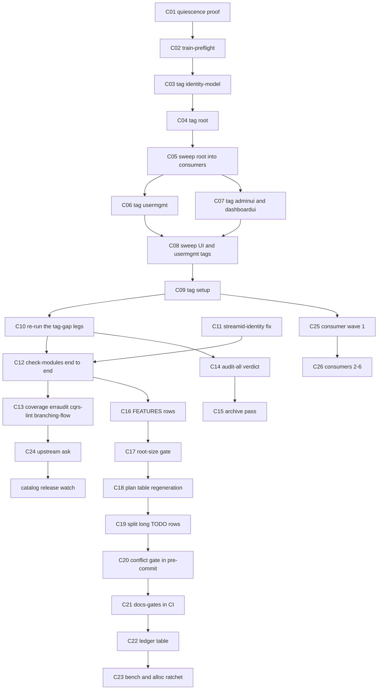

# SUPERB plan: train-first recovery, then burn the gate debt

**Planned:** 2026-11-06 09:48 CET (`date`), immediately after the 09-38 status report.
**Planning scope:** everything the 09-38 report opened (50 items), the repo rows that are executable now, and the one decision that shapes all of them.
**Not in scope (parked by trigger, listed so nothing is lost):** the v5 window (re-export W1–W4), the owner-gated upstream filings, and the P3 long-tail rows in `TODO_LIST.md`.

---

## 0. Verdict in one paragraph

Every red gate on this tree has **one of two causes**, and only one of them is code. Cause A is the **tag gap** (gotcha 30): the workspace carries API that no published tag contains, so every hermetic (`GOWORK=off`) build of a consumer reds — that is 8 of the 9 red `check-modules` legs, both `check-cqrs-lint` module reds, all three bump-dep failures from today's go-appkit sweep, and the whole reason `setup` cannot verify. Cause B is a **single upstream defect** (`catalog/v4@v4.12.0` docserver generated against a templ the family graph cannot resolve) plus **one real local bug** (`dashboardui/core/command_fates.go:198`). Therefore the highest-leverage work is not writing code: it is **cutting our own release train in the right order**, which flips roughly a dozen gate legs from red to green in one afternoon and makes every later sweep meaningful. Everything else — the docs-gates backlog, the feature-inventory gap, the bench re-pin, the consumer waves — is real but is *downstream* of the tree being verifiable again. The trap to avoid is doing the downstream work first and mistaking tag-lag reds for code breakage, which is exactly what cost this session a triage cycle.

---

## 1. Evidence at planning time (all verified 2026-11-06 09:00–09:45)

| # | Fact | Where |
| --- | --- | --- |
| 1 | Workspace build and vet are green in `setup`, `examples/setup-demo`, `examples/async-startup-demo`, `integration_test` | `go build ./...` + `go vet ./...`, rc=0 each |
| 2 | Hermetic builds of `setup` fail on **unpublished local symbols** | `cqrshtmx.DropStats` (`sse_drop_stats.go:31`), `NewDropStats` (`:36`), `NewBroadcaster(opts ...)` (`sse_broadcaster.go:54`), `adminui.NavEntry` (`adminui/config.go:114`), `ExtraNav` (`:102`), `DashboardURL` (`:109`) |
| 3 | Hermetic build of `examples/setup-demo` fails on `setup.Config.AdminDashboardURL` | `setup/config.go:426` |
| 4 | Hermetic vet of `integration_test` fails on the dashboardui replace **plus** upstream catalog poison | `integration_test/go.mod:193`; `catalog/v4@v4.12.0/docserver/specview_templ.go` (`templ.JoinURLErrs`, `templ.ResolveAttributeValue`) |
| 5 | Published tags are behind the tree | newest: root `v4.16.0`, identity-model `v4.15.0`, usermgmt `v4.19.0`, adminui/dashboardui/setup/loginpage `v4.16.0`, systemadapter `v4.12.4` |
| 6 | `docs-gates run .` = 4 PASS / 1 FAIL (`audit-all` 393 vs pinned 322); `annotate` repaired to CLEAN this session | `docs-gates`, 09:33 |
| 7 | `docs-gates freshness` reds on the 09-38 report: 9 unharvested §f items | item ids 4, 6, 9, 10, 14, 30, 32, 39, 45 |
| 8 | 13 live status reports against a tail budget of 3 | `docs/status/TAIL_BASELINE` = 13 |
| 9 | `FEATURES.md` has no row for either 2026-11-06 subsystem | nearest row `FEATURES.md:200` (ADR-0055) |
| 10 | Machine load 32–42 on 32 cores, and a sibling session is live in the tree | `/proc/loadavg`; `huma/` module appeared mid-session |
| 11 | One authoring bug remains, unrelated to tags | `dashboardui/core/command_fates.go:198` (display form of a stream ID in an identity slot, gotcha 25) |

---

## 2. The constraint that shapes the whole plan

| Fact | Consequence |
| --- | --- |
| A published module cannot gain API without a new tag | no consumer can verify against local work; every hermetic leg reds until we tag |
| `usermgmt/command_postures.go` consumes `cqrshtmx.DispatchPosture` | **root must be tagged before usermgmt** — the order in every older train is now wrong |
| Tagging is irreversible (module proxy poisoning on a bad tag) | the train runs only on a quiet, verified tree; preflight is mandatory, not optional |
| The repo has a documented tag-cache race | use `check-release-train --refresh-cache` before and after |
| Another session edits this tree | never run the train, a tree-wide formatter, or `git add -A` while a foreign diff exists |

---

## 3. Pareto decomposition

### 3.1 The 1% that delivers ~51% — cut the train

One operation: tag `identity-model`, then **root**, then `usermgmt`, `adminui`, `dashboardui`, `setup`, sweeping the consumer requires between steps. It clears, in one pass: 8 `check-modules` legs (`module-isolation`, `module-isolation-examples`, `workspace-build` consumer half, `release-train`, `train-consumers-hermetic`, `readme-quickstart`, `route-postures` + its self-test), the two `check-cqrs-lint` module reds, and 3 of the 4 bump-dep failures. Nothing else in the backlog comes close.

### 3.2 The 4% that delivers ~64% — make the post-train tree *provably* green

The train only converts red to green if someone re-runs and records the legs, and if the one non-tag bug is fixed. That means: fix `streamid-identity`, run `check-modules` end to end, run `coverage-gate` + `erraudit-strict` + `check-cqrs-lint` (never run as a set this session), and re-run the go-appkit sweep to confirm 4/4. Without this step the train is a claim, not a receipt.

### 3.3 The 20% that delivers ~80% — drain the debt the gates are now honest about

With the tree green, the remaining reds are *content* reds: `docs-gates audit-all` (393 vs 322), the 13-report tail against a budget of 3, the two missing `FEATURES.md` rows, the wrong root-size number in `TODO_LIST.md:21`, the 15 over-1,500-char TODO rows, and the freshness discipline that every new report re-earns. Plus the two cheap hardening wins the conflict-marker discovery handed us: wire the gate into the pre-commit hook and publish the battery matrix in CI.

### 3.4 The remaining 20% to reach 100% — the things that need other people or a quiet machine

Consumer adoption (six repos, one per guardrail 7), the upstream go-cqrs-lite ask, the catalog-release bump, the bench re-pin and the parallel-throughput bench, `check-policy-rows` promotion, the `huma/` module's gates, and the whole v5-window re-export program. All real, all blocked on an external condition, none of them urgent for the 80%.

---

## 4. Waves

### W0 — Train (the 1%, ~5 h of a quiet afternoon)

Verification for the wave: `nix run .#check-modules` reports the tag-gap legs green; `nix run .#check-release-train -- --refresh-cache --strict-lag 0` reports 0 unpublished and 0 lag; `nix run .#verify-remote-tags` reports 0 missing.

### W1 — Receipt (the 4%, ~3 h)

Verification: `check-modules` fully run with a recorded red list (target: only the catalog-poison legs remain), `coverage-gate` 15/15, `erraudit-strict` advisory baseline compared, `check-cqrs-lint` module verdicts recorded, go-appkit sweep 4/4.

### W2 — Debt (the 20%, ~4 h)

Verification: `docs-gates run .` all five PASS; `check-docs-tail-budget --ratchet` green with the tail at 3; `FEATURES.md` carries both rows; `TODO_LIST.md:21` carries measured numbers; no open row exceeds 1,500 chars.

### W3 — Others (the last 20%, ~6 h spread over weeks)

Verification: per-item, each blocked item names its unblocking event. No wave-3 work starts before the owner answers §9 questions 1–3.

---

## 5. Coarse tasks (30–100 min each, sorted by impact then effort)

Impact scale: **A** = unblocks a dozen other tasks, **B** = closes a red gate, **C** = truth/maintainability, **D** = polish. Customer value: **H** = consumer-visible, **M** = maintainer-visible, **L** = internal only.

| ID | Task | Impact | Effort (min) | Cust. value | Depends on | Done when |
| --- | --- | --- | --- | --- | --- | --- |
| C01 | W0 quiescence proof: load, no foreign diff, no live sweeps; record the window in the release runbook | A | 30 | L | — | a written window line with load + `git status` evidence |
| C02 | `train-preflight` run with every skipped stage's reason recorded (S52 mandate) | A | 60 | L | C01 | preflight summary committed with the skip reasons |
| C03 | Tag `identity-model` (next v4 minor) and push the tag | A | 40 | H | C02 | `verify-tag.sh` green, tag peeled on the remote |
| C04 | Tag **root** (next v4 minor) — the load-bearing tag of this train | A | 60 | H | C03 | root tag resolves; `NewDropStats`/`DispatchGate`/`NewBroadcaster` visible in the tagged tree |
| C05 | Sweep the root tag into `usermgmt`, `adminui`, `dashboardui`, `setup`, `loginpage`, `systemadapter` | A | 90 | H | C04 | `bump-dep` PASS table, absence assertion clean |
| C06 | Tag `usermgmt` (posture table + session events) | A | 50 | H | C05 | tag resolves, hermetic usermgmt build green |
| C07 | Tag `adminui` + `dashboardui` (NavEntry, ExtraNav, DashboardURL, drop-stats wiring) | A | 60 | H | C05 | both tags resolve; hermetic builds green |
| C08 | Sweep UI tags into `setup`, `integration_test`, `examples/*` | A | 90 | H | C06, C07 | bump-dep PASS table for every consumer |
| C09 | Tag `setup` and prove the one-call bundle hermetically | A | 50 | H | C08 | `GOWORK=off go build ./...` + `go vet ./...` in `setup` |
| C10 | Re-run the eight tag-gap legs and record the before/after table | A | 40 | M | C09 | table with leg, before, after, evidence |
| C11 | Fix `streamid-identity` (`dashboardui/core/command_fates.go:198`) — the one red no tag fixes | B | 30 | H | — | `check-streamid-identity.sh` green |
| C12 | `check-modules` end to end, with the residual red list recorded | B | 60 | M | C10, C11 | one composite run, its red list written down |
| C13 | `coverage-gate` + `erraudit-strict` + `check-cqrs-lint` + `branching-flow` as a set | B | 90 | M | C12 | four verdicts recorded against their baselines |
| C14 | Decide and execute the `docs-gates audit-all` verdict (drain or owner-approved re-pin) | B | 100 | L | owner Q1 | `docs-gates run .` all five PASS |
| C15 | Archive pass for the 13 live reports (annotate, then `git mv`, then lower the tail baseline) | B | 100 | M | C14 | tail 3, `--ratchet` green, manifest row written |
| C16 | Add the two `FEATURES.md` rows (dispatch gate, direct-imports policy) | C | 30 | H | tree free of foreign edits | two rows citing the shipped files |
| C17 | True the root-size numbers in `TODO_LIST.md:21` and add a recompute gate | C | 60 | M | — | the gate prints the count; the doc quotes the gate |
| C18 | Replace the re-export plan's hand-summed cluster table with a script output | C | 50 | M | — | table regenerated by script, committed with the script |
| C19 | Split the 15 over-long TODO rows into short rows plus linked anchors | C | 90 | M | — | no open row over 1,500 chars |
| C20 | Wire the conflict-marker gate into the pre-commit hook + template (fail early, not post-commit) | C | 40 | M | — | hook refuses a planted marker; template in sync |
| C21 | Publish the docs-gates matrix in CI and decide `check-modules` membership | C | 60 | M | — | CI prints the five verdicts; membership decided |
| C22 | Reformat the corpus ledger paragraph into a table | C | 40 | L | — | ledger readable line-per-pass |
| C23 | Bench re-pin in a quiet window + parallel-throughput sub-bench + allocation ratchet | C | 90 | L | quiet machine | re-pinned baseline, new sub-bench, new gate |
| C24 | File the upstream go-cqrs-lite ask (dispatch middleware offer) | D | 60 | M | owner Q2 | issue filed, ADR 0063 links it |
| C25 | Consumer wave 1 (browser-history): durable grants replace `reconcileSuperAdmins` | A | 90 | H | C09 | their repo green with the gate installed |
| C26 | Consumers 2–6 (Swetty, crm, InboxClean, github-local-sync, webphone) | A | 100 each | H | C25 | per repo, per guardrail 7 |

---

## 6. Fine tasks (≤12 min each — the whole plan, executable without further thought)

| ID | Task | Parent | Min | Done when |
| --- | --- | --- | --- | --- |
| F01 | `cat /proc/loadavg`; record load and core count | C01 | 2 | line written |
| F02 | `pgrep -af 'bump-dep\|wave-tag\|go test\|nix build'` and record foreign processes | C01 | 3 | line written |
| F03 | `git status --short` and list every file not owned by this plan | C01 | 2 | list written |
| F04 | Grep the release runbook for the quiet-window policy; add today's evidence | C01 | 5 | runbook line updated |
| F05 | `nix run .#train-preflight` (background, expect minutes) | C02 | 10 | rc and stage table captured |
| F06 | Record every skipped preflight stage with its reason | C02 | 5 | reasons file/paragraph committed |
| F07 | `git tag --list 'identity-model/v4.*'` and pick the next minor | C03 | 2 | version chosen |
| F08 | `scripts/tools/verify-tag.sh identity-model <ver> --push` | C03 | 8 | tag peeled on remote |
| F09 | `git log --oneline identity-model/<old>..HEAD -- identity-model/` and summarize the delta | C03 | 6 | summary in the commit body |
| F10 | Pick the root version from the tag list and the delta type (minor vs patch) | C04 | 3 | version chosen |
| F11 | `scripts/tools/verify-tag.sh . <ver> --push` | C04 | 8 | tag peeled on remote |
| F12 | Confirm the tagged tree carries `NewDropStats` and `DispatchGate` | C04 | 3 | `git show <tag>:sse_drop_stats.go` proves it |
| F13 | `scripts/tools/bump-dep.sh 'cqrs-htmx/v4$' <rootver> --commit --lint` | C05 | 10 | PASS table |
| F14 | Re-run the two FAIL modules from that sweep and read the logs | C05 | 6 | either PASS or a named cause |
| F15 | `nix run .#check-release-train -- --refresh-cache --strict-lag 0` | C05 | 6 | 0 unpublished, 0 lag |
| F16 | Pick the usermgmt version; confirm it is above `v4.19.0` | C06 | 2 | version chosen |
| F17 | `verify-tag.sh usermgmt <ver> --push` | C06 | 8 | tag peeled |
| F18 | Hermetic `go build ./...` + `go vet ./...` inside `usermgmt` | C06 | 8 | rc=0 both |
| F19 | Pick adminui + dashboardui versions (same minor, family convention) | C07 | 3 | versions chosen |
| F20 | `verify-tag.sh adminui <ver> --push` and `verify-tag.sh dashboardui <ver> --push` | C07 | 10 | both peeled |
| F21 | Hermetic builds of both UI modules | C07 | 8 | rc=0 both |
| F22 | `bump-dep.sh 'cqrs-htmx/(adminui\|dashboardui)/v4$' <ver> --commit --lint` | C08 | 10 | PASS table |
| F23 | `bump-dep.sh 'cqrs-htmx/usermgmt/v4$' <ver> --commit --lint` | C08 | 10 | PASS table |
| F24 | Bump `integration_test` + `examples/*` requires to the new tags | C08 | 10 | bump-dep PASS table |
| F25 | Pick the setup version; `verify-tag.sh setup <ver> --push` | C09 | 8 | tag peeled |
| F26 | Hermetic `go build ./...` + `go vet ./...` in `setup` | C09 | 8 | rc=0 both |
| F27 | Hermetic build of `examples/setup-demo` and `examples/async-startup-demo` | C09 | 10 | rc=0 both |
| F28 | Re-run `check-module-isolation.sh` and record the leg verdict | C10 | 8 | before/after row |
| F29 | Re-run `check-module-isolation.sh --examples` | C10 | 8 | before/after row |
| F30 | Re-run `check-route-postures.sh` + its self-test | C10 | 8 | both green |
| F31 | Re-run `check-readme-quickstart.sh` | C10 | 8 | green |
| F32 | Re-run `check-train-consumers-hermetic.sh` | C10 | 8 | green |
| F33 | Re-run `check-workspace-build.sh` and separate the catalog-poison legs from the rest | C10 | 10 | residual classified |
| F34 | Open `dashboardui/core/command_fates.go:198` and identify the identity slot it feeds | C11 | 5 | the offending call named |
| F35 | Replace the display form with the identity form (or pin it with a suppression and a reason) | C11 | 8 | `check-streamid-identity.sh` green |
| F36 | Re-run the dashboardui suite after the fix | C11 | 10 | rc=0 |
| F37 | `nix run .#check-modules` end to end (background) | C12 | 12 | full stage table |
| F38 | Write the residual red list with one cause per leg | C12 | 8 | list committed |
| F39 | `nix run .#coverage-gate` and compare against the tsv thresholds | C13 | 12 | 15/15 or named modules |
| F40 | `nix run .#check-erraudit-strict` and compare against TOTAL=303 | C13 | 10 | delta recorded |
| F41 | `nix run .#check-cqrs-lint` and record per-module verdicts | C13 | 12 | 14/14 or named modules |
| F42 | `nix run .#check-branching-flow` and compare against the SARIF baseline | C13 | 8 | no new findings |
| F43 | `nix run .#check-upstream-treadmill -- --strict-lag 0` | C13 | 8 | worst lag recorded |
| F44 | `docs-gates freshness . --audit-all --audit-max=0` and bucket the 393 by report | C14 | 10 | per-report table |
| F45 | Harvest the top five reports' items into living-doc lines with distinctive nouns | C14 | 12 | freshness count drops |
| F46 | Re-measure and either lower the pin or write the re-pin request for the owner | C14 | 6 | pin decision recorded |
| F47 | Run `check-rows --strict` over each report about to be archived | C15 | 10 | no offenders |
| F48 | Run `bare-rows` over the same set | C15 | 8 | no offenders |
| F49 | `nix run .#archive-status -- <spec.tsv>` dry run | C15 | 10 | plan printed |
| F50 | `--apply`, then re-base links, then lower `TAIL_BASELINE` | C15 | 12 | tail 3, links green |
| F51 | Draft the two `FEATURES.md` rows with evidence paths | C16 | 10 | rows drafted |
| F52 | Insert them under the authorization cluster and re-run `check-docs-links.sh` | C16 | 6 | links green |
| F53 | Measure root production files and LOC with the documented command | C17 | 3 | numbers captured |
| F54 | Replace `TODO_LIST.md:21`'s stale numbers and cite the command | C17 | 5 | row corrected |
| F55 | Draft `check-root-size.sh` that prints the count and a ratchet | C17 | 12 | script prints the truth |
| F56 | Wire it into `check-modules` + a self-test | C17 | 12 | stage green |
| F57 | Run the reexport scanner `--files` summary | C18 | 5 | per-cluster output captured |
| F58 | Regenerate the plan's cluster table from that output | C18 | 10 | table replaced |
| F59 | Commit the plan update with the table diff called out | C18 | 4 | commit cites the drift |
| F60 | `awk 'length>1500'` over `TODO_LIST.md` and list the 15 offenders | C19 | 4 | list captured |
| F61 | For each offender, extract the done-narrative into CHANGELOG or a linked report | C19 | 12 per 2 rows | row shrinks |
| F62 | Re-run `check-todo-hygiene.sh` after each batch | C19 | 2 | clean |
| F63 | Add the conflict gate to `.githooks/pre-commit` with the MANUAL EDIT comment | C20 | 8 | hook runs it |
| F64 | Mirror the block into `scripts/hooks/pre-commit.template` | C20 | 6 | template in sync |
| F65 | Plant a marker in a scratch clone and prove the hook refuses the commit | C20 | 10 | refusal captured |
| F66 | Add a CI step that runs `docs-gates run . --json` | C21 | 10 | step appears in the matrix |
| F67 | Decide `check-modules` membership and record the reason either way | C21 | 5 | decision line |
| F68 | Convert the ledger paragraph into a one-row-per-pass table | C22 | 12 | table committed, corpus unchanged or lower |
| F69 | Re-pin the bench baseline on an idle machine | C23 | 10 | new raw baseline committed |
| F70 | Add the `b.RunParallel` sub-bench | C23 | 12 | sub-bench runs green |
| F71 | Add the allocation ratchet gate for the three dispatch paths | C23 | 12 | gate green, self-test present |
| F72 | Draft the upstream ask from ADR 0063 and link it back | C24 | 12 | issue body ready |
| F73 | File it (owner-gated) and record the URL in the ADR | C24 | 5 | URL in the ADR |
| F74 | Browser-history: replace `reconcileSuperAdmins` with `GrantRoles` | C25 | 12 | their suite green |
| F75 | Browser-history: install the dispatch gate and declare postures | C25 | 12 | `authztest.CommandSuite` green there |
| F76 | Five remaining consumers, one task each (their repos, their tests) | C26 | 12 each | per repo receipt |

---

## 7. Execution graph

Kill points: if C04 (root tag) cannot ship because the workspace is not verifiable, **stop the train** and fix C11 first — never tag a tree whose own build is red. If C14 needs an owner decision and the owner is unavailable, skip to C16–C22, which are independent.

---

## 8. Verification per wave

| Wave | Command | Green means |
| --- | --- | --- |
| W0 | `nix run .#check-release-train -- --refresh-cache --strict-lag 0` | 0 unpublished requires, 0 train lag |
| W0 | `nix run .#verify-remote-tags` | every tag peels to the same commit |
| W0 | `nix run .#check-module-isolation` and `--examples` | consumers resolve published tags |
| W1 | `nix run .#check-modules` | residual red list contains only the catalog-poison legs |
| W1 | `nix run .#coverage-gate` | 15/15 modules at or above threshold |
| W1 | `nix run .#check-cqrs-lint` | 14/14 modules strict |
| W2 | `nix run github:Artmann-Technologies/docs-gates -- run .` | five gates PASS |
| W2 | `nix run .#check-docs-tail-budget -- --ratchet` | tail at 3 |
| W2 | `nix run .#check-todo-hygiene` | clean, no row over 1,500 chars |
| W3 | `nix run .#bench-spike` | median ns/op within the re-pinned tolerance |

---

## 9. Risks and guardrails (anti-verschlimmbesserung)

1. **Never tag a red tree.** If the workspace itself does not build and vet, stop (kill point).
2. **Never tag with uncommitted `go.mod` edits** (gotcha 5) — the tag would carry a different graph than the commit.
3. **Refresh the tag cache** before judging a fresh tag (gotcha 27); a just-pushed tag reads unpublished until TTL.
4. **Do not run the train while a foreign diff exists.** A sibling session is live; `git status` must show only owned files.
5. **Never raise the `audit_max` pin without an owner tick.** The drain is the policy; the re-pin is a decision.
6. **Never tree-wide format.** Scope `nix run .#fmt` to owned paths (gotcha 53) — a formatter rewrites in-flight files.
7. **Do not delete or rewrite the two plans' evidence tables.** Correct in place with a re-measure note; history is the value.
8. **Do not promote `check-policy-rows` to blocking** until a consumer actually commits a policy CSV — it would verify zero rows today.
9. **Do not bulk-edit `FEATURES.md` or `AGENTS.md` while another session holds them** — route instead, as the 09-38 pass did.
10. **Every wave ends with a written receipt**, because this session proved a green-looking table can hide a corrupted gate file.

---

## 10. Open owner decisions

| # | Question | Default if unanswered |
| --- | --- | --- |
| Q1 | `docs-gates audit-all`: drain 393 → 322, or approve a re-pin to the measured value? | hold the gate red and keep draining the newest reports |
| Q2 | Is the release train authorized now, and may it run while the sibling session is live? | do not tag; execute C11–C22 only |
| Q3 | May edits land in files a sibling session holds (`AGENTS.md`, `FEATURES.md`), or always route to `TODO_LIST.md`? | always route |

---

## 11. What we deliberately do NOT do

- **No new gate architecture.** The gap is execution, not tooling; the repo already has 50+ gates.
- **No v5 window opening.** Alias eviction (re-export W1–W4) stays inside the single planned cut.
- **No consumer repo edits from here.** Six waves, six repos, six receipts (guardrail 7).
- **No `go work sync`.** It rewrites every member from workspace state and breaks the sweep discipline.
- **No bench numbers under load.** The allocation set is the metric until a quiet window exists.
- **No re-litigating green gates.** A gate that passes does not get a redesign.
- **No rewriting historical reports.** Rule-F rewordings are formatting repairs; content stays.

---

## 12. Coverage proof — the 09-38 report's 50 items are all routed

| Report item | Task |
| --- | --- |
| 1, 2 (`audit-all` decision, drain) | C14 (F44–F46) |
| 3 (`FEATURES.md` rows) | C16 (F51–F52) |
| 4 (`check-modules` end to end) | C12 (F37–F38) |
| 5 (`check-cqrs-lint`) | C13 (F41) |
| 6 (`coverage-gate`) | C13 (F39) |
| 7 (`erraudit-strict`) | C13 (F40) |
| 8 (`train-preflight`) | C02 (F05–F06) |
| 9, 10 (tag order, post-train sweep) | C03–C09 (F07–F27) |
| 11 (route-postures post-train) | C10 (F30) |
| 12 (`streamid-identity`) | C11 (F34–F36) |
| 13 (`verify-remote-tags`) | §8 verification row |
| 14 (upstream ask) | C24 (F72–F73) |
| 15, 16 (catalog release + bumps) | W3, blocked with the watch trigger |
| 17, 18, 19, 20 (pre-commit gate, `--staged`, daemon question, hooksPath) | C20 (F63–F65) |
| 21 (bench re-pin) | C23 (F69) |
| 22 (parallel bench) | C23 (F70) |
| 23 (alloc ratchet) | C23 (F71) |
| 24 (`check-policy-rows` promotion) | §11, deliberately parked |
| 25–29 (consumer waves) | C25, C26 (F74–F76) |
| 30 (`TODO_LIST.md:21` numbers) | C17 (F53–F54) |
| 31 (recompute gate) | C17 (F55–F56) |
| 32 (cluster table regeneration) | C18 (F57–F59) |
| 33 (archive the 13 reports) | C15 (F47–F50) |
| 34 (ledger table) | C22 (F68) |
| 35 (`AGENTS.md` format pass) | C16 adjacent, executed when the tree frees |
| 36, 37 (docs-gates in CI, membership) | C21 (F66–F67) |
| 38, 39 (TODO row split) | C19 (F60–F62) |
| 40, 41 (skill gates, 248 → 218 delta) | C13 adjacent; recorded as a W2 follow-up |
| 42 (sibling ledger attribution) | C22 |
| 43, 44 (`bump-dep` hints) | §11, deferred until the train proves the flow |
| 45, 46 (go-appkit re-run, demo check) | C08 (F24), C09 (F27) |
| 47 (baseline file format) | C17 adjacent, recorded |
| 48, 49 (collision probe, quiet-window doc) | C01 (F01–F04) |
| 50 (`huma/` gates) | W3, blocked on the sibling landing it |
