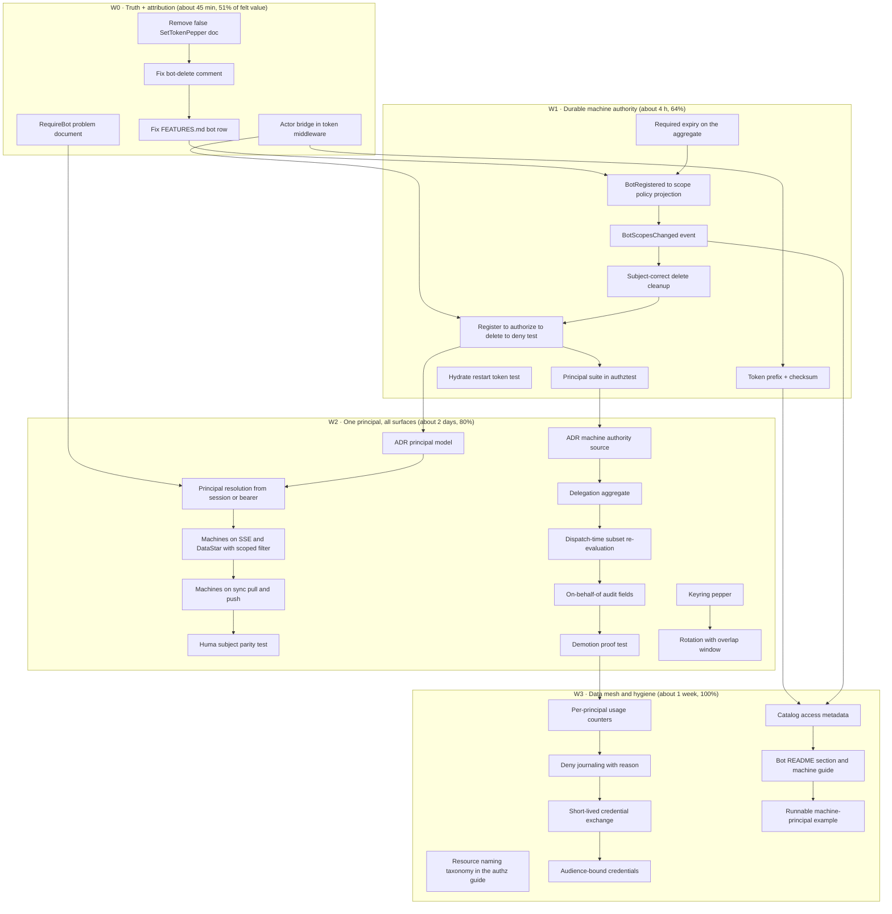

# SUPERB plan — machine-to-machine, project-to-project, data-mesh, and AI-agent auth, made default-secure

**Created:** 2026-11-06, 11:49 CET
**Repo:** `/home/lars/projects/cqrs-htmx`, branch `master`
**Companion documents:** `docs/status/2026-11-06_11-13_usermgmt-m2m-ai-agent-answer-audit-and-two-policy-identity-traps_status.md` (the findings), `docs/status/2026-11-06_11-49_m2m-findings-report-and-superb-design-answer_status.md` (the audit of the answer)
**Status:** plan only. Nothing in this document has been implemented. No code was changed to produce it.

---

## 0. The thesis in one paragraph

Four use cases (service-to-service, project-to-project, data mesh, AI agents) are one problem: a non-human principal acting on a resource in a domain, where authority must be narrow, short-lived, revocable, attributable, and observable. The library already ships the vocabulary for four of those five (posture declarations, a decision contract with reasons, an event-sourced audit chain, a catalog) and none of the machinery for the fifth. The single load-bearing defect is that a machine principal cannot be given authority through an event-derived path at all: the Casbin projection has no `BotRegistered` branch, `RolesForActor` returns nil for machine actors by design, `GrantRoles` is membership-shaped, and the only remaining door is the enforcer write that the repo itself documents as an ephemeral bug. Every wave below follows from closing that hole and then making the resulting principal uniform across transports.

---

## 1. Non-goals (write these down before the first task)

- No agent framework: no agent registry, no tool-calling protocol, no MCP server, no prompt/plan state.
- No new auth engine: Casbin stays the engine; delegation is a grant shape on top of it.
- No breaking v4 API: new principal surface is additive; removals wait for the v5 window (ADR-0062).
- No cross-process federation, no OAuth2 authorization server, no token introspection endpoint.
- No second event store, no second read-model strategy: everything rides existing projections.
- No silently-optional security: a knob that defaults to permissive must be named in the wave that adds it.

---

## 2. Invariants the whole plan must preserve

1. **Event-derived authority only.** A policy row that a journal replay cannot restore is a bug, not a shortcut (gotcha 45).
2. **One subject spelling.** The spelling the dispatcher checks is the spelling projections write and cleanups remove (`authz_dispatch.go:612` versus `usermgmt/es_casbin_projection.go:61`).
3. **Deny by default.** Undeclared dispatch is denied; an empty scope set is denied; an engine failure is 503, never a silent deny.
4. **Always attributable.** A dispatched command from a machine principal with no actor is a defect, testable as such.
5. **Fail closed on revocation.** Deleting or demoting a principal takes effect on the next dispatch, with no restart.
6. **No secret in an event, a log, or an error.** Fingerprints only.
7. **Additive only** in v4: new columns, new events, new options; no signature breaks.

---

## 3. Pareto layers

| Layer | Share of effort | Content | Share of outcome |
| --- | --- | --- | --- |
| **1%** (about 45 min) | Truth trio plus attribution bridge plus machine-parseable rejection | Consumers stop being lied to; agent dispatches stop being anonymous | **51% of the felt value**, because it touches every existing bot consumer with near-zero regression risk |
| **4%** (about 4 h) | Token identity (prefix, checksum), required expiry, `BotRegistered` to policy derivation, subject-correct delete cleanup, invariant test suite | A machine principal becomes authorizable and revocably provable: the actual hole closes | **64%** |
| **20%** (about 2 days) | One principal abstraction, machines on SSE/sync/Huma with scoped filters, delegation aggregate, keyring pepper, rotation | "Superb" arrives: every surface accepts every principal with scoped authority | **80%** |
| **Remaining 80%** (about 1 to 2 weeks) | Data-mesh taxonomy and catalog metadata, short-lived exchange, audience binding, metering, docs, examples, gates, ADRs | Completeness and durability: the design stops depending on any single session's memory | 100% |

The 1% layer is deliberately first and deliberately tiny: it is the only layer that fixes a false statement in shipped documentation, and false statements cost more than missing features because they are trusted.

### 3.1 What the 1% actually is (do these five, today)

1. Remove the `SetTokenPepper` sentence (`usermgmt/service_bot.go:28`) that names a method which does not exist.
2. Rewrite the bot-delete comment (`usermgmt/es_casbin_projection.go:119`) to say what is removed.
3. Correct the `FEATURES.md` row that repeats the same false claim.
4. Bridge the authenticated bot into the actor chain inside `NewAPITokenMiddleware`, so no command is anonymous.
5. Make `RequireBot` reject with the shared problem document and a stable code.

### 3.2 What the 4% adds

Token prefix plus checksum (a leak becomes identifiable without disclosure), optional-to-required expiry, the `BotRegistered` projection branch deriving rows from scopes plus `BotScopesChanged`, a delete cleanup that clears direct rows on the right subject, and one test that proves register, authorize, delete, re-authorize in sequence.

### 3.3 What the 20% adds

The principal abstraction (kind, id, scopes, delegation, credential fingerprint resolved once and read everywhere), machines on the realtime and sync transports with permission-scoped filters, the delegation aggregate with dispatch-time subset re-evaluation, and credential hygiene (keyring pepper, rotation overlap).

---

## 4. Execution graph

Reading the graph: nothing in W2 starts before the W1 invariant test exists, because the delegation model is meaningless if a plain bot row cannot be created durably. Nothing in W3 starts before principal parity, because metering and mesh naming are observations of a principal that must already exist everywhere.

---

## 5. Task table A — full plan, 30 to 100 minutes per task

Scoring: Impact, Effort, Customer value, Risk-if-skipped, each 1 to 5. Score is (Impact + Customer value + Risk) / Effort, higher is earlier. Effort 5 means hardest, not longest.

| ID | Task (30 to 100 min) | Impact | Effort | Cx value | Risk | Score | Wave |
| --- | --- | --- | --- | --- | --- | --- | --- |
| A1 | Truth trio: remove the `SetTokenPepper` sentence, rewrite the bot-delete comment, correct the `FEATURES.md` row | 3 | 1 | 4 | 5 | 12.0 | W0 |
| A2 | Actor bridge in `NewAPITokenMiddleware` plus a zero-actor assertion test | 5 | 2 | 5 | 5 | 7.5 | W0 |
| A3 | `RequireBot` problem document with a stable code plus test | 3 | 1 | 4 | 3 | 10.0 | W0 |
| A4 | Fix the mislabelled evidence row and collapse the duplicated owner-question list into one tracked place | 2 | 1 | 3 | 3 | 8.0 | W0 |
| A5 | Token prefix and checksum: format, parse, keep HMAC hashing, tests | 4 | 3 | 5 | 4 | 4.3 | W1 |
| A6 | Required expiry: event field, aggregate state, resolution check, tests | 4 | 4 | 4 | 4 | 3.0 | W1 |
| A7 | Bot authentication events: success and failure, catalog registration, no secret material | 5 | 3 | 3 | 5 | 4.3 | W1 |
| A8 | `BotRegistered` to scope policy derivation in the Casbin projection, replay-safe path | 5 | 4 | 5 | 5 | 3.75 | W1 |
| A9 | `BotScopesChanged` command, event, decider branch, projection handling | 4 | 4 | 3 | 4 | 2.75 | W1 |
| A10 | Bot delete cleanup: subject-aware removal including direct policy rows | 5 | 3 | 3 | 5 | 4.3 | W1 |
| A11 | Invariant test: register, authorize, delete, re-authorize, expect deny | 5 | 3 | 4 | 5 | 4.7 | W1 |
| A12 | Hydrate restart test for token resolution | 4 | 2 | 3 | 4 | 5.5 | W1 |
| A13 | Authorization proof kit: principal matrix skeleton with bot rows | 4 | 4 | 3 | 4 | 2.75 | W1 |
| A14 | Export `ListBots(ctx, ownerID)` with test | 2 | 1 | 3 | 2 | 7.0 | W1 |
| A15 | ADR: principal model (one abstraction, all surfaces) | 5 | 3 | 3 | 5 | 4.3 | W2 |
| A16 | ADR: machine authority source (scopes, delegation, or consumer-owned) | 5 | 3 | 3 | 5 | 4.3 | W2 |
| A17 | Principal resolution from either a cookie session or a bearer credential | 5 | 5 | 5 | 5 | 3.0 | W2 |
| A18 | Machines on SSE and DataStar feeds with a permission-scoped filter | 4 | 4 | 4 | 4 | 3.0 | W2 |
| A19 | Machines on the sync pull and push handlers | 3 | 4 | 3 | 3 | 2.25 | W2 |
| A20 | Huma and route subject parity test | 3 | 2 | 2 | 4 | 4.5 | W2 |
| A21 | Delegation aggregate: grant, revoke, expiry, purpose, both actors | 5 | 5 | 5 | 5 | 3.0 | W2 |
| A22 | Dispatch-time subset re-evaluation against the delegator's live authority | 5 | 5 | 4 | 5 | 2.8 | W2 |
| A23 | On-behalf-of audit fields plus tests | 4 | 3 | 4 | 5 | 4.3 | W2 |
| A24 | Demotion proof test: grant while admin, demote the human, expect agent deny | 5 | 3 | 4 | 5 | 4.7 | W2 |
| A25 | Keyring pepper with key-id in the hash | 3 | 4 | 2 | 4 | 2.25 | W2 |
| A26 | Rotation with an overlap window and its own event | 4 | 4 | 3 | 4 | 2.75 | W2 |
| A27 | Hot-path measurement of principal resolution, recorded in the plan | 3 | 3 | 2 | 3 | 2.7 | W2 |
| A28 | Resource naming taxonomy for data products in the authorization guide | 4 | 2 | 3 | 4 | 5.5 | W3 |
| A29 | Catalog access metadata so a data product can declare its requirements | 3 | 3 | 3 | 3 | 3.0 | W3 |
| A30 | Per-principal usage counters and idle-credential visibility | 3 | 3 | 3 | 3 | 3.0 | W3 |
| A31 | Deny journaling with the decision reason | 4 | 3 | 3 | 4 | 3.7 | W3 |
| A32 | Short-lived credential exchange design spike, then implementation | 4 | 5 | 4 | 4 | 2.4 | W3 |
| A33 | Audience-bound credentials so one project cannot call another | 4 | 4 | 4 | 4 | 3.0 | W3 |
| A34 | Bot README section, machine authentication guide, hydration warning | 3 | 2 | 4 | 3 | 5.0 | W3 |
| A35 | Runnable example: a machine principal calling a command endpoint | 3 | 3 | 4 | 2 | 3.0 | W3 |
| A36 | Sweep other projections for raw versus prefixed subject mismatch | 3 | 1 | 2 | 4 | 9.0 | W2 |
| A37 | Sweep other `RemoveAll*` calls for the grouping-only blind spot | 3 | 1 | 2 | 4 | 9.0 | W2 |
| A38 | Tombstone decision spike: is the deleted flag observable at all | 2 | 1 | 2 | 3 | 7.0 | W1 |
| A39 | File the seven findings as issues or owned TODO rows, then drop them from the report | 3 | 1 | 2 | 4 | 9.0 | W0 |
| A40 | Constant-time comparison review of the resolution path, with a note either way | 2 | 1 | 1 | 3 | 6.0 | W1 |

Sum of Effort: 118 units, where 1 unit is roughly 12 minutes, giving about 24 hours of focused work for the whole plan. W0 and W1 together are about 5 hours and carry the majority of the risk reduction.

---

## 6. Task table B — 12-minute steps (every task above, decomposed)

Each row is one sitting, at most 12 minutes, with a verification you can run before moving on.

| ID | Step (max 12 min) | Verify |
| --- | --- | --- |
| A1.1 | Delete the `SetTokenPepper` sentence from the token pepper doc comment | `rg SetTokenPepper` returns nothing |
| A1.2 | Rewrite the bot-delete comment to state exactly which rows are removed | comment names grouping rows and the subject used |
| A1.3 | Correct the `FEATURES.md` Casbin projection row | row no longer claims full bot cleanup |
| A2.1 | Read `NewAPITokenMiddleware` and write the failing test asserting a bot actor is present | test fails for the right reason |
| A2.2 | Add the actor to the request context in the middleware | new test passes |
| A2.3 | Add the zero-actor guard assertion to the existing audit tests | guard test passes |
| A3.1 | Write the failing test for a problem-document rejection from `RequireBot` | test fails on content type |
| A3.2 | Implement the problem document with a stable code | test passes |
| A4.1 | Fix the mislabelled evidence row in the design audit | table reads correctly |
| A4.2 | Collapse the two owner-question lists into one TODO entry | one list remains |
| A39.1 | Draft the seven issue titles and bodies | seven drafts exist |
| A39.2 | File or track them, then delete the duplicate copies from reports | no duplicate remains |
| A5.1 | Define the token format and checksum in a doc comment | format written down |
| A5.2 | Write the failing round-trip test for format and checksum | test fails |
| A5.3 | Implement generation with the prefix | generated tokens carry the prefix |
| A5.4 | Implement parsing and checksum validation | round-trip test passes |
| A5.5 | Prove the hash path is unchanged by an existing-token test | legacy token still resolves |
| A6.1 | Add the expiry field to the registration request and command | compiles |
| A6.2 | Add expiry to the event payload and the aggregate state | fold test passes |
| A6.3 | Enforce expiry in resolution with a distinct error code | expired token test fails then passes |
| A6.4 | Validate that registration rejects a zero expiry | rejection test passes |
| A7.1 | Choose the fingerprint shape and write it down | one paragraph exists |
| A7.2 | Add the success event type and payload | catalog test passes |
| A7.3 | Emit it from the resolver path | success test passes |
| A7.4 | Add the failure event with a reason enum | failure test passes |
| A7.5 | Assert no secret material appears in either payload | grep and test both clean |
| A8.1 | Write the failing test: register a bot with scopes, expect an allow decision | test fails |
| A8.2 | Add the `BotRegistered` case to the projection switch | test progresses past the case |
| A8.3 | Map scopes to objects and actions with a closed vocabulary | mapping table reviewed |
| A8.4 | Write rows through the replay-safe API, not the deprecated one | replay test passes |
| A8.5 | Verify deny-by-default when scopes are empty | deny test passes |
| A9.1 | Add the command and event types for a scope change | compiles |
| A9.2 | Add the decider branch with validation | decider test passes |
| A9.3 | Projection: remove old rows then add new ones | change test passes |
| A9.4 | Replay test proving the final state matches | replay test passes |
| A10.1 | Write the failing test: delete a bot, expect its direct rows gone | test fails |
| A10.2 | Change the cleanup subject to the dispatcher's spelling | subject assertion passes |
| A10.3 | Remove direct policy rows in addition to grouping rows | test passes |
| A10.4 | Add a regression test for a raw-subject row already written | documented behaviour asserted |
| A11.1 | Write the four-step invariant test | test drives the fix list |
| A11.2 | Make it fail loudly on each step in isolation | three sub-tests fail independently |
| A12.1 | Write the restart test with hydration enabled | test fails before hydration fix if any |
| A12.2 | Document the hydrate requirement in the test comment | comment states the trap |
| A13.1 | Add the principal matrix skeleton to the proof kit | skeleton compiles and skips |
| A13.2 | Add bot rows for route, dispatch, and deny paths | three cases pass |
| A14.1 | Export the list method and add a test | test passes |
| A38.1 | Grep for readers of the deleted flag | list of readers recorded |
| A38.2 | Write the tombstone recommendation note | note exists for the ADR |
| A40.1 | Read the resolution path and compare the comparison primitive | finding written |
| A40.2 | Write the decision note either way | note exists |
| A36.1 | Grep all projections for subject derivation | list of sites |
| A36.2 | Record the mismatches found as findings | findings listed |
| A37.1 | Grep all removal calls for grouping-only semantics | list of sites |
| A37.2 | Record the blind spots as findings | findings listed |
| A15.1 | Draft the principal model ADR problem statement | half page |
| A15.2 | Draft the principal shape and the context contract | shape written |
| A15.3 | Draft migration and compatibility notes | notes written |
| A16.1 | Draft the three options with their tradeoffs | three sections |
| A16.2 | Record the recommendation and its reversal cost | one paragraph |
| A17.1 | Write the failing test: a bearer caller is a principal on a non-auth route | test fails |
| A17.2 | Extract resolution into one function used by both paths | compiles, both tests pass |
| A17.3 | Make the existing session middleware use it | suite passes |
| A17.4 | Add the principal getter and deprecate the narrow ones in docs | docs updated |
| A18.1 | Write the failing test: a bot subscribes to the domain feed | 401 today, documented |
| A18.2 | Replace the session gate with a principal gate | bot receives events |
| A18.3 | Wire the scoped filter to the principal's scopes | out-of-scope event not delivered |
| A19.1 | Test the pull handler with a machine principal | result recorded |
| A19.2 | Make the permission filter principal-aware | test passes |
| A20.1 | Write the parity test comparing route and Huma subjects | test passes or fails informatively |
| A20.2 | Fix any divergence found | both sides equal |
| A21.1 | Draft the delegation aggregate state and events | types compile |
| A21.2 | Implement the decider validity rules | decider table test passes |
| A21.3 | Add the projection for live grants | query test passes |
| A22.1 | Write the failing demotion test | test fails |
| A22.2 | Evaluate the subset at dispatch time | test passes |
| A22.3 | Add the reason code for a revoked delegation | deny reason asserted |
| A23.1 | Add the on-behalf-of field to the enriched event metadata | payload test passes |
| A23.2 | Assert both actors on a delegated dispatch | test passes |
| A24.1 | Write the demotion proof as an end-to-end test | test green |
| A24.2 | Add it to the proof kit as a reusable suite | suite runs |
| A25.1 | Add the key-id prefix to the hash and a resolver for known keys | old tokens still verify |
| A25.2 | Add the second-key acceptance test and the removal window note | test passes |
| A26.1 | Add the rotation command and event | compiles |
| A26.2 | Implement the overlap window in resolution | both tokens resolve during overlap |
| A26.3 | Assert the old token dies after the window | test passes |
| A27.1 | Add a benchmark for the resolution path | baseline recorded |
| A27.2 | Record the measurement in this plan | number in the doc |
| A28.1 | Draft the resource naming convention | half page in the guide |
| A28.2 | Add two worked examples for a data product | examples in the guide |
| A29.1 | Add the access metadata field to the catalog entry | catalog test passes |
| A29.2 | Serve it and document the consumer contract | doc section |
| A30.1 | Add the counter projection for principal usage | query test passes |
| A30.2 | Surface it in the admin panel or a JSON handler | endpoint test passes |
| A31.1 | Journal denials with the decision reason | deny test asserts a record |
| A31.2 | Cap the volume with a documented policy | policy documented |
| A32.1 | Write the exchange design as one page | page exists |
| A32.2 | Implement the exchange endpoint behind an option | test passes |
| A32.3 | Prove the short-lived token cannot outlive its TTL | test passes |
| A33.1 | Add the audience claim to the token format | format updated |
| A33.2 | Enforce the audience on resolution | cross-project test denies |
| A34.1 | Write the bot README section | section exists |
| A34.2 | Write the machine guide with the SSE limitation stated | guide exists |
| A34.3 | Add the hydration warning to both | warning present |
| A35.1 | Scaffold the example from an existing demo | builds |
| A35.2 | Prove it end to end with a test or a run | output captured |

---

## 7. Verification plan

| Wave | Gate that must be green before the wave is called done |
| --- | --- |
| W0 | Module tests, the lint suite, and a diff review proving no API change; the three truth fixes each verified by a grep that no longer matches |
| W1 | The four-step invariant test, the hydrate restart test, the projection replay test, the authorization proof kit, plus a full hermetic build of every dependent module |
| W2 | Principal parity test, scoped feed test, demotion proof, resolution benchmark recorded, both ADRs merged, no v4 signature broken |
| W3 | Catalog and guide links resolve, the example builds and runs, counters visible, deny records present, docs budgets re-pinned |

Gate commands, in the repo's own vocabulary: the module test app, the lint app, the module-isolation and dependency-budget checks, the authorization surface and maturity gates, the docs freshness and corpus gates. Any wave that cannot name its gate is not a wave, it is a wish.

---

## 8. Risk register

| Risk | Shape | Mitigation |
| --- | --- | --- |
| Subject-spelling drift | A projection writes one spelling, the dispatcher checks another, everything looks authorized in tests and denies in production | One constant, one test asserting equality, one grep gate |
| Ephemeral authority creeping back | A consumer writes enforcer rows directly because it is one line | Projection branch plus a documented gate flagging direct writes |
| Ambient authority through delegation | Delegation is implemented as an implicit owner inheritance, so an agent silently holds everything its user holds | Explicit grant aggregate, dispatch-time subset check, demotion proof test |
| Anonymous machine dispatches | The actor bridge is optional, so most consumers never add it | Bridge inside the middleware, zero-actor assertion in tests |
| Unbounded journal growth from auth events | Every token use writes an event | Fingerprint-only payload, documented volume policy, coarse option where needed |
| Ratchet churn from new docs | Corpus and tail baselines pinned inside a shared-tree write window | Measure, pin, commit, re-measure from the committed tree |
| v4 breakage | A principal refactor changes a signature consumers already use | Additive options, deprecated wrappers with a stated removal release, one breaking window only |

---

## 9. Decisions that block work (owner input required)

| Decision | Blocks | Why it cannot be inferred |
| --- | --- | --- |
| Is bot-token M2M a supported surface or a vestige to deprecate? | W1 entirely | The code implies supported, the authorization path implies unsupported; a deprecation is cheaper and needs an owner |
| Authority source: scopes, owner delegation, or consumer-owned? | W1 and W2 | All three shapes are currently implied by different files; they produce different data models |
| Does one agent ever act for several humans at once? | W2 delegation | Single-delegator folds into one field; multi-delegator requires per-dispatch union evaluation |
| Does machine access belong in the journal, and at what granularity? | W1 and W3 | Volume is an event-store ownership question, not a code question |

---

## 10. Definition of done

The plan is done when a consumer who has never read this repository can, from the README alone:

1. Register a machine principal and receive a credential that expires.
2. Give it a named, finite set of capabilities, derived from an event, that survives a restart and a replay.
3. Mount one call and have every surface accept that principal, including the realtime feed, with scoped delivery.
4. Delegate a subset of a human's authority to an agent, with the agent's actions attributed to both, and revoke the delegation and see the very next dispatch denied.
5. Ask who used which credential against which resource in a window, including denials, and get an answer from the journal and the counters.
6. Do all of the above without ever writing a policy row by hand.

If any of those six still requires reading source, the plan is not done, regardless of how many tasks are checked off.

---

## 11. What this plan deliberately does not attempt

No agent runtime, no prompt or tool orchestration, no cross-tenant federation, no authorization server, no replacement for Casbin, no new event store, no v4 removals. The value of the plan is that it adds authority, credential lifecycle, and observability to machinery that already exists, and it removes three false statements that currently cost a consumer more than any missing feature.
