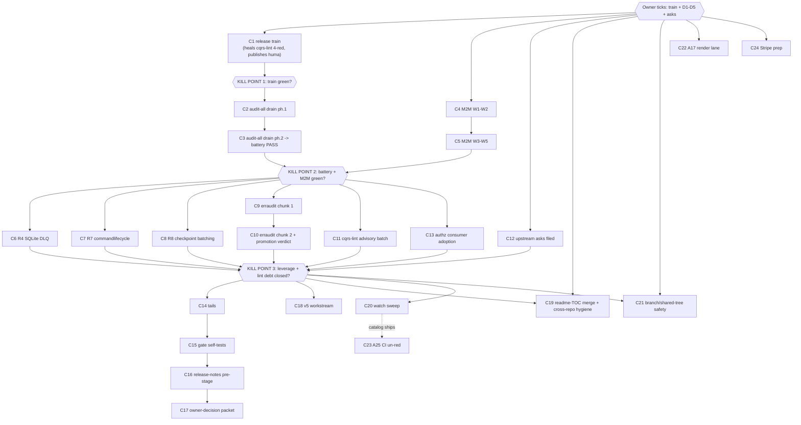

# SUPERB — Post-fleet-plan backlog burn-down (pareto plan of record)

**Written:** 2026-11-06 23:02 CET · **Author:** the wave-5 closeout session (execution continues the 2026-11-06 22:48 directive: finish work → pareto plan → commit + push) · **Predecessor:** [`2026-11-06_00-37_SUPERB-fleet-libs-audit-follow-through-pareto-plan.md`](2026-11-06_00-37_SUPERB-fleet-libs-audit-follow-through-pareto-plan.md) (§12 execution log: 18 DONE, 1 not-actionable, 3 open, 2 gated)

## Context (what this plan inherits)

The fleet-libs follow-through plan is closed: A1–A3, A7–A14, A16, A18–A24, A26 DONE; A4 not-actionable (go-etag artifact — audit files corrected); A5/A6/A10 remain open inside TODO row 34; A25 waits on go-cqrs-lite's catalog release; A17 waits on the owner. This session additionally landed: A2's adminui+setup legs (`SSEHubStats`), SA1019 sweep workspace-wide 0, A24 atomic write, the CHANGELOG debt receipts, FEATURES.md's two missing subsystem rows, the go-etag erratum corrections, and the plan/TODO truth passes. The backlog that remains is `TODO_LIST.md`'s 53 open rows — every one is mapped below (TODO# column; "gw" = grouped-watch).

**Standing rules carried:** never tag/push without instruction (the 22:48 directive sanctioned ONE push of this session's work; release trains stay owner-gated); baselines LAST same-change with a ledger row; `BUILDFLOW_MAX_CONCURRENCY=1` on first commit under load; verify HEAD after daemon commits; serialize slog tests.

## §1 Pareto breakdown

### The 1% that delivers 51% — THE RELEASE TRAIN (owner tick, then mechanics)
One decision releases everything 2026-11-05/06 shipped and heals the standing gate reds: root v4.17.0 (DropStats, `NewBroadcaster` option-arity, audience-aware errors, dispatch gate, `RecommendedSecurityStack`, atomic-write CLI), adminui v-next (`SSEHubStats`, Nav APIs), dashboardui v-next (drop card, throughput panel), usermgmt v-next (`ArchitectureCatalog`), systemadapter v-next (presets), setup v-next (hooks, hub wiring), identity-model v4.16.0 (carried question), and **huma/v4's first tag** (consumers literally cannot `go get` it today). The four cqrs-lint hermetic FAILs (API-vs-tag class, TODO row 49) heal at exactly this train. This is one owner decision + `nix run .#wave-tag` executions + the bump sweep — hours, not days, and it converts a week of landing work into consumable releases.

### The 4% that delivers 64% — three autonomous campaigns
1. **docs-gates audit-all drain (419 → ≤322)** — the biggest standing battery red; annotate-by-evidence across ~119 reports (archived ones replay too), then lower the pin. Pure grind, fully autonomous, unblocks the five-gate PASS posture.
2. **M2M W1–W5** (five audit findings: durable bot grants, subject-correct Casbin cleanup, SSE session-gating, bot auth-audit events, hydration-safe token checks) — blocked only on owner decisions D1–D5; once ticked, the waves are scoped in the 11-49 plan.
3. **Leverage R4/R7/R8** (SQLite DLQ default, commandlifecycle opt-in + dashboardui FailureLog depth, checkpoint batching) — the last three open slices of the go-cqrs-lite utilization plan (73/100 → target ~80).

### The 20% that delivers 80% — quality debt + wiring + docs truth
erraudit strict drain (baseline 303) toward blocking promotion; the cqrs-lint advisory batch (A013 ×2, A027, P008, F005, heuristic tuning, waivers); the upstream-asks filing batch (owner-gated content, drafts ready); authz consumer-adoption M06–M09 (wire `authztest.Suite` in the example apps); the small test/docs tails; self-tests for the two uncovered gates; next-train release-notes pre-stage; README/FEATURES quarterly sweep.

### The other 20% to reach 100% — watches, rituals, owner calls
Everything demand-gated, upstream-gated, or owner-gated: A25 catalog watch, A17 render lane, #113 watch, templ-components upstream fixes, BuildFlow re-enable, /mnt/buildcache watch, DataStar T4, SidebarNav criteria, v5 workstream (ProjectionLayer removal, codemod tracks), Stripe promotion, branch protection + shared-tree guard, merge the readme-TOC branch, go-cqrs-lite cross-repo hygiene, PapDashboard reply, datastar-demo rebrand, scorecard timing, RequireSession export, README TOC (2026-11-17).

## §2 Table A — comprehensive plan (30–100 min; ALL TODOs mapped; sorted by importance → impact → effort → customer-value)

| ID | Task (verification bar) | Tier | min | Imp | Eff | CV | TODO# | Depends |
|----|--------------------------|------|-----|-----|-----|-----|-------|---------|
| C1 | **Owner train packet + release train** (present the one-decision packet: module list, versions, order; then `.#wave-tag --execute` per module + bump sweep + `check-release-train --strict-lag 0`; huma/v4 FIRST tag; identity-model v4.16.0 rides the same tick). Verify: `.#verify-remote-tags` + cqrs-lint 14/14 again + TODO rows 22/24/44 close | 1% | 100 | 5 | 2 | 5 | 22,24,44,49 | owner tick |
| C2 | **docs-gates audit-all drain, phase 1** — annotate the newest ~40 reports' §f items with evidence (distinctive-noun rule; archived replay included). Verify: `audit_max` measured drop ≥60; annotate 0 findings | 4% | 100 | 4 | 4 | 3 | 46 | — |
| C3 | **docs-gates audit-all drain, phase 2** — remaining reports to ≤322, re-pin `.docs-gates.json`, battery PASS. Verify: `docs-gates run .` five gates PASS | 4% | 100 | 4 | 4 | 3 | 46 | C2 |
| C4 | **M2M W1–W2** (post-D1–D5 tick): durable bot grant path + subject-correct Casbin cleanup (+ tests). Verify: usermgmt suite + `authztest.GrantSuite` bot cases | 4% | 90 | 4 | 3 | 4 | 37 | owner D1–D5 |
| C5 | **M2M W3–W5**: SSE session-gating for bot tokens, bot auth-audit events, hydration-safe token checks. Verify: usermgmt suite −race + audit-chain test | 4% | 90 | 4 | 3 | 4 | 37 | C4 |
| C6 | **R4 SQLite DLQ default** in the three SQL setups (durableDeadLetterStore for postgres/mysql too or reasoned keep). Verify: restart-with-poison-event test + guide note | 4% | 60 | 4 | 2 | 4 | 34 | — |
| C7 | **R7 commandlifecycle opt-in**: outer+`AttemptMiddleware` pair on the `CommandMiddleware` seam, recorder store, docs. Verify: wiring test + dashboardui FailureLog view reads it | 20% | 90 | 3 | 4 | 3 | 34 | — |
| C8 | **R8 checkpoint batching seam**: `WithCheckpointEvery/Interval` on usermgmt/setup projection options. Verify: config test + guide | 20% | 45 | 2 | 2 | 2 | 34 | — |
| C9 | **erraudit strict drain, chunk 1** (303 → ~150): fix/`nolint`-with-reason the top modules. Verify: `.#check-erraudit-strict` TOTAL drop | 20% | 100 | 3 | 3 | 3 | 79,156 | — |
| C10 | **erraudit strict drain, chunk 2 + promotion proposal** (→ ≤50; write the blocking-promotion M01 verdict). Verify: TOTAL + verdict note | 20% | 100 | 3 | 3 | 3 | 79,156 | C9 |
| C11 | **cqrs-lint advisory batch**: A013 value-embeds ×2, A027 codec-once, P008 e2e batch, F005 upcaster note, C028/C023/A032 suppression-heuristic tuning, scorecard waivers w/ triggers. Verify: `--show-suppressed` clean-ish + strict green | 20% | 90 | 2 | 3 | 2 | 47 | — |
| C12 | **Upstream-asks filing batch** (owner-gated content): templ-components popover CSS (f), go-cqrs-lite event.New pooled (g), E005 proposal, ReadLastN (U2), plus the doc-only-classifier proposal P15. Verify: issues filed w/ verified evidence | 20% | 60 | 3 | 1 | 4 | 51,96,113,48 | owner tick |
| C13 | **Authz consumer adoption M06–M09**: wire `authztest.Suite`/`CommandSuite` into examples (admin-demo, setup-demo, middleware-demo) as living proofs. Verify: examples' suites + README notes | 20% | 90 | 3 | 3 | 4 | 28,30 | — |
| C14 | **Test/docs tails**: `DecideRecordCredentialUse` 3rd case; templ formatter→derived-artifact chain; `StateShape` SQL round-trip audit; README↔FEATURES quarterly sweep early pass. Verify: named tests + audit note | 20% | 60 | 2 | 2 | 2 | 87,89,90,92 | — |
| C15 | **Gate self-tests**: `check-coverage-threshold.sh` happy-path fixture + `architecture-gate-preflight` self-test. Verify: `.#test-*` wired in check-modules | 20% | 45 | 2 | 2 | 2 | 97,100 | — |
| C16 | **Next-train release-notes pre-stage** (loginpage NoWebAuthn + dashboardui W14 + everything [Unreleased] since). Verify: drafts exist per module | 20% | 30 | 2 | 1 | 3 | 98 | C1 timing |
| C17 | **Owner-decision packet consolidation**: ONE dated packet listing every open owner call (train, D1–D5, A17, branch protection, Stripe, readme-TOC merge, datastar-demo, usermgmt RequireSession, architecture-gate policy, PapDashboard). Verify: packet + TODO rows point at it | 20% | 45 | 3 | 1 | 4 | 38,42,100,102,108,119,121,125 | — |
| C18 | **v5 workstream continuation** (codemod tracks B: R-rules for SSE sync rename class; ProjectionLayer removal prep check). Verify: rules + inventory trues | 20% | 90 | 3 | 3 | 3 | 118,123 | — |
| C19 | **Merge readme-TOC branch + go-cqrs-lite cross-repo hygiene** (owner-gated direction): merge or close; CHANGELOG/AGENTS receipts for the linter-fix commits. Verify: master state + their repo tidy | 20% | 60 | 2 | 2 | 2 | 32,115 | owner tick |
| C20 | **Watch-lane sweep (batch)**: /mnt/buildcache, BuildFlow go-version-auto-configure upstream check, #113, templ-components svg + popover upstream releases, A25 catalog release (→ un-red CI), DataStar T4 demand, SidebarNav criteria, scorecard timing. Verify: dated watch notes, escalate what fired | rest | 60 | 2 | 1 | 3 | 51(b,d,e),71,72,117,124,59,70 | — |
| C21 | **Shared-tree safety**: branch-protection decision impl (if owner ticks), pre-push hook coverage note (gotcha 50 class), daemon/HEAD guard script proposal. Verify: protection state or documented non-fix | rest | 45 | 3 | 1 | 3 | 102,104 | owner tick |
| C22 | **A17 render-verification lane** (if owner sanctions chromium screenshots): trace screenshots for `docs/review/libs/index.html` + the go-cqrs-lite report. Verify: traces in-repo | rest | 45 | 2 | 2 | 2 | 35(§g.2) | owner tick |
| C23 | **A25 CI un-red** (when go-cqrs-lite catalog release ships): bump integration_test + examples/catalog-demo pins. Verify: CI run green | rest | 30 | 3 | 1 | 4 | 21,51(b) | upstream |
| C24 | **Stripe billing bounded context promotion prep** (only on owner tick): self-review refresh + module skeleton. Verify: decision recorded | rest | 60 | 2 | 3 | 2 | 108 | owner tick |

**Time budget:** C1–C24 ≈ 29.5 h of focused work (≈ 4–5 sessions). Rows 1% = 100 min of mechanics behind one decision; 4% = 6.5 h; 20% = ~16 h; rest = ~4 h + external gates.

## §3 Table B — micro breakdown (≤12 min each; sorted by tier → importance → dependency order)

| µ | Task | ≤min | →C | | µ | Task | ≤min | →C |
|---|------|------|---|-|---|------|------|---|
| 1 | Draft the owner train packet (module/version table + order + identity-model question) | 12 | C1 | | 31 | A027 codec-once `es_decide_credentials.go:44` fix + nolint verdict | 10 | C11 |
| 2 | `wave-tag --execute` root v4.17.0 (guards → push → tag → strict train) | 12 | C1 | | 32 | P008 e2e batch-size adjudication note | 8 | C11 |
| 3 | `wave-tag --execute` usermgmt next | 12 | C1 | | 33 | F005 upcaster adjudication note | 8 | C11 |
| 4 | `wave-tag --execute` adminui next | 12 | C1 | | 34 | C028×22 suppression review → tune or nolint | 12 | C11 |
| 5 | `wave-tag --execute` dashboardui next | 12 | C1 | | 35 | C023×9 + A032×8 review batch | 12 | C11 |
| 6 | `wave-tag --execute` setup + systemadapter next | 12 | C1 | | 36 | scorecard waivers with remove-when triggers | 10 | C11 |
| 7 | huma/v4 first tag (`wave-tag`) | 10 | C1 | | 37 | identity-model v4.16.0 tag (if ticked) | 10 | C1 |
| 8 | bump-dep sweep + `check-release-train --strict-lag 0` + verify-remote-tags | 12 | C1 | | 38 | cqrs-lint 14/14 re-run (API-vs-tag healed?) | 6 | C1 |
| 9 | Close TODO rows 22/24/44/49 with receipts | 10 | C1 | | 39 | audit-all phase-1: measure + list worst 40 reports | 10 | C2 |
| 10 | audit-all: annotate reports 1–10 §f (distinctive nouns) | 12 | C2 | | 40 | audit-all: annotate 11–20 | 12 | C2 |
| 11 | audit-all: annotate 21–30 | 12 | C2 | | 41 | audit-all: annotate 31–40 + re-measure | 12 | C2 |
| 12 | M2M W1: durable GrantRoles-for-bots service method + test | 12 | C4 | | 42 | M2M W1: Casbin subject-correct cleanup on BotDeleted | 12 | C4 |
| 13 | M2M W1: projection/restart durability test (GrantSuite bot case) | 12 | C4 | | 43 | M2M W2: bot grant docs + guide true | 8 | C4 |
| 14 | M2M W3: SSE handler bot-token gate + test | 12 | C5 | | 44 | M2M W3: session-gating matrix in authztest | 12 | C5 |
| 15 | M2M W4: BotTokenUsed/audited auth-audit events + fold | 12 | C5 | | 45 | M2M W4: audit-chain e2e test | 12 | C5 |
| 16 | M2M W5: hydration-dependent token re-hash check + test | 12 | C5 | | 46 | M2M W5: docs + TODO row 37 close-out | 8 | C5 |
| 17 | R4: postgres DLQ dialect store (or reasoned in-memory keep note) | 12 | C6 | | 47 | R4: mysql mirror decision + note | 8 | C6 |
| 18 | R4: restart-with-poison-event test | 12 | C6 | | 48 | R4: guide + CHANGELOG receipts | 8 | C6 |
| 19 | R7: middleware pair builder + unit test | 12 | C7 | | 49 | R7: recorder store (in-memory) + test | 12 | C7 |
| 20 | R7: setup/usermgmt config threading | 10 | C7 | | 50 | R7: dashboardui FailureLog view reads records | 12 | C7 |
| 21 | R7: docs + receipts; TODO row 34 R7 strike | 8 | C7 | | 51 | R8: `WithCheckpointEvery/Interval` options + test | 12 | C8 |
| 22 | R8: setup surface + guide + receipts | 10 | C8 | | 53 | erraudit chunk-1: root module sweep | 12 | C9 |
| 54 | erraudit chunk-1: usermgmt sweep | 12 | C9 | | 55 | erraudit chunk-1: adminui+dashboardui sweep | 12 | C9 |
| 56 | erraudit chunk-1: setup+systemadapter+huma sweep | 12 | C9 | | 57 | erraudit chunk-1: re-measure TOTAL + ledger | 8 | C9 |
| 58 | erraudit chunk-2: identity-model+loginpage+datastar+health+auditlog | 12 | C10 | | 59 | erraudit chunk-2: remainder modules | 12 | C10 |
| 60 | erraudit: blocking-promotion M01 verdict draft | 10 | C10 | | 61 | A013 ×2 value-embeds (e2e/server + sync-demo) fix | 12 | C11 |
| 62 | upstream ask (f) popover CSS: verify evidence pack + draft body | 12 | C12 | | 63 | upstream ask (g) event.New pooled: attach bench data | 10 | C12 |
| 64 | E005 proposal final pass + file | 12 | C12 | | 65 | ReadLastN (U2) upstream issue file | 10 | C12 |
| 66 | P15 doc-only-classifier proposal file | 12 | C12 | | 67 | authztest wiring: admin-demo | 12 | C13 |
| 68 | authztest wiring: setup-demo | 12 | C13 | | 69 | authztest wiring: middleware-demo | 12 | C13 |
| 70 | authztest: CommandSuite in one example + README notes | 12 | C13 | | 71 | DecideRecordCredentialUse 3rd test case | 10 | C14 |
| 72 | templ formatter→artifact chain: reproduce + fix rule | 12 | C14 | | 73 | StateShape SQL round-trip audit + note | 12 | C14 |
| 74 | README↔FEATURES sweep early pass (diff claims) | 12 | C14 | | 75 | coverage-threshold self-test fixture | 12 | C15 |
| 76 | architecture-gate-preflight self-test | 12 | C15 | | 77 | release-notes drafts: loginpage + dashboardui | 10 | C16 |
| 78 | release-notes drafts: root + usermgmt + adminui + setup | 12 | C16 | | 79 | owner-decision packet: enumerate every open call w/ links | 12 | C17 |
| 80 | owner-decision packet: write + point TODO rows at it | 12 | C17 | | 81 | v5 codemod: SSE-rename rule class + fixture | 12 | C18 |
| 82 | v5: ProjectionLayer removal prep re-check + inventory true | 10 | C18 | | 83 | readme-TOC branch: rebase-check + merge-or-close rec | 12 | C19 |
| 84 | go-cqrs-lite cross-repo receipts (CHANGELOG/AGENTS for linter fix) | 12 | C19 | | 85 | watch: /mnt/buildcache fill check + note | 6 | C20 |
| 86 | watch: BuildFlow upstream TODO re-check | 8 | C20 | | 87 | watch: #113 interface NewCache shipped? | 6 | C20 |
| 88 | watch: templ-components releases (svg + popover) | 8 | C20 | | 89 | watch: go-cqrs-lite catalog tag (→ C23 if shipped) | 6 | C20 |
| 90 | A25 leg 1 (when catalog ships): bump integration_test pin | 10 | C23 | | 91 | A25 leg 2: bump examples/catalog-demo + CI verify | 10 | C23 |
| 92 | branch-protection impl (if ticked) or documented non-fix | 10 | C21 | | 93 | pre-push hook coverage note (coverage-gap class) | 8 | C21 |
| 94 | shared-tree HEAD guard proposal draft | 10 | C21 | | 95 | A17 screenshots lane (if sanctioned): chromium probe | 12 | C22 |
| 96 | A17: capture index.html traces + commit | 12 | C22 | | 97 | A17: capture go-cqrs-lite report traces + close row | 12 | C22 |
| 98 | DataStar T4 demand check + note | 6 | C20 | | 99 | SidebarNav criteria re-check | 6 | C20 |
| 100 | scorecard timing re-measure + note | 8 | C20 | | 101 | usermgmt RequireSession export decision row update | 8 | C17 |
| 102 | PapDashboard reply send (owner channel) | 6 | C17 | | 103 | datastar-demo rebrand-or-remove row update (owner) | 6 | C17 |
| 104 | Stripe: promotion-ready check (no code without tick) | 8 | C24 | | 105 | quarterly claim-sweep scheduling note | 4 | C14 |

*(µ52 intentionally merged into µ51; numbering keeps table stable.)*

## §4 Execution graph

## §5 Not autonomously executable (owner-gated — C17 consolidates these)

Release train & tags (rows 22/24/44, identity-model v4.16.0); M2M D1–D5; docs-gates pin RAISE (policy says drain-down only); branch protection (102); Stripe promotion (108); readme-TOC merge direction (32); datastar-demo rebrand (119); architecture-gate policy (100); PapDashboard channel (121); A17 screenshot sanction; upstream-ask filing approvals (51/96/113); `RequireSession` export decision (125); A25/A17 external gates.

## §6 Verification bars

Every C-row carries its bar in-table. Session-level: `nix run .#check-modules` green before any pause; corpus/tail ratchets re-trued same-change; TODO-hygiene gate after row edits; docs-links gate after guide edits; never `git reset --hard`/`checkout`; the daemon commits — verify HEAD content after each wave.
