# SUPERB plan — full-backlog pareto rank & execution plan (post-v4.17.0, QUERY-first)

**Created:** 2026-11-07, 08:42 CET · **Repo:** `/home/lars/projects/cqrs-htmx`, branch `master`
**Input:** `TODO_LIST.md` as of 2026-11-07 08:42 (all open P1/P2/P3 rows + the owner-decision table), the 08-27 QUERY status report, and the 2026-11-07_07-21 QUERY plan of record.
**Status:** EXECUTING (true-up 2026-11-07 evening, blanket-directive session). Done: C01 (root tagged — grew into **v4.18.1**, the pristine-asset patch; strict train 0/0, verify-remote-tags green), C03 (QUERY D1–D3 answered, D18 GO), C05–C11's QUERY core (openapi.Query + 3.2 auto-bump, ETagResults, ADR-0064, huma verdict, W2.3/W2.4), plus loginpage/v4.17.0 and huma/v4.0.0 tags, the e2e/server family-pin sweep (fixed its templ-poisoned typecheck), docs-gates 5/5 (audit-all ≤268 held), the M2M D1–D4 packet (C29 pre-staged, awaits owner tick), and C27 where trees allowed (browser-history, InboxClean, github-local-sync landed; Swetty unlocatable; webphone deferred-active; crm row stale — no admin surface exists). Open from the 1% layer: C02's cqrs-lint leg, C04 (erraudit receipt), C23–C26 tails, C27 leftovers, C28 (dispatch-gate waves), C31+ owner-gated filings. Every task below is ranked; owner-gated items carry their gate. Stale TODO claims found during Step-0 verification are in §2 — fixed forward in the TODO row text, not silently absorbed.

---

## 0. Thesis

The v4.17.0 family train shipped 2026-11-07 and the QUERY workstream landed W0+W1 same-day, unpublished beyond the root tag. The 1% that pays 51% is therefore **publish and prove what already exists**: tag root v4.18 (the fallback ladder is consumer-visible only after a tag), run the three unrun gate receipts, and answer the three QUERY owner decisions that gate W2/W3. The 4% completes the QUERY workstream's spec-truth (OpenAPI 3.2, conditional 304s, ADR) and clears the small session debts. The 20% delivers the "superb integrations" (htmx 4 alongside, DataStar bundle bump) and drains the two loudest standing reds (audit-all decision, the SA1019 sweep). The remaining 80% is consumer-repo waves, owner-gated upstream filings, the v5 workstream, and parked rows — real, but none of it blocks a consumer from shipping QUERY tomorrow.

## 1. Pareto layers

| Layer | Time | Content | Outcome |
| --- | --- | --- | --- |
| **1%** (~1.5h) | C01–C04: root v4.18 tag via wave-tag discipline; coverage-gate + cqrs-lint + check-modules receipts; the three QUERY owner answers recorded | **51%** — the fallback ladder is consumable, the landed work is gate-proven, W2/W3 unblock |
| **4%** (~4h) | C05–C11: `openapi.Query()` + 3.2 auto-bump; `ETagResults`; huma verdict; ADR-0064; root README row; the two hermetic module suites; PR #40 receipt; branch-guard assertion | **64%** — QUERY is spec-complete and durable; session debts cleared |
| **20%** (~2 days) | C12–C26: htmx 4 embed + `cqrs-query` extension + browser e2e; DataStar fork bump; audit-all drain-or-repin execution; SA1019 sweep; ExtraNav (c)(d)(e); cqrs-lint advisory batch; coverage self-test; StateShape audit; templ codegen chain; round-42 tails; art-dupl pre-stage | **80%** |
| **80%** (1–2 weeks, largely other repos / owner-gated) | C27–C44: consumer adoption waves (5+ repos), M2M W1/W2 (owner D1–D4), upstream filings (S55 packet + catalog templ watch), v5 tracks, parked rows, watches, skill evals | 100% |

## 2. Step-0 errata (stale TODO claims, verified against source today)

1. **Fleet-libs row's "Remaining OPEN: R4 SQLite DLQ default, R7 commandlifecycle, R8 checkpoint batching" is STALE ×3** — `durableDeadLetterStore` (`usermgmt/es_projection_setup.go` + `dlq_durability_test.go`), `ServiceConfig.CommandLifecycle` (`usermgmt/service_factory.go`), and `WithCheckpointEvery` (`setup/config.go`) all exist with receipts in the leverage row. Only A25 (upstream catalog release) and A17 (owner) remain open there.
2. **cqrs-lint "4 FAILs (root/usermgmt/dashboardui/systemadapter)"** are the API-vs-tag class — self-heals at C01's root tag (re-run the gate after; expect 14/14).
3. **Row 23 / release-notes pre-stage row**: predates the executed v4.17.0 train — verify whether loginpage rode it before drafting notes (loginpage was NOT in the train list → the draft row likely still live for loginpage only).
4. **huma/v4 tag row**: local tags carry none and the host is offline (buildflow preflight) — remote state unverified; the row stays open, owner-gated push.
5. **Gotcha-candidates row**: all candidates written (51–53) — row is pure history, closeable at next TODO harvest.

## 3. Coarse plan (30–100 min each; ALL open TODO items; sorted impact/effort/customer-value)

| ID | Task (source row) | Impact | Effort | Tier |
| --- | --- | --- | --- | --- |
| C01 | Tag root v4.18.0 via `.#wave-tag` (carries QUERY W1; sweep nothing — no consumer requires it yet); `.#verify-remote-tags` (QUERY row) | 10 | M | 1% |
| C02 | Gate receipts: `.#coverage-gate`, `.#check-cqrs-lint` (expect 14/14 post-tag), full `.#check-modules` (QUERY row + row 49) | 9 | M | 1% |
| C03 | Record QUERY owner decisions D1–D3 (extension asset? htmx-4 alongside? tag cadence) in TODO (status report g) | 9 | S | 1% |
| C04 | `check-erraudit-strict` re-receipt for the new QUERY code (row 156 cadence) | 7 | S | 1% |
| C05 | `openapi.Query()`: PathItem field + hasMethod + operations() + ctor + 3.2.0 auto-bump, tests (W4.1) | 9 | M | 4% |
| C06 | `ETagResults()` conditional-QUERY option (FNV + If-None-Match → 304), tests (W4.2) | 8 | M | 4% |
| C07 | huma QUERY verdict (NV3) + README gap-note or recipe (W4.3) | 6 | S | 4% |
| C08 | ADR-0064: the fallback ladder as library contract (W4.4) | 7 | S | 4% |
| C09 | Root README QUERY surface row + guide link (status report e) | 7 | S | 4% |
| C10 | Hermetic suites: samber-do-demo + loginpage `GOWORK=off go test ./...` (row 41) | 6 | S | 4% |
| C11 | PR #40 F020 receipt comment (github-voice first) (row 42); branch-guard assertion in preflight-tree-check + session-start wiring (row 104 — today's gotcha-47 strike argues loudly) | 8 | M | 4% |
| C12 | htmx 4 embed alongside 2.0.10: `htmx4.min.js` + `ScriptHandler4()` + `Version4()`, NV6 pin verify (W2.3; gated D1) | 9 | M | 20% |
| C13 | `cqrs-query` extension (upgrade + auto-downgrade + memory) — gated D3 (W2.4) | 9 | L | 20% |
| C14 | Browser e2e for extension + htmx-4 `hx-query` (e2e/server) (W2.4/W2.5) | 8 | M | 20% |
| C15 | NV4: htmx-4 extension compat verdict for ExtSSE/idiomorph (W2.2) | 7 | S | 20% |
| C16 | NV1: identify upstream DataStar release with `@query()` (W3.1) | 7 | S | 20% |
| C17 | Fork `go-datastar/static` bump + wire-format goldens + treadmill sweep — gated D4 (W3.2) | 8 | M | 20% |
| C18 | datastar README § QUERY + ReadSignals-on-QUERY e2e + guide § DataStar (W3.3/3.4) | 6 | S | 20% |
| C19 | docs-gates audit-all: execute the owner's chosen drain-or-repin (419 vs 322; row 46) — owner-gated direction | 8 | L | 20% |
| C20 | SA1019 sweep: `HTMXScriptHandler`→`htmx.ScriptHandler` in basic/e2e/middleware-demo/observability-demo | 6 | S | 20% |
| C21 | ExtraNav (c) dashboard-embedding guide (+`NavLink.Verbatim`), (e) `renderNavForTest` probe helper (row 43) | 6 | M | 20% |
| C22 | cqrs-lint advisory batch: A013 ×2, A027, P008, F005 adjudication (row 47) | 6 | M | 20% |
| C23 | `check-coverage-threshold` CI-shape self-test (row 97) | 6 | S | 20% |
| C24 | StateShape SQL round-trip audit + upstream file if dropped (row 90) | 7 | M | 20% |
| C25 | templ formatter→codegen chain: templ-generate leg after templ-fmt or exclude (row 89) | 6 | M | 20% |
| C26 | Round-42 tails: DecideRecordCredentialUse 3rd case; art-dupl re-identification pre-stage (rows 87/94) | 5 | M | 20% |
| C27 | Consumer authorization waves: browser-history, Swetty, crm, InboxClean, github-local-sync, webphone (authz row 4) — THEIR repos | 9 | L | rest |
| C28 | Consumer dispatch-gate adoption waves + CommandSuite per repo (row 4b) — THEIR repos | 8 | L | rest |
| C29 | M2M W1/W2 (bot grants, delete cleanup, SSE feeds, audit events, token identity) — blocked on owner D1–D4 (m2m) | 9 | L | rest |
| C30 | Merge `docs/readme-table-of-contents` ↔ master (owner-gated; row 29) | 7 | S | rest |
| C31 | Upstream filings batch: S55 packet (ReadLastN, GCL legs, cqrs-lint swap D4/D6, BF1, erraudit asks, upstream drafts rows 48/81/96) — owner ticks | 7 | M | rest |
| C32 | httputil CSRF safe-list QUERY ask + patch (W5.1) | 6 | S | rest |
| C33 | Proxy QUERY table, verified rows only (W5.2/NV2) | 5 | M | rest |
| C34 | v5 flags into ROADMAP + htmx-4 default flip / 422 / extension retirement (W5.3) | 5 | S | rest |
| C35 | sync protocol tails: N5 streamId adjudication, e2e DB_VERSION spec, worker smoke, cursor guard, guide notes (row 59) | 6 | M | rest |
| C36 | loginpage: WebAuthn Playwright e2e + full-page render golden (row 75) | 6 | M | rest |
| C37 | Skill-maintenance: authored evals + description optimization; deep re-audit core-api/realtime/usermgmt (row 95) | 5 | M | rest |
| C38 | loginpage release-notes pre-stage — VERIFY staleness vs v4.17.0 train first (row 98) | 4 | S | rest |
| C39 | health surfaces wire-format guide if missing (row 57e) + crush-config lessons.md F12/F11 (row 55) | 4 | S | rest |
| C40 | architecture-gate policy + probe self-test; repository-protection decision (owner) (rows 100/102) | 5 | S | rest |
| C41 | v5 tracks: direct-imports W1–W3, v5-upgrade codemod M26–M28, ProjectionLayer removal, appkit revisit (rows 2/123/112/118) | 8 | L | rest |
| C42 | system/metaengine migration plan (needs the usermgmt deep-dive; row 110) + V007 watch (row 111) | 5 | L | rest |
| C43 | PARKED (no action): Stripe (S00 unmet), DataStar Tier 4 (no demand), SidebarNav (criterion 2), BF1 (upstream), bench-spike (quiet window), quarterly sweep (due 2027-01), README TOC (2026-11-17), hardware watch, scorecard timing, datastar-demo rebrand (owner) | 3 | — | rest |
| C44 | WATCHES: catalog templ release (blocks hermetic integration_test), go-cqrs-lite#113, templ-components svg + popover upstream, treefmt-nix#545, erraudit month flip (row 51/156/68) | 5 | S | rest |

## 4. Fine plan (≤12 min each; ALL tasks; grouped by coarse id)

| ID | Task | Min | ID | Task | Min |
| --- | --- | --- | --- | --- | --- |
| F01 | wave-tag dry-run for root v4.18 | 8 | F31 | extension: downgrade-on-405 path | 12 |
| F02 | wave-tag --execute + verify-remote-tags | 10 | F32 | extension: sessionStorage memory + TTL | 12 |
| F03 | coverage-gate run + threshold check | 10 | F33 | extension: embed + ExtensionHandler wiring | 10 |
| F04 | check-cqrs-lint rerun (expect 14/14) | 8 | F34 | e2e: extension upgrade case | 12 |
| F05 | check-modules full battery | 12 | F35 | e2e: extension downgrade case | 12 |
| F06 | record D1/D2/D3 answers in TODO row | 6 | F36 | e2e: hx-query on htmx-4 case | 12 |
| F07 | erraudit strict re-receipt | 10 | F37 | NV4: load ext in htmx-4 probe page | 10 |
| F08 | openapi: PathItem.Query field + json tag | 10 | F38 | NV4: verdict row in plan | 4 |
| F09 | openapi: hasMethod + operations() cases | 10 | F39 | NV1: grep upstream releases/tags | 8 |
| F10 | openapi: Query() constructor + doc | 10 | F40 | fork bump: replace bundle + Version | 10 |
| F11 | openapi: 3.2.0 auto-bump on first query op | 12 | F41 | fork bump: wire-format goldens | 12 |
| F12 | openapi: spec-version test-pinned | 10 | F42 | fork bump: PR/commit + tag | 8 |
| F13 | openapi: README tooling note | 8 | F43 | treadmill sweep to new pin | 10 |
| F14 | ETagResults: hash rendered bytes option | 12 | F44 | datastar README § QUERY | 10 |
| F15 | ETagResults: 304 branch + tests | 12 | F45 | ReadSignals-on-QUERY e2e | 12 |
| F16 | huma: QUERY registration probe | 10 | F46 | guide § DataStar (openWhenHidden note) | 10 |
| F17 | huma: verdict + README note | 8 | F47 | audit-all: owner answer recorded | 4 |
| F18 | ADR-0064 skeleton (context/decision) | 12 | F48 | audit-all: drain batch 1 (newest §f) | 12 |
| F19 | ADR-0064 ladder + consequences + Accept | 12 | F49 | audit-all: re-measure + pin update | 10 |
| F20 | README QUERY row + guide link | 8 | F50 | SA1019: fix examples/basic | 6 |
| F21 | hermetic: samber-do-demo suite | 10 | F51 | SA1019: fix e2e/server | 6 |
| F22 | hermetic: loginpage suite | 10 | F52 | SA1019: middleware+observability demos | 8 |
| F23 | github-voice load + PR #40 draft | 10 | F53 | ExtraNav: embedding guide § Integration | 12 |
| F24 | PR #40 post | 4 | F54 | ExtraNav: Verbatim section | 8 |
| F25 | branch-guard: expected-branch assert | 12 | F55 | ExtraNav: renderNavForTest helper | 12 |
| F26 | branch-guard: /tmp sibling-warning | 8 | F56 | ExtraNav: migrate extra_nav_test | 10 |
| F27 | branch-guard: self-test fixture | 12 | F57 | cqrs-lint: A013 ×2 adjudication | 12 |
| F28 | htmx4: fetch + pin + NV6 verify | 10 | F58 | cqrs-lint: A027 codec-once | 10 |
| F29 | htmx4: embed + handler + version const | 12 | F59 | cqrs-lint: P008 + F005 notes | 10 |
| F30 | extension: upgrade verb-flip core | 12 | F60 | coverage self-test fixture + wire | 12 |
| F61 | StateShape: SQL round-trip test | 12 | F92 | sync: Family.IsZero + guide notes | 10 |
| F62 | StateShape: verdict + upstream file | 8 | F93 | loginpage: Playwright WebAuthn e2e | 12 |
| F63 | templ: templ-generate leg after fmt | 12 | F94 | loginpage: full-page render golden | 12 |
| F64 | templ: red-green proof (fmt→drift→fixed) | 12 | F95 | skills: evals run + optimize pass | 12 |
| F65 | R42: third DecideRecordCredentialUse case | 10 | F96 | skills: core-api deep re-audit | 12 |
| F66 | art-dupl: re-identification pre-stage | 12 | F97 | skills: realtime re-audit | 10 |
| F67 | consumer wave: browser-history | 12 | F98 | skills: usermgmt re-audit | 10 |
| F68 | consumer wave: Swetty | 12 | F99 | release-notes: staleness verify | 6 |
| F69 | consumer wave: crm | 12 | F100 | release-notes: loginpage draft (if live) | 10 |
| F70 | consumer wave: InboxClean | 12 | F101 | lessons.md F12/F11 entry (crush-config) | 10 |
| F71 | consumer wave: github-local-sync + webphone | 12 | F102 | health-surfaces guide check/write | 12 |
| F72 | dispatch-gate: wave scaffolding per repo | 12 | F103 | arch-gate: probe self-test | 12 |
| F73 | M2M: W1 owner answers check | 4 | F104 | repo-protection: decision note | 8 |
| F74 | M2M: BotRegistered projection branch | 12 | F105 | ROADMAP: v5 flags section | 10 |
| F75 | M2M: RolesForActor machine actors | 12 | F106 | CSRF ask: httputil issue draft | 10 |
| F76 | M2M: delete cleanup direct rows | 12 | F107 | CSRF ask: patch PR | 10 |
| F77 | M2M: bot SSE scoped feeds | 12 | F108 | proxy table: Cloudflare check | 8 |
| F78 | M2M: BotTokenUsed-class events | 12 | F109 | proxy table: nginx/Envoy/Caddy/ALB | 12 |
| F79 | M2M: token prefix+checksum+expiry | 12 | F110 | proxy table: guide table + cites | 10 |
| F80 | merge: read TOC branch state | 8 | F111 | S55 packet: assemble owner ticks list | 12 |
| F81 | merge: conflict resolve (serve.go form) | 12 | F112 | ReadLastN upstream draft | 10 |
| F82 | merge: erraudit rerun + verify | 10 | F113 | GCL legs ask (cqrs-lint/coverage) | 8 |
| F83 | v5: direct-imports W1 alias deletions | 12 | F114 | BF1 watch check | 6 |
| F84 | v5: W2 authz/ extraction prep | 12 | F115 | catalog templ release watch | 6 |
| F85 | v5: upgrade codemod R1–R10 scaffold | 12 | F116 | #113 watch check | 4 |
| F86 | v5: v4-journal decode goldens | 12 | F117 | templ-components svg/popover watch | 8 |
| F87 | v5: upcaster coverage matrix | 12 | F118 | erraudit month-flip check | 6 |
| F88 | migration plan: usermgmt deep-dive 1 | 12 | F119 | tail ratchet: archive pass −3 | 12 |
| F89 | migration plan: usermgmt deep-dive 2 | 12 | F120 | TODO harvest: this plan's §f → rows | 12 |

*(F67–F79, F83–F89 ride their owning rows' gates — consumer repos, owner decisions, or the v5 window; listed so the plan includes ALL TODOs.)*

## 5. Execution graph

```mermaid
flowchart TD
    subgraph T1["1% — publish + prove (~1.5h, 51%)"]
        C01[C01 root v4.18 tag] --> C02[C02 gate receipts]
        C03[C03 owner decisions D1-D3] --> C12
        C02 --> C04[C04 erraudit receipt]
    end
    subgraph T2["4% — spec-truth + session debts (~4h, 64%)"]
        C05[C05 openapi.Query 3.2] --> C06[C06 ETagResults]
        C07[C07 huma verdict] --> C08[C08 ADR-0064]
        C09[C09 README row]
        C10[C10 hermetic suites]
        C11a[C11 branch guard] 
    end
    subgraph T3["20% — superb integrations + loud reds (~2d, 80%)"]
        C12[C12 htmx4 embed] --> C13[C13 cqrs-query ext] --> C14[C14 browser e2e]
        C15[C15 NV4 verdict] --> C12
        C16[C16 NV1 release id] --> C17[C17 datastar bump] --> C18[C18 datastar docs+e2e]
        C19[C19 audit-all execute] 
        C20[C20 SA1019 sweep]
        C21[C21 ExtraNav] 
        C22[C22 cqrs-lint batch]
        C23[C23 coverage self-test]
        C24[C24 StateShape]
        C25[C25 templ chain]
        C26[C26 round-42 + art-dupl]
    end
    subgraph T4["80% — waves, upstream, v5, watches (100%)"]
        C27[C27 consumer authz waves]
        C28[C28 dispatch-gate waves]
        C29[C29 M2M W1/W2 owner-gated]
        C30[C30 TOC merge owner-gated]
        C31[C31 S55 upstream filings]
        C32[C32 httputil CSRF] --> C33[C33 proxy table]
        C34[C34 v5 flags]
        C35[C35 sync tails]
        C36[C36 loginpage e2e]
        C37[C37 skill evals]
        C38to40[C38-C40 notes/decisions]
        C41[C41 v5 tracks]
        C42[C42 migration plan]
        C44[C44 watches]
    end
    C01 --> C05
    C03 --> C12
    C03 --> C17
    C05 --> C34
    C02 --> C19
    C11a --> C27
```

## 6. Verification receipts

- T1: `.#wave-tag` report + `.#verify-remote-tags` peeled-ref audit; `.#coverage-gate` 15/15; `.#check-cqrs-lint` 14/14; `.#check-modules` composite green; D1–D3 answers in the QUERY TODO row.
- T2: openapi tests pin `openapi: 3.2.0` + `query` key; conditional-QUERY 304 test; `nix run .#check-skill-snippets` + skill-claims; hermetic suite greens; PR #40 comment link; branch-guard self-test.
- T3: extension e2e battery; fork wire-format goldens + treadmill worst-lag 0; docs-gates battery re-run; BuildFlow golangci on every touched module.
- T4: per-owning-row receipts (their repos' gates; upstream issue links; ROADMAP diff).

## 7. Guardrails (no verschlimmbessern)

- One writer per worktree (gotcha 47/53): verify branch + tree before each wave; never pop a foreign stash.
- Corpus/tail baselines bump in the same commit as their growth; TODO rows true in place with receipts, never bulk-rewritten.
- Owner-gated items execute ONLY after their tick is recorded in the TODO decision table.
- Every new fence/guide claims only shipped behavior; the plan's NV items stay NV until verified at source.
