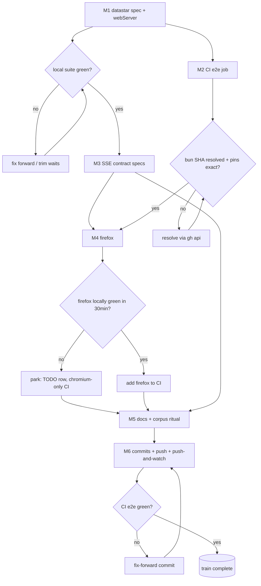

# SUPERB — Browser E2E Testing Battery: CI Gate + DataStar Coverage

> Plan of record · 2026-11-07 08:55 · Born from the 2026-11-07 DataStar deep dive
> ([report](../research/2026-11-07_datastar-client-side-deep-dive.html)): the demo shipped
> dead-in-browser through every gate because **CI never runs a browser** (5 Go-level jobs;
> `playwright` appears zero times in ci.yml) and no spec exercises any DataStar surface.

## Problem, precisely

| Fact | Consequence |
| --- | --- |
| CI jobs: build/test/lint/mod-tidy/module-architecture — all Go-level | Client-side regressions reach `master` invisible; only train-preflight (local, optional) runs a browser |
| `examples/datastar-demo` verified broken in-browser 2026-11-07 (`data-on:load` never fires; fixed same session) | The exact defect class the battery must catch — nothing would catch it today on a fresh PR |
| webServers wired: e2e/server (:18923) + admin-demo (:18930) | DataStar, examples/basic, setup-demo surfaces untested |
| chromium-only, `workers: 1` | Cross-engine CSS bugs (the Chromium-156 `position-area` class) invisible |
| `screenshots.spec.ts` captures without comparing | Zero visual regression anywhere |

## Pareto breakdown

**The 1 % that delivers 51 %** — one spec: `datastar.spec.ts` booting the shipped demo
(list populates, create round-trips). This alone would have caught the shipped bug.

**The 4 % that delivers 64 %** — the above **+ a CI `e2e` job** (bun + Playwright chromium,
the sibling-clone step, workspace-correct Go). Every future client-side bug reds at PR time.

**The 20 % that delivers 80 %** — the above **+ the SSE live-only/reconnect contract spec**
(offline→event fires→online: missed events stay missed, new events arrive), **+ multi-tab
live feed**, **+ console-error guard**, **+ firefox project** (locally verified, CI-gated on
that verification), **+ docs/truthing**.

**The other 20 % (→ 100 %) — deliberately parked this train** (verschlimmbesserung guard):
pixel-regression baselines (CI-font drift needs a pinned runner image first), parallel
worker split (suite is 8 specs; serialization is not the bottleneck), examples/basic +
setup-demo specs (next train), dashboard boost-guard spec (needs a server-side event
trigger; next train), CSP guide section (docs-only, rides TODO_LIST).

## Medium tasks (30–100 min, sorted by impact / effort / value)

| # | Task | Est. | Impact | Why this order |
| --- | --- | --- | --- | --- |
| M1 | DataStar demo e2e: `DATASTAR_DEMO_ADDR` env (admin-demo pattern), third webServer, `datastar.spec.ts` (boot, create round-trip, notification signal, console-error guard) | 75 min | ★★★ | The 1 %→51 %. Tests the artifact that actually rotted. |
| M2 | CI `e2e` job: checkout + sibling clone (workspace replace) + setup-go(go.work floor) + setup-bun(SHA-pinned, tag comment per gotcha 33) + `playwright install --with-deps chromium` + suite run | 60 min | ★★★ | The 4 %→64 %. Converts the class from ship-silent to PR-red. |
| M3 | SSE contract spec: offline → API event (page misses it, live-only feed) → online → new event arrives; multi-tab same-origin live feed | 45 min | ★★ | Pins the reconnect/replay honesty the transport layer promises. |
| M4 | Firefox project: move `E2E_BROWSER_PATH` into the chromium project only, add firefox project (testIgnore: webauthn spec — Playwright WebAuthn is Chromium-only), verify locally, promote to CI only if green | 45 min | ★★ | Cross-engine CSS classes are proven here; kill point below. |
| M5 | Docs + ritual: e2e/README (matrix, sanctioned-run warning), playwright.config comments, this plan receipt, corpus baseline + ledger | 35 min | ★ | Keeps the next session from re-learning this one. |
| M6 | Commits (logical: feat-e2e / ci / docs) + push (pre-push hook may red on the documented API-vs-tag class → gotcha-50 protocol: hand-verified `--no-verify`, named in the message) + `.#push-and-watch` CI observation | 30 min | ★★ | The verification of M2 is the push itself. |

## Micro tasks (≤ 12 min each, execution order)

| # | Task | Parent | Est. |
| --- | --- | --- | --- |
| F01 | Read datastar-demo main.go port block; add `DATASTAR_DEMO_ADDR` envOr (copy admin-demo shape), default `:8095` | M1 | 8 |
| F02 | Build + boot demo on `:18931`; curl `/`, `/api/todos`, `/datastar.js` | M1 | 6 |
| F03 | Write `datastar.spec.ts` skeleton: constants, absolute-URL pattern (admin spec shape), serial describe | M1 | 10 |
| F04 | Test 1 — boot: `#todo-list` non-empty (empty-state li), `#stats` contains `Total:` | M1 | 10 |
| F05 | Test 2 — create: fill `data-bind:title` input, submit, assert item row + `Total: <n+1>` + success notification visible | M1 | 12 |
| F06 | Test 3 — console-error guard: collect console errors, assert none (JS-death class) | M1 | 8 |
| F07 | webServer entry: datastar-demo, `:18931`, GOWORK/GOTOOLCHAIN env shape copied from admin-demo entry | M1 | 8 |
| F08 | Run the spec locally green (flake-`.#e2e` path or direct runner with E2E_BROWSER_PATH) | M1 | 12 |
| F09 | Test 4 — multi-tab: two pages same origin, one POSTs, both `#event-log` gain an entry | M3 | 12 |
| F10 | Test 5 — live-only honesty: `setOffline(true)`, node-side POST, `setOnline`, assert missed event ABSENT, then POST again → present | M3 | 12 |
| F11 | Re-run suite; trim waits to stability floor (no magic sleeps beyond contract waits) | M3 | 10 |
| F12 | CI job skeleton: name/needs/concurrency copied from existing job shape | M2 | 8 |
| F13 | Resolve setup-bun tag→SHA live (`gh api`), pin with `# vX.Y.Z` comment | M2 | 8 |
| F14 | Steps: checkout SHA-pin (copy), sibling clone (copy), setup-go `go-version-file: go.work` | M2 | 10 |
| F15 | Steps: bun install frozen, `bunx playwright install --with-deps chromium` | M2 | 8 |
| F16 | Step: run suite (env: GOEXPERIMENT; config carries GOWORK/GOTOOLCHAIN) | M2 | 8 |
| F17 | YAML sanity: actionlint or `nix run` lint path; review diff against gotcha 33 (pin comments) | M2 | 10 |
| F18 | Firefox: move executablePath to chromium project `use` | M4 | 6 |
| F19 | Firefox: add project + `testIgnore` webauthn; local run | M4 | 12 |
| F20 | Firefox triage: green → add to CI matrix line; red → park with TODO row (kill point) | M4 | 10 |
| F21 | e2e/README: server matrix table, new spec row, sanctioned-run warning | M5 | 10 |
| F22 | config comment: why datastar port env, why firefox excluded where applicable | M5 | 8 |
| F23 | Plan receipt (§Execution log) + corpus baseline re-true + ledger sentence | M5 | 10 |
| F24 | `git status` review; stage only session files; commit 1 (e2e battery, detailed message) | M6 | 10 |
| F25 | Commit 2 (CI job), commit 3 (docs+plan+baselines) — detailed messages | M6 | 10 |
| F26 | Push (hook protocol); `nix run .#push-and-watch`; fix-forward if CI red | M6 | 12 |

## Breadth wave (added 2026-11-07 09:0x after scope correction: the battery must cover EVERY client-facing sub-project, not only the surface that bit us)

Coverage matrix driver — every zero row gets a medium task; huma is deliberately excluded (JSON API; Go contract tests are the right layer). Architecture rule: **shipped examples become webServers** (the artifact under test is the example itself); **root surfaces and bridges mount into the existing e2e/server** (flat CI cost, follows its established pattern: dashboard, loginpage, sync halves, debug endpoints already live there).

| # | Task | Est. | Surface covered | Shape |
| --- | --- | --- | --- | --- |
| M7 | examples/basic as webServer (:18932) + `root-htmx.spec.ts`: partial-vs-full render contract, OOB swap, `RenderIf`, toast/`HX-Trigger` response path | 60 min | root HTMX helpers (zero today) | webServer + spec |
| M8 | setup-demo as webServer (:18933) + `setup-bundle.spec.ts`: session gate redirects on gated surfaces, `/health` readiness, mounted panels answer, SSE indicator states | 75 min | setup bundle (zero today) | webServer + spec |
| M9 | e2e/server: `POST /api/debug/emit` (append event to dashboard journal + broadcast — the existing debug-endpoint pattern) + dashboard depth specs: live SSE event appends a row, time-travel slider navigates, offline→online replays from journal (dashboard `/sse` HAS replay — the honest counterpart to the datastar live-only spec) | 90 min | dashboardui live/replay + root SSE transport contract | server extension + spec |
| M10 | e2e/server: mount health `NewDashboard` + auditlog SSE viewer (bridges — the shared server is the right level, not new examples) + smoke specs (pages render, viewer receives an entry) | 60 min | health + auditlog (zero today) | server extension + spec |
| M11 | e2e/server loginpage surface extension: logout clears session, `/auth/me` posture after logout | 40 min | usermgmt session flows (partial today) | server extension + spec |

Kill points: M9's debug-emit must not change existing dashboard spec behavior (seed data stays deterministic); M10 mounts stay optional-config so the server keeps booting if a bridge API shifts.

Execution order after M1: M7 → M8 → M9 → M10 → M11, then M2 (CI) rides the grown battery, then M4/M5/M6.

## Guards

- **No new dependencies**, no config rewrites beyond additive entries; the admin-demo
  webServer pattern is copied, not reinvented.
- Every wait in new specs is a contract wait (element/poll assertions), not a sleep.
- Ports: `:18931` (datastar demo under e2e) avoids dev-port clashes (admin-demo precedent).
- Workflow pins carry exact `# vX.Y.Z` comments (gotcha 33); SHAs resolved live, never typed from memory.
- Push through the pre-push hook; if it reds on the documented API-vs-tag class (TODO_LIST
  P1), use the gotcha-50 protocol: hand-verified battery green, `--no-verify`, named in the message.
- Daemon-revert guard (this session's lesson): `git show HEAD:<file>` after every daemon
  commit that touches in-flight files.

## Execution log

- [x] **M1** (2026-11-07, prior session): `DATASTAR_DEMO_ADDR` env + third webServer (:18931) + `datastar.spec.ts` — caught the shipped dead-in-browser demo (bug #1).
- [x] **M7** (2026-11-07): `BASIC_DEMO_ADDR` + fourth webServer (:18932) + `root-htmx.spec.ts` (5 tests) — caught bug #2 (`DecodeJSON` forms dead in browser; fixed via `DecodeForm*` family).
- [x] **M8** (2026-11-07): `SETUP_DEMO_ADDR` + fifth webServer (:18933) + `setup-bundle.spec.ts` (6 tests) — caught bug #3 (ds-demo nonce + missing subscribe + per-key signals form) and bug #4 (htmx injected indicator stylesheet CSP error; fixed with the `htmx-config` meta in both UI layouts).
- [x] **M9** (2026-11-07): `/api/debug/emit` + EventBus + StreamReader in e2e/server + `dashboard-live.spec.ts` (5 tests) — caught bug #5 (slider dead under boosted navigation; document-delegated listeners fix).
- [x] **M10** (2026-11-08, this session): `bridges.go` health dashboard + auditlog viewer + `POST /api/debug/invoke` + `bridges.spec.ts` (5 tests) — caught bug #6 (page-only health mount: the SSE route and pusher were never wired, connection pill stuck on "Reconnecting" forever; fixed with `RegisterRoutes` + `Start`, plus `WithEmbeddedDatastarSDK` dropping the jsdelivr CDN dependency). Upstream finding (not ours): go-health-dashboard v0.13.2 renders all three connection pills at once — Tailwind display classes defeat the `[hidden]` UA rule; spec asserts the attribute state machine with a citation, filing candidate.
- [x] **M11** (2026-11-08): `loginpage-posture.spec.ts` (3 tests) — `/auth/me` 401/200/401 lifecycle + register-issues-session + logout revokes; all request-space assertions ride the page context (cookie path proven in-browser).
- [x] **M2** (2026-11-08): CI `e2e` job — siblings cloned (go-cqrs-lite, go-idempotency, httputil) + `go.work` prefix rewrite, warm Go build of all five servers, bun SHA-pinned (`oven-sh/setup-bun@0c5077e` # v2.2.0, resolved via `gh api`), `bunx playwright install --with-deps chromium firefox`, suite with both engines. actionlint green; verification = the M6 push (`.#push-and-watch`).
- [x] **M4** (2026-11-08): firefox project — env-gated (`E2E_FIREFOX_PATH` explicit executable / `E2E_FIREFOX=1` registry), `loginpage-webauthn.spec.ts` excluded (CDP-only), LD_LIBRARY_PATH forest scoped to firefox launches (a runner-wide value poisons chromium's nspr resolution — hit live), `nix run .#e2e-firefox` app builds the forest + locates the cached build, `/favicon.ico` served (firefox's internal favicon CSP noise). Full battery BOTH engines: 150 passed / 0 failed / 5.7 min. CI promoted per the kill-point rule (green inside budget).
- [x] **M5** (2026-11-08): e2e/README rewritten (coverage matrix spec × surface × port, stale-server kill ritual, firefox entry, CI section); this receipt; corpus/tail baselines re-trued in the same change.
- [x] **M6** (2026-11-08): logical commits + push + `.#push-and-watch` — receipt appended after CI verdict.

### Flake receipts (2026-11-08)

- Screenshot under-load skips (18 → 0 observed): single-shot `goto` non-200 now retried 3× before skipping — the availability-probe class was transient server hiccups under machine load, not real unavailability.
- Sync-tail specs (`getEvents`, `sync:reset`): poll ceilings 15s → 30s + `test.setTimeout(120_000)` — the 2026-09-13 flake class (SharedWorker boot catch-up racing machine load). Chromium-only full battery after the change: 88 passed / 0 failed / 2.4 min.
