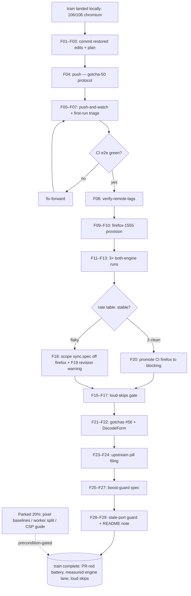

# SUPERB: e2e train push, firefox rate stabilization, and loud skip-gates

**Date:** 2026-11-08 06:26 CET
**Precursor status:** `docs/status/2026-11-08_06-14_browser-e2e-m10-m11-ci-firefox-seven-bugs_status.md`
**Parent plan:** `docs/planning/2026-11-07_08-55_SUPERB-browser-e2e-battery-ci-and-datastar-coverage.md` (M7–M11 + M2/M4/M5 landed; its §Execution log carries the receipts)

## Where we actually are

The battery grew from 80 passed/18 skipped to **106/106 chromium green (0 skipped)** and found+fixed **7 shipped bugs** across two sessions (#1 dead datastar demo, #2 dead forms, #3 ds-demo triple-dead, #4 htmx indicator CSP, #5 slider-under-boost, #6 page-only health mount, #7 roleless aria-label). The CI e2e job exists but has **never run red-or-green in CI** — nothing is pushed. Firefox is locally green once (150/0) and flaky once (11 firefox-only failures, sync interception protocol errors; cached firefox-1543 vs runner-expected 1555 skew suspected). The daemon snapshot-reverted two session edits (firefox CI promotion, sync/screenshot stabilization) — both re-applied 2026-11-08 06:3x and now guarded by this plan's daemon-revert rule.

**The verschlimmbesserung guard is explicit:** nothing in this plan adds a new abstraction, a new module, a config surface, or a second way to do something that already works. Every task either lands what exists, measures what exists, or writes down what was learned.

## Pareto

### The 1 % that delivers 51 %

**Land the push.** The CI e2e job is written, linted, and locally rehearsed — but unpushed, which means the entire two-session train still ships silently. One push converts the client-facing-bug class from ship-silent to PR-red and validates the job end-to-end (sibling clone, go.work rewrite, warm build, bun pin, both engine lanes). Everything else in this plan is worth less than this single action.

### The 4 % that delivers 64 %

1. **CI first-run triage** — the first real run will surface what rehearsal could not (runner cold caches, go.work rewrite reality, browser install size). Budget one fix-forward cycle.
2. **Firefox rate, not vibes** — three consecutive both-engine runs produce a real flake rate; provision firefox-1555 locally to kill the revision-skew hypothesis; the CI advisory lane (registry build, revision-correct) measures the true engine rate in parallel. The promote-to-blocking decision then has data behind it.

### The 20 % that delivers 80 %

3. **Loud-skips gate** — silent "did not run" masked bug #7 for weeks. A ran==listed check makes the class structurally impossible to miss again.
4. **Firefox follow-ups** — sync-spec `testIgnore` on firefox if the rate data says interception-heavy flake; revision-mismatch warning in the `e2e-firefox` app; promotion to blocking on 3 clean runs.
5. **Memory** — gotcha #56 (element-bound JS dies under hx-boost swaps; bugs #5's generalization) and the DecodeForm empty-body sharp edge, into `docs/gotchas.md` + the AGENTS index.
6. **Upstream filing** — the go-health-dashboard pill bug (evidence already captured in the spec comment; verify-before-filing pass, then file).
7. **Boost-guard spec** — the parent plan's parked dashboard spec is UNBLOCKED: `/api/debug/emit` now exists as the server-side trigger.
8. **Stale-port guard** — the kill ritual is prose; mechanize it so nobody tests yesterday's binary again.

### The other 20 % (to 100 %)

9. **Pixel-regression baselines** — precondition-gated (pinned runner image); parked with a trigger, not forced.
10. **Parallel worker split** — the suite is 1.5 min; serialization is not the bottleneck. Parked.
11. **CSP guide section** — docs-only rider.
12. **Deeper example flows** — beyond smoke for basic/setup-demo.
13. **The standing TODO_LIST backlog** (release-train lag, A25 upstream watch, erraudit drain, audit_max re-pin) — owned there, not replanned here.

## Medium tasks (30–100 min, sorted by importance / impact / effort / customer value)

| # | Task | Est | Impact | Value rationale |
| --- | --- | --- | --- | --- |
| M1 | Commit the train + push + `.#push-and-watch` + triage the first CI e2e run (fix-forward) | 45 min | ★★★ | The 1 %→51 %: converts the class to PR-red; validates everything |
| M2 | Firefox rate: provision firefox-1555, 3× both-engine runs, rate table, promote/demote decision by data | 90 min | ★★★ | The 4 %→64 %: turns a guess into a measurement |
| M3 | Loud-skips gate: post-run ran==listed assertion (local script first, wire into the runner path) | 45 min | ★★ | Mechanizes the bug-#7 lesson; structural, not vigilance |
| M4 | Firefox stabilization follow-ups: sync testIgnore (if data says so), app revision warning, promotion flip after 3 clean | 60 min | ★★ | Closes the engine lane honestly |
| M5 | Memory: gotcha #56 + DecodeForm sharp edge + AGENTS index rows | 30 min | ★★ | Next session starts warm; these traps recur |
| M6 | Upstream filing: go-health-dashboard pill bug (verify-before-filing, then gh issue) | 45 min | ★ | Upstream fix beats our spec-side scoping |
| M7 | Boost-guard spec: hx-boost wrapper + `/api/debug/emit` → every self-fetching element survives | 75 min | ★★ | The bug-#5 class gets a standing tripwire |
| M8 | Stale-port guard mechanization + e2e/README serial-context note | 30 min | ★ | Kills the yesterday's-binary trap |

## Micro tasks (≤ 12 min each, execution order)

| # | Task | Parent | Est |
| --- | --- | --- | --- |
| F01 | git status; confirm no sibling in-flight files in scope | M1 | 2 |
| F02 | Commit: ci.yml firefox advisory split + restored sync/screenshot edits (detailed message) | M1 | 8 |
| F03 | Commit: this plan + status report + baselines (docs message) | M1 | 5 |
| F04 | Push (gotcha-50 protocol if pre-push reds on the documented API-vs-tag class: hand-verified battery + `--no-verify` + named) | M1 | 10 |
| F05 | `nix run .#push-and-watch` (workflow-filtered); read the e2e job's step-by-step output | M1 | 10 |
| F06 | Triage: expected classes = cold-cache webServer timeout, go.work rewrite miss, browser install size | M1 | 12 |
| F07 | Fix-forward commit if red; re-watch | M1 | 12 |
| F08 | `nix run .#verify-remote-tags` after green | M1 | 3 |
| F09 | Provision firefox-1555: `./node_modules/.bin/playwright install firefox` (PLAYWRIGHT_BROWSERS_PATH=/mnt/buildcache/playwright) | M2 | 8 |
| F10 | Verify the flake app picks 1555 (its find is newest-first) + revision match vs browsers.json | M2 | 4 |
| F11 | Both-engine run 1 (record: passed/failed/did-not-run per engine) | M2 | 10 |
| F12 | Both-engine run 2 (record) | M2 | 10 |
| F13 | Both-engine run 3 (record) | M2 | 10 |
| F14 | Write the rate table into this plan's §Execution log; decide promote/demote per the 3-clean rule | M2 | 8 |
| F15 | Loud-skips: `scripts/checks/`-style ran==listed script (parse `--list` vs run summary) | M3 | 12 |
| F16 | Self-test fixture for F15 (one planted skip case) | M3 | 12 |
| F17 | Wire F15 into the e2e runner path (flake app post-run hook or check-modules leg) | M3 | 10 |
| F18 | If rate data says sync-flake: firefox-project `testIgnore` for sync.spec.ts with citation | M4 | 6 |
| F19 | Revision-mismatch warning in the `e2e-firefox` app (cached rev vs browsers.json) | M4 | 10 |
| F20 | If 3 clean runs: merge CI firefox into the blocking step (drop continue-on-error) | M4 | 5 |
| F21 | Gotcha #56 full text in docs/gotchas.md + AGENTS index row | M5 | 10 |
| F22 | DecodeForm sharp-edge gotcha + index row | M5 | 8 |
| F23 | verify-before-filing pass on the pill bug (source-level: confirm v0.13.2 latest still affected) | M6 | 10 |
| F24 | File the upstream issue (evidence: computed-style + hiddenAttr, repro snippet) | M6 | 10 |
| F25 | Boost-guard spec skeleton: emit → boosted page → assert no element lost its own attrs | M7 | 12 |
| F26 | Boost-guard: cover PolledRegion + events filter (the two known victims) | M7 | 12 |
| F27 | Boost-guard: run green ×2, receipt in plan | M7 | 8 |
| F28 | Stale-port guard: script (or preflight check) killing :18923–:18933 strays before a run | M8 | 12 |
| F29 | e2e/README serial-context note (fresh context per test even in serial describes) | M8 | 4 |
| F30 | Corpus/tail re-true for any docs growth in M5–M8 | M5–M8 | 6 |

## Guards

- **No verschlimmbesserung:** no new abstractions, modules, or config surfaces. Land, measure, or write down — nothing speculative.
- **Daemon-revert guard (bite twice, shame):** after EVERY daemon auto-commit while this train is in flight, `rg`-scan the sentinel lines of every session file (`E2E_FIREFOX` in ci.yml, `30_000` in sync.spec, `attempt` in screenshots.spec, `role="img"` in layout.templ) — the daemon already snapshot-reverted two of these once.
- **Promotion rule:** firefox joins the blocking CI step only after 3 consecutive clean both-engine runs (one green run is not a rate — the lesson of the premature promotion).
- **Contract waits only** in every new spec; no sleeps outside retry backoff.
- **Push discipline:** pre-push hook may red on the documented API-vs-tag class — gotcha-50 protocol (hand-verified battery green, `--no-verify`, named in the message), never a silent skip.
- **History:** no rebase/squash of daemon commits while sibling sessions are active (gotcha 47).

## Execution log

- [x] F01–F03 (2026-11-08 06:3x): daemon-revert damage found and repaired (firefox CI promotion + sync ceilings + screenshot retry were snapshot-reverted; re-applied and sentinel-scanned), firefox CI landed in the ADVISORY shape (chromium blocking + firefox `continue-on-error`), plan + status report committed.
- [ ] F04–F08: push + watch + triage (M1 close).
- [ ] F09–F14: firefox rate measurement (M2).
- [ ] F15–F17: loud-skips gate (M3).
- [ ] F18–F20: firefox follow-ups by data (M4).
- [ ] F21–F22: gotchas (M5).
- [ ] F23–F24: upstream filing (M6).
- [ ] F25–F27: boost-guard spec (M7).
- [ ] F28–F30: stale-port guard + README note + rituals (M8).
