# SUPERB — Owner unlock, v4.19 wave, migration probes, and auth adoption (Pareto plan)

**Date:** 2026-11-08 06:35 · **Author:** close-out session (03-48 report) · **Status:** PLANNED (execution waves gated as marked)

**Inputs ranked:** `TODO_LIST.md` (79 rows, read in full 06:29), the 03-48 status report, the D1–D18 owner table, the two sitting packets (M2M D1–D4; migration D1–D5), the C28 pre-stage, the 2026-11-07 07-21 QUERY plan (W3/W5), and the 2026-11-07 10-45 migration plan.

**Tree truth at planning time:** master = origin (green CI through `b62c46b8`); root v4.18.1 / loginpage v4.17.0 / huma v4.0.0 tagged; strict train 0/0; docs-gates 5/5 (audit-all 264 vs pin 268 — **headroom 4**); tail 14; corpus 57,176; branching-flow **unpinned +1/−1** on the sibling e2e lane's in-flight `bridges.go` refactor (their lane owns the re-pin); the sibling's new `e2e` CI job is red on first run (axe a11y on the dashboardui overview — their iteration); `e2e/tests/loginpage-posture.spec.ts` landed via the daemon; the version-drift gate starves under multi-session load (blocked pushes ~15 min on 2026-11-08, ticket in TODO P2).

## §1 Verified facts this plan rides on (source-checked 2026-11-08)

1. **The migration D1–D5 defaults are ADOPTED → W1–W2 probes are GO now** (CURRENT_FOCUS + the 10-45 plan; no further owner input required). The W1.2 starvation probe is the GO/NO-GO hinge for the whole usermgmt→system migration and the V007 v5 criterion.
2. **M2M D1–D4 has NO recorded defaults** — W1/W2 code cannot start without the tick (packet: `docs/proposals/2026-11-07_m2m-owner-decisions-d1-d4.md`).
3. **C28 needs one product answer** (browser-history domain-keyed commands: any-authenticated vs admin-tier); InboxClean's shape is uniform-authenticated and its authz-engine wiring is an engineering call once the browser-history pattern proves.
4. **NV1 RESOLVED**: `@query()` is registered in upstream DataStar **1.0.4**; the fork's master carries the bundle (`static.Version = "1.0.4"`, static module tests green) but is **unreleased** (their [Unreleased] CHANGELOG empty; their v0.7.0 convention is a four-module lockstep cut). W3.2 = "cut their v0.8.0, then sweep here".
5. **A25 RESOLVED**: catalog/v4.14.0 is the templ-era docserver release (1100-era verified at tree level); catalog-demo + integration_test hermetic legs already green.
6. **The version-drift starvation** is root-caused (GitHub 403-rate-limits ~25 anonymous smart-HTTP requests per gate run; git only authenticates on 401; the hook's single-probe disambiguation misreads starvation as real drift) — the fix is small and unblocks every future push under load.
7. **webphone has NO grant surface** (no `AddGroupPolicy`/`GrantRoles` anywhere) — its leg is exactly a family-pin sweep (identity-model v4.15.0 / usermgmt v4.19.0 / loginpage v4.16.0), blocked only by its active tree.
8. **kv v4.4.0 is still latest** (#113 no movement); go-cqrs-lite#117 and httputil#48 open with zero maintainer response.

## §2 Errata found during Step-0 (stale backlog rows — corrected by M20, not silently)

1. **Two inconsistent erraudit-window semantics are live in TODO**: row 81/82 says the promotion window "opened 2026-10-31, closes 2026-11-30 (332 inside it)"; row 157 says the window "RESTARTS from the 2026-11-07 TOTAL=326 receipt". Both cannot hold. The stricter reading (restart on growth) is the honest one for a stability gate → the true window is **2026-11-07 @ 332 → 2026-12-07**. M20 trues both rows to one sentence.
2. **Four rows are fully resolved and await retirement** (hum tag row 44 — tagged 11-07; cqrs-lint drift row 50 — resolved + re-red explained as the API-vs-tag class; gotcha write-ups row 51 — ALL candidates written; tooling micro-batch row 116 — ALL CLOSED). They inflate the open surface and feed stale-context drift.
3. The TODO **header "Updated:" line still names the v4.17.0 train** — two trains stale (v4.18.0/v4.18.1 shipped since).
4. Row 68/71 (fleet cqrs-lint swap; cqrs-lint in CI) both reduce to the same D4/D6 chain — one execution, two rows; M21 closes both.

## §3 Pareto breakdown

### The 1 % that pays 51 %
**One consolidated owner decision sheet + the push-infra starvation fix.**
Every large workstream (M2M security hardening, C28 consumer auth adoption, the v4.19 shape, cqrs-lint CI, ten parked D-table rows) is gated on ONE owner sitting or blocked on the SAME push gate. M00 makes that sitting 10 minutes (index page: one line + recommendation + wrong-answer cost per decision, linking the four detail packets). M01 removes the recurring push-lock tax that tonight cost 15 minutes and worsens with every concurrent session. Together they unlock or accelerate every other wave.

### The 4 % that pays 64 %
1. **M03 — the migration W1.1/W1.2 probes** (GO under adopted defaults): resolves the v5-criterion question for usermgmt with evidence, not opinion — the single highest-information act available without the owner.
2. **M04/M05 — M2M W1** (after the tick): closes the five remaining security-audit findings (durable bot grants, delete-cleanup completeness, machine-actor audit trail, restart-pin proof) — the largest open security debt.
3. **M06/M07 — C28 consumer adoption** (after the posture answer): makes L5 dispatch-gating real in the two consumers with command surfaces; the authorization story becomes end-to-end instead of library-only.

### The 20 % that pays 80 %
The v4.19 wave (go-datastar release → static sweep + goldens → httputil legs → train), the quality batch (the 7 harvested items, adminui CHANGELOG reconstruction, hermetic suites, bench re-pin at a quiet window, loginpage E2E depth), the a11y first-response to the sibling's axe findings, docs-health (archive + row retirements + audit-all headroom), and the push/CI hardening batch (branch guard, gate tickets, gosec pin).

### The other 20 % (to 100 %)
Owner-gated long tail executed after the D-table ticks: the cqrs-lint fleet swap + CI gate chain, architecture-gate enforcement, repo protection, upstream drafts batch, watches (kv v4.5, #117, #48, templ-components popover, BF1, SidebarNav zero-JS drawer, DataStar Tier 4 demand), parked v5-window items (codemod tracks, appkit, ProjectionLayer bundle), and the quarterly rituals. Plus the standing load-gated items (bench, buildflow-format) that wait for quiet windows.

## §4 Coarse plan — 27 milestones, 30–100 min each, ALL TODO rows covered

Sorted by importance/impact (I) / effort (E) / customer value (CV). **Gate** = what must be true to start.

| # | Milestone | Tier | Gate | Est | I/E/CV |
|---|---|---|---|---|---|
| M00 | Owner decision-sheet INDEX (one page: M2M D1–D4, browser-history postures, Swetty, go-datastar v0.8.0, ExtraNav a/b, live D-table rows D3/D4/D6/D7/D8/D13/D14/D15/D16/D17, architecture-gate, repo protection, Stripe S00, PapDashboard reply, RequireSession home; each: one line + recommendation + link) | 1% | none | 45m | 10/2/10 |
| M01 | version-drift starvation fix (URL-username pre-auth OR train-cache reuse OR retry+starvation-exit; hook + template sync; fixture self-test; 3× under load green) | 4% | none | 60m | 9/3/8 |
| M02 | branching-flow re-pin on the SETTLED sibling tree (adjudicate +1/−1, refresh baseline, triage row) | 20% | sibling settles | 30m | 6/2/5 |
| M03 | migration W1.1+W1.2 probes (NewService façade probe; declarative-hydration starvation probe → GO/NO-GO verdict recorded in the 10-45 plan) | 4% | none (defaults adopted) | 90m | 9/6/7 |
| M04 | M2M W1a: durable bot grants (BotRegistered projection branch; RolesForActor for machine actors) + bot-delete cleanup completeness (direct + kind-prefixed rows) | 4% | M2M tick | 100m | 9/7/7 |
| M05 | M2M W1b: BotTokenUsed-class events at D4 granularity + restart-pin proof (sql_hydrate token-hash index test) | 4% | M2M tick | 90m | 8/6/7 |
| M06 | C28 browser-history: DispatchGate + 9 postures + authztest.CommandSuite (mount after userSvc, gate outermost) | 4% | posture answer | 60m | 8/5/8 |
| M07 | C28 InboxClean: authz engine wiring (browser-history pattern) + uniform postures + CommandSuite | 20% | M06 proves pattern | 60m | 7/5/7 |
| M08 | webphone family-pin sweep (3 pins → current trains; hermetic build + module suite) | 20% | tree quiet | 30m | 5/2/5 |
| M09 | go-datastar v0.8.0 lockstep cut per THEIR checklist (bundle-only, 1.0.4; CHANGELOG [v0.8.0] + lockstep requires + tags on one commit) | 20% | owner/lane GO (M00) | 45m | 7/4/6 |
| M10 | QUERY W3.2/W3.3: sweep `go-datastar/static` pin + wire-format goldens + datastar README § QUERY (`@query()` recipe + interim snippets) | 20% | M09 tagged | 60m | 7/5/6 |
| M11 | QUERY W5: httputil CSRF safe-list adoption (tracks #48; local interim safe-list if the fix lags) + verified-only proxy-table guide § | 20% | none (track) | 60m | 6/4/6 |
| M12 | v4.19.0 train (wave-tag: root tag → 21-module sweep → strict train 0/0 → verify-remote-tags; CHANGELOG cut) | 20% | M10/M11 ready (or W5-only if K2) | 90m | 8/6/8 |
| M13 | Harvested batch 1: huma `ProblemError.Retryable` decision+impl · `validationCode` cross-module drift test · zero-ULID-subject gotcha · CI tidy-list from go.work | 20% | none | 75m | 6/5/5 |
| M14 | Harvested batch 2: dashboardui auth-stream filter preset · `lint-sweep.sh` parity gate in check-modules+CI · CI go-cqrs-lite sibling-clone cache | 20% | none | 75m | 6/5/5 |
| M15 | adminui CHANGELOG reconstruction (v4.13.0–v4.16.0 sections from git history + wave receipts; every tag has a section) | 20% | none | 60m | 6/5/4 |
| M16 | Hermetic suites batch: samber-do-demo (otter bump), loginpage (commandlifecycle), the four v0.12.3-swept modules | 20% | none | 45m | 5/3/4 |
| M17 | Quiet-window batch: bench-spike re-pin (twice-quiet rule) + `buildflow format` starvation-free green | 20% | verified-quiet window | 45m | 5/2/4 |
| M18 | loginpage test depth: Playwright WebAuthn-ceremony E2E + full-page render golden | 20% | none | 75m | 6/6/5 |
| M19 | a11y first-response: triage the sibling's axe findings on dashboardui overview; fix library-side violations (contrast/semantics); re-run their spec green | 20% | sibling pins findings | 75m | 7/5/7 |
| M20 | Docs-health: archive the settled 2026-11-06 report set (tail 14→~10) · erraudit-window true-up (§2.1) · retire 4 resolved rows (§2.2) · TODO header true (§2.3) · audit-all headroom batch for the next report | 20% | none | 60m | 6/3/4 |
| M21 | cqrs-lint fleet swap chain (D4/D6: tag nested cmd/cqrs-lint module → fleet pin bump → B024 suppression re-add → CI gate wiring; closes rows 68+71) | tail | D4/D6 tick | 60m | 6/4/5 |
| M22 | CI hardening batch: D17 gosec pin · architecture-gate secret-or-documented-skip + fixture self-test · repo-protection wiring per decision | tail | ticks (M00) | 75m | 5/4/5 |
| M23 | Shared-tree branch guard: preflight expected-branch assertion + /tmp sibling-sweep warning + fixture self-test | tail | none | 60m | 6/4/6 |
| M24 | Gate-ticket batch: wave-tag sweep-then-train ordering · fleet consumer hermetic-build leg (`--consumers`) · wave-row existence checks · templ formatter→codegen chain leg | tail | none | 75m | 6/5/5 |
| M25 | Watches + re-verifications: kv v4.5 · #117 · #48 · templ-components popover upstream · BF1 · SidebarNav v1.25+ drawer · DataStar Tier-4 demand · hardware /mnt · quarterly README↔FEATURES (due 2027-01-17) | tail | none | 45m | 4/2/3 |
| M26 | Upstream batch: erraudit asks (config file, --modules hint, generic_return exemption) · E005 proposal · upstream drafts under docs/proposals/upstream/ · go-error-modernization skill sweep · crush-config lessons.md entries | tail | owner where marked | 60m | 4/4/3 |

**Runnable-NOW spine (no owner input needed):** M00, M01, M02*, M03, M08*, M11, M13–M20, M23, M24, M25 (* = event-gated, not owner-gated). That is 16 of 27 milestones — the plan does not stall on the owner.

## §5 Fine plan — 92 tasks, ≤12 min each

| ID | M | Task | Min | Tier |
|---|---|---|---|---|
| F01 | M00 | Skeleton `docs/proposals/2026-11-08_owner-decision-sheet.md`: intro + table (id/decision/recommendation/cost-if-wrong/link) | 10 | 1% |
| F02 | M00 | Fill M2M D1–D4 rows (link packet; copy recommendations verbatim) | 8 | 1% |
| F03 | M00 | Fill browser-history posture + Swetty + go-datastar v0.8.0 rows | 8 | 1% |
| F04 | M00 | Fill live D-table rows (D3/4/6/7/8/13/14/15/16/17) — one line each, link the two packets | 10 | 1% |
| F05 | M00 | Fill remaining owner rows (ExtraNav a/b, architecture-gate, repo protection, Stripe S00, PapDashboard, RequireSession, datastar-demo) | 8 | 1% |
| F06 | M00 | Battery: docs-gates + corpus ratchet; commit+push | 6 | 1% |
| F07 | M01 | Reproduce starvation 3× (log rc + repo); pin the failing position (iteration order) | 10 | 4% |
| F08 | M01 | Implement fix (a): `https://larsartmann@…` pre-auth URL in fetch_repo_tags | 8 | 4% |
| F09 | M01 | If (a) insufficient: fix (b) train-cache reuse for version-drift | 12 | 4% |
| F10 | M01 | Fix (c) fallback: retry-once + starvation-aware offline exit (train-gate shape) | 12 | 4% |
| F11 | M01 | Sync `.githooks/pre-push` + `scripts/hooks/pre-push.template` probe logic (multi-request probe or shared state) | 10 | 4% |
| F12 | M01 | Fixture self-test case (starving stub → warn-not-fail); wire into check-modules | 12 | 4% |
| F13 | M01 | Verify: gate 3× back-to-back under a live sibling push; all green; commit+push | 8 | 4% |
| F14 | M02 | Confirm sibling bridges.go refactor settled (mtimes + their report) | 6 | 20% |
| F15 | M02 | Run branching-flow; read the +1/−1 findings; adjudicate with evidence | 10 | 20% |
| F16 | M02 | Refresh baseline + triage-decisions row; check-modules single gate green; commit | 12 | 20% |
| F17 | M03 | Read 10-45 plan §W1.1/W1.2; list probe preconditions + file targets | 8 | 4% |
| F18 | M03 | W1.1 façade probe: NewService shape vs system.New wiring map (symbol-level) | 12 | 4% |
| F19 | M03 | W1.1 probe test: composed system.New satisfies the usermgmt service surface (compile-pin) | 12 | 4% |
| F20 | M03 | W1.2 starvation probe: declarative hydration under concurrent replay (test scaffold) | 12 | 4% |
| F21 | M03 | W1.2 probe: run under `-race` + load; capture verdict data | 10 | 4% |
| F22 | M03 | Record GO/NO-GO verdict in the 10-45 plan §11 + TODO row 111 true-up | 10 | 4% |
| F23 | M04 | `BotRegistered` projection branch: grant rows for machine actors (identity-model authz) | 12 | 4% |
| F24 | M04 | `RolesForActor` machine-actor path + table-driven tests (grant/revoke/no-double-grant) | 12 | 4% |
| F25 | M04 | Bot-delete cleanup: direct + kind-prefixed row removal (mirror the grouping fix) | 10 | 4% |
| F26 | M04 | Integration test: durable bot grant survives restart (hydrate path) | 12 | 4% |
| F27 | M04 | `authztest` extension for machine actors; suite green; CHANGELOG receipt | 10 | 4% |
| F28 | M05 | `BotTokenUsed`-class event payload + catalog row (D4 granularity) | 12 | 4% |
| F29 | M05 | Emit at token resolution (middleware seam); actor attribution test (bot:<id>) | 12 | 4% |
| F30 | M05 | Audit-journal visibility test (journal answers "which bot, when") | 10 | 4% |
| F31 | M05 | Restart-pin proof: token-hash index rebuild test at sql_hydrate.go:280-311 | 12 | 4% |
| F32 | M05 | 11-13 report verification-table re-run; findings 1/2/5/7 closed rows; receipts | 10 | 4% |
| F33 | M06 | browser-history: mount gate after userSvc (cmdDisp.Use outermost + Validate) | 12 | 4% |
| F34 | M06 | Declare 9 postures (the pre-stage inventory; domain-keyed five per the owner answer) | 10 | 4% |
| F35 | M06 | `authztest.CommandSuite` in their suite; anonymous/unauthorized probes | 12 | 4% |
| F36 | M06 | Their api suite green (60s) + hermetic build; receipt in their repo | 10 | 4% |
| F37 | M07 | InboxClean: wire identity-model Authz engine (browser-history pattern) | 12 | 20% |
| F38 | M07 | Declare uniform-authenticated postures for ~12 email commands | 10 | 20% |
| F39 | M07 | CommandSuite + suite green; receipt | 10 | 20% |
| F40 | M08 | Check webphone tree quiet (status + mtimes); sweep 3 pins via go get+tidy | 10 | 20% |
| F41 | M08 | Hermetic build + their suite green; GOTOOLCHAIN note; receipt | 10 | 20% |
| F42 | M09 | Read go-datastar release checklist (their repo docs); list lockstep steps | 8 | 20% |
| F43 | M09 | Their CHANGELOG [v0.8.0] cut (bundle 1.0.4 entry + static.Version receipt) | 10 | 20% |
| F44 | M09 | Lockstep requires (4 modules) + full test suite + wire goldens green | 12 | 20% |
| F45 | M09 | Tag v0.8.0 ×4 on one commit; push tags; proxy verify (go get resolves) | 10 | 20% |
| F46 | M10 | Sweep `go-datastar/static` pin here (+family); treadmill 0 lag | 10 | 20% |
| F47 | M10 | Wire-format goldens re-run; datastar module suite green | 10 | 20% |
| F48 | M10 | datastar README § QUERY: `@query()` recipe + interim custom-action + override recipes | 12 | 20% |
| F49 | M10 | datastar-demo/integration QUERY-on-DataStar e2e proof (W3.3 bar) | 12 | 20% |
| F50 | M11 | Track httputil#48; if unfixed: document local CSRF safe-list interim in the QUERY guide | 10 | 20% |
| F51 | M11 | Verified-only proxy-table guide § (W5 second leg) | 12 | 20% |
| F52 | M11 | QUERY plan W5 rows trued (adopted-vs-upstream state) | 6 | 20% |
| F53 | M12 | Pre-train: strict train --refresh-cache; consumer hermetic spot-builds | 10 | 20% |
| F54 | M12 | CHANGELOG [v4.19.0] cut (W3/W5 entries) | 10 | 20% |
| F55 | M12 | wave-tag root v4.19.0 (guards, tag, push) | 12 | 20% |
| F56 | M12 | 21-module sweep (--lint); strict train 0/0; verify-remote-tags | 12 | 20% |
| F57 | M13 | huma Retryable: write the decision memo (expose vs lean) + implement if GO | 12 | 20% |
| F58 | M13 | validationCode cross-module drift test (or grep gate) + fixture | 12 | 20% |
| F59 | M13 | zero-ULID-subject trap → docs/gotchas.md (next number; AGENTS index row) | 10 | 20% |
| F60 | M13 | CI tidy module list derived from go.work (delete hand list); CI green | 12 | 20% |
| F61 | M14 | dashboardui auth-stream filter preset (session-lifecycle only) + golden | 12 | 20% |
| F62 | M14 | lint-sweep.sh parity gate wired into check-modules + CI + self-test | 12 | 20% |
| F63 | M14 | CI go-cqrs-lite sibling-clone cache (actions cache keyed on rev) | 12 | 20% |
| F64 | M15 | adminui: enumerate tags v4.12.4..v4.17.0; map commits→sections | 10 | 20% |
| F65 | M15 | Write the missing v4.13.0–v4.16.0 sections from history + wave receipts | 12 | 20% |
| F66 | M15 | Verify every tag has a section (one-liner check); docs gates green | 8 | 20% |
| F67 | M16 | GOWORK=off go test: samber-do-demo; loginpage | 12 | 20% |
| F68 | M16 | GOWORK=off go test: auditlog, e2e/server deps, integration_test (v0.12.3 surface) | 12 | 20% |
| F69 | M16 | Record receipts; fix anything hermetic-only red at source | 10 | 20% |
| F70 | M17 | Load check ×2 quiet (uptime both times); refuse honestly if not | 6 | 20% |
| F71 | M17 | bench-spike --save-baseline on idle box; commit baseline same change | 12 | 20% |
| F72 | M17 | buildflow format full run; verify zero starvation losses | 12 | 20% |
| F73 | M18 | loginpage Playwright E2E scaffold (ceremony happy-path via virtual authenticator) | 12 | 20% |
| F74 | M18 | Wire into the e2e battery; run green ×2 | 12 | 20% |
| F75 | M18 | Full-page render golden (replace strings.Contains assertions) | 12 | 20% |
| F76 | M19 | Pull the sibling's axe findings (their run artifacts + spec) | 8 | 20% |
| F77 | M19 | Triage: library-side (dashboardui templates) vs test-harness findings | 10 | 20% |
| F78 | M19 | Fix library-side violations (contrast/roles/labels); goldens updated | 12 | 20% |
| F79 | M19 | Their axe spec re-run green; cross-link receipts | 10 | 20% |
| F80 | M20 | Archive the settled 11-06 set (archive-status --update-baseline; tail ledger) | 12 | 20% |
| F81 | M20 | Erraudit-window true-up (rows 81/82+157 → one sentence, restart-on-growth) | 8 | 20% |
| F82 | M20 | Retire 4 resolved rows (44/50/51/116) → CHANGELOG pointers; TODO header true | 10 | 20% |
| F83 | M20 | Audit-all headroom batch (harvest ≥6 from the next reports; margin 4 → 10) | 12 | 20% |
| F84 | M20 | Battery 5/5 + ratchets; commit+push | 6 | 20% |
| F85 | M21 | D6: tag nested cmd/cqrs-lint module (their repo, their checklist) | 10 | tail |
| F86 | M21 | D4: fleet pin bump + B024 suppression re-add; 14/14 strict green | 12 | tail |
| F87 | M21 | Wire check-cqrs-lint into CI (gates rows 68+71 close) | 10 | tail |
| F88 | M22 | D17: pin gosec to a tagged release; CI green | 8 | tail |
| F89 | M22 | Architecture-gate: configure secret + drop continue-on-error, OR documented skip + fixture self-test | 12 | tail |
| F90 | M22 | Repo protection per decision (require checks or record the no-protection posture) | 10 | tail |
| F91 | M23 | preflight-tree-check: expected-branch assertion + /tmp sibling warning + fixture self-test | 12 | tail |
| F92 | M24 | Gate tickets: wave-tag order fix; --consumers leg; existence checks; templ codegen chain | 12 | tail |

*(M25/M26 are watch/draft batches: execute as rolling 10–12 min sweeps per watch item; no new micro-tasks invented here — their inputs are the watch rows themselves.)*

## §6 Execution graph

```mermaid
flowchart TD
    subgraph ONE["1% — unlock"]
        M00[M00 owner decision sheet]
        M01[M01 version-drift starvation fix]
    end
    subgraph FOUR["4% — highest information + security"]
        M03[M03 migration probes GO under defaults]
        M04[M04 M2M W1a grants+cleanup]
        M05[M05 M2M W1b events+restart pin]
        M06[M06 C28 browser-history gate]
    end
    subgraph TWENTY["20% — wave + quality"]
        M07[M07 C28 InboxClean]
        M08[M08 webphone sweep]
        M09[M09 go-datastar v0.8.0]
        M10[M10 static sweep+goldens]
        M11[M11 httputil W5 legs]
        M12[M12 v4.19.0 train]
        M13[M13 harvested 1]
        M14[M14 harvested 2]
        M15[M15 adminui CHANGELOG]
        M16[M16 hermetic suites]
        M17[M17 quiet-window batch]
        M18[M18 loginpage E2E]
        M19[M19 a11y first-response]
        M20[M20 docs-health]
    end
    subgraph TAIL["other 20% — ticks + watches"]
        M02[M02 branching-flow re-pin]
        M21[M21 cqrs-lint swap chain]
        M22[M22 CI hardening]
        M23[M23 branch guard]
        M24[M24 gate tickets]
        M25[M25 watches]
        M26[M26 upstream batch]
    end
    M00 -->|tick| M04 & M05 & M06
    M00 -.->|tick| M21 & M22 & M09
    M06 --> M07
    M09 --> M10 --> M12
    M11 --> M12
    M03 -->|verdict| V007[V007 / v5 criterion]
    M02 --> M12
    M19 --> E2EGREEN[e2e CI job green]
    K1{{K1: owner defers M2M}} -.-> M04 & M05
    K2{{K2: go-datastar NO}} -.-> M10
    K3{{K3: probe NO-GO}} -.-> M03
    K4{{K4: no quiet window}} -.-> M17
```

**Kill points:** K1 — owner defers M2M → M04/M05 wait, plan continues on the runnable spine. K2 — go-datastar cut declined → M12 ships W5-only (v4.19 without the DataStar lane; QUERY row records the hold). K3 — W1.2 probe NO-GO → migration waves stop, verdict + V007 stay honestly open, zero code forced. K4 — quiet window never verified → M17 stays refused (honest refusal over contended numbers).

## §7 Coverage proof — every open TODO row maps to a milestone

| TODO row (line) | Maps to |
|---|---|
| 21 (09-48 plan of record) | remainder rides M12/M16/M20 (train + receipts + docs drain) |
| 22 (direct imports W1–W3) | v5 window — parked tail (M25 re-verification only) |
| 24 (authz remaining: consumer waves + tenant-isolation) | M06/M07/M08; tenant-isolation cases fold into M06 F35 |
| 26 (L5 remaining: upstream ask + adoption) | M06/M07 (adoption); ask draft → M26 |
| 28/29 (leverage + fleet-libs remainder) | A17 owner-gated → M00 index; rest DONE |
| 31/32 (M2M findings + decisions) | M04/M05 (+M00 for the tick) |
| 34 (QUERY W3/W5) | M09/M10/M11/M12 |
| 36 (blanket tail) | M08/M12/M16/M17/M19/M25 + this plan (v4.19 planning = §4) |
| 40 (starvation) | M01 |
| 41 (hermetic suites) | M16 |
| 42 (ExtraNav a/b) | M00 |
| 44/50/51/116 (resolved rows) | M20 retirement |
| 45 (audit-all) | M20 (+F83 headroom) |
| 46 (7 harvested) | M13/M14 |
| 48 (cqrs-lint adjudication remainder) | tail sweeps M25 |
| 49 (ReadLastN) | M26 (upstream watch) |
| 52 (adminui CHANGELOG) | M15 |
| 53 (upstream asks d/e/f/g) | M25 (watches) + M00 (g owner tick) |
| 55–59 (samber/do×health tails) | filings → M00/M26; lessons.md → M26; [g] doanalyzerv2 → M00; [e] health-surfaces wire map → M14 slot (F61-adjacent; folded into M14's hour if room, else M26) |
| 61–64 (sync watches) | M25 (N5 adjudication rides the next id-module branding publish; N4 + harvested tails demand-gated) |
| 66 (GCL F22 remainder) | owner legs → M00; (e) teardown twin → M26 |
| 68/71 (cqrs-lint swap + CI) | M21 |
| 69 (battery remainder) | M16/M17 |
| 70 (fleet asks watch) | M25 |
| 72/73/74 (SidebarNav/BF1/Tier-4) | M25 re-verifications (parked) |
| 76 (doc-only misclassify) | M26 (upstream draft) |
| 77 (loginpage depth) | M18 |
| 81–87 (erraudit follow-through) | M20 (window true-up); wiring/upstream/skill → M00/M26 |
| 89 (round-42 tails b/c) | M17 (b quiet run); (c) = session ritual, not a task |
| 91 (templ formatter chain) | M24 |
| 92 (StateShape #117) | M25 (watch; closes on upstream fix + train) |
| 94 (quarterly sweep) | M25 (due 2027-01-17) |
| 95 (dashboardui tails) | M19 (browser e2e smoke rides their battery); page-size selector → M14 if room else M26 |
| 96 (art-dupl pre-stage) | fold into M02's settled-tree pass |
| 97 (skill evals) | M26 |
| 98 (upstream drafts) | M26 |
| 100/102 (architecture-gate, protection) | M22 (+M00) |
| 104 (branch guard) | M23 |
| 108 (Stripe S00) | M00 index (parked) |
| 110/111 (migration plan + V007) | M03 (+ waves gated on its verdict) |
| 112/118/123 (appkit, ProjectionLayer, v5 codemod) | v5 window — parked (M25 re-verify only) |
| 113/114 (E005, cqrs-lint CI) | M26 / M21 |
| 115 (GCL cross-repo debt) | M00 (tick) |
| 117 (hardware) | M25 |
| 119 (datastar-demo) | M00 |
| 120 (templ ep-4 micro) | M17 (quiet-window re-pin) |
| 121 (PapDashboard reply) | M00 (owner sends) |
| 124/125/126 (scorecard, RequireSession, TOC) | M00 (125) / M25 (124, 126 due 11-17) |
| 157 (erraudit watch) | M20 true-up + M25 monthly receipt |
| D-table (D1–D18) | resolved rows closed; live rows → M00 index; D4/D6 → M21; D14 → M26; D17 → M22 |

**No open TODO row is unmapped.** Parked/v5-window rows map to M25 re-verification by design (their rows carry standing re-check criteria; the plan does not invent work for them).

## §8 Risks & standing discipline

1. **One writer per worktree** (gotcha 47): M02/M19 coordinate with the sibling e2e lane; every consumer-repo milestone (M06–M08) starts with a tree-state check.
2. **Never re-pin bench under load** (twice-quiet rule) — M17 refuses honestly.
3. **The daemon races commits**: stage → verify content in HEAD → push once per batch; no manual full-hook commits into visible races (tonight's lesson ×2).
4. **No verschlimmbessern**: M01 changes shared gate code — fixture self-test + 3×-under-load proof before push; the go-datastar cut (M09) follows THEIR checklist verbatim, bundle-only.
5. **Audit-all headroom is 4**: any new status report without F83-class drainage reddens the battery — M20 is scheduled before the next report, not after.

*Plan ritual: this plan adds no TODO rows (everything it surfaces is already filed); corpus growth = this file (~1 line over the +40 planning budget class — ledger row with the M20 pass if the ratchet reddens).*
