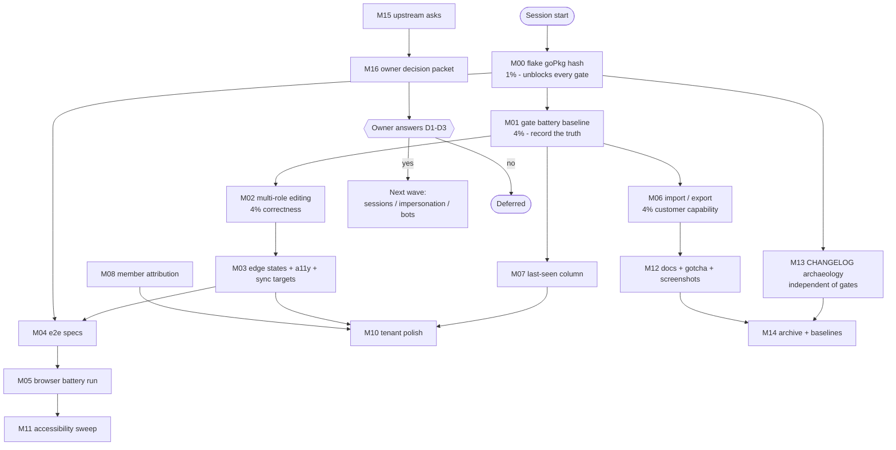

# SUPERB plan: adminui tenant integration and user management, next wave

**Date:** 2026-11-14 08:45 CET
**Author:** session agent (plan-only; execution awaits owner approval)
**Status:** proposed
**Predecessor:** `docs/status/2026-11-14_08-41_adminui-tenant-and-user-management-ux_status.md` (the wave that shipped member identity, add-member UX, tenant meta/search/counts, user access column, and user-side tenant access)
**Scope:** the adminui module, its tests and docs, the repo-level verification entry points that gate it, and two explicitly owner-gated capability decisions.

---

## 0. Why this plan exists

The last session closed the most visible UX gaps in tenant integration and user management, but it ended with
three open questions, ten not-started surfaces, and a set of verification claims that could not be made because
the repository's own gate entry points are broken on this host. This plan answers "what should we really do
next", ranks it by impact, effort and customer value, and splits it into executable units.

The guiding rule for every item: **do not verschlimmbessern.** A change must make the system measurably better
(verifiable behavior, or a gate that can prove behavior), never "cleaner" at the cost of a working surface.

---

## 1. Verified starting facts (measured this session, not assumed)

| # | Fact | Evidence |
| --- | --- | --- |
| F1 | Ambient toolchain is **go1.27.3**, exactly the workspace floor. `go build` / `go test` work for every module. | `go version` -> `go1.27.3`; hermetic adminui build + tests green |
| F2 | **`nix run` gate apps are dead on this host.** `flake.nix` pins `goPkg` with a placeholder fixed-output hash (`sha256-AAAA...`) for the go1.27.3 source tarball. | `nix run .#build-adminui-css` -> hash mismatch, "got `sha256-bndJA1zzYPBrJXXRYup535/ajvZxiJ5cN1+OUHd/Jrs=`" |
| F3 | That single broken `goPkg` is referenced by `build-adminui-css`, `check-modules`, `coverage-gate`, `check-cqrs-lint`, `check-go-toolchain`, `train-preflight` and **`e2e`** (its `runtimeInputs` include `goPkg`). | `flake.nix:53-59`, `flake.nix:2892-2900` |
| F4 | Playwright Chromium **is provisioned** at `/mnt/buildcache/playwright/chromium-1248/chrome-linux64`, but it cannot run on NixOS outside the flake wrapper (missing glib/nss shared libs). The `.#e2e` app supplies `pkgs.chromium` + the FHS-friendly wrapper. | `playwright install --dry-run`; `ldd ... chrome` -> `not found`; `flake.nix:2892-2924` |
| F5 | Consequently **browser proof is reachable only through `nix run .#e2e`** - which F2 currently blocks. My previous report called this "no Chromium"; the correct statement is "Chromium exists, the launcher is blocked by the same flake defect". | this session's probes |
| F6 | The new adminui code compiles and tests **hermetically** against published pins (identity-model v4.17.0, usermgmt v4.20.0, root v4.18.1). No unpublished API is used. | `GOWORK=off go build ./...` and `go test` green in `adminui/` |
| F7 | Published usermgmt v4.20.0 **does** expose `ImportUsersFromJSON/CSV`, `ExportUsersToJSON/CSV`, `RegisterBot/GetBot/DeleteBot/ResolveBotByToken`. It **does not** expose bot listing, tenant rename, session listing, or batched membership counts. | module cache grep at `usermgmt/v4@v4.20.0` |
| F8 | Membership roles are `viewer`, `user`, `admin`, `owner` (`AssignableRoles()`); the panel currently flattens multi-role memberships to one role through a single `<select>`. | `identity-model/authz_types.go:63`; `adminui/members.templ`, `adminui/users.templ` |
| F9 | `Service` exposes `Authz()`, `ReadModel()`, `AuditLog()`, `Journal()`, `EventBus()`, `ProjectionHost()`. Audit entries carry per-event action + timestamp, which is enough to derive "last seen" without new API. | `usermgmt/v4@v4.20.0/service_lifecycle.go` |
| F10 | The docs tail sits at the baseline (13 reports) and the corpus at 58,386 lines; every future report must land with a ledger sentence + re-true in the same change. | `docs/status/TAIL_BASELINE`, `docs/CORPUS_BASELINE`, ratchets green |
| F11 | adminui coverage threshold is 66% (`scripts/checks/coverage-thresholds.tsv`); the module was last measured at 70.1% and the new code adds 20+ tests, so the gate should pass but has not been run. | threshold file; FEATURES.md coverage row |
| F12 | The `AddMember` doc comment claims "re-adding the same actor replaces its role set"; the decider actually **refuses** a duplicate. This was the one real defect of the last wave (UI copy had to be corrected). | `usermgmt/service_membership.go:10-13` vs the decider reject; `adminui/user_tenant_access_test.go` proves the refusal |

---

## 2. What we should really do: three Pareto lenses

The usual "80/20" framing is ambiguous here because part of the work buys **capability** and part buys **the
ability to prove capability**. Both are reported, separately, so nothing is smuggled.

### 2.1 Lens A - risk reduction (protect what already ships)

**The 1% that pays 51%: fix the `goPkg` hash in `flake.nix`.**

One line. It restores `check-modules`, `coverage-gate`, `check-cqrs-lint`, `check-go-toolchain`, `train-preflight`,
`build-adminui-css` and the **entire e2e battery** (F2, F3, F5). Every other item in this plan is verified through
one of those entry points. Without it, "green" means "green on the subset of scripts that happen to run with the
ambient toolchain", which is exactly the class of false confidence the repo has spent months eliminating.

**The 4% that pays 64%: run the battery and record the truth.**

Then run the unblocked gates once, with no code change, and write the receipts (including reds) into this plan's
execution log. This is how we learn whether the last wave regressed coverage, lint, cqrs-lint or the docs battery.
It is also the cheapest possible detection of a mistake: zero new code, maximum signal.

**The 20% that pays 80%: close the shipped gaps in the wave's own surface.**

Multi-role editing (F8), the "member of every tenant" dead-end, aria-live on the new alerts, and browser-level
specs for the three new flows. These are defects in what shipped last week; leaving them means every subsequent
feature is built on a surface we know is incomplete.

**The remaining 20%: capability, docs and owner-gated work** (sections 3 and 4).

### 2.2 Lens B - customer value (what an admin can DO that they cannot do today)

1. **Bulk onboard / migrate users** (import CSV/JSON) - buildable today on published API (F7). Highest value
   per unit of work.
2. **See when a user was last active** - derivable from the audit log (F9). Removes "is this account dead?"
   guesswork.
3. **Correct multi-role memberships** - the panel cannot express what the API allows (F8).
4. **Jump between tenants** without a round trip through `/tenants`.
5. **Understand tenant blast radius before suspend/delete** (member counts, preflight).
6. **Bots / API tokens, impersonation, session revocation** - highest operational value, but all require an owner
   decision and (for two of them) a usermgmt API addition (F7). Deferred by decision, not by ignorance.

### 2.3 The 4% and 1% summaries, stated explicitly

| Band | Items | Why it pays disproportionately |
| --- | --- | --- |
| **1%** | T001-T007 (five flake FOD hashes) | Unblocks 7 gate entry points, the browser battery and the pre-commit hook; without it every later claim is unverifiable and nothing can even be committed |
| **4%** | T010-T019 (battery baseline) + T020-T028 (multi-role) | Buys the verification multiplier and fixes a correctness gap in what shipped |
| **20%** | T040-T069 (e2e specs, import/export, last-seen) + T090-T096 (tenant switcher) | Customer-visible capability (import/export, last activity) plus browser proof of the new flows |
| **Rest** | T030-T039, T070-T089, T100-T169 | Edge states, attribution, docs, CHANGELOG archaeology, archive hygiene, upstream asks, owner decisions |

---

## 3. Milestones (coarse tasks, 30-100 min each)

Ordered by execution dependency, then by score (impact x customer value / effort). "Band" is the Pareto lens.

| ID | Milestone | Band | Min | Impact | Customer value | Risk | Depends on | Done when |
| --- | --- | --- | --- | --- | --- | --- | --- | --- |
| M00 | Restore the flake toolchain (five FOD hashes) | 1% | 60 | Critical | None (enabler) | Low | - | `nix develop -c go version` prints 1.27.3, `nix run .#check-go-toolchain` is green, and the canonical CSS build reproduces the committed bundle's class set |
| M01 | Gate battery baseline + receipts | 4% | 80 | Critical | None (enabler) | Low | M00 | coverage-gate, cqrs-lint, check-modules, erraudit, docs battery each have a recorded verdict |
| M02 | Multi-role membership editing (tenant + user surfaces) | 4% | 90 | High | Medium | Medium | M01 | A member can hold two roles; both surfaces set the full set; tests pin it |
| M03 | Edge states, a11y announcements, sync targets | 20% | 45 | Medium | Medium | Low | M02 | "member of every tenant" state, empty CTA, aria-live alert, data-sync-target markers, last-owner guard; tests green |
| M04 | e2e specs for the three new flows | 20% | 90 | High | None (proof) | Medium | M00, M03 | Specs exist for tenant access, add-member autocomplete/error, access column; each self-seeds |
| M05 | Run the browser battery and triage | 20% | 60 | High | None (proof) | Medium | M04 | chromium suite green incl. ran-count gate; firefox advisory verdict recorded |
| M06 | Import / export users (CSV + JSON) | 4% | 100 | High | High | Medium | M01 | Round-trip test: export -> import; duplicate + malformed rows summarized; CSRF + body limit enforced |
| M07 | Last-seen column on the directory (audit-derived) | 20% | 60 | Medium | High | Low | M01 | Users list shows last recorded activity or an honest dash; no unbounded scan |
| M08 | Member attribution ("added by") | Rest | 60 | Low | Medium | Medium | M02 | Either a cheap implementation from event metadata, or a recorded verdict with the cost |
| M09 | Tenant switcher in the header (super-admin) | 20% | 45 | Medium | Medium | Low | M01 | One click moves between tenants, preserving the current page where possible |
| M10 | Tenant list/detail polish (chips, sort, preflight, impact) | Rest | 60 | Medium | Medium | Low | M07 | Suspended/deleted chips, sort by name/members, delete preflight counts, suspension impact |
| M11 | Accessibility sweep of the new surfaces | Rest | 45 | Medium | Medium | Low | M05 | axe spec green (or documented exceptions); keyboard path for the new selects |
| M12 | Docs truth + gotcha + screenshots | Rest | 45 | Medium | Low | Low | M06 | Gotcha entry for doc-comment-vs-decider; README route table; refreshed demo screenshots |
| M13 | Reconstruct the adminui CHANGELOG v4.12.4 to v4.16.0 | Rest | 90 | Low | Low | Low | - | Every adminui tag in that range has a section, mined from git history |
| M14 | Docs-health archive pass + baseline re-true | Rest | 45 | Low | None | Low | M13 | Archive tool applied to settled reports; corpus + tail green with a ledger sentence |
| M15 | Upstream asks and the wrong doc comment | Rest | 45 | Medium | Low | Low | - | `AddMember` doc comment corrected; four usermgmt asks filed or recorded as owner-gated |
| M16 | Owner decision packet (impersonation, sessions, bots, APIs) | Rest | 30 | High | High (unlocks next wave) | Low | - | One decision sheet with the security and release-train tradeoffs, ready for a yes/no |

**Total:** 16 milestones, roughly 16.5 hours of focused work. M00 was executed while unblocking this plan's own commit (receipts in §9); M01 is the next step and is safe to start immediately.

---

## 4. Fine tasks (max 12 min each)

Every task is independently verifiable; each has a done-when in the milestone table above. Tasks marked
**owner-gated** must not start without an answer to section 7.

### M00 - Restore the flake toolchain (45 min)

| ID | Task | Min | Band |
| --- | --- | --- | --- |
| T001 | Confirm ambient `go version` matches the `go.work` floor; record both | 4 | 1% |
| T002 | Read the five FOD pins and capture the real hash each failed build reports | 8 | 1% |
| T003 | Patch `flake.nix` goPkg src, `hash.nix`, `vendorHash.nix`, `templ-hash.nix`, `templ-vendorHash.nix` | 12 | 1% |
| T004 | `nix develop --command go version` (builds goPkg + benchstat + templGen) and `nix run .#check-go-toolchain` | 12 | 1% |
| T005 | `nix run .#build-adminui-css`; diff the class-token set against the committed bundle (patch-level Tailwind drift must be token-neutral) | 12 | 1% |
| T006 | Re-run the CSS form + class-set gates through the canonical path | 8 | 1% |
| T007 | Add/close the TODO_LIST row naming the defect class (placeholder FOD hashes) and the receipts | 8 | 1% |

### M01 - Gate battery baseline (80 min)

| ID | Task | Min | Band |
| --- | --- | --- | --- |
| T010 | Run `nix run .#coverage-gate` for the adminui + root rows; record percentages | 12 | 4% |
| T011 | Run the remaining coverage rows; record every pass/fail | 12 | 4% |
| T012 | Run `nix run .#check-cqrs-lint -- --strict`; triage findings | 12 | 4% |
| T013 | Run `nix run .#check-erraudit-strict`; record the advisory total | 10 | 4% |
| T014 | Run `nix run .#check-modules` (start; it is long) | 12 | 4% |
| T015 | Triage `check-modules` reds one by one; classify owned vs sibling vs environmental | 12 | 4% |
| T016 | Fix the owned reds (only), re-run the affected legs | 12 | 4% |
| T017 | Run the docs-gates battery; annotate findings in place | 10 | 4% |
| T018 | Write every verdict into this plan's §9 execution log | 8 | 4% |

### M02 - Multi-role membership editing (90 min)

| ID | Task | Min | Band |
| --- | --- | --- | --- |
| T020 | Decide the control (checkbox group) and the "no roles" rule; write it in one sentence | 8 | 4% |
| T021 | Add a `roleCheckboxGroup` templ primitive (shared by both surfaces) | 12 | 4% |
| T022 | Replace the tenant-roster single select with the group; parse `roles` as a slice | 12 | 4% |
| T023 | Do the same on the user tenant-access rows | 12 | 4% |
| T024 | Keep the single-role path working (one checked = one role; none checked = refuse with a toast) | 10 | 4% |
| T025 | Tests: set two roles, reduce to one, clear all (refused), on both surfaces | 12 | 4% |
| T026 | Regenerate templ (canonical generator), gofmt, lint, module tests | 12 | 4% |
| T027 | CHANGELOG entry describing the correction and its blast radius | 6 | 4% |

### M03 - Edge states, announcements, sync targets (45 min)

| ID | Task | Min | Band |
| --- | --- | --- | --- |
| T030 | Replace the disabled-only grant select with a "member of every tenant" state | 10 | 20% |
| T031 | Add the users-list empty-state CTA ("create the first user") | 8 | 20% |
| T032 | Give the inline unknown-email alert `role="alert"` semantics (library alert already does) and verify | 6 | 20% |
| T033 | Add `data-sync-target` markers to the tenant meta and tenant-access cards | 8 | 20% |
| T034 | Last-owner removal guard: confirm text escalates like the passkey case | 10 | 20% |
| T035 | Tests for all four states | 12 | 20% |

### M04 - e2e specs for the new flows (90 min)

| ID | Task | Min | Band |
| --- | --- | --- | --- |
| T040 | Read `admin-behavior.spec.ts` seeding + CSRF recipe; note the constraints | 10 | 20% |
| T041 | Write a self-seeding helper (create tenant + user through the panel) | 12 | 20% |
| T042 | Spec: grant tenant access from the user page; assert the row, the email, the role badge | 12 | 20% |
| T043 | Spec: change a role and revoke; assert the row's state each time | 12 | 20% |
| T044 | Spec: add-member datalist present, existing member absent, unknown email shows the banner | 12 | 20% |
| T045 | Spec: access column badges + Administrators chip + id search | 12 | 20% |
| T046 | Run the new specs locally through `nix run .#e2e` | 12 | 20% |
| T047 | Fix selector/timing fallout; keep every assertion relative, never absolute | 10 | 20% |

### M05 - Browser battery run and triage (60 min)

| ID | Task | Min | Band |
| --- | --- | --- | --- |
| T050 | Run the chromium admin-behavior spec plus the new ones; record the ran count | 12 | 20% |
| T051 | Run the full chromium suite; triage failures | 12 | 20% |
| T052 | Continue triage / fixes for suite failures | 12 | 20% |
| T053 | Run the new specs under firefox (advisory); record divergences or green | 12 | 20% |
| T054 | Verify `check-e2e-ran-count.sh` passes; commit screenshots if they drifted | 10 | 20% |

### M06 - Import / export users (100 min)

| ID | Task | Min | Band |
| --- | --- | --- | --- |
| T060 | Confirm the published `ImportUsersFromCSV/JSON` and `ExportUsersTo*` signatures; note limits | 8 | 4% |
| T061 | Add route rows: `GET /users/import`, `POST /users/import`, `GET /users/export.{csv,json}` with Why | 12 | 4% |
| T062 | Update the manifest golden + route-posture test expectations | 10 | 4% |
| T063 | Import page template (file input, format note, passwordless caveat, result slot) | 12 | 4% |
| T064 | Handler: multipart parse, size cap, dispatch to the Service importer, capture the result | 12 | 4% |
| T065 | Result summary (imported / skipped / per-row errors), honest and bounded | 12 | 4% |
| T066 | Export handlers: stream CSV/JSON, content type + filename, no buffering in memory | 12 | 4% |
| T067 | Entry points: users list action + empty state; README | 10 | 4% |
| T068 | Tests: round-trip, duplicates, malformed header, oversized body, CSRF path | 12 | 4% |
| T069 | CHANGELOG + security notes (import creates accounts; call it out) | 8 | 4% |

### M07 - Last-seen column (60 min)

| ID | Task | Min | Band |
| --- | --- | --- | --- |
| T070 | Read `AuditEntry` shape + `AuditLog` query API; confirm a bounded per-user lookup exists | 10 | 20% |
| T071 | Implement a bounded "last activity per user" derivation for the visible page only | 12 | 20% |
| T072 | Render the column with `RelativeTime` + absolute title | 10 | 20% |
| T073 | Honest dash when no activity is recorded | 5 | 20% |
| T074 | Tests: known activity, unknown activity, pagination boundary | 12 | 20% |
| T075 | CHANGELOG | 6 | 20% |

### M08 - Member attribution (60 min)

| ID | Task | Min | Band |
| --- | --- | --- | --- |
| T080 | Inspect the MemberAdded event metadata for the acting user (journal level) | 10 | Rest |
| T081 | Cost the per-tenant journal scan; decide implement vs verdict | 8 | Rest |
| T082 | Implement "added by" if the cost is bounded; otherwise write the verdict with numbers | 12 | Rest |
| T083 | Tests or verdict note | 12 | Rest |
| T084 | CHANGELOG | 5 | Rest |

### M09 - Tenant switcher (45 min)

| ID | Task | Min | Band |
| --- | --- | --- | --- |
| T090 | Header control listing live tenants (super-admin only), current tenant marked | 12 | 20% |
| T091 | Preserve the current page when possible; fall back to the tenant dashboard | 12 | 20% |
| T092 | Tests (both modes; tenant-admin mode must not render it) | 10 | 20% |
| T093 | CHANGELOG | 5 | 20% |

### M10 - Tenant list/detail polish (60 min)

| ID | Task | Min | Band |
| --- | --- | --- | --- |
| T100 | Suspended/deleted chips on the tenant list + a status filter | 12 | Rest |
| T101 | Sort by display name and by member count | 12 | Rest |
| T102 | Delete preflight: state how many memberships will be revoked | 10 | Rest |
| T103 | Suspension impact: state how many members lose access | 8 | Rest |
| T104 | Per-tenant audit shortcut link | 6 | Rest |
| T105 | Tests + CHANGELOG | 10 | Rest |

### M11 - Accessibility sweep (45 min)

| ID | Task | Min | Band |
| --- | --- | --- | --- |
| T110 | Add an axe spec covering tenant detail and user detail | 12 | Rest |
| T111 | Fix findings (labels, landmarks, focus order, contrast) | 12 | Rest |
| T112 | Keyboard path test for the role selects and the tenant grant form | 10 | Rest |
| T113 | Record results (green or documented exceptions) | 6 | Rest |

### M12 - Docs truth, gotcha, screenshots (45 min)

| ID | Task | Min | Band |
| --- | --- | --- | --- |
| T120 | Add the gotcha entry: a Service doc comment is not the decider's contract | 12 | Rest |
| T121 | Document the new routes in the adminui README (route table if one exists) | 10 | Rest |
| T122 | Refresh demo screenshots for the new cards | 12 | Rest |
| T123 | Optional: dedupe the two member-row renderers ONLY if the diff is mechanical and tests prove parity | 8 | Rest |

### M13 - CHANGELOG archaeology (90 min)

| ID | Task | Min | Band |
| --- | --- | --- | --- |
| T130 | Inventory `git log adminui/v4.12.4..adminui/v4.17.0 --oneline` | 10 | Rest |
| T131 | Read the archived 2026-11-06 wave report for receipts | 10 | Rest |
| T132 | Write the v4.13.0 section | 12 | Rest |
| T133 | Write the v4.14.0 + v4.15.0 sections | 12 | Rest |
| T134 | Write the v4.16.0 section | 12 | Rest |
| T135 | Verify every tag in the range has a section | 8 | Rest |

### M14 - Docs-health archive + baselines (45 min)

| ID | Task | Min | Band |
| --- | --- | --- | --- |
| T140 | Dry-run `archive-status` with the settled-report spec | 12 | Rest |
| T141 | Apply the archive (blockquote + SUPERSEDED + manifest rows) | 12 | Rest |
| T142 | Re-true corpus + tail baselines in the same change; append the ledger sentence | 10 | Rest |
| T143 | Run the docs-gates battery; all five green or annotated | 10 | Rest |

### M15 - Upstream asks (45 min)

| ID | Task | Min | Band |
| --- | --- | --- | --- |
| T150 | Correct the `AddMember` doc comment (usermgmt, with a CHANGELOG note) | 10 | Rest |
| T151 | File or record the four usermgmt asks (bot listing, batched counts, tenant rename, session listing) | 12 | Rest |
| T152 | Record the decision that the panel stays on published API until a tag train is scheduled | 8 | Rest |

### M16 - Owner decision packet (30 min)

| ID | Task | Min | Band |
| --- | --- | --- | --- |
| T160 | Write the decision sheet: impersonation, sessions, bots, API additions (security + release tradeoffs) | 12 | Rest |
| T161 | Cross-link the answers into TODO_LIST and this plan | 10 | Rest |

---

## 5. Execution graph

### Kill points (abort and re-plan, do not push through)

1. **K1 (after M00/T004):** if the toolchain still fails to build, stop - do not stack gate work on a broken flake.
2. **K2 (after M01):** if `check-modules` exposes a sibling-owned red, do NOT fix it here; record and continue.
3. **K3 (after M04/T046):** if the browser cannot launch even through the flake, drop M05 and convert the specs
   into CI-only artifacts, stating that plainly.
4. **K4 (after M06):** if import cannot be made safe (size limits, duplicate handling) in the allotted time, ship
   export only and defer import - half an import story is worse than none.
5. **K5 (before M16):** if the owner has not answered, do not implement impersonation, sessions or bots.

---

## 6. Anti-goals (the "do not verschlimmbessern" list)

1. Do not refactor working handlers for style. The new code follows existing patterns; leave the old ones alone.
2. Do not add a gate that needs new infrastructure. Gates must run with what the flake already provides.
3. Do not change published API without a tag train. adminui stays on published pins; the one exception is T150 (a
   doc comment in usermgmt, which is not an API change).
4. Do not mass-rename or move files. The last wave's value came from additive change.
5. Do not hand-edit the CSS bundle. Rebuild with the canonical recipe, prove the token delta, run both CSS gates.
6. Do not regenerate templ with a non-canonical generator (the ambient one is v0.3.1100, which is canonical here).
7. Do not raise the corpus or tail baseline without the same-change ledger sentence.
8. Do not "fix" the `vendorHash` warning (gotcha 43); it is a documented non-fix.
9. Do not touch sibling-owned modules (root, dashboardui, loginpage) unless a task names them.
10. Do not let the auto-commit daemon be the only author: commit at milestone boundaries with a message that
    explains the why.

---

## 7. Owner decisions required (blocking only the named items)

| ID | Decision | Blocks | Options and tradeoffs |
| --- | --- | --- | --- |
| D1 | **Ship impersonation in the admin panel?** | M16 follow-on | Behind opt-in config (cookie name, super_admin, mandatory reason, persistent banner) it is a real support tool; without it the service API stays headless. Security surface: an "act as user" button. |
| D2 | **May the adminui require new usermgmt APIs?** | M16 follow-on (bots listing, batched counts, tenant rename, session listing) | Yes = a usermgmt tag + adminui pin bump (the gotcha-30 root-tag-gap dance), unlocking bots/sessions/rename. No = panel stays on published API and accepts the documented workarounds. |
| D3 | **Priority for the next wave after this plan: (a) bots/API tokens, (b) sessions + impersonation, (c) import/export depth (dry-run, column mapping), (d) hardening only?** | M16 follow-on | Import/export is in this plan as M06. The others all need D2 (and D1 for impersonation). |

---

## 8. Verification bar per milestone

| Milestone | Must pass before it is done |
| --- | --- |
| M00 | `nix develop -c go version`; `nix run .#check-go-toolchain`; `nix run .#build-adminui-css` produces a zero-diff bundle; both CSS gates green |
| M01 | Every gate has a recorded verdict; owned reds fixed; sibling/environmental reds named |
| M02 | adminui tests (workspace + `GOWORK=off`), lint 0 issues, route-posture gate green, rendered-HTML assertions for multi-role |
| M03 | Same tests + the four new state assertions |
| M04 | `nix run .#e2e -- tests/admin-behavior.spec.ts` green including the new specs |
| M05 | Full chromium suite green; `check-e2e-ran-count.sh` green; firefox verdict recorded |
| M06 | Round-trip import/export test green; oversized body rejected; CSRF path covered; manifest golden updated |
| M07 | Last-seen rendering + unknown-activity test green; query bounded to the visible page |
| M08 | Implementation green, or a verdict with measured cost |
| M09 | Switcher renders in super-admin only; tests green |
| M10 | Tests + rendered assertions green |
| M11 | axe spec green or documented exceptions; keyboard test green |
| M12 | Docs gates green (freshness, links, corpus, tail, conflict markers) |
| M13 | Every adminui tag from v4.12.4 to v4.16.0 has a CHANGELOG section |
| M14 | All five docs-gates PASS; baselines re-trued with the ledger sentence |
| M15 | Doc comment corrected; asks filed or recorded |
| M16 | Decision sheet committed; answers cross-linked |

---

## 9. Execution log (append-only; empty until execution starts)

| Date | Milestone | Receipt |
| --- | --- | --- |
| 2026-11-14 | M00 (T001-T005) | Five FOD hashes fixed (goPkg src, benchstat src, benchstat vendor, templGen src, templGen vendor). `nix develop --command go version` -> `go1.27.3`; `nix run .#check-go-toolchain` -> "go.work go directive (1.27.3) <= toolchain (1.27.3)"; `nix run .#build-adminui-css` now runs (tailwindcss 4.3.4) and changes only the banner version plus one numeric artifact token, zero utility-set change; `check-css-bundles.sh` green at 87,933 bytes. Found because the pre-commit hook refused the plan commit on `nix-fmt` - the blocker was real, not theoretical. |
| - | M01 | not started |

---

## 10. Coverage proof: every item from the predecessor report is routed

| Predecessor item | Routed to |
| --- | --- |
| f1 e2e tenant-access spec | T042, T043 |
| f2 e2e add-member spec | T044 |
| f3 full e2e battery | T050-T054 |
| f4 dark mode + axe | T110-T113 |
| f5 flake Go hash | T001-T007 |
| f6 check-modules + coverage | T010, T014-T016 |
| f7 cqrs-lint + docs battery | T012, T017 |
| f8 AddMember doc comment | T150 |
| f9 multi-role editing | T020-T027 |
| f10 impersonation | T160 / D1 |
| f11 sessions | T160 / D2 |
| f12 bots / API tokens | T160 / D2 |
| f13 import / export | M06 (T060-T069) |
| f14 tenant display-name edit | T160 / D2 |
| f15 member attribution | M08 |
| f16 last-login column | M07 |
| f17 member-of-every-tenant state | T030 |
| f18 bulk actions | Not planned (deferred; see D3) |
| f19 sortable columns | T101 (tenant list); users list deferred |
| f20 export filtered list | M06 export entry point |
| f21 tenant switcher | M09 |
| f22 tenant activity preview | T104 (audit shortcut) |
| f23 role distribution | T104 scope decision |
| f24 tenant chips + filter | T100 |
| f25 sort by count/name | T101 |
| f26 add member + create user inline | T063 scope (import page covers bulk) |
| f27 last-owner guard | T034 |
| f28 tenant reachability dry check | T160 / D2 |
| f29 delete preflight | T102 |
| f30 suspension impact | T103 |
| f31 cross-links | Done in the prior wave; T104 extends |
| f32 per-tenant audit shortcut | T104 |
| f33 type-ahead search | T160 / D2 |
| f34 dynamic query API | T160 / D2 |
| f35 batched counts | T160 / D2 |
| f36 empty/edge states | M03 |
| f37 typed/templ partial refactor | T123 (only if mechanical) |
| f38 aria-live | T032 |
| f39 data-sync-target | T033 |
| f40 empty-state CTA | T031 |
| f41 dedupe member renderers | T123 |
| f42 authztest route posture proof | T062 (route additions) + M01 |
| f43 README route table | T121 |
| f44 gotcha entry | T120 |
| f45 CHANGELOG reconstruction | M13 |
| f46 archive pass | T140, T141 |
| f47 corpus ledger | T142 |
| f48 surface gate | Not planned (risk of a gate that outlives its value; revisit after M06) |
| f49 flake hash TODO row | T007 |
| f50 demo screenshots | T122 |
| Predecessor §g Q1 | D1 |
| Predecessor §g Q2 | D2 |
| Predecessor §g Q3 | D3 |
| Predecessor §b6 coverage not measured | T010, T011 |
| Predecessor §d2 flake red | M00 |
| Predecessor §d3 stray demo server | T050 cleanup (kill strays first) |

---

## 11. Notes for the executing session

1. **Start with M00 and M01.** They are safe, owner-independent, and they tell you whether the rest of this plan
   is being verified honestly.
2. **Kill strays before any browser run:** `bash scripts/tools/e2e-kill-strays.sh`.
3. **Commit at milestone boundaries** with a message explaining the why, not the file list. The daemon will commit
   intermediates; do not let that be the only narrative.
4. **Run the hermetic leg** (`GOWORK=off`) for anything touching adminui, plus the workspace leg. The two catch
   different classes of mistake (the hermetic leg catches unpublished-API use).
5. **Do not trust a green that verified nothing** - the route-posture and ran-count gates exist precisely because
   that failure mode is real.
6. **Write the execution log (§9) as you go.** A plan without receipts ages into fiction within a week.
