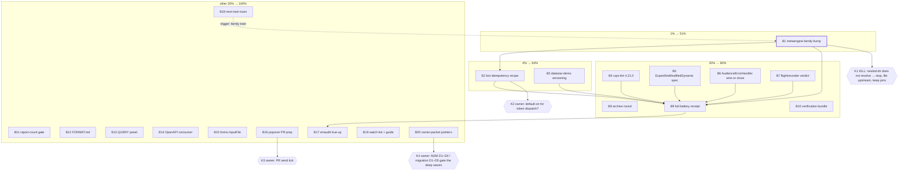

# SUPERB — Fleet Audit Follow-Through v2 (Pareto Plan)

**Date:** 2026-11-15 07:21 · **Author:** Crush · **Status:** plan of record for the 2026-11-14 audit-refresh backlog
**Inputs:** [fleet audit v2](../review/libs/index.html) (22 reports, 2026-11-14) · [session status](../status/2026-11-15_07-16_fleet-libs-audit-refresh-22-libs_status.md) (§f = the ranked backlog this plan covers) · [v1 follow-through plan](2026-11-06_00-37_SUPERB-fleet-libs-audit-follow-through-pareto-plan.md) (fully executed — linked, not re-dispatched) · `TODO_LIST.md` (living backlog; fleet row carries this plan's pointer)

**Scope:** ALL 30 §f items from the audit-refresh status report. Owner-gated threads (M2M D1–D4, system-migration D1–D5, render-lane, A17) are LINKED as decision gates, never re-dispatched as tasks. Do not verschlimmbessern: every change leaves the repo verifiably no worse.

## Errata — corrections discovered during Step 0

1. **The "tail 13" the 08-41 ledger recorded was already stale when this session arrived.** A sibling archive round drained it to 5 live before 2026-11-15; this session's status report raised it to 6 with `TAIL_BASELINE` 5→6 same-change. B8 targets the REAL tail (the four settled 2026-11-14 adminui-era reports), not the phantom 13.
2. **No §f item was already done.** Every one of the 30 was source-verified open during the 2026-11-14 refresh (grep receipts in the per-lib reports); CHANGELOG sweeps for the code items (bot idempotency, datastar-demo tag, AudienceErrorHandler call sites, flightrecorder imports) return nothing. No re-dispatch corrections needed — the v1 plan's errata class did not recur.
3. **The e2e/examples "pin skew" is mid-train lag, not drift.** e2e pins dashboardui v4.17.0 / loginpage v4.18.0 vs adminui v4.20.0 because the last family train tagged modules in order and consumers ride the next sweep. B18 is therefore TRIGGER-GATED (next family train), not a free-floating task.
4. **Adapter re-export of `ScriptTagVersioned`/`ETagFor` is rejected on policy, not deferred.** Re-exporting upstream symbols into the `datastar/` adapter would create exactly the permanent-alias class ADR-0062 bans. Autonomous decision D2 below: consumers import `go-datastar/static` directly; the demo adopts it directly. This kills half of §f.3's "consider adapter re-export".

## Overlap check

- §f.20–§f.23 + §f.19 (owner-gated/decision threads) → B20 pointer-refresh only; the owning plans (`2026-11-07_10-45_SUPERB-usermgmt-system-metaengine-migration-plan.md`, M2M D1–D4 packet, ROADMAP q35a) keep the substance.
- §f.8 (SSE drops → OTel metric) is trigger-gated ("once drops have burned in") → B19 watch-list row, not a now-task.
- Everything else (§f.1–§f.18, §f.24–§f.30) is NEW from the 2026-11-14 refresh and owned here.

## Pareto breakdown

### The 1% that delivers 51% — **B1: the metaengine-family bump wave**

The tree ships with exactly one RED strict gate (`check-upstream-treadmill --strict-lag 0`: metaengine v4.23.0→v4.24.0 + sqliteengine v4.8.0→v4.9.0, both tagged after the M17 sweep). One wave restores version truth for the whole fleet (38/38 trains at latest), closes the audit's #1 Important issue, and de-risks the migration plan's engine layer (W-waves sit on metaengine). Kill point K1 if the nested-dir restructure does not resolve cleanly.

### The 4% that deliver 64% — **the three audit action items** (B1, B2, B3)

B1 (above) + the M2M bot idempotency recipe (B2: bots are the replay-prone caller class and today's path mints no key) + datastar-demo versioned serving (B3: 24h-cached unversioned script = old-client/new-server skew, upstream built the fix for exactly this). Together: every "Important" issue in the refreshed index is closed with receipts.

### The 20% that deliver 80% — **gate currency + last partials + the receipt** (B4–B10)

cqrs-lint rebuilt at v4.21.0 (B4); the v1.9.0 feature actually adopted as a spec (B5); the last go-error-family partial wired or consciously closed (B6); the last go-cqrs-lite miss evaluated (B7); the docs-health archive round (B8); the full-battery receipt the status report §c.1 still owes (B9); the verification bundle that converts agent attestations into spot-checked receipts (B10).

### The other 20% (to 100%) — **dogfood, integrity gates, upstream, trues** (B11–B20)

The report-count integrity gate that would have caught the go-etag omission mechanically (B11); the series FORMAT.md so the next refresh inherits the link-depth and verify-block conventions (B12); the QUERY-ladder internal panel (B13) and a shipped OpenAPI consumer (B14) — the self-audit's two real thin spots; forms.InputFile (B15); the popover-CSS upstream PR prep (B16, send owner-gated); post-wave trues (B17, B18); watch-list + guide DropStats mention (B19); owner-packet pointer refresh (B20).

## Table A — comprehensive plan (20 tasks, 30–100 min; sorted by importance → impact → effort → customer-value)

| ID | Task (with verification bar) | Tier | min | Imp | Eff | CV | Depends on |
| --- | --- | --- | --- | --- | --- | --- | --- |
| B1 | **Metaengine-family bump wave**: bump `metaengine` v4.24.0 + `metaengine/sqliteengine` v4.9.0 across usermgmt/dashboardui/systemadapter/root; verify the nested `metaengine/v4/` module path resolves (dual tags); hermetic per-module builds. Verify: `check-upstream-treadmill --refresh-cache --strict-lag 0` GREEN + workspace build/vet + affected module suites | 1% | 75 | 5 | 3 | 4 | K1 |
| B2 | **M2M bot idempotency recipe**: guide section (Idempotency-Key keyExtractor for token-authenticated routes, keyed to `middleware.CommandIdempotency`), demo wiring in admin-demo bot path, `DropStats`-style doc cross-ref. Default-on stays owner-gated (K2). Verify: docs-links + admin-demo suite + guide example compiles | 4% | 40 | 4 | 1 | 4 | B1* |
| B3 | **datastar-demo versioned serving**: adopt `ScriptTagVersioned`/`ETagFor` in `examples/datastar-demo` (direct `go-datastar/static` import — D2), replace hand-rolled SSE-body assertions in `datastar/` adapter tests with `datastartest`. Verify: demo e2e (chromium) + adapter suite | 4% | 45 | 3 | 2 | 3 | — |
| B4 | **cqrs-lint v4.21.0 rebuild**: git-archive tag → build with commit-hash ldflags (gotcha-era recipe) → `cqrs-lint version` check → strict run over 14 modules with `--fail-on-stale-suppressions`. Verify: `nix run .#check-cqrs-lint` green; new waiver-adoption rule behaves (moved findings reattach) | 4% | 35 | 3 | 2 | 2 | — |
| B5 | **`ExpectNotModifiedDynamic` spec**: httpspec case asserting dynamic ETag + 304 for the five ETag handlers (event catalog, OpenAPI, projection status, sync pull, partial render). Verify: root httpspec suite | 20% | 40 | 3 | 1 | 3 | — |
| B6 | **AudienceErrorHandler wiring-or-decision**: wire the per-request audience resolver at the shipped problem-handler path, or record the N/A decision in `go-error-family.md` with the reason. Verify: audience-split body tests OR decision row updated | 20% | 60 | 3 | 3 | 3 | — |
| B7 | **flightrecorder spike verdict**: evaluate `go-cqrs-lite/flightrecorder` + appkit `flightrecorderhealth` against the last missed row; adopt (usermgmt opt-in config + dashboard panel) or record N/A-with-reason in `go-cqrs-lite.md`. Verify: spike notes in report OR wiring test | 20% | 50 | 2 | 3 | 2 | — |
| B8 | **Docs-health archive round**: archive the four settled 2026-11-14 adminui-era reports (11-29, 16-21, 18-30 + 08-41 if settled) via `archive-status --apply` with spec TSV; `TAIL_BASELINE` re-true (6→≤3). Verify: tail gate green + corpus re-trued with ledger | 20% | 45 | 2 | 2 | 1 | — |
| B9 | **Full-battery receipt**: `nix run .#check-modules` end-to-end + `.#coverage-gate` + `GOEXPERIMENT=jsonv2 go test ./... -count=1 -race` on the post-wave tree. Verify: receipts pasted into this plan's § execution log + TODO row | 20% | 60 | 3 | 3 | 2 | B1–B7 |
| B10 | **Verification bundle**: ls-verify `templ-components/datastar` latest tag; independently replay 2 agent-authored verify blocks (go-sse, go-cqrs-lite); queue render.png owner eyeball line in TODO. Verify: three receipts in plan log | 20% | 30 | 2 | 1 | 1 | — |
| B11 | **Fleet-series integrity gate**: `check-libs-report-count.sh` (report files == index table rows == 22, both directions) + fixture self-test + check-modules/CI wiring. Verify: self-test green; plant-a-mismatch fixture fails | rest | 35 | 2 | 2 | 1 | — |
| B12 | **Series FORMAT.md**: conventions file (fleet format, link-depth `../../research/` class, verify-block-must-run rule, score-derivation shape) in `docs/review/libs/`, linked from index footer. Verify: docs-links + corpus ledger | rest | 25 | 1 | 1 | 1 | — |
| B13 | **QUERY-ladder internal panel**: adminui user-search panel over a QUERY-method route (self-audit row 13: proven examples/integration-only today). Verify: adminui suite + e2e chromium path + golden | rest | 90 | 2 | 4 | 3 | — |
| B14 | **Shipped OpenAPI consumer**: admin-demo (or setup-demo) serves its spec via `WithOpenAPI` + UI link (self-audit row 9: option form test-only today). Verify: example build + spec handler test + README | rest | 80 | 2 | 3 | 3 | — |
| B15 | **forms.InputFile adoption**: replace the hand-rolled file input (adminui `users.templ:43`) with upstream `forms.InputFile`; CSS bundle rebuild same-change; goldens diffed line-by-line. Verify: `check-css-bundles` + `check-css-bundle-classes` + adminui goldens | rest | 30 | 1 | 1 | 2 | — |
| B16 | **Popover-CSS upstream PR prep**: verify-before-filing evidence pack (Chromium 156 rejection repro + corrected single-keyword bands), branch with the fix against templ-components master, PR text per github-voice. SEND is owner-gated (K3). Verify: evidence commands replay clean; branch builds | rest | 40 | 2 | 2 | 2 | — |
| B17 | **erraudit re-baseline + true-up**: post-waves `erraudit-inventory.sh --strict` re-run; re-true TOTAL in AGENTS + reports; advisory posture held. Verify: number reproduced twice | rest | 30 | 1 | 1 | 1 | B1–B7 |
| B18 | **Next-train pin trues** (TRIGGER: next family train): sweep e2e/examples requires; verify `templ-components/datastar` latest; treadmill strict-lag 0. Verify: hermetic examples legs + treadmill | rest | 35 | 2 | 1 | 2 | family train |
| B19 | **Watch-list + guide DropStats mention**: name `DropStats` in `docs/guides/sse-and-datastar.md` OnDrop section; consolidate watch rows (SSE→OTel trigger, go-filewatcher Healthy(), credentials-store anchor recheck, templ-components unreleased-fixes + CSS gates). Verify: docs-links + TODO row | rest | 20 | 1 | 1 | 1 | — |
| B20 | **Owner-packet pointer refresh**: one-line pointers in the M2M D1–D4 + migration D1–D5 packets + render-lane row + A17 noting the audit's supporting evidence (K4 unchanged). No new decisions. Verify: docs-links | rest | 30 | 1 | 1 | 1 | — |

\* B2 sequenced after B1 only to ride the same test-battery window; no hard dependency.

**Totals:** 20 tasks · ~935 min (~15.6 h) · 1 task trigger-gated (B18) · 3 owner-gated send/decision points (K2–K4) · 1 upstream kill point (K1).

## Table B — fine breakdown (88 tasks, each ≤12 min; sorted by tier → dependency → importance)

| ID | Task | min | Tier | Dep |
| --- | --- | --- | --- | --- |
| B1.1 | Read the v4.24.0 tag diff for `metaengine/` (module-path restructure: nested dir, dual tags) and list every import site in-tree (`rg -l 'metaengine/v4' --type go`) | 10 | 1% | — |
| B1.2 | `go get github.com/larsartmann/go-cqrs-lite/metaengine/v4@v4.24.0` + `metaengine/sqliteengine/v4@v4.9.0` in usermgmt, dashboardui, systemadapter, root; `go mod tidy` each | 12 | 1% | B1.1 |
| B1.3 | Resolve the nested-path module resolution (proxy vs dual-tag) — if `metaengine/v4/v4.24.0` is the resolvable form, sweep requires to it; record which tag form wins | 12 | 1% | B1.2 |
| B1.4 | Workspace `go build ./...` + `go vet` (GOEXPERIMENT=jsonv2); fix any API deltas v4.24.0 carries | 12 | 1% | B1.3 |
| B1.5 | Affected module suites green: systemadapter (sqliteengine-heavy), dashboardui, usermgmt | 12 | 1% | B1.4 |
| B1.6 | `nix run .#check-upstream-treadmill -- --refresh-cache --strict-lag 0` → GREEN receipt | 8 | 1% | B1.5 |
| B1.7 | CHANGELOG entries (root/usermgmt/dashboardui/systemadapter [Unreleased]) + TODO row strike for audit item 1 | 10 | 1% | B1.6 |
| B2.1 | Draft the guide section: bot-route idempotency recipe (keyExtractor over `Idempotency-Key`, TTL guidance, replay-409 semantics) referencing `middleware.CommandIdempotency` | 12 | 4% | — |
| B2.2 | Wire the recipe live in `examples/admin-demo` (bot dispatch path takes the key from header when present) | 12 | 4% | B2.1 |
| B2.3 | Compile-check the guide example (quickstart-gate pattern: throwaway fence build) + docs-links | 8 | 4% | B2.2 |
| B2.4 | Cross-ref from `docs/review/libs/go-idempotency.md` gap row → guide anchor; strike audit item 2 in TODO | 8 | 4% | B2.3 |
| B3.1 | Replace the demo's hardcoded script tag with `ScriptTagVersioned` + wire `ETagFor` (direct static import) | 10 | 4% | — |
| B3.2 | Add `datastartest` to `datastar/` go.mod; convert the two hand-rolled SSE-body assertion blocks in `response_test.go` | 12 | 4% | B3.1 |
| B3.3 | Demo e2e (chromium lane) green: script serves versioned, cache headers correct | 12 | 4% | B3.2 |
| B3.4 | Strike audit item 3 in TODO + `go-datastar.md` gap rows updated | 6 | 4% | B3.3 |
| B4.1 | `git archive cmd/cqrs-lint/v4.21.0` from the go-cqrs-lite checkout → build with commit-hash ldflags → `cqrs-lint version` | 10 | 4% | — |
| B4.2 | Strict run over 14 modules `--strict --fail-on-stale-suppressions`; triage new findings (waiver adoption expected to REDUCE orphans) | 12 | 4% | B4.1 |
| B4.3 | AGENTS cqrs-lint row true-up (v4.21.0, waiver-adoption note) + gate receipt | 8 | 4% | B4.2 |
| B5.1 | Read `httpspec.ExpectNotModifiedDynamic` semantics (tag-pinned source) and draft the 5-handler spec table | 8 | 20% | — |
| B5.2 | Write the spec cases (event catalog, OpenAPI, projection status) | 12 | 20% | B5.1 |
| B5.3 | Write the spec cases (sync pull, partial render) + suite green | 12 | 20% | B5.2 |
| B5.4 | `httputil.md` row 18 true-up (dynamic check adopted) | 5 | 20% | B5.3 |
| B6.1 | Map the shipped problem-handler path and the zero-call-site `ProblemDetailsAudienceErrorHandler`; pick wire-or-N/A with a written reason | 10 | 20% | — |
| B6.2 | (If wire) per-request audience resolver at the handler chain + audience-split body tests | 12 | 20% | B6.1 |
| B6.3 | (If wire) httperr tests for public-redaction vs operator detail + CHANGELOG; (else) decision row in `go-error-family.md` + report score true | 12 | 20% | B6.2 |
| B7.1 | Spike: read `flightrecorder` + appkit `flightrecorderhealth` APIs; map candidate seams (usermgmt opt-in? dashboard panel?) | 12 | 20% | — |
| B7.2 | Spike verdict recorded: adopt-path sketch OR N/A-with-reason written into `go-cqrs-lite.md` row (score derivation re-run if row flips) | 10 | 20% | B7.1 |
| B7.3 | (If adopt) minimal wiring: config flag + recorder mount + one test; full panel deferred to its own wave | 12 | 20% | B7.2 |
| B8.1 | Read the four 2026-11-14 adminui-era reports; confirm settled + choose successors (16-21 ← 08-41? 18-30 ← 16-21; 11-29 ← 08-45 plan?) | 12 | 20% | — |
| B8.2 | Write the archive spec TSV; dry-run `archive-status` (row gate BEFORE move) | 8 | 20% | B8.1 |
| B8.3 | `archive-status --apply` + `--update-baseline` (TAIL_BASELINE 6→≤3) + corpus re-true + ledger sentence | 12 | 20% | B8.2 |
| B8.4 | Tail + corpus + docs-links gates green; manifest row check | 8 | 20% | B8.3 |
| B9.1 | `nix run .#check-modules` end-to-end; triage any red leg to green (expected: none post-B1) | 12 | 20% | B1–B7 |
| B9.2 | `nix run .#coverage-gate`; thresholds file unchanged unless a wave moved coverage (then same-change threshold edit) | 12 | 20% | B9.1 |
| B9.3 | `GOEXPERIMENT=jsonv2 go test ./... -count=1 -race` full battery (background shell, gotcha-41 flake rerun rule) | 12 | 20% | B9.2 |
| B9.4 | Receipts into plan § execution log + TODO row; status-report §c.1 debt closed | 8 | 20% | B9.3 |
| B10.1 | `git ls-remote` templ-components `datastar/` tag; record latest vs v1.27.0 in `templ-components.md` | 6 | 20% | — |
| B10.2 | Replay `go-sse.md` verify block literally; diff against its annotated outputs | 10 | 20% | — |
| B10.3 | Replay `go-cqrs-lite.md` verify block literally; diff (the fixed tag-loop grep included) | 12 | 20% | — |
| B10.4 | TODO line: owner eyeball of `index.render.png` (human-only task, queued not done) | 4 | 20% | — |
| B11.1 | Write `scripts/checks/check-libs-report-count.sh` (count `docs/review/libs/*.md` minus FORMAT/index == index.html `<tr>` report links == 22; parse the table, not a hardcoded int) | 12 | rest | — |
| B11.2 | Fixture self-test `test-check-libs-report-count.sh`: pass case + planted missing-file case + planted extra-row case | 12 | rest | B11.1 |
| B11.3 | Flake app + check-modules stage + CI row (the shellcheck leg applies — gotcha class of 2026-11-03) | 12 | rest | B11.2 |
| B11.4 | Run gate green on the real tree; note the §e.1 failure class it mechanizes | 6 | rest | B11.3 |
| B12.1 | Write `docs/review/libs/FORMAT.md` (fleet format block: header lines, verdict table shape, inventory statuses, score derivation, link-depth `../../`, verify-block-must-run, audit-date stamping) | 12 | rest | — |
| B12.2 | Link FORMAT.md from index footer + one line in `go-etag.md` header; docs-links + corpus ledger | 8 | rest | B12.1 |
| B13.1 | Pick the panel + query (adminui users search); declare the QUERY route in adminui routeSpec (posture row included — L4 gate) | 12 | rest | — |
| B13.2 | Handler + query registration through the QUERY-method ladder (fallback twin per ADR/QUERY docs) | 12 | rest | B13.1 |
| B13.3 | Panel templ + HTMX wiring (own hx-target/select pins — the boost-wrapper trap) | 12 | rest | B13.2 |
| B13.4 | Tests: route posture matrix row, byte-parity twin, authz matrix | 12 | rest | B13.3 |
| B13.5 | e2e chromium path + goldens; CSS bundle rebuild if new utilities | 12 | rest | B13.4 |
| B13.6 | Self-audit row 13 true-up in `cqrs-htmx.md` (partial→full if shipped) + CHANGELOG | 8 | rest | B13.5 |
| B14.1 | Choose the demo (admin-demo preferred: it has a mux + routes to enumerate); add `WithOpenAPI` wiring | 10 | rest | — |
| B14.2 | Spec handler mount + UI link (sidebar/nav entry) + title metadata | 12 | rest | B14.1 |
| B14.3 | Test: spec validates (OpenAPI 3.1 shape), routes enumerated, ETag/304 path | 12 | rest | B14.2 |
| B14.4 | README section + self-audit row 9 true-up + CHANGELOG | 8 | rest | B14.3 |
| B15.1 | Swap `users.templ:43` hand-rolled file input → `forms.InputFile` (props parity: accept, label, ID pinned) | 10 | rest | — |
| B15.2 | Regenerate templ (canonical pinned generator) + CSS bundle rebuild same-change | 10 | rest | B15.1 |
| B15.3 | Diff goldens line-by-line (documented-drift rule); suite + css gates green; templ report gap row strike | 10 | rest | B15.2 |
| B16.1 | Evidence pack: minimal repro (compound `position-area` declaration dropped by Chromium 156 vs single-keyword accepted) — headless browser receipt | 12 | rest | — |
| B16.2 | Branch on templ-components checkout; apply the corrected layer (adminui's vendored form generalized); build + their tests | 12 | rest | B16.1 |
| B16.3 | PR text per github-voice (evidence, engine versions, fix rationale); queue for owner send (K3) | 10 | rest | B16.2 |
| B17.1 | `bash scripts/checks/erraudit-inventory.sh --strict` twice; record TOTAL | 8 | rest | B1–B7 |
| B17.2 | Re-true AGENTS erraudit row + report citations; advisory posture held (no blocking promotion without the green month) | 8 | rest | B17.1 |
| B18.1 | (TRIGGER: family train) sweep e2e/server + examples requires to new tags; hermetic legs | 12 | rest | train |
| B18.2 | (TRIGGER) verify templ-components/datastar tag; treadmill strict-lag 0 receipt | 8 | rest | B18.1 |
| B19.1 | Name `DropStats` in the sse-and-datastar guide OnDrop section (1 paragraph, wiring example pointer) | 8 | rest | — |
| B19.2 | Consolidate watch rows in the TODO fleet row (SSE→OTel trigger, filewatcher Healthy(), credentials-store anchor, templ-components unreleased fixes + CSS gates) | 10 | rest | B19.1 |
| B20.1 | One-line pointers added to the M2M D1–D4 packet + migration-plan header + render-lane TODO row: "audit evidence: docs/review/libs/* (2026-11-14)" | 8 | rest | — |
| B20.2 | NV4/htmx-4 seed decision pointer into ROADMAP q35a row (audit row 13 evidence); docs-links green | 8 | rest | B20.1 |

**Totals:** 88 fine tasks · ~12 min avg ≈ 900 min (matches Table A within rounding; B9/B13 pairs share window time).

## Execution graph

## Autonomous decisions (recorded, reversible, owner-visible)

1. **D1 — B1 runs without a train**: the bump is a dependency sweep, not an API change; if v4.24.0 carries API deltas beyond mechanical, the wave stops at K1 and the pins stay (never a half-swept tree).
2. **D2 — no adapter re-export of `ScriptTagVersioned`/`ETagFor`** (ADR-0062: a re-export is a permanent-alias class). Demo imports `go-datastar/static` directly; the audit item shrinks accordingly.
3. **D3 — B2 ships the recipe, not the default**: defaulting `CommandIdempotency` on for token-authenticated dispatch is a library-opinion change entangled with M2M owner-decision D1 — recipe now, default behind K2.
4. **D4 — B6/B7 are wire-OR-record**: if wiring fails its own cost/benefit bar mid-task, the honest N/A-with-reason closes the row; a forced wiring would be verschlimmbessern.
5. **D5 — B18 stays trigger-gated**: sweeping consumer pins mid-train fights the release-train machinery for zero customer value.

## Coverage proof (all 30 §f items → this plan)

§f.1→B1 · §f.2→B2 · §f.3→B3 · §f.4→B4 · §f.5→B5 · §f.6→B6 · §f.7→B7 · §f.8→B19 (watch, trigger-gated) · §f.9→B13 · §f.10→B14 · §f.11→B15 · §f.12→B16 · §f.13→B8 · §f.14→B9 · §f.15→B10.1 · §f.16→B10.2/3 · §f.17→B10.4 · §f.18→B18 · §f.19→B20 (decision pointer, owner) · §f.20→B20 (gated link) · §f.21→B20 (gated link) · §f.22→B20 (gated link) · §f.23→B20 (gated link) · §f.24→B11 · §f.25→B12 · §f.26→B19 · §f.27→B19 · §f.28→B17 · §f.29→B19 · §f.30→policy row in B20 (owner §g.3 pending). **30/30 covered; 24 executable now, 4 owner-gated links, 1 trigger-gated, 1 policy-pending.**

## Execution log

| When | What | Receipt |
| --- | --- | --- |
| 2026-11-15 07:21 | Plan written, harvested pointer added to TODO fleet row | this file; corpus re-trued with ledger |
| 2026-11-15 07:30 | **B1 EXECUTED** — metaengine v4.24.0 sweep (commit `8e7822c9`, 5 modules, tidy+verify+build+vet+lint green) + sqliteengine v4.9.0 sweep (bump-dep own commit); nested-dir restructure resolved cleanly through the module path, zero import changes (K1 not hit) | `nix run .#check-upstream-treadmill -- --strict-lag 0` GREEN (worst lag 0, 20 repos · 79 prefixes); dashboardui + systemadapter suites green; usermgmt hermetic (GOWORK=off) green — the one workspace-mode red is the `StateShape` sentinel correctly firing because the tracked go.work replaces storage at unreleased upstream MASTER carrying the go-cqrs-lite#117 fix (no storage tag yet; flip+close at the tag — TODO row 93 updated with the nuance) |

<!-- append rows as waves land; never rewrite history -->
