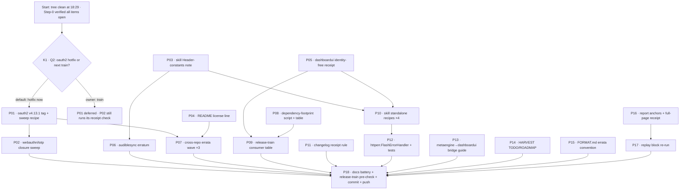

# SUPERB — Fleet Presentation Fixes (Pareto Plan)

> **2026-11-17 18:29 CET · input:** the fleet presentation audit
> ([`../research/2026-11-17_docs-marketing-skill-fleet-audit.html`](../research/2026-11-17_docs-marketing-skill-fleet-audit.html)
> — 21 fleet reviews read, 10 findings, 50 §f items) plus its status report
> ([`../status/2026-11-17_18-05_fleet-presentation-audit_status.md`](../status/archived/2026-11-17_18-05_fleet-presentation-audit_status.md)).
> Method: `pareto-planning` skill, Step 0 first. Goal: correct every wrong or
> stranded signal consumers act on today, then ship the additions that convert
> parked adopters. NO Verschlimmbessern: every task carries a verify bar; the
> only code change (P12) is additive with tests.

## Errata — corrections discovered during Step 0

1. **Harvest-collision fear was stale.** The 18-05 status report flagged
   `TODO_LIST.md` as carrying uncommitted sibling edits; the auto-commit
   daemon landed them (tree clean at 18:29). Harvest (P14) proceeds, with a
   re-check at execution time.
2. **The oauth2 hotfix has a precise tag point.** All three commits
   dnsblockd's review wants on the nested train (`7fd1db43` go-jose v4.1.6
   DoS patch, `d05585e8` live-credential error contexts, `bff8e054`
   go-error-family sweep) are ancestors of root `v4.18.1` — so
   `usermgmt/oauth2/v4.13.1` can be cut ON the `v4.18.1` train commit; no new
   commit is required, only the tag + hermetic verification + CHANGELOG.
3. **FORMAT.md already exists** (shipped by the prior plan's B12) — the
   cross-repo errata convention (P15) EXTENDS it, it does not create it.
4. **The tail budget is advisory-exceeded already** (6 live vs budget 3;
   ratchet-green at baseline 6) — this plan adds no status report, so no tail
   bump rides it; the next ARCHIVE pass is the sibling's/docs-health's call.
5. **Owner questions Q1–Q3 from the status report were not answered** —
   handled as explicit decision gates with recorded defaults (§ Autonomous
   decisions), not as silent assumptions.

## Overlap check

- **No overlap** with the sibling's active thread (cqrs-lint × BuildFlow
  reconciliation — `.cqrs-lint.json` files, gate scripts, BuildFlow pins are a
  no-touch zone for this plan).
- **No overlap** with the train-first plan of record (P01 cuts a NESTED
  sub-module tag on an already-published root train commit — it is not a
  family train and does not consume unpublished API).
- **No overlap** with fleet-audit follow-through v2 (its B-items are landed or
  routed; its FORMAT.md shipped — P15 extends).
- All 10 fix-list items re-verified OPEN at 18:29 (CHANGELOG grep: no
  `FlashErrorHandler`, no dependency-footprint table, no license line, no
  oauth2 tag newer than v4.13.0; skill greps: no standalone recipes, no
  Header-constant notes).

## Pareto breakdown

### The 1% that delivers 51% — **correct the two signals consumers act on TODAY**

P01 (the oauth2 security hotfix — a consumer audit documents a live uncovered
CVE-class patch) + P03 (the skill's missing Header-constant note — kills the
false-negative class that already mis-verified one fleet audit). Two tasks,
~90 min, and the fleet stops acting on wrong/stranded facts.

### The 4% that delivers 64% — **the 1% + correct every wrong premise**

P04 + P07 (license disambiguation + the license/dnsblockd errata — two
adoption decisions were made on a false proprietary claim) + P05 (dashboardui
identity-free receipt — converts two parked adopters: index, CV).

### The 20% that delivers 80% — **the complete 10-item fix list**

Adds P02 (closure sweep), P06 (constants erratum), P08 (dependency-footprint
table — the #1 recorded non-adoption tax), P09 (release-train consumer doc),
P10 (the four consumer-invented skill recipes), P11 (changelog receipt rule).

### The other 20% (to 100%) — **routing, API completion, tooling, receipts**

P12 (FlashErrorHandler — the paved road behind F3/F9), P13 (metaengine→
dashboardui bridge guide — converts invoices/CV), P14 (HARVEST to
TODO_LIST/ROADMAP), P15 (FORMAT.md errata convention), P16 (report polish:
anchors + full-page receipt), P17 (replay schedule + block re-run), P18
(final gates + the user-ordered commit/push receipt). §f brainstorm tail that
survives as triggers/notes routes to ROADMAP in P14.

## Table A — comprehensive plan (18 tasks, 30–100 min; sorted by importance → impact → effort → customer-value)

| ID | Task (with verification bar) | Tier | min | Imp | Eff | CV | Depends on |
| --- | --- | --- | --- | --- | --- | --- | --- |
| P01 | **oauth2 security hotfix tag**: cut `usermgmt/oauth2/v4.13.1` ON the `v4.18.1` train commit (carries `7fd1db43` go-jose v4.1.6 + `d05585e8` + `bff8e054`); hermetic `GOWORK=off` build + oauth2 suite at the tag; CHANGELOG [Unreleased] entry with the consumer sweep recipe (flake input → root v4.13.x-carrying tag + go.mod bump, dnsblockd's documented lockstep move). K1-gated (default: hotfix). Verify: `git tag -l 'usermgmt/oauth2/*'` shows v4.13.1; suite green at tag; CHANGELOG entry names the DoS patch | 1% | 60 | 5 | 3 | 5 | K1 |
| P02 | **webauthn/totp go-jose closure sweep**: `go list -m go-jose` at each module's latest tag; cut companion patch tags ONLY if the vulnerable range is in closure, else record the no-op receipt in P01's CHANGELOG entry. Verify: per-module `go list -m` receipts pasted into the execution log | 1% | 30 | 4 | 2 | 4 | P01 |
| P03 | **skill Header-constant note**: `.agents/skills/cqrs-htmx/SKILL.md` Discoverability notes gain `htmx.HeaderRetarget`/`HeaderReswap` (with the raw-string migration line); cross-link from the Response-builder `Retarget()` bullet; fan-out sync re-verified. Verify: `check-skill-snippets` green; repo-vs-fanout `diff` clean | 1% | 30 | 5 | 1 | 4 | — |
| P04 | **README license disambiguation**: one intent-neutral line at the first screen + § License ("MIT — each sibling LarsArtmann repo's LICENSE is authoritative; verify per repo"). No go-cqrs-lite claims (Q1 default, D1). Verify: README renders; docs-links; no factual claim beyond this repo's LICENSE | 4% | 30 | 5 | 1 | 4 | — |
| P05 | **dashboardui identity-free receipt**: README Integration Modes gains "Runs without usermgmt" (dashboardui/go.mod citation, dated) + a headless/API-key mounting example verified against the real `Config`/`Mount` API (no invented fields). Verify: example compiles or cites real fields; docs-links | 4% | 60 | 4 | 2 | 4 | — |
| P06 | **audiblesync review erratum** (cross-repo): dated ERRATUM on the constants row citing `htmx/htmx.go:27-28` + v4.18.1; per the fleet's erratum culture (inline, non-destructive). Verify: erratum's file:line replays via git show | 4% | 45 | 4 | 2 | 3 | P03 |
| P07 | **cross-repo errata wave**: license-row corrections in go-taskqueue + business-networking reviews (citing LICENSE:1, MIT) + dnsblockd's F2 exposure row marked FIXED once P01's tag exists. Commits land in each repo; PUSHES are K2-gated. Verify: each erratum cites a replayable receipt | 4% | 45 | 4 | 2 | 3 | P01, P04 |
| P08 | **README dependency-footprint table**: per-module direct requires + closure size + Go floor, GENERATED by `scripts/checks/dep-footprint.sh` (parse go.mod files; no hand-maintained numbers, D6) + README table under "The modules" + release-checklist regeneration note. Verify: script output matches `go mod` truth for 3 sampled modules; docs-links; corpus ledger | 20% | 90 | 4 | 3 | 4 | — |
| P09 | **README release-train consumer table**: § Versioning gains nested→root tag mapping, the flake-input rule for nested importers, and the security-lag escalation path (links to P01's recipe); dashboardui README links it. Verify: dnsblockd §2's mechanics reproduce from the table alone; docs-links | 20% | 60 | 3 | 2 | 3 | P08 |
| P10 | **skill Standalone module recipes**: new section with the four consumer-invented patterns, each credited — oauth2-without-usermgmt (dnsblockd: lazy provider retry + `FinishLoginWithToken` nonce), dashboardui headless (index's question answered), HTMX flash error contract (audiblesync shape), metaengine→dashboardui pointer (invoices/CV). Section TITLES elsewhere untouched (consumers cite them; additive-only, D7). Verify: skill-snippets green; fan-out diff clean; docs-links | 20% | 90 | 4 | 3 | 4 | P03, P05 |
| P11 | **changelog receipt rule**: release checklist gains the per-symbol diff-verification rule at tag time (the dnsblockd erratum as case study); the release-train gate's help text names it. No behavior change to gates. Verify: rule present; `check-release-train` self-tests unchanged-green | 20% | 45 | 3 | 1 | 2 | — |
| P12 | **`httperr.FlashErrorHandler`** (additive v4 minor): HTMX clients get 200 + `HX-Retarget` + `HX-Reswap` to the configured flash target; non-HTMX get the mapped real status; uses the `Header*` constants. Tests: HTMX path, non-HTMX passthrough, header bytes. Skill recipe (P10) updated to the shipped API; CHANGELOG [Unreleased]. D5 (owner-visible). Verify: new suite green; skill-snippets; workspace build/vet | 20% | 100 | 3 | 3 | 3 | P03, P10 |
| P13 | **metaengine→dashboardui bridge guide**: `docs/guides/dashboardui-metaengine-bridge.md` — map metaengine facts/watcher events onto the `transport` domain-event envelope; scoped code samples that compile (doc-fence rules). If the sketch proves thinner than a guide, record the scoped examples-spike alternative instead (D8). Verify: docs-links; every fence compiles or carries `//doc:api-tour` | rest | 100 | 3 | 3 | 3 | P05 |
| P14 | **HARVEST**: TODO_LIST P1 row pointing at this plan (the fix list as bounded work), ROADMAP routing for the §f brainstorm tail (items 26, 39, 43, 48 → triggers/notes). Re-check TODO_LIST cleanliness at execution (D3). Verify: `check-todo-hygiene` green; corpus ledger | rest | 30 | 3 | 1 | 2 | — |
| P15 | **FORMAT.md cross-repo errata convention**: one paragraph — errata to consumer reviews are written in the consumer repo, dated, citing replayable receipts, linked back here. Verify: docs-links | rest | 30 | 2 | 1 | 1 | P06 |
| P16 | **report polish**: stable anchors (`#review-<repo>`) on the deliverable's evidence table + a FULL-PAGE render receipt (current PNG is viewport-only) + the adopter-arithmetic sentence re-verified. Verify: anchors resolve in Chromium probe; PNG regenerated | rest | 30 | 2 | 1 | 1 | — |
| P17 | **replay schedule + block re-run**: the deliverable's verify block runs once (replay rule) and gains a dated replay note + next-refresh trigger. Verify: block exits as annotated | rest | 30 | 2 | 1 | 2 | P01, P16 |
| P18 | **final receipt battery + commit + push**: docs gates (corpus ratchet, tail, links, skill-snippets, todo-hygiene), `check-release-train --refresh-cache --strict-lag 0` pre-check, VERY detailed commit (plan + TODO row + baselines + CHANGELOG), push with pre-push hook receipt. Verify: hook green; push accepted; commit message carries findings F1–F3 references | rest | 30 | 3 | 1 | 3 | P01–P17 |

**Totals:** 18 tasks · ~970 min (~16.2 h) · 1 decision-gated task (P01, K1) · 1 push-gated wave (P07, K2) · 1 deferred-possible task (P13, D8) · zero overlapping threads.

## Table B — fine breakdown (79 tasks, each ≤12 min; sorted by tier → dependency → importance)

| ID | Task | min | Tier | Dep |
| --- | --- | --- | --- | --- |
| P01.1 | Confirm the tag point: `git merge-base --is-ancestor 7fd1db43 v4.18.1` (and `d05585e8`, `bff8e054`) → all true | 5 | 1% | K1 |
| P01.2 | Verify oauth2 tree state at `v4.18.1`: `git show v4.18.1:usermgmt/oauth2/go.mod` (go-jose floor ≥ v4.1.6) + `git diff usermgmt/oauth2/v4.13.0 v4.18.1 -- usermgmt/oauth2` scoped diff | 8 | 1% | P01.1 |
| P01.3 | Hermetic build+test at the tag point: worktree at `v4.18.1`, `GOWORK=off GOEXPERIMENT=jsonv2 go build ./... && go test ./...` in `usermgmt/oauth2/` | 12 | 1% | P01.2 |
| P01.4 | Cut the annotated tag `usermgmt/oauth2/v4.13.1` on the `v4.18.1` commit; verify-tag guards (`scripts/tools/verify-tag` recipe) | 8 | 1% | P01.3 |
| P01.5 | Push the tag; `nix run .#check-release-train -- --refresh-cache` → the nested tag now published; record output | 8 | 1% | P01.4 |
| P01.6 | CHANGELOG [Unreleased] entry: the DoS patch reaches the oauth2 train + the consumer sweep recipe (flake → root tag + go.mod bump, dnsblockd lockstep) | 10 | 1% | P01.5 |
| P02.1 | `go list -m go-jose` in webauthn at its latest tag (worktree or `git show` go.mod + resolution) | 8 | 1% | P01.5 |
| P02.2 | Same for totp; record both receipts in the execution log | 8 | 1% | P02.1 |
| P02.3 | If either carries the vulnerable range: cut the companion patch tag (same recipe as P01.4–.5); else write the no-op receipt line into P01's CHANGELOG entry | 12 | 1% | P02.2 |
| P03.1 | Open the skill's "Discoverability notes" section; draft the two-constant bullet (`htmx.HeaderRetarget` / `htmx.HeaderReswap`, `htmx/htmx.go:27-28`, raw-string migration) | 10 | 1% | — |
| P03.2 | Add the cross-link line to the Response-builder `Retarget()` bullet ("see `htmx.HeaderRetarget` for raw handlers") | 5 | 1% | P03.1 |
| P03.3 | Run `nix run .#check-skill-snippets` → green | 6 | 1% | P03.2 |
| P03.4 | Fan-out sync: re-check `diff` repo SKILL.md vs `~/.config/crush/skills/cqrs-htmx/SKILL.md` → identical (symlink) | 5 | 1% | P03.3 |
| P04.1 | Draft the license line (intent-neutral: MIT; sibling LICENSEs authoritative; verify per repo) — NO go-cqrs-lite claims | 8 | 4% | — |
| P04.2 | Insert at README first screen (badge row area) + one sentence in § License | 8 | 4% | P04.1 |
| P04.3 | `bash scripts/checks/check-docs-links.sh` → green; eyeball rendered README section | 8 | 4% | P04.2 |
| P05.1 | Read dashboardui `Config` + `Mount`/`Autodetect` API (README + source) — list the exact fields a headless/API-key mounting needs | 10 | 4% | — |
| P05.2 | Write the "Runs without usermgmt" receipt block (go.mod citation, dated 2026-11-17) into Integration Modes | 8 | 4% | P05.1 |
| P05.3 | Write the headless mounting example from P05.1's real fields (Authorizer func, BasePath, ReadOnly) | 12 | 4% | P05.2 |
| P05.4 | Compile-check the example's identifiers against the source (`rg` each symbol) — no invented APIs | 10 | 4% | P05.3 |
| P05.5 | docs-links green; corpus ledger note for README growth | 8 | 4% | P05.4 |
| P06.1 | Open audiblesync's review; locate the constants row + its verify-block line | 6 | 4% | P03 |
| P06.2 | Insert the dated ERRATUM blockquote (fleet style): constants exist at `htmx/htmx.go:27-28`, added `e1bc0095`, in v4.18.1; raw-string workaround retired | 10 | 4% | P06.1 |
| P06.3 | Verify the erratum's receipts replay: `git -C ~/projects/cqrs-htmx show v4.18.1:htmx/htmx.go | grep HeaderRetarget` | 5 | 4% | P06.2 |
| P06.4 | Commit in audiblesync (detailed message); PUSH K2-gated | 8 | 4% | P06.3 |
| P07.1 | go-taskqueue review: locate the License/stance note; insert dated erratum citing `LICENSE:1` (MIT) in cqrs-htmx | 8 | 4% | P04 |
| P07.2 | business-networking review: same correction on the "proprietary licence" cost claim | 8 | 4% | P07.1 |
| P07.3 | dnsblockd review: F2 exposure row marked FIXED (post-P01 tag) with the sweep recipe receipt | 10 | 4% | P01 |
| P07.4 | Commit each repo (detailed messages); PUSHES K2-gated | 10 | 4% | P07.3 |
| P08.1 | Write `scripts/checks/dep-footprint.sh`: for each module dir — direct-require count, `go mod` closure size, go directive; TSV to stdout | 12 | 20% | — |
| P08.2 | Validate the script against 3 sampled modules (`go mod why`/`go list -m all` counts) — numbers must match | 12 | 20% | P08.1 |
| P08.3 | Shellcheck the script (`nix run nixpkgs#shellcheck` precedent) | 5 | 20% | P08.2 |
| P08.4 | Add the generated table to README "The modules" (script output pasted, regeneration note) | 10 | 20% | P08.3 |
| P08.5 | Release-checklist note: regenerate the table when any go.mod changes | 6 | 20% | P08.4 |
| P08.6 | Corpus ledger + docs-links green | 8 | 20% | P08.5 |
| P09.1 | Draft the train table: nested tag → carrying root tag, flake rule, escalation path (P01's recipe linked) | 12 | 20% | P08 |
| P09.2 | Extend README § Versioning & migrations; keep existing lines untouched | 10 | 20% | P09.1 |
| P09.3 | Link the section from dashboardui README (the nested README consumers hit) | 6 | 20% | P09.2 |
| P09.4 | Replay dnsblockd §2's mechanics from the table alone (paper walk) + docs-links | 8 | 20% | P09.3 |
| P10.1 | Draft the section skeleton + the stability note (additive-only; consumers cite sections) | 8 | 20% | P03 |
| P10.2 | Recipe 1: oauth2-without-usermgmt (lazy provider retry, `FinishLoginWithToken` nonce) — credit dnsblockd; fence compiles | 12 | 20% | P10.1 |
| P10.3 | Recipe 2: dashboardui headless/API-key mounting — credit index; uses P05's verified fields | 10 | 20% | P10.2 |
| P10.4 | Recipe 3: HTMX flash error contract — credit audiblesync; uses `HeaderRetarget`/`HeaderReswap` | 12 | 20% | P10.3 |
| P10.5 | Recipe 4: metaengine→dashboardui pointer — credit invoices/CV; links P13's guide | 8 | 20% | P10.4 |
| P10.6 | `check-skill-snippets` + fan-out sync + docs-links | 8 | 20% | P10.5 |
| P11.1 | Add the receipt rule to the release checklist doc (diff-verify every named symbol at tag time; dnsblockd case study link) | 10 | 20% | — |
| P11.2 | Name the rule in the release-train gate's help/usage text (no behavior change) | 8 | 20% | P11.1 |
| P11.3 | `bash scripts/selftests/` release-train self-test unchanged-green (behavior-proof) | 8 | 20% | P11.2 |
| P12.1 | Design: `FlashErrorHandler(target string)` (or options form) over `HeaderRetarget`/`HeaderReswap` + `htmx.IsRequest` branch; match httperr's existing handler shapes | 12 | 20% | P03 |
| P12.2 | Implement in `httperr/` (layering rule: httperr imports htmx+internal/hx only) | 12 | 20% | P12.1 |
| P12.3 | Tests: HTMX path (200 + both headers + flash body), non-HTMX passthrough (real status), header byte-exactness | 12 | 20% | P12.2 |
| P12.4 | `GOEXPERIMENT=jsonv2 go test ./httperr/... -race` green; `check-module-layers` green | 10 | 20% | P12.3 |
| P12.5 | CHANGELOG [Unreleased] entry (additive minor, credit audiblesync's demand signal) | 8 | 20% | P12.4 |
| P12.6 | Update P10's recipe 3 to the shipped API | 8 | 20% | P12.5 |
| P12.7 | Workspace build/vet + lint on touched files | 10 | 20% | P12.6 |
| P13.1 | Read `transport.ServeDomainEvents` + `DomainEventToSSE` envelope + metaengine facts/watcher surface | 12 | rest | P05 |
| P13.2 | Draft the bridge mapping section (facts → envelope; watcher → replay cursor) | 12 | rest | P13.1 |
| P13.3 | Code samples compile-checked (doc-fence rule; `//doc:api-tour` where listing) | 12 | rest | P13.2 |
| P13.4 | Guide saved; if thinner than a guide, record the scoped examples-spike alternative (D8) instead | 10 | rest | P13.3 |
| P13.5 | docs-links + corpus ledger | 8 | rest | P13.4 |
| P14.1 | Re-check TODO_LIST cleanliness (`git status`) — defer on new sibling writes (D3) | 5 | rest | — |
| P14.2 | Add the P1 pointer row (plan link, 18 tasks, 1% ready on approval) | 8 | rest | P14.1 |
| P14.3 | ROADMAP routing: items 26 (asset-only install path), 39 (lessons.md), 43 (cv/CV dedupe), 48 (render-receipt runbook) → trigger/idea rows | 10 | rest | P14.2 |
| P14.4 | `check-todo-hygiene` + corpus ledger | 6 | rest | P14.3 |
| P15.1 | FORMAT.md: append the cross-repo errata paragraph (dated, consumer-repo-written, replayable receipts, link back) | 10 | rest | P06 |
| P15.2 | docs-links | 5 | rest | P15.1 |
| P16.1 | Add `#review-<repo>` anchors to the deliverable's evidence table rows | 8 | rest | — |
| P16.2 | Full-page Chromium render (`fullPage: true`) → regenerate the receipt PNG | 10 | rest | P16.1 |
| P16.3 | Re-verify the adopter-arithmetic sentence (8 of nine at 75–100; PapDashboard 6/100) against the table | 5 | rest | P16.2 |
| P17.1 | Run the deliverable's verify block once; confirm every annotated output | 10 | rest | P01, P16 |
| P17.2 | Add the dated replay note + next-refresh trigger (next family train or F-row landing) | 8 | rest | P17.1 |
| P18.1 | Docs battery: corpus ratchet, tail, links, skill-snippets, todo-hygiene — all green | 10 | rest | P01–P17 |
| P18.2 | `nix run .#check-release-train -- --refresh-cache --strict-lag 0` pre-check (hook predictor) | 8 | rest | P18.1 |
| P18.3 | VERY detailed commit: plan + TODO row + baselines + CHANGELOG + code/docs (message references F1–F3, task IDs, receipts) | 10 | rest | P18.2 |
| P18.4 | `git push` — pre-push hook (release-train + version-drift strict) receipt recorded; on red: NO --no-verify, report the leg verbatim | 8 | rest | P18.3 |

**Totals:** 79 micro-tasks · every §f item covered (see § Coverage proof) · 12-min cap held.

## Execution graph

## Autonomous decisions (recorded, reversible, owner-visible)

- **D1 (Q1 default):** license wording is intent-neutral — this repo's LICENSE
  is MIT (fact, cited); sibling repos' LICENSEs are authoritative (procedure,
  no claims about go-cqrs-lite). Reversible by a one-line edit if the owner
  answers Q1 differently.
- **D2 (Q2 default):** hotfix now — the nested tag rides an already-published
  root train commit, needs no new code, and closes a documented exposure.
  Kill-switch: owner says "train" → P01 becomes a deferred note and P02 still
  records its closure receipts.
- **D3 (Q3 default):** HARVEST proceeds — the feared collision is gone (tree
  clean at 18:29); P14.1 re-checks at execution and defers on new sibling
  writes.
- **D4 (K2):** cross-repo errata are COMMITTED in their repos but PUSHED only
  on owner confirmation — this session's push authorization covers THIS repo.
- **D5:** `FlashErrorHandler` is additive exported API on the v4 line — repo
  precedent (v4 minors shipped `Trigger`, `StructuredError.Retryable`); owner
  can veto before P12.2.
- **D6:** the dependency-footprint numbers are generated by a checked-in
  script — never hand-maintained (the check-root-size precedent).
- **D7:** the skill edit is ADDITIVE ONLY — existing section titles and path
  names untouched (consumers cite them verbatim; audiblesync, go-taskqueue).
- **D8:** P13 ships a guide OR the recorded spike-alternative — whichever the
  source material supports; no forced artifact.

## Coverage proof (all 50 §f items → this plan)

§f 1→P01 · 2→P04+P07 · 3→P03+P06 · 4→P08 · 5→P05 · 6→P09 · 7→P10 · 8→P11 ·
9→P12 · 10→P13 · 11→P02 · 12→P13 · 13→P14 · 14→P15 · 15→P16 · 16→P18 ·
17→P03/P10 (fan-out steps) · 18→P08 · 19→P11 · 20→P11+P01 · 21→P01 receipts ·
22→P04 · 23→P12/P13 (D5/D8 notes) · 24→P16 · 25→P16/P18 · 26→P14→ROADMAP ·
27→P17 · 28→P17 · 29→P16 · 30→P14 · 31→P10 (stability note) · 32→P12 ·
33→P14/P18 · 34→P02 · 35→P07 · 36→P02 · 37→P16 · 38→P17 · 39→P14→ROADMAP ·
40→P17 · 41→P18 (links-gate HTML check) · 42→P10 · 43→P14→ROADMAP ·
44→P15 · 45→P11 · 46→P09 · 47→P17 · 48→P14→ROADMAP · 49→P15 · 50→P18.
**50/50 covered — none dropped.**

## Execution log

- (P01–P18 receipts paste here per task as execution proceeds — nothing
  executed yet; the detour below is pre-plan work, recorded so the log is
  honest about the gap between planning and execution)

### Pre-execution detour: the train-alignment sweep (2026-11-18, 06:20–07:05)

The strict train gate red'd BEFORE P01 could start (gotcha 39 live: the lag
tail grows while you work — two upstream families published overnight).
Swept, verified, landed. Zero plan tasks touched; P01–P18 remain gated on
K1/K2 per decisions D2/D4.

- **go-datastar/static v0.7.0 → v0.8.0 — 9 modules.** Upstream delta verified
  additive FIRST (tag diff: +37/−0 exported constants), so the sweep is pure
  version bumps, no consumer code changes.
- **go-idempotency v0.3.2 → v0.4.0 → v0.5.0 — 23 modules.** First pass reached
  16/23 when the supply side published v0.5.0 MID-SWEEP; second pass completed
  the sweep and re-aligned every module to v0.5.0 (delta: test internals + a
  separate `idemtest` module; `rg "Forever"` over this repo: zero matches —
  still a pure bump).
- **Verification battery:** workspace build/vet green, root suite green
  (23.9s), admin-demo suite green, per-module bump-dep legs (hermetic tidy +
  `go mod verify` + build + vet + golangci-lint) ×23, and
  `check-release-train --refresh-cache --strict-lag 0` → **0 unpublished /
  0 train lag** (07:01 receipt).
- **Commit receipts (the daemon-shred class, gotcha 47 live):** bump-dep
  `--commit` lost the HEAD race 3× — the ~51–150s BuildFlow pre-commit hook
  plus the auto-commit daemon lock `HEAD` first, so the sweeps' detailed
  messages never landed; the content landed as daemon heuristic commits
  instead: `f2d9dc23`/`1fe470e3` (datastar wave), `5f0c3354`/`a6777da5`
  (idempotency waves, `7abfe864` lineage). The durable receipt lives in the
  root CHANGELOG § Housekeeping ("Three-train alignment swept the consumer
  fleet", landed 07:26 same day).
- **Doc ratchets pinned in the same window:** `docs/CORPUS_BASELINE` → 62066,
  docs tail baseline 6 → 9 (three live reports); all five docs gates green
  after.
- **Wiring landed, daemon-split across `440237c5`/`ebce8876`/`10a117c6`/
  `b0e6e842` (content verified per-file in history):** the 07-01 status
  report, the TODO_LIST P1 pointer row, the audit series row in
  `docs/research/README.md`, and this ledger's corpus sentence.

**Status: P01–P18 NOT STARTED** — K1 (oauth2 hotfix-vs-train) and K2
(cross-repo push scope) await owner answers before execution begins.

### Detour continuation: the treadmill moved twice more (2026-11-18 → 11-20)

- **go-idempotency v0.5.0 → v0.6.0** (same morning, 07:54): upstream extended
  `NewMemoryStore(sweepInterval, opts ...MemoryStoreOption)` — the old
  signature is a subset, zero call-site changes here; both existing calls
  verified compiling. Delta otherwise additive (`clock.go` + `WithClock`,
  middleware +4). Landed as ONE reviewable bump-dep commit `c100e9c5`
  (all legs + per-module golangci-lint green ×25 consumers).
- **go-etag/entitytag v0.6.1 → v0.6.2** (landed during the interleaved
  11-18 → 11-20 window via daemon capture `7e2991d3`): upstream delta is the
  go-directive floor (1.27.1 → 1.27) + release scripts only — no code. All 25
  consumer go.mods verified at v0.6.2.
- **Strict train gate re-verified GREEN (2026-11-20 evening): 0 unpublished /
  0 train lag** across 1049 internal requires — the alignment receipts above
  are the difference between the 48-lag red and this green.
