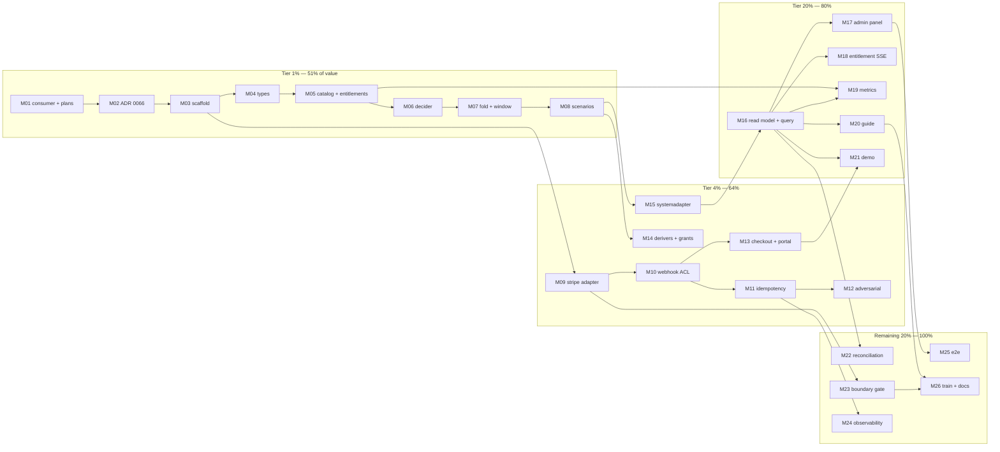

# SUPERB plan: Stripe billing v3 — execution plan after the S00 close

**Created:** 2026-11-20 20:25 CET
**Status:** PLAN — proposed, NOT started. Not the active thread until the owner promotes it; S00 is closed so S01-equivalent work is executable.
**Supersedes:** [`2026-10-24_18-15_SUPERB-stripe-billing-v2-self-review-hardened-pareto-plan.md`](2026-10-24_18-15_SUPERB-stripe-billing-v2-self-review-hardened-pareto-plan.md) **for execution order and task decomposition only**. v2 remains authoritative for the design (its D1/D2/D5/D6/D9 anchors and §2 deltas) and v1 remains authoritative for the Stripe-docs evidence — read them, do not re-derive them.
**Built on:** [ADR 0065](../adr/0065-billing-processor-and-merchant-of-record.md) (merchant of record decided: Stripe as processor, owner holds tax liability; demand recorded as an explicit owner override).
**Trigger:** owner request 2026-11-20 ("what next?" → Pareto + comprehensive plan + ≤12 min breakdown).
**Predecessor:** the S00 close of 2026-11-20 (ADR 0065 + TODO verdict + plan annotations).

---

## 1. Verify first — what changed since v2 (errata, not a re-plan)

Each row was checked against the tree on 2026-11-20 before ranking. v2 items that are already done are dropped rather than re-dispatched.

| # | v2 claim | Verified state 2026-11-20 | Effect on this plan |
| --- | --- | --- | --- |
| E1 | S00 is an open blocking gate | Closed in [ADR 0065](../adr/0065-billing-processor-and-merchant-of-record.md); merchant of record decided, demand recorded as an owner override | Drop v2 F01–F03; the gate milestone disappears |
| E2 | S01 files "ADR-0057" | ADR 0057 is the authorization contract (`docs/adr/0057-authorization-contract.md`) | The design ADR is **0066**; the number is fixed here, not left to chance |
| E3 | 26 milestones, header says 25 | v2 §4 header/table disagreed | Counts in this plan are computed from the tables, not asserted |
| E4 | Seats and plan limits are decider fields | No plan catalog, no PriceRef, no plan→capability mapping exists anywhere in the repo or in v2's tasks | New milestone M01 + M05: without a plan catalog, seat clamping has nothing to clamp against and entitlement grants nothing |
| E5 | S07 grants "a role" on activation | No mapping from plan to identity roles exists | New work: `Entitlement` → `Service.GrantRoles`/`RevokeRoles` (adapter-free, uses [ADR 0057](../adr/0057-authorization-contract.md) durable grants) |
| E6 | Metrics lane needs `amount_minor` + currency | ADR 0065 makes the owner the merchant, so tax facts are our liability too | `PaymentReceived` carries `amount_minor`, `currency`, `tax_minor`, `tax_country`; CLV/MRR stay gross-vs-net honest |
| E7 | Webhook handler mounts somewhere | [ADR 0063](../adr/0063-authorization-at-the-dispatch-boundary.md) requires every route declare a posture; the webhook is `ungated` by design and authenticated by signature | Explicit task in M10, plus a `check-route-postures` manifest row in M16 |
| E8 | Payload decoding is generic | [gotcha 55](../gotchas.md) — `event.New` defaults CBOR, decoders must switch on `Encoding()` | Explicit adversarial task in M12 |
| E9 | No SSE surface for billing | v2 had SSE only inside the metrics lane | M18 gives entitlement changes their own scoped feed row (cheap, high demo value) |
| E10 | "Replaceable by Paddle" is prose | v2 S18 gate is the mechanised version; still unbuilt | Kept, now also gated on the plan catalog living in domain-neutral vocabulary |

**Corrections recorded, not silently dropped:** v2's F01–F03 are done (ADR 0065), F04–F07 are re-keyed to ADR 0066, and the seat/plan gap (E4, E5) is new work v2 never scoped — that is why this plan is not a copy.

---

## 2. Pareto decomposition

### 2.1 The 1% that delivers 51% — the honest state machine (M02–M08, ≈ 8.4 h)

A billing system that double-applies a payment or accepts an out-of-order webhook is worse than no billing system: it charges people wrongly and then cannot prove what happened. This tier buys the only thing that makes the rest safe: **domain types where duplicate, stale, and unknown references are impossible rather than merely unlikely** — `ProcessorRef`-keyed idempotency, a bounded seen-refs window, monotonic guards, and a scenario suite that replays the journal from scratch.

Cheapest irreversible decision in the lane is the shape of `SubscriptionState`. Everything downstream (webhook, seats, metrics, reconciliation) is a projection of it.

### 2.2 The 4% that delivers 64% — the money door plus both choreography directions (M09–M15, ≈ 8.0 h)

Money only moves through the webhook and the checkout redirect. So: signature-verified ingestion, durable dedup keyed by processor event id, translation into OUR commands in ONE table, and the two-way choreography (billing → suspend/reactivate/roles, identity → seats/cancel) with entitlement grants. Without M14 the product can charge a customer and give them nothing — that is the single most embarrassing failure mode available here.

### 2.3 The 20% that delivers 80% — the customer-visible surface (M16–M21, ≈ 7.5 h)

Read model + typed query, admin panel, entitlement SSE, the guide, the runnable demo, and the metrics lane. This is where "data like CLV back to my apps" (owner ask, v2 §2.5) lands. Customer value is high, risk is low, and each item is independently shippable.

### 2.4 The remaining 20% to reach 100% — permanence (M22–M26, ≈ 5.5 h)

Reconciliation against processor truth, the vocabulary/import gate, observability, browser E2E, the release train, and docs inventory. Nothing here demos well and everything here decides whether the lane survives six months.

**Total:** 26 milestones · 1,845 min ≈ **30.75 h** · ~118 fine tasks (≤ 12 min each).

---

## 3. Comprehensive plan — milestones 30–100 min, sorted by tier then customer value

| ID | Milestone | Tier | Customer value | Impact | Est | Depends | Verify |
| --- | --- | --- | --- | --- | ---: | --- | --- |
| M01 | **First consumer + plan catalog**: name the product that pays, define 3 plans (keys, seat limits, currencies), decide where Stripe Price IDs live (adapter config, never domain) | 1% | **Critical** (unblocks "who is this for") | High | 45m | — | Decision record filed; plan table in the domain doc-comment compiles into M05 |
| M02 | **ADR 0066 — billing design** (v2 D-set by reference + deltas: PlanKey/PriceRef, entitlement→role mapping, tax facts, chain-of-custody) | 1% | High | High | 60m | M01 | ADR filed, INDEX row, linked from the v2 banner |
| M03 | `billing-model` scaffold (go.mod, go.work, README, lint configs, coverage row) | 1% | Medium | High | 40m | M02 | `GOEXPERIMENT=jsonv2 go build ./billing-model/...` |
| M04 | Domain types: `ProcessorRef`, branded `SubscriptionID`, `PlanKey`/`PriceRef`, seats, 9 event payloads, 7 commands, rejections | 1% | High | **Critical** | 90m | M03 | compiles; `rg -i 'stripe\|evt_\|cus_\|sub_' billing-model/` → 0 code hits |
| M05 | **Plan catalog + entitlements**: catalog value type, entitlement status enum, plan→roles table, tax facts on money events | 1% | High | **Critical** | 60m | M04 | catalog tests; every plan has a seat limit and a role set |
| M06 | Decider: all command paths, unknown/stale reference rejection, seat clamping, checkout session match | 1% | High | **Critical** | 90m | M05 | decide table-tests green |
| M07 | Fold: transitions, monotonic guards, bounded seen-refs window (current + previous period), compaction invariant | 1% | High | **Critical** | 75m | M06 | fold tests incl. expired-duplicate → stale rejection |
| M08 | `systemscenario` suite: happy, duplicate, out-of-order, unknown refs, grace timer, seats both ways, full-replay idempotence | 1% | Medium | **Critical** | 100m | M07 | `-race` suite green |
| M09 | `billing/stripe` adapter scaffold + `ProcessorGateway` + fake with non-Stripe-shaped errors | 4% | Medium | High | 40m | M03 | module builds; fake passes conformance stub |
| M10 | Webhook ACL: raw body, `Stripe-Signature` verify, dual-secret overlap, tolerance window, translation table, `ungated` posture | 4% | **Critical** | **Critical** | 90m | M09 | signed fixture applies; unsigned/garbled rejected |
| M11 | Idempotent dispatch: durable dedup store, event-id keyFn, 30d TTL, `ErrDuplicate` → 2xx, selective type list | 4% | **Critical** | High | 60m | M10 | duplicate delivery dispatches exactly once |
| M12 | Adversarial webhook suite: malformed, unknown type, unknown ref, replay tolerance, CBOR/JSON decoding, fuzz | 4% | Medium | High | 75m | M11 | green under `-race` |
| M13 | Checkout + billing portal outbound (side-effect-then-record; price-ref resolution; cancel-at-period-end) | 4% | **Critical** | High | 90m | M10 | known session accepted, foreign rejected |
| M14 | Derivers both directions + **entitlement grants**: PaymentFailed×grace → suspend, Activated → reactivate + roles, member add/remove → seats, user delete → cancel | 4% | **Critical** | High | 90m | M08 | cross-domain `ThenCommands` scenarios green |
| M15 | `systemadapter.WithBilling` (closure wrap + schema + event catalog registration) | 4% | Medium | High | 60m | M08 | system-demo-style integration test; hermetic build |
| M16 | Entitlement read model + typed query (tenant-keyed, grace-aware) behind Casbin posture | 20% | **Critical** | High | 75m | M15 | query tests; no-gateway-on-read proof |
| M17 | adminui billing panel (plan, seats, status, grace, reconcile action role-gated) | 20% | High | Medium | 90m | M16 | goldens + authz tests |
| M18 | Scoped entitlement SSE feed (tenant-filtered, journal replay on reconnect) | 20% | High | Medium | 30m | M16 | reconnect replay test |
| M19 | Metrics lane: CLV/MRR/ARPU/churn/seat-utilization projections + typed queries + definitions in catalog | 20% | High | High | 90m | M05, M16 | rebuild-from-journal test; live push test |
| M20 | Guide `docs/guides/stripe-billing.md` (wiring, idempotency doctrine, tax posture, ops) + catalog entries | 20% | High | Medium | 75m | M16 | doc gates green; quickstart fence compiles |
| M21 | `examples/billing-demo` with webhook simulator (test-mode keys only) | 20% | High | Medium | 90m | M13, M16 | smoke: register → checkout → webhook → suspend → reactivate |
| M22 | Reconciliation sweep (our timer; processor truth vs journal; correction events on drift) | 100% | Medium | Medium | 75m | M16 | drift-injection scenario green |
| M23 | Boundary gate v2 (import direction + vocabulary purity + planted violations) wired into check-modules + CI | 100% | Low | High | 60m | M09 | red on planted `cus_` in `billing-model`, green when clean |
| M24 | Observability: middleware bundle, Server-Timing on webhook, webhook counters, structured failure codes | 100% | Low | Medium | 45m | M11 | metrics proof test |
| M25 | Browser E2E billing flow (checkout redirect stub → webhook simulator → entitlement visible) | 100% | Medium | Medium | 90m | M17 | `nix run .#e2e-firefox` green (chromium blocking) |
| M26 | Release train + docs inventory (FEATURES, CHANGELOG receipts, gotchas, TODO retirement, AGENTS module count) | 100% | Low | High | 60m | M20, M23 | `check-release-train --strict-lag 0`; doc gates green |

---

## 4. Fine breakdown — every task ≤ 12 min, sorted by tier then customer value

### Tier 1% — the honest state machine (M01–M08)

| ID | Task | Est | Ms | Value |
| --- | --- | ---: | --- | --- |
| F01 | Name the paying consumer and file the decision record | 12m | M01 | H |
| F02 | Define 3 plans: keys, seat limits, monthly price refs | 12m | M01 | H |
| F03 | Write the plan→capability-role table (which role each plan grants) | 12m | M01 | H |
| F04 | Record the price-ID placement rule (adapter config only) | 9m | M01 | M |
| F05 | ADR 0066 skeleton referencing v2's D-set | 10m | M02 | H |
| F06 | Write the three v3 deltas into the ADR | 12m | M02 | H |
| F07 | Consequences paragraph: PCI, webhook liability, tax ops | 12m | M02 | M |
| F08 | Kill criteria + done-when line | 10m | M02 | M |
| F09 | ADR INDEX row + v2 banner link | 6m | M02 | L |
| F10 | `billing-model` go.mod + go.work entry | 10m | M03 | H |
| F11 | README: purpose, boundary, non-goals | 12m | M03 | M |
| F12 | `.golangci.yml` + `.cqrs-lint.json` (library preset) | 8m | M03 | M |
| F13 | Coverage threshold row in `coverage-thresholds.tsv` | 5m | M03 | L |
| F14 | Module pickup sanity (`go list ./billing-model/...`) | 5m | M03 | L |
| F15 | `ProcessorRef` + `BillingPeriod` + seen-refs window types | 12m | M04 | H |
| F16 | Branded `SubscriptionID` + stream type + constructors | 10m | M04 | H |
| F17 | `PlanKey`/`PriceRef`/seat-count types + clamp helper | 12m | M04 | H |
| F18 | Event payloads 1: Activated, Renewed, PaymentReceived, PaymentFailed | 12m | M04 | H |
| F19 | Event payloads 2: GraceEntered, Canceled, CheckoutStarted, SeatsUpdated, Reconciled | 12m | M04 | H |
| F20 | Commands + accessors 1: Activate, RecordPayment, RecordFailure | 12m | M04 | H |
| F21 | Commands + accessors 2: Cancel, ConfirmCheckout, UpdateSeats, Reconcile | 12m | M04 | H |
| F22 | Errorfamily rejection values (unknown-ref, stale-ref, plan-limit, session-mismatch) | 8m | M04 | M |
| F23 | Vocabulary pre-check sweep over the new package | 5m | M04 | M |
| F24 | `PlanCatalog` value type + three default plans | 12m | M05 | H |
| F25 | `Entitlement` type + status enum (active/grace/suspended/canceled) | 12m | M05 | H |
| F26 | Plan→roles mapping table + validation test | 12m | M05 | H |
| F27 | Tax facts on money events (`amount_minor`, `currency`, `tax_minor`, `tax_country`) | 10m | M05 | M |
| F28 | Catalog + entitlement unit tests | 12m | M05 | M |
| F29 | decide: ActivateSubscription | 12m | M06 | H |
| F30 | decide: RecordPaymentReceived | 12m | M06 | H |
| F31 | decide: RecordPaymentFailed → grace entry | 12m | M06 | H |
| F32 | decide: CancelSubscription | 10m | M06 | H |
| F33 | decide: ConfirmCheckout (session-match invariant) | 12m | M06 | H |
| F34 | decide: UpdateSeats (clamp to plan limit, idempotent delta) | 12m | M06 | H |
| F35 | decide: unknown/stale reference rejection paths | 10m | M06 | H |
| F36 | Decide table-tests for every branch | 12m | M06 | M |
| F37 | Fold: state transitions | 12m | M07 | H |
| F38 | Fold: record seen refs into the window | 12m | M07 | H |
| F39 | Fold: compaction invariant (drop older than previous period) | 12m | M07 | H |
| F40 | Fold: duplicate-in-window → no-op | 10m | M07 | H |
| F41 | Fold: expired duplicate → stale rejection | 10m | M07 | H |
| F42 | Fold: monotonic guards (never timestamps) | 12m | M07 | H |
| F43 | Fold tests incl. snapshot round-trip | 10m | M07 | M |
| F44 | Scenario suite bootstrap (DomainConfig slice) | 12m | M08 | H |
| F45 | Scenario: happy activate → pay → cancel | 12m | M08 | H |
| F46 | Scenario: duplicate replay emits nothing | 10m | M08 | H |
| F47 | Scenario: out-of-order convergence | 12m | M08 | H |
| F48 | Scenario: unknown session / subscription rejected | 10m | M08 | H |
| F49 | Scenario: grace timer via `TimeAdvances` | 12m | M08 | H |
| F50 | Scenario: seats add/remove → clamped updates | 12m | M08 | H |
| F51 | Scenario: full replay idempotence | 10m | M08 | H |
| F52 | `-race` suite pass + fix fallout | 8m | M08 | M |

### Tier 4% — the money door and choreography (M09–M15)

| ID | Task | Est | Ms | Value |
| --- | --- | ---: | --- | --- |
| F53 | `billing/stripe` go.mod + scaffold + README | 10m | M09 | H |
| F54 | `ProcessorGateway` interface (checkout, portal, subscription pull, quantity sync) | 12m | M09 | H |
| F55 | Fake gateway with processor-neutral error semantics | 12m | M09 | H |
| F56 | Import + vocabulary stub check | 6m | M09 | M |
| F57 | Raw-body capture middleware (never read the body twice) | 12m | M10 | H |
| F58 | Signature header parse + `ConstructEvent` verify | 12m | M10 | H |
| F59 | Dual-secret verify loop + overlap test | 12m | M10 | H |
| F60 | Tolerance-window config + injectable clock | 12m | M10 | H |
| F61 | Translation table: processor event types → our commands | 12m | M10 | H |
| F62 | Handler + `ungated` route posture declaration | 12m | M10 | H |
| F63 | Signed happy-path fixture test | 12m | M10 | H |
| F64 | Ignored-type semantics doc comment + 200 contract | 6m | M10 | M |
| F65 | Durable dedup store wiring (SQLite default) | 10m | M11 | H |
| F66 | `CommandIdempotency(store, 30d, evtKeyFn)` | 12m | M11 | H |
| F67 | `ErrDuplicate` → 2xx mapping | 12m | M11 | H |
| F68 | Sweep schedule + test | 10m | M11 | M |
| F69 | Selective event-type constant | 6m | M11 | M |
| F70 | Exactly-once duplicate-delivery test | 8m | M11 | H |
| F71 | Malformed body → 4xx | 8m | M12 | M |
| F72 | Unknown event type → 2xx ignore | 8m | M12 | M |
| F73 | Unknown reference → 2xx + rejection event | 10m | M12 | H |
| F74 | Replay outside tolerance tests | 10m | M12 | M |
| F75 | CBOR/JSON decode switch test (gotcha 55) | 10m | M12 | H |
| F76 | Fuzz the signature parser | 10m | M12 | M |
| F77 | `-race` adversarial suite | 10m | M12 | M |
| F78 | `StartCheckout` command + state tracking | 12m | M13 | H |
| F79 | Gateway call then record (side-effect-then-record) | 12m | M13 | H |
| F80 | Billing-portal redirect handler | 12m | M13 | H |
| F81 | Known/foreign session scenarios | 12m | M13 | H |
| F82 | Price-ref resolution (plan key → adapter price config) | 12m | M13 | H |
| F83 | Cancel-at-period-end path | 12m | M13 | M |
| F84 | Handler tests + posture row | 10m | M13 | M |
| F85 | Deriver: PaymentFailed × grace → `SuspendTenant("billing")` | 12m | M14 | H |
| F86 | Deriver: Activated → reactivate + role grant | 12m | M14 | H |
| F87 | Deriver: MemberAdded/Removed → `UpdateSeats` | 12m | M14 | H |
| F88 | Deriver: UserDeleted → `CancelSubscription` | 10m | M14 | H |
| F89 | Entitlement → `GrantRoles`/`RevokeRoles` (durable, ADR 0057 path) | 12m | M14 | H |
| F90 | Cross-domain `ThenCommands` scenarios | 12m | M14 | H |
| F91 | Deriver idempotency flags + subscriber filter review | 8m | M14 | M |
| F92 | `WithBilling` closure wrap | 12m | M15 | H |
| F93 | Event catalog + schema registration | 12m | M15 | H |
| F94 | system-demo-style integration test | 12m | M15 | H |
| F95 | Hermetic build check (`GOWORK=off`) | 8m | M15 | M |
| F96 | API-surface compat pin | 8m | M15 | L |

### Tier 20% — the customer-visible surface (M16–M21)

| ID | Task | Est | Ms | Value |
| --- | --- | ---: | --- | --- |
| F97 | Entitlement projection (tenant, plan, seats, status, grace until) | 12m | M16 | H |
| F98 | Query handler + `RegisterTyped` + Casbin posture | 12m | M16 | H |
| F99 | Grace/status computation from fold state | 12m | M16 | H |
| F100 | Query tests + no-gateway-on-read proof | 10m | M16 | H |
| F101 | Hydration/rebuild-from-journal test | 12m | M16 | H |
| F102 | `check-route-postures` manifest row | 10m | M16 | M |
| F103 | adminui panel template (plan, seats, status, grace) | 12m | M17 | H |
| F104 | Reconcile action (role-gated) + handler | 12m | M17 | H |
| F105 | Goldens + CSS rebuild if classes changed | 12m | M17 | M |
| F106 | authz tests for the panel | 12m | M17 | M |
| F107 | Scoped SSE store + filter (`SSEFilter` per tenant) | 12m | M18 | H |
| F108 | Reconnect/journal-replay test | 12m | M18 | M |
| F109 | Amount facts flow into projection | 12m | M19 | H |
| F110 | CLV/MRR projection + typed query | 12m | M19 | H |
| F111 | Churn/seat-utilization projection | 12m | M19 | M |
| F112 | Metric definitions in the event catalog | 10m | M19 | M |
| F113 | Rebuild-from-journal + live-push tests | 12m | M19 | H |
| F114 | Guide outline + compilable quickstart fence | 12m | M20 | H |
| F115 | Guide body: wiring, idempotency doctrine, tax posture, ops | 12m | M20 | H |
| F116 | Catalog + usermgmt README pointer | 10m | M20 | M |
| F117 | Corpus baseline bump + link check | 8m | M20 | L |
| F118 | Demo `main.go` (setup + billing mount) | 12m | M21 | H |
| F119 | Webhook simulator route (test-mode secret) | 12m | M21 | H |
| F120 | Demo README walkthrough | 10m | M21 | M |
| F121 | Smoke script + fix fallout | 12m | M21 | M |

### Remaining 20% — permanence (M22–M26)

| ID | Task | Est | Ms | Value |
| --- | --- | ---: | --- | --- |
| F122 | Reconcile command + drift diff in decide/fold | 12m | M22 | M |
| F123 | Scheduler wiring (our timer, never on a read path) | 10m | M22 | M |
| F124 | Drift-injection scenario | 12m | M22 | M |
| F125 | Gate v2 script: import direction + vocabulary + planted violations | 12m | M23 | H |
| F126 | Wire gate into check-modules + CI + fixture self-test | 12m | M23 | H |
| F127 | Middleware bundle + Server-Timing on webhook | 12m | M24 | L |
| F128 | Webhook counters + structured failure codes | 10m | M24 | L |
| F129 | E2E: checkout stub → webhook → entitlement visible | 12m | M25 | M |
| F130 | E2E: suspend → access denied → reactivate | 12m | M25 | M |
| F131 | E2E fixture/seed helpers + stray-server hygiene | 10m | M25 | L |
| F132 | Train prep: CHANGELOG receipts, badges, coverage rows | 12m | M26 | M |
| F133 | Tag wave (both modules) + `--refresh-cache` re-run | 12m | M26 | M |
| F134 | FEATURES/AGENTS/gotchas updates + TODO retirement | 12m | M26 | M |

**Totals:** 26 milestones · 1,845 min ≈ 30.75 h · 134 fine tasks (max 12 min).

---

## 5. Execution graph

Critical path: M01 → M02 → M03 → M04 → M05 → M06 → M07 → M08 → M14 → M16 → M17 → M25 → M26 (≈ 13 h of the 30.75 h). Everything else is parallelisable once M10 lands.

---

## 6. Verification battery

| Stage | Command | Gate class |
| --- | --- | --- |
| Domain | `nix run .#test-billing-model` (or `GOEXPERIMENT=jsonv2 go test ./billing-model/... -race`) | blocking |
| Adapter | `GOEXPERIMENT=jsonv2 go test ./billing/stripe/... -race` | blocking |
| Coverage | `nix run .#coverage-gate` with the new rows in `scripts/checks/coverage-thresholds.tsv` | blocking |
| Lint | `nix run .#lint` + `nix run .#check-cqrs-lint` | blocking |
| Architecture | `nix run .#check-module-layers`, `.#check-module-isolation`, `.#check-reexport-policy -- --strict`, the new `billing-boundary` gate | blocking |
| Docs | `nix run .#check-docs-corpus-budget -- --ratchet`, `.#check-docs-links`, `.#check-todo-hygiene` | blocking |
| Postures | `nix run .#check-route-postures` (webhook row + admin panel row) | blocking |
| Browser | `nix run .#e2e-firefox` (chromium blocking, firefox advisory) | blocking |
| Train | `nix run .#train-preflight` then `.#wave-tag -- <module> <version>` | blocking |

One-off checks worth writing as fixtures rather than trusting: signature verification (signed, unsigned, dual-secret overlap), duplicate delivery, and the vocabulary sweep. Each is a test, not a manual step.

---

## 7. Kill criteria & done-when

| # | Criterion |
| --- | --- |
| K1 | No named paying consumer by the end of M01 → do not start M02; the plan parks back to ROADMAP with ADR 0065 as its record. |
| K2 | M06 forces a second rewrite of the aggregate shape → stop and reopen ADR 0066 instead of patching around it. |
| K3 | Processor API-version pin breaks the translation table twice consecutively → reconsider the reconciliation-first shape before writing more adapter code. |
| K4 | The plan catalog cannot express the first consumer's pricing (usage-based, per-feature, multi-currency) → stop; this is a domain-model failure, not an adapter gap. |

**Done when:** the first consumer ships a paywalled app on `billing-model` + the guide, entitlement grants work through durable roles, the boundary gate runs in check-modules and CI, both module trains are tagged, and every TODO row this plan created is retired with receipts.

---

## 8. Verschlimmbessern guards

v2 §7 is inherited in full (no decider purity regressions, no synchronous gateway call on an identity command path, seen-ref compaction is a fold invariant and never a janitor goroutine, metrics never call the processor). Additions:

1. **No price or plan vocabulary in the domain's identifiers** — `PlanKey` and `PriceRef` are ours; Stripe price IDs live only in adapter config. Breaking this reintroduces the portability hole v2 fixed.
2. **Entitlement grants go through `Service.GrantRoles`**, never `Authz.AddGroupPolicy` ([gotcha 45](../gotchas.md)). A role granted inside the enforcer disappears on restart and the customer loses what they paid for.
3. **The webhook endpoint is `ungated` by posture and authenticated by signature** — do not bolt the session gate onto it, and do not let a posture checker call it a hole.
4. **Money events carry facts, not opinions** — `amount_minor`, `currency`, `tax_minor` are settled truth from the processor; FX rates, discounts, and CLV formulas live in projections.
5. **No new module without a gate** — `billing-model` and `billing/stripe` ship in the same change as their layer/vocabulary checks, or the next extraction will recreate the façade problem (ADR 0062 lesson).

---

## 9. Errata / verification log

- 2026-11-20: plan created after the S00 close (ADR 0065). Verified before ranking: no billing package exists; ADR 0057 is taken (authorization contract); v2's F01–F03 are done by the S00 close; no plan catalog or entitlement mapping exists in either plan.
- 2026-11-20: v2 superseded **for execution order only**; its design sections and v1's Stripe-docs evidence stay authoritative and are cited, not duplicated.
- 2026-11-20: milestone/task counts computed from the tables (26 milestones, 134 fine tasks, 1,845 min); v2's 25-vs-26 header inconsistency is not repeated.
- 2026-11-21: **M01 executed.** The owner named the paying consumers: Issue Shield (`sales-landing-page`, live production Stripe checkout since 2026-09-19 — the demand artifact ADR 0065's override awaited) and ssh-key-monitor (named; hosted-tier plans deferred). Decision record: `docs/decisions/2026-11-21_02-00_m01-first-consumer-and-plan-catalog.md`. K1 cleared with evidence; K4 assessed non-firing (fixed-price, single-currency, one-time variant). Grounding correction: the first consumer's real limit axis is protected targets, not seats — ADR 0066 D18 replaces the single-seat-int shape with a named limit set, and M05's verify wording reads "named limits and a role set". **M02 executed same day:** [ADR 0066](../adr/0066-billing-domain-design.md) pins the design contract; M03 (scaffold) is the next unstarted milestone.
