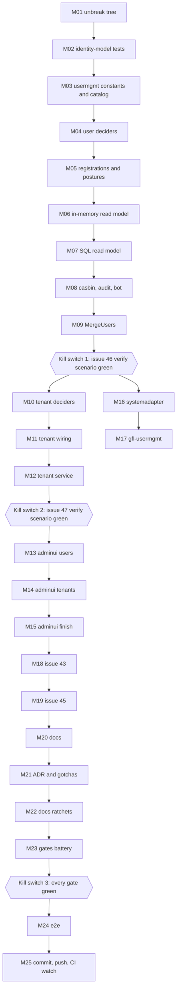

# SUPERB plan — identity merge wave: issues #46 (user merge), #47 (tenant rename/merge), #45 (legal party), #43 (appkit Server-Timing)

**Created:** 2026-11-24, 06:30 CET · **Repo:** `/home/lars/projects/cqrs-htmx`, branch `master` (11 commits ahead of origin at planning time, nothing of this wave pushed)
**Status:** EXECUTING. Steps marked DONE in §10 were verified by the command named there. Predecessor snapshot: `docs/status/2026-11-24_06-20_open-issue-wave-46-47-45-43-midwave-paused-self-review_status.md`.
**Scope line:** every fact in §3 was read at source or produced by a command in this session. Anything not listed in §10 was not verified.

---

## 0. Thesis

Four issues are open on a repo whose live deployment carries nine user rows for one human. The lossless exit is a merge, and neither users nor tenants have one. This wave lands merge (and tenant rename) as event-sourced domain behaviour with resumable orchestration, exposes it in the admin panel, keeps every gate that pins event and command counts truthful, and closes the two small issues (#43, #45) whose remaining work is a knob, a doc line and two tests.

## 1. Non-goals

- No journal rewrite, no event re-encoding. New events are additive; every existing journal replays unchanged.
- No DDL. The merge pointer lives inside the existing `users_view` data blob (D4), so no deployment needs a migration.
- No new usermgmt aliases for new symbols (ADR-0062 direct imports; the re-export ratchet only shrinks).
- No change to the tenant ID scheme: the panel still derives the tenant stream ID from the submitted name.
- No closing or commenting on the GitHub issues before the release train lands (nothing is tagged).
- No cross-module test that imports `legalparty-model`: the module has no published tag, so no hermetic module can require it (D9).

## 2. Invariants

1. The tree builds and the usermgmt test binary compiles after every milestone. A half-landed symbol set with red gates is not a stopping point.
2. Count pins are updated in the same milestone as the symbols they count (`AGENTS.md`, `FEATURES.md`, the catalog table, the decoder, the bijection gate).
3. A merge never loses an authenticator, a role or a bot token: the loser is tombstoned LAST, every step is idempotent, and re-invoking the same merge resumes it.
4. `UserMerged` / `TenantMerged` appear exactly once per merge in the journal, including after a retry.
5. Merged-away identities are terminal. Lookups by a merged ID, email or external subject resolve to the survivor.
6. The library enforces no default a consumer could disagree with: tenant-name uniqueness is opt-in.
7. No `--no-verify` on commit or push. If the pre-push hook is red, the push waits and the report says why.

## 3. Verified fact base (read at source or produced by command this session)

| #    | Fact                                                                                                                                                                                                  | Evidence                                                                  |
| ---- | ----------------------------------------------------------------------------------------------------------------------------------------------------------------------------------------------------- | ------------------------------------------------------------------------- |
| F1   | identity-model now has 33 event payload structs and 27 command structs (was 27 / 21)                                                                                                                  | `bash scripts/checks/check-domain-counts.sh`                              |
| F2   | Count pins that go red on new symbols: `AGENTS.md` identity-model bullet, two `FEATURES.md` rows, `check-command-bijection.sh` (every `Cmd*` needs one `RegisterTyped` in the four `es_*_dispatch.go` files), `usermgmt/es_projection_health_test.go:15` (`want exactly 27`), `TestEventCatalog_InventoryMatchesEventConstants`, the `event-catalog.json` sync test | gates and tests read; the first two were run and were red                 |
| F3   | Deciders may return several events; the caller numbers them `v+1, v+2, ...` and the repository saves and publishes them atomically                                                                     | go-cqrs-lite `decider/v4/decider_bdd_test.go:265`                          |
| F4   | `CredentialAdded` and `TOTPEnabled` are CBOR payloads; the other user events are JSON                                                                                                                 | `usermgmt/es_decide_credentials.go:54`, `es_decide_security.go:39`        |
| F5   | A user may hold several external accounts per provider; global uniqueness of a provider+subject pair is a read-model index check in the service, not a decider rule                                     | `usermgmt/es_decide_external.go:27`, `service_oauth2_extracted.go:461`    |
| F6   | `DeleteUser` tombstones first, then removes memberships and bots best-effort; `DeleteTenant` tombstones first, then removes memberships best-effort                                                   | `usermgmt/service_misc.go:100`, `service_tenant.go:77`                    |
| F7   | Membership deciders are stream-local: `AddMember` conflicts when the membership exists, `RemoveMember` rejects when it does not; no tenant or user liveness rule inside                                                | `usermgmt/es_membership_decide.go`                                        |
| F8   | The SQL user view store creates tables with `CREATE TABLE IF NOT EXISTS` only and deletes rows with a hard `DELETE`; the row payload is the `User` JSON inside the `data` column                       | go-cqrs-lite `storage/v4/view/store.go:240`, `crud.go:88`; `usermgmt/sql_hydrate.go:96` |
| F9   | WebAuthn login resolves the user by email; OAuth2 by external subject then verified email; both go through the read model                                                                                | `usermgmt/webauthn_service.go:213`, `service_oauth2_extracted.go:425`     |
| F10  | `TenantState` was a comparable struct and `usermgmt/property_sequences_more_test.go` relied on it                                                                                                     | fixed in M01 with `tenantStateEqual`                                      |
| F11  | systemadapter registers 21 commands and decodes 27 events through its own lists and has its own declarative projections (user, tenant, bot, membership, policy, audit)                                 | `systemadapter/domain_config.go`, `type_decoder.go`, `schema.go`, `views.go` |
| F12  | Issue #43: all claims true; every go.mod pins go-appkit v0.13.0; `setup` never set `ServerTiming`; no test asserts an exact header set                                                                   | read-only verifier, module cache `go-appkit@v0.13.0`                       |
| F13  | Issue #45: 4 of 5 proposal checkboxes done; the `Tenant --bill_to--> LegalParty` link is missing; the round-trip test does not assert `LegalForm`; no cross-aggregate retention test                    | read-only verifier, `legalparty-model/`, status report of 2026-11-20      |
| F14  | Five of six subagents died to provider rate limits when four ran in parallel                                                                                                                           | session log                                                               |

## 4. Decisions (owner did not object to D2, D4 and D9 when asked; all reversible)

| #   | Decision                                                                                                                                                                                                                                                                 |
| --- | ------------------------------------------------------------------------------------------------------------------------------------------------------------------------------------------------------------------------------------------------------------------------ |
| D1  | Resumable merge, every step idempotent: survivor adoption (ONE command, ONE atomic append), memberships through the existing commands, bots, loser sessions, loser tombstone LAST.                                                                                     |
| D2  | A plain-deleted tenant stream may be recreated under its ID (the fold already resets on `TenantCreated`); a merged-away tenant or user is terminal and answers a typed conflict naming the survivor.                                                                     |
| D3  | Adopted assets are ordinary `CredentialAdded` / `ExternalAccountLinked` / `TOTPEnabled` / `EmailVerified` events on the survivor, followed by one `UserMerged`. `EmailVerified` is adopted only when the loser's verified email equals the survivor's email.                 |
| D4  | The merged-away user row stays as a soft tombstone: `users_view.tombstoned = 1`, the pointer inside the existing data blob. No DDL. Every lookup follows the pointer.                                                                                                   |
| D5  | Normalized tenant-name uniqueness is opt-in: `ServiceConfig.UniqueTenantNames`.                                                                                                                                                                                         |
| D6  | New symbols live only in identity-model; usermgmt code references `identitymodel.` directly.                                                                                                                                                                            |
| D7  | Membership move takes the UNION of both role sets per tenant (a superset of "highest role wins" for flat sets): no role is ever lost.                                                                                                                                   |
| D8  | Admin routes: `POST /users/{id}/merge` and `POST /tenants/{id}/merge` merge the path identity INTO the form field `survivor`; `POST /tenants/{id}/rename` takes `display_name`. Duplicates are sections on the two list pages, served by `Service.DuplicateUsers` and `Service.DuplicateTenants`. |
| D9  | Issue #45: the bill-to link is implemented inside `legalparty-model` (a small aggregate keyed by tenant). The cross-aggregate retention test is recorded as a follow-up for the first legalparty-model tag (non-goal 6).                                                |
| D10 | No GitHub state change before the release train.                                                                                                                                                                                                                        |
| D11 | An adopted `CredentialAdded` carries `UserPresent` and `UserVerified` from the loser's credential, beyond the fields `decideAddCredential` sets. Lossless: the payload struct has both and `NewCredentialFromPayload` folds them. |
| D12 | The `EmailVerified` adoption gate is exact string equality between the contribution's email and the survivor's email (D3 says "equals"). `ParseEmail` lowercases and trims on the canonical paths, so a case or whitespace difference means the contribution was not built canonically and proves nothing. |
| D13 | A survivor that is itself merged away answers Conflict `usermgmt.merge_users.survivor_merged` with `merged_into` context, before any deleted check. Terminal identities stay terminal and the admin sees the real survivor. |
| D14 | A plain-deleted loser answers Conflict `usermgmt.merge_user_into.deleted`, not a Rejection: a deleted user is a terminal state, and conflicts are how the module spells "already in that state". Rejections are reserved for malformed input (`not_found`, `survivor_required`, `self_merge`). |
| D15 | `identitymodel.User` carries `MergedUserIDs` beside `MergedInto`, both omitted from JSON when empty. The admin panel and the duplicates report need "which identities did this one absorb" without replaying the journal. |
| D16 | A merged-away row leaves the in-memory `users` map; only the pointer map keeps its trace. Deleting a user evicts every index entry owned by it, including the aliases it inherited, so a merged row never counts, lists or answers as live. |
| D17 | The chain resolver answers with the zero stream ID when the walk has used every pointer and is still on a merged stream. A cycle has no live member. The deciders cannot build a cycle (D13), so this is defence against a corrupt map. |
| D18 | A retired stream stays retired. `readModelCore.drop` lets a read model refuse an event before dispatch; the user model refuses everything on a stream in the pointer map except `UserMergedInto`, which re-applies as a no-op. After a hydrate the drain replays events that precede the merge, and a re-applied registration brought the merged identity back (the test was red before the change). |
| D19 | The SQL tombstone is written before the in-memory removal and carries the pointer inside `Data` (`merged_into`), the loser's own snapshot and the merge time in `updated_at`. A failure of that write aborts `Handle` before memory changes, so the retry starts from the pre-merge state. |
| D20 | `Hydrate` rebuilds the indexes as a replay in key order: every live and merged row claims its email and external accounts keep-first, then each merge re-points its row's entries to its survivor in merge-time order. A merged row's external account is claimed only while the survivor's live row still holds it (G5). When the survivor chain is dead, a live row created after the merge takes the entry over (the deleted-survivor release). |
| D21 | `FindByEmailSQL` answers with live rows only: a merged row is replaced by the live view at the end of its chain, duplicates collapse. `FindByIDSQL` answers with the tombstone itself, `Tombstoned` true, so a caller can show what became of an identity. |
| D22 | The SQL model keeps a retired stream out of its table, not only its tombstone: after the in-memory `Handle`, every event on a stream in the pointer map returns before `syncToSQL` (G9). Without this the pointer-following `FindByID` would write the survivor's row under the loser's key when the drain re-delivers pre-merge events after a hydrate. |
| D23 | `storedUser` answers a pointer-only user (`&User{ID}`) when the store holds no row: a merge retirement for a stream that never registered still writes a tombstone carrying the pointer, so the restart rebuilds it. A stored row that is already a tombstone answers `live=false` and `retireToSQL` keeps the first snapshot (a re-delivered retirement is the no-op D18 promises). |

### Accepted divergences of the hydrate path (R1 to R4, with G9)

Finding **G9** (2026-11-24): a re-delivered pre-merge event on a retired stream reached `syncToSQL`, whose `FindByID` follows the merge pointer — writing the survivor's row under the loser's key and resurrecting the identity in the table. Fixed by D22; pinned by `TestSQLUserReadModel_Merge_RedeliveredEventsAfterHydrateStayRetired`.

- **R1** — Key order approximates registration order. `Scan` orders rows by the user's ULID key; two registrations in the same millisecond across processes can arrive swapped, so the keep-first winner of a tie is whichever row the store sorts first. The event path has the same tie (it keeps whichever stream registered first with the projection host). Accepted: the tie is a sub-millisecond race and both answers are legitimate keep-first winners.
- **R2** — A claimant's acquisition time is its registration/link time, not the moment the released entry became free. When a dead merge chain releases an email or subject, the hydrate hands it to the first live row that holds it with `CreatedAt`/`LinkedAt` after the merge; the event path hands it to whoever claimed first in wall-clock order. The two agree unless a claimant held the email before the merge without owning the index entry. Accepted: that state requires a third duplicate the event path also resolves arbitrarily.
- **R3** — `MergeUserInto` without prior adoption loses the loser's external-account aliases at restart: the tombstone's snapshot lists the accounts, but the survivor's row never held them, so the G5 gate refuses to move them. The event path had already re-pointed the lookup to the survivor. Accepted: `Service.MergeUsers` always adopts first (D3); only a hand-crafted `MergeUserInto` hits this.
- **R4** — `liveAfterMerge` stops at a chain end that is not a tombstone and not live: a pointer to a stream whose row is absent answers not-found rather than an error. The in-memory resolver does the same. Accepted: both spellings of "the survivor is gone" agree.

## 5. Pareto split

| Tier       | Share of work | Result                                                                                                           | Milestones                                   |
| ---------- | ------------- | ---------------------------------------------------------------------------------------------------------------- | -------------------------------------------- |
| 1 percent  | about 9 of 25  | `Service.MergeUsers` works end to end with tests: the live nine-duplicate case becomes fixable from any consumer | M01 to M09                                   |
| 4 percent  | +4            | Tenant rename and merge exist; the admin panel exposes both; the wave is operable by a human, not only by code    | M10 to M12, M13 to M15                       |
| 20 percent | +8            | Declarative path parity, specs, the two small issues, docs and every count pin truthful: the wave is shippable   | M16 to M23                                   |
| rest       | +4            | ADR, gotchas, e2e, commit, push, CI watch: the wave is delivered                                                  | M24, M25, plus the deferred follow-ups below |

Deferred by constraint, not by choice: the cross-aggregate retention test and the `examples/legalparty-demo` (need the first `legalparty-model` tag); closing the four issues (needs the release train).

## 6. Comprehensive plan (30 to 100 minutes per task, ALL tasks, sorted by importance)

| ID  | Task                                                                                                                                 | Min | Impact | Depends on |
| --- | ------------------------------------------------------------------------------------------------------------------------------------ | --- | ------ | ---------- |
| M01 | Unbreak the tree: `TenantState` comparator in the property test, gofmt, line review of the two-session `fold.go`                      | 10  | critical | nothing (DONE) |
| M02 | identity-model tests: six fold cases, state helpers, payload round trips, command immutability, `UserState.HasCredential`             | 45  | critical | M01 |
| M03 | usermgmt wiring: event and command aliases, event-type lists, six catalog rows, regenerated `event-catalog.json`, count pins        | 45  | critical | M02 |
| M04 | user deciders: `decideMergeUsers`, `decideMergeUserInto`, `decideTransferBot`, exported wrappers, decider tests                       | 90  | critical | M03 |
| M05 | Dispatch registrations for the three user-side commands, three command postures, bijection gate green                                  | 30  | high     | M04 |
| M06 | In-memory user read model: pointer map, two handlers, pointer-following finders, tests                                               | 60  | critical | M05 |
| M07 | SQL user read model: `User.MergedInto`, soft tombstone, `syncToSQL` skip, hydrate of the pointer map, tests                           | 60  | critical | M06 |
| M08 | Casbin projection (two events), audit log, bot read model handler, tests                                                              | 45  | high     | M07 |
| M09 | `Service.MergeUsers`: validation, conflict check, contributions, membership move, bots, sessions, tombstone, the issue's verify scenario | 100 | critical | M08 |
| M10 | Tenant deciders: rename, merge, merge-into, recreate rule in `decideCreateTenant`, wrappers, tests                                    | 75  | high     | M09 |
| M11 | Tenant wiring: registrations, postures, tenant read model (in-memory and SQL), normalized-name lookup, tests                          | 60  | high     | M10 |
| M12 | `Service.RenameTenant`, `Service.MergeTenants`, `Service.DuplicateUsers`, `Service.DuplicateTenants`, `UniqueTenantNames`, tests     | 90  | high     | M11 |
| M13 | adminui users: merge route and handler, survivor picker on the detail page, duplicates section, tests                                | 100 | high     | M09 |
| M14 | adminui tenants: rename and merge routes and forms, duplicates section, create-form message that names the existing tenant, tests      | 100 | high     | M12 |
| M15 | adminui finish: route manifest pins, audit labels, templ regeneration through the canonical generator, module tests                  | 60  | high     | M13, M14 |
| M16 | systemadapter: decoder, schemas, six registrations, gate declarations, declarative projections, count comments, tests                 | 100 | high     | M09, M10 |
| M17 | gfl-usermgmt: regenerate the events artifact and the eventcatalog resources; add merge scenarios if the CLI is available              | 45  | medium   | M16 |
| M18 | Issue #43: knob tests, `setup/README.md`, a setup change entry, true the stale hold claims                                       | 60  | medium   | nothing        |
| M19 | Issue #45: `LegalForm` assertions, bill-to aggregate in `legalparty-model`, README, follow-up row                                      | 100 | medium   | nothing |
| M20 | Docs: domain language, AGENTS and FEATURES counts, module READMEs, skill references, six CHANGELOGs, TODO harvest                    | 90  | high     | M15, M16, M18, M19 |
| M21 | ADR for identity merge, two gotchas, plan execution log                                                                              | 45  | medium   | M20 |
| M22 | Docs ratchets: measure and re-true `CORPUS_BASELINE` and `TAIL_BASELINE` with the ledger sentence                                     | 30  | high     | M20, M21 |
| M23 | Gates battery: domain counts, bijection, re-export policy, cqrs-lint, route postures, permission surface, coverage, full test, lint  | 100 | critical | M22 |
| M24 | e2e specs for the admin merge and rename flows, or a recorded follow-up                                                             | 60  | medium   | M23 |
| M25 | Review `git status` for foreign files, staged commits with detailed messages, pre-push hook, push, CI watch                            | 30  | critical | M23 |

## 7. Detailed breakdown (max 12 minutes per micro-task, ALL tasks sorted by importance; 145 rows: 1 to 142 plus 42a/42b/42c)

| #   | M   | Micro-task                                                                              | Min |
| --- | --- | --------------------------------------------------------------------------------------- | --- |
| 1   | M01 | `tenantStateEqual` comparator in `property_sequences_more_test.go`                      | 5   |
| 2   | M01 | `gofmt -w` the two identity-model files                                                 | 1   |
| 3   | M01 | Line review of `identity-model/fold.go`                                                 | 5   |
| 4   | M02 | `UserState.HasCredential` and its test                                                  | 8   |
| 5   | M02 | Fold test: `UserMerged` appends losers once and leaves the caller's slice untouched     | 10  |
| 6   | M02 | Fold test: `UserMergedInto` sets Deleted, the pointer and the reason                    | 6   |
| 7   | M02 | Fold tests: `TenantRenamed`, `TenantMerged`, `TenantMergedInto`                         | 12  |
| 8   | M02 | Fold test: `TenantCreated` after `TenantDeleted` yields a clean incarnation             | 8   |
| 9   | M02 | Fold test: `BotTransferred` moves only the owner                                        | 6   |
| 10  | M02 | Tests: `IsMerged` on both states, `IsValid` merged-implies-deleted                       | 8   |
| 11  | M02 | Payload JSON round trips for the six payloads                                           | 12  |
| 12  | M02 | Command tests: accessors return deep copies, constructors set type and stream           | 12  |
| 13  | M02 | Hermetic identity-model build, vet, test                                                | 4   |
| 14  | M03 | `es_constants.go`: six event aliases, six command aliases, three event-type lists       | 10  |
| 15  | M03 | Six catalog rows in `eventCatalogSpecs`                                                 | 12  |
| 16  | M03 | Regenerate `event-catalog.json`; update the 27 pins in the catalog tests                | 12  |
| 17  | M03 | Run catalog, inventory and architecture tests (workspace mode)                          | 6   |
| 18  | M04 | `decideMergeUsers` guards: not registered, deleted, merged, empty, self-merge, zero ID  | 12  |
| 19  | M04 | Credential adoption: dedupe against survivor state and inside the batch                 | 12  |
| 20  | M04 | Adopted `CredentialAdded` event built exactly like `decideAddCredential` (CBOR)         | 8   |
| 21  | M04 | External-account adoption with dedupe                                                  | 10  |
| 22  | M04 | TOTP adoption: first available secret, only when the survivor has none                  | 10  |
| 23  | M04 | `EmailVerified` adoption behind the email-equality gate                                 | 8   |
| 24  | M04 | `UserMerged` emitted last for unrecorded losers; no events when nothing is new          | 10  |
| 25  | M04 | `decideMergeUserInto`: guards, no-op on repeat, typed conflict for another survivor     | 10  |
| 26  | M04 | `decideTransferBot`: not found, deleted, same owner no-op, transfer                     | 10  |
| 27  | M04 | Exported wrappers in `system_exports.go`                                                | 8   |
| 28  | M04 | Tests: adoption happy path, event order, versions, codecs                               | 12  |
| 29  | M04 | Tests: retry no-op, duplicates skipped                                                 | 10  |
| 30  | M04 | Tests: every guard, merge-into, transfer                                                | 12  |
| 31  | M05 | `RegisterTyped` for `MergeUsers` and `MergeUserInto` in `es_dispatch.go`                | 10  |
| 32  | M05 | `RegisterTyped` for `TransferBot` in `es_bot_dispatch.go`                               | 6   |
| 33  | M05 | Three role-gated command postures; bijection gate green                                 | 8   |
| 34  | M06 | Pointer map and chain resolver with a cycle guard                                       | 10  |
| 35  | M06 | Handlers for `UserMerged` and `UserMergedInto` (index re-pointing, row removal, pointer) | 12  |
| 36  | M06 | `FindByID`, `FindByEmail`, `FindByExternalAccount` follow the pointer                   | 10  |
| 37  | M06 | Tests: live path, keep-first re-pointing, transitive chain                               | 12  |
| 38  | M06 | Tests: `Count` and `AllUsers` exclude merged rows; loser ID resolves to survivor         | 8   |
| 39  | M07 | `identitymodel.User.MergedInto` (omitted when zero)                                     | 6   |
| 40  | M07 | SQL `Handle` writes the soft tombstone before the in-memory removal                      | 12  |
| 41  | M07 | `syncToSQL` skips `UserMergedInto`                                                      | 6   |
| 42  | M07 | `Hydrate` rebuilds the pointer map from tombstoned rows                                                  | 12  |
| 42a | M07 | `Hydrate` rebuilds the email aliases a merged row handed to its survivor (G4: a restart keeps login by a merged email working) | 12 |
| 42b | M07 | `Hydrate` claims a merged row's external accounts only while the survivor still holds them (G5) | 10 |
| 42c | M07 | `FindByEmailSQL` answers with live rows; merged rows resolve to their survivor (G7) | 8  |
| 43  | M07 | Tests: SQL live path, fresh hydrate, `CountSQL`, tombstone view readable by ID           | 12  |
| 44  | M08 | Casbin: `UserMergedInto` removes every role of the user                                 | 8   |
| 45  | M08 | Casbin: `TenantMergedInto` clears the domain                                            | 8   |
| 46  | M08 | Bot read model handler for `BotTransferred`                                             | 8   |
| 47  | M08 | Audit labels and actions for the two user merge events                                  | 8   |
| 48  | M08 | Tests for the three projections                                                         | 12  |
| 49  | M09 | `MergeUsers` input validation                                                          | 8   |
| 50  | M09 | Load survivor and losers; typed rejections for not found, merged, deleted                | 12  |
| 51  | M09 | Third-party external-account conflict naming both rows                                  | 12  |
| 52  | M09 | Build contributions from the read model                                                 | 10  |
| 53  | M09 | Dispatch the survivor command                                                          | 5   |
| 54  | M09 | Membership move: survivor add or role union, then loser removal                         | 12  |
| 55  | M09 | Bots: transfer each loser-owned bot                                                     | 8   |
| 56  | M09 | Sessions: revoke each loser's sessions                                                  | 6   |
| 57  | M09 | Loser tombstone last                                                                   | 8   |
| 58  | M09 | Test: the issue's verify scenario                                                       | 12  |
| 59  | M09 | Tests: idempotent re-run, conflict, memberships, bots, sessions                          | 12  |
| 60  | M10 | `decideRenameTenant`                                                                    | 8   |
| 61  | M10 | `decideMergeTenants`                                                                    | 8   |
| 62  | M10 | `decideMergeTenantInto`                                                                 | 8   |
| 63  | M10 | `decideCreateTenant`: recreate allowed on a plain tombstone, conflict on a merged one   | 10  |
| 64  | M10 | Exported wrappers (four)                                                                | 8   |
| 65  | M10 | Tests for rename, merge, merge-into                                                     | 12  |
| 66  | M10 | Tests for create after delete, create after merge, duplicate live create                | 12  |
| 67  | M11 | Three registrations and three postures                                                  | 10  |
| 68  | M11 | Tenant read model: pointer on the row, three handlers, pointer-following lookup         | 12  |
| 69  | M11 | SQL tenant sync and hydrate for merged rows                                             | 12  |
| 70  | M11 | `NormalizeTenantName` in identity-model and the normalized-name lookup                  | 10  |
| 71  | M11 | Tests: tenant read model live path and hydrate                                          | 12  |
| 72  | M11 | Bijection gate green                                                                    | 4   |
| 73  | M12 | `RenameTenant`                                                                          | 8   |
| 74  | M12 | `MergeTenants`: validation and survivor record                                          | 12  |
| 75  | M12 | `MergeTenants`: roster move and loser tombstone                                         | 12  |
| 76  | M12 | `UniqueTenantNames` in `CreateTenant`                                                   | 10  |
| 77  | M12 | `DuplicateUsers` and `DuplicateTenants`                                                 | 12  |
| 78  | M12 | Tests: rename, merge, retry                                                             | 12  |
| 79  | M12 | Tests: uniqueness on and off, name released after delete                                | 10  |
| 80  | M13 | Route row for `POST /users/{id}/merge`                                                  | 8   |
| 81  | M13 | Handler: form fields, authorization, service call, notification                          | 12  |
| 82  | M13 | Users list handler loads the duplicates report                                          | 8   |
| 83  | M13 | Template: merge form with the survivor picker on the user detail page                   | 12  |
| 84  | M13 | Template: duplicates section on the users page                                          | 12  |
| 85  | M13 | Tests: 401, 403, 200 on the route; roster moved; duplicates rendered                     | 12  |
| 86  | M14 | Route rows for tenant merge and rename                                                  | 8   |
| 87  | M14 | Handlers for tenant merge and rename                                                    | 12  |
| 88  | M14 | Templates: rename and merge forms on the tenant detail page                              | 12  |
| 89  | M14 | Template: duplicates section on the tenants page                                        | 10  |
| 90  | M14 | Create-form message that names the existing tenant                                      | 12  |
| 91  | M14 | Tests for the three tenant flows                                                        | 12  |
| 92  | M15 | Route posture manifest pins                                                             | 10  |
| 93  | M15 | Regenerate templ output with the canonical generator                                    | 10  |
| 94  | M15 | Full adminui test run and gofmt                                                         | 10  |
| 95  | M16 | Type decoder and event schemas for the six events                                       | 10  |
| 96  | M16 | Six command registrations in `domain_config.go`                                         | 12  |
| 97  | M16 | Six gate declarations                                                                   | 10  |
| 98  | M16 | Declarative projections: user, tenant, bot, policy, audit                               | 12  |
| 99  | M16 | Count comments and the command, fidelity and volume tests                               | 12  |
| 100 | M16 | Test: a merge sequence on the declarative path                                           | 12  |
| 101 | M16 | Run systemadapter tests                                                                 | 5   |
| 102 | M17 | Regenerate `usermgmt-events.json`                                                       | 10  |
| 103 | M17 | Regenerate the eventcatalog resources                                                   | 10  |
| 104 | M17 | Merge scenarios in the spec, or a recorded follow-up                                    | 12  |
| 105 | M18 | Tests for `AppkitServerTiming` (default emits, false omits)                              | 12  |
| 106 | M18 | `setup/README.md` config row and `RunWithAppkit` paragraph                              | 10  |
| 107 | M18 | Change entry for setup: the module has no `CHANGELOG.md` (defect in the original plan path), so the entry goes to the file the repo's convention names; verify with `ls setup/` | 6   |
| 108 | M18 | True the stale hold claims in six files                                                 | 12  |
| 109 | M18 | Run setup tests                                                                         | 6   |
| 110 | M19 | Round-trip test asserts `LegalForm`                                                     | 6   |
| 111 | M19 | Decode-unknown-value rejection test                                                     | 8   |
| 112 | M19 | Bill-to aggregate: constants, payloads, commands, state                                 | 12  |
| 113 | M19 | Bill-to fold, deciders, bot-actor guard                                                 | 12  |
| 114 | M19 | Bill-to tests                                                                          | 12  |
| 115 | M19 | Module README and domain language rows                                                 | 10  |
| 116 | M19 | Follow-up row for the retention test, `FEATURES.md` row                                 | 8   |
| 117 | M20 | `docs/DOMAIN_LANGUAGE.md`: six events, six commands, merge vocabulary                   | 10  |
| 118 | M20 | `AGENTS.md` count trues                                                                 | 8   |
| 119 | M20 | `FEATURES.md` rows                                                                      | 8   |
| 120 | M20 | usermgmt and identity-model README sections                                             | 12  |
| 121 | M20 | adminui and systemadapter README sections                                               | 10  |
| 122 | M20 | Skill references; run the two skill gates                                               | 12  |
| 123 | M20 | CHANGELOG entries for identity-model, usermgmt, adminui, systemadapter, setup, root    | 12  |
| 124 | M20 | `TODO_LIST.md` harvest                                                                 | 10  |
| 125 | M21 | ADR for identity merge and its index row                                                | 12  |
| 126 | M21 | Gotchas 69 and 70 plus the index table in `AGENTS.md`                                   | 10  |
| 127 | M21 | Execution log in this plan                                                              | 6   |
| 128 | M22 | Measure the corpus with the gate's own command                                          | 6   |
| 129 | M22 | Re-true `CORPUS_BASELINE`, append the ledger sentence                                   | 8   |
| 130 | M22 | Tail baseline: measured count, ledger sentence                                          | 8   |
| 131 | M23 | Domain counts and bijection gates                                                       | 4   |
| 132 | M23 | Re-export policy (strict) and module layers                                             | 6   |
| 133 | M23 | cqrs-lint per module                                                                    | 10  |
| 134 | M23 | Route postures, permission surface, session wrappers                                    | 8   |
| 135 | M23 | Coverage gates for the touched modules                                                  | 10  |
| 136 | M23 | Full test suite and lint                                                               | 12  |
| 137 | M24 | e2e spec for the admin merge flow, or a recorded follow-up                               | 12  |
| 138 | M24 | e2e spec for the tenant rename flow, or a recorded follow-up                             | 12  |
| 139 | M24 | Battery run or follow-up record                                                        | 12  |
| 140 | M25 | `git status` review: stage only this wave's files                                       | 6   |
| 141 | M25 | Staged commits with detailed messages                                                   | 10  |
| 142 | M25 | Pre-push hook, push, CI watch                                                           | 8   |

## 8. Execution graph



Kill switches: at K1, K2 or K3 a red result stops the downstream milestones. The wave is reported at the last green milestone; nothing broken is pushed.

Red gates that the plan itself creates, each until the milestone that clears it (verified 2026-11-24 08:35): `check-command-bijection.sh` (`constants: 27 registrations: 24`, the three tenant commands register in M11); `check-domain-counts.sh` (FEATURES.md says 27 events and 21 commands, source has 33 and 27; trued in M20); `systemadapter` `TestArchitectureCatalog_EventParityWithUsermgmt` (the six new events are missing from its derivation; M16). A red outside this list is not expected.

## 9. Verification battery (the commands behind K1 to K3)

```sh
source scripts/lib/go-cache-env.sh; export GOEXPERIMENT=jsonv2
# Per milestone, for the module just touched (lint debt must not accumulate):
buildflow -s "golangci-lint [usermgmt]" --format finding
(cd identity-model && GOWORK=off go build ./... && GOWORK=off go vet ./... && GOWORK=off go test ./... -count=1)
go build ./... && go vet ./usermgmt/ ./systemadapter/ ./adminui/ ./setup/ ./integration_test/
go test ./identity-model/ ./usermgmt/ ./systemadapter/ ./adminui/ ./setup/ ./legalparty-model/ ./gfl-usermgmt/ -count=1
bash scripts/checks/check-domain-counts.sh
bash scripts/checks/check-command-bijection.sh
nix run .#check-reexport-policy -- --strict && nix run .#check-module-layers && nix run .#check-route-postures
nix run .#check-cqrs-lint
nix run .#test
```

## 10. Execution log

| Step | Result | Evidence                                                                                               |
| ---- | ------ | ------------------------------------------------------------------------------------------------------ |
| M01  | DONE   | `go vet ./usermgmt/` exit 0; `go test ./usermgmt/ -run TestFoldTenantSequence` ok; `gofmt -l` empty    |
| M02  | DONE   | `(cd identity-model && GOWORK=off go build ./... && go vet ./... && go test ./... -count=1)` ok, re-run 2026-11-24 07:25; `identity-model/merge_test.go` has 11 test functions |
| M03  | DONE   | `bash scripts/checks/check-domain-counts.sh` counts 33 events and 27 commands at source; catalog, inventory and architecture tests green in the full `go test ./usermgmt/` run (only the unrelated snapshot tripwire is red, see M23) |
| M04  | DONE   | `go test ./usermgmt/ -run 'MergeUsers\|MergeUserInto\|TransferBot\|UnmergedLosers' -count=1`: 33 subtests pass (guards, adoption order, versions 5 to 11, codecs, fold-through, retry no-op, late credential, two losers, TOTP and email gates, merge-into, transfer); `go vet ./usermgmt/` exit 0 |
| M05  | PARTIAL | Registrations and postures landed; `TestCommandPostures_*` green. The bijection gate stays red until the three tenant commands register in M11 (`constants: 27 registrations: 24`). The two merge registrations moved into `registerMergeCommands` on 2026-11-24 to clear a `maintidx` warning; `TestCommandPostures_*` 3 PASS after the move |
| M06  | DONE   | `go test ./usermgmt/ -run 'TestUserReadModel_Merge\|TestReadModels_HandleEveryDeclaredEventType' -count=1`: 17 PASS lines, 0 failures (re-run 2026-11-24 08:35 in the same command as the M04 and posture tests: 53 PASS lines in total); `es_readmodel_merge_test.go`. Decisions D15 to D18 |
| M07  | DONE   | `go test ./usermgmt/ -run 'TestSQLUserReadModel_Merge' -count=1 -v`: 12 PASS (tombstone row, hydrate parity, unlink across restart, live-rows-only email lookup, view-cache copy, re-delivery stays retired, deleted-survivor release, transitive chain, keep-first both directions, pointer-only tombstone, re-delivered retirement keeps the first snapshot); full `go test ./usermgmt/ -count=1` green except the M23 tripwire. Decisions D19 to D23, divergences R1 to R4, finding G9 recorded above. Lint receipts in the M07 close-out |
| M08  | DONE   | `go test ./usermgmt/ -run 'TestCasbinProjection_\|TestBotReadModel\|TestSQLBotReadModel\|TestAuditLog_Labels\|TestReadModels_HandleEvery' -count=1 -v`: 6 test functions PASS (loser grants removed domain-wide with member-user isolation, tenant domain cleared, bot owner moved with token/scopes kept through restart, audit labels for the merge events, guard rows incl. bot). Casbin merge contract documented in `es_casbin_projection.go`: retirement removes only raw-subject grants, actor-spelled membership rows die via the service's RemoveMember commands (M09) |
| M09  | DONE   | **K1 GREEN.** `go test ./usermgmt/ -run 'TestService_MergeUsers' -count=1 -v`: 6 test functions / 16 subtests PASS (the issue #46 nine-rows-one-human scenario collapses to 1 live identity with credentials, external account, role-union membership, transferred bot still authenticating by token, revoked loser session, retired pointers, visited stream history intact with UserMergedInto LAST; idempotent re-run nil + version unchanged; survivor_required/no_losers/self_merge/duplicate_loser/loser_not_found rejections; D13 survivor_merged + D14 deleted conflicts with named context; loser_merged + chain-skip; external-account conflict naming loser and holder, unlink resolves). `-race` clean; lint at the expected 3 `unused`; full suite green except the M23 tripwire; cqrs-lint usermgmt red is only the phantom tag-gap class (verified same shape, no new classes). `Service.MergeUsers` in `service_merge.go`: contributions built from the repository fold state (authoritative, cannot lag the journal the deciders decide against — plan said read model, divergence recorded here), tombstones via `retireMergeLosers` LAST |
| M10  | DONE   | `go test ./usermgmt/ -run 'TestDecideRenameTenant\|TestDecideMergeTenants\|TestDecideMergeTenantInto\|TestDecideCreateTenant_RecreateRules' -count=1`: 4 PASS (rename happy/not-found/merged-conflict+context/required/same-value no-op; survivor record happy+fold-through+guards+re-record no-op; tombstone happy+idempotent+already-merged+deleted+not-found+required+self; D2 recreate-after-delete allowed, recreate-after-merge conflict naming survivor, live duplicate conflict). Exported wrappers DecideRenameTenant/DecideMergeTenants/DecideMergeTenantInto in `system_exports.go`. Guard order fixed live: merged/deleted checks precede the Exists() gate (Exists is false on terminal streams) |
| M11  | DONE   | **Bijection gate GREEN 27/27** (`check-command-bijection.sh`: constants 27, registrations 27, both directions). Three registrations in `RegisterTenantCommands`; three posture rows (role-gated) + the 27-name guard table updated. Tenant read model: pointer map + Retired/MergeTarget/resolve, three handlers (rename, merged, mergedInto), FindByID/FindByName follow pointers, row+MergedTenantIDs on the survivor, re-delivered retirement no-op. SQL: `retireTenantToSQL` tombstone (D19-shape, Deleted column, merged_into in Data), Retired-guard before sync (G9 class), Hydrate rebuilds tenants+mergedInto. `identitymodel.NormalizeTenantName` + `FindByNormalizedName`. Tests: MergeLivePath, NormalizedNameLookup, SQLMergeSurvivesRestart incl. replay-stays-retired; guard test gained the tenant row. Lint TOTAL: 0 |
| M12  | DONE   | **K2 GREEN.** `go test ./usermgmt/ -run 'TestService_RenameTenant\|TestService_MergeTenants\|TestService_UniqueTenantNames\|TestService_DuplicateUsers' -count=1 -v`: 5 test functions / 9 subtests PASS (rename moves label keeps ID + same-value no-op; issue #47 scenario: duplicate tenants collapse to 1 live, roster union [user+viewer] and admin inherited, loser roster empty, GetTenant(loser) answers survivor via pointer, idempotent re-run version-unchanged; guards incl. survivor_merged/loser_merged naming merged_into + deleted conflict; UniqueTenantNames off/on/release-after-delete with existing-tenant context; DuplicateUsers email+external-account clusters collapse after merges). `Service.RenameTenant`/`MergeTenants` in `service_tenant_merge.go` (validation, repo-load rejections, chain-skip, atomic record, roster move, tombstones last), `UniqueTenantNames` ServiceConfig knob wired through CreateTenant, `DuplicateTenants`+`DuplicateUsers` reports. `-race` clean, lint TOTAL 0, full suite green except the M23 tripwire |
| M13-M15 | DONE   | adminui merge surfaces landed under the Q2 defaults: NEW files (`merge.templ` + `merge_templ.go` generated with the CANONICAL v0.3.1118 templGen via `-path merge.templ`, `handler_merge.go`, `merge_test.go`), the ONE-LINE hook in routes.go (`h.superAdminMergeRoutes()` in the Concat; the routeSpec rows themselves moved into routes.go because `check-adminui-surface.sh` builds its pattern table from routes.go alone — first run caught the dead-link class). Divergence from the plan wording recorded: the duplicates sections are their own pages (`GET /users/duplicates`, `GET /tenants/duplicates`) instead of sections on the sibling-owned list pages. Routes: `POST /users/{id}/merge` + `POST /tenants/{id}/merge` (path id INTO form survivor, D8), `POST /tenants/{id}/rename` (display_name). Manifest golden pins the five rows. Tests: 401/403/200 gates on all five surfaces, user merge redirects to survivor + loser retired, tenant cluster rendered + rename + merge + report empty after, users empty state. `go test ./adminui/ -count=1` ok (one gotcha-68 transient re-run), adminui lint TOTAL 0, surface gate OK (rows=57) |
| M16-M17 | DONE   | **Parity red CLEARED.** systemadapter: 6 decoder registrations (33 events, test renamed All33), 6 command registrations (27 commands — MergeUsers/MergeUserInto/RenameTenant/MergeTenants/MergeTenantInto/TransferBot), 6 event schemas (30 declared), declarative folds (UserMerged records MergedUserIDs, UserMergedInto Removes user+policy rows, TenantRenamed/Merged/MergedInto, BotTransferred OwnerID) wired into every query incl. policy lookups/scans, view fields added, catalog want list 21→27. Tests: TestDeclarative_UserMergeSequence (MergedUserIDs, loser gone, bot transferred — consumer drives roster on the declarative path, noted in-test) + TestDeclarative_TenantRenameAndMerge both PASS; full systemadapter suite ok, lint 0. gfl-usermgmt: events list +6, `usermgmt-events.json` regenerated via `-update`, `gfl validate` green vs the 33-event universe, graph + 57-resource eventcatalog export regenerated, suite ok. Merge scenarios IN THE SPEC recorded as the M20 TODO_LIST follow-up (plan task 104's alternative) |
| M18     | DONE   | **Issue #43 closed in-tree.** `go test ./setup/ -run TestRunWithAppkit_ServerTiming -count=1 -v`: 3/3 subtests PASS (nil = appkit default header on, false omits, true matches). The knob wiring itself (`run_appkit.go` `ServerTiming: b.config.AppkitServerTiming`) + `Config.AppkitServerTiming` doc + the test had landed via the sibling's test-first commit; THIS milestone's work: trued the test's header assertion to appkit's actual render (`total;desc=...;dur=` — the adjacent-form assert was the 2/3 red), added the `setup/README.md` config-table row + the drain-section sentence, verified `ls setup/` has NO CHANGELOG.md (no entry file exists — the repo-convention entry point is the root-level per-module CHANGELOG set covered in M20), trued the stale hold claim in `docs/review/libs/httputil-server-timing.md` (setup now exposes the appkit-mechanism knob; httputil wiring stays absent by design). Full setup suite ok (13.2s) |
