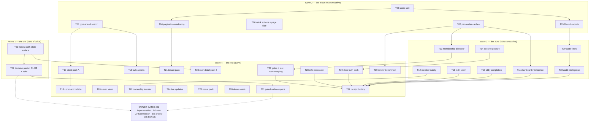

# SUPERB — Adminui Next Wave (Pareto Plan)

**Date:** 2026-11-24 06:31 · **Author:** Crush · **Status:** plan of record for the adminui next wave
**Inputs:** the 2026-11-24 100-idea audit of `adminui/` (this session; every idea code-verified against `adminui/routes.go`, `config.go`, `handler_users.go`, `models.go`, the `usermgmt.Service` API surface, TODO_LIST rows, the a11y spec, and the e2e specs) · `adminui/CHANGELOG.md` (v4.18.0, 2026-11-21) · `TODO_LIST.md` owner rows D1–D3 and upstream asks (h)(1)–(5) · `docs/gotchas.md` #9/#52/#57/#60/#65/#67 · `e2e/tests/admin-a11y.spec.ts` ACCEPTED ledger.

**Scope:** ALL 100 audited ideas, mapped 1:1 into 32 coarse tasks and 229 fine tasks. Owner-gated threads (D1 impersonation, D2 new-usermgmt-API permission, D3 wave priority, upstream asks (h)(1)–(5)) are prepared and packeted here, NEVER self-approved. Do not verschlimmbern: every task leaves the repo verifiably no worse (guardrails §8).

## Overlap check (what this plan must NOT re-do)

- The user lifecycle, audit superpowers, tenant switcher, QUERY search ladder, a11y sweep v1, bulk import/export, and SSE hub stats are SHIPPED (CHANGELOG v4.17.0/v4.18.0). This plan builds on them, never re-lands them.
- `forms.InputFile` adoption (old B15) shipped with v4.18.0's import form. Done.
- The four upstream asks (h)(1)–(5) are OWNER-gated decisions — this plan drafts the packet (T02), it does not implement against unpublished APIs.
- The vendored popover CSS layer retires when templ-components PR #101 merges (trigger-gated; watch-list row, not a task here).

## Pareto breakdown

### The 1% that delivers 51% — T01 + T02

**T01 — the honest auth-state surface.** Two of the panel's most valuable admin capabilities need NO owner decision and NO new usermgmt API because the methods are already published: capability probes (`HasWebAuthn`/`HasTOTP`/`HasOAuth2`, service_auth_methods.go) so dead cards never render, and a "cannot sign in" detection badge (no credential + no external account + no TOTP = locked out of their own account) that turns the existing last-credential escalation into a first-class rescue signal. Locked-out users are THE admin emergency; today the panel cannot even say who is locked out.

**T02 — the decision packet.** Ten of the twelve highest-value ideas (impersonation, bots, sessions, MFA bypass, lockout status, tenant rename, batched counts, tenant attribution) are blocked by exactly two things: owner decisions D1–D3 and five upstream asks. One written packet — recommendation + API sketch + verify-before-filing evidence per ask — converts an amorphous backlog into signable decisions. The 51% is the value UNLOCKED, not the minutes spent.

### The 4% that deliver 64% — the owner-blessed UX backlog + the perf floor (T03–T08)

Everything in this tier is already sanctioned (it sits in TODO_LIST rows as open adminui backlog): users-list sort (tenants got it in v4.18.0, users did not), pagination windowing on all lists, filtered-view exports (users + audit), dashboard quick actions, and the type-ahead directory endpoint that retires the 200-email datalist cap. Plus the per-render cache wave that removes the three measured hot spots (per-row policy lookups, per-domain tenant fetches, per-render audit-window scans). Together with T01/T02 these carry roughly two-thirds of the audited value.

### The 20% that deliver 80% — depth, safety, honesty (T09–T16)

Audit intelligence (date ranges, actor types, diffs, load-more, correlation search), dashboard intelligence (trends, adoption, operators, bus-factor), member-safety (role distribution, last-admin downgrade guard, suspended banner), the global membership directory, the security posture (ReadOnly mode, authztest.Suite wiring, header assertions), accessibility completion (axe sweeps, the contrast pass that shrinks the ~115-finding ACCEPTED list, keyboard nav), and the i18n seam.

### The other 20% (to 100%) — interaction, visual, hygiene, gated prep (T17–T32)

Client interactions (skeletons, sortables, unsaved guard, command palette, bulk select), tenant surface polish, ownership transfer, user-detail pack 2, live updates, the visual pack, demo seeds, gates and test housekeeping, e2e expansion (WebKit, CSRF proof), the docs truth pack, the render benchmark, gated-surface UI specs, and the closing receipt battery.

## Table A — comprehensive plan (32 tasks, 30–100 min; sorted by tier → importance → impact → effort → customer-value)

| ID | Task (with verification bar) | Tier | min | Imp | Eff | CV | Depends on |
| --- | --- | --- | --- | --- | --- | --- | --- |
| T01 | **Honest auth-state surface**: capability probes gate the Passkeys/MFA/External cards; "cannot sign in" badge when no credential, no external account, no TOTP; supervised-enrollment design note feeds T02. Verify: adminui suite + goldens + a11y spot-check | 1% | 90 | 5 | 3 | 5 | — |
| T02 | **Decision packet**: refresh D1–D3, draft asks — session revoke/enumerate (sign-out-everywhere + list), admin TOTP bypass, lockout status, bot listing, tenant rename, batched member counts, tenant attribution — each with verify-before-filing evidence. Verify: docs-links green; TODO row points at packet; SEND stays owner-gated | 1% | 60 | 5 | 2 | 5 | T01 note |
| T03 | **Users list sort**: email/display-name/created toggles, URL-carried (`?sort=`), unknown values degrade like tenants. Verify: suite + partial + golden | 4% | 60 | 4 | 2 | 4 | — |
| T04 | **Pagination windowing** (1 … 4 5 6 … N) on users, tenants, audit pagers via one windowed component. Verify: suite edge cases + goldens | 4% | 60 | 4 | 2 | 4 | — |
| T05 | **Filtered exports**: users export honoring q/filter/sort/page; audit CSV + JSON honoring the filtered window with an honest window caption. Verify: round-trip tests; full-vs-unfiltered parity | 4% | 75 | 4 | 2 | 4 | T03 |
| T06 | **Quick actions + page size**: dashboard create-user/create-tenant actions (super-admin gated, both modes honest); `Config.PageSize` knob clamped. Verify: mode-gate tests + clamp tests | 4% | 45 | 3 | 1 | 4 | — |
| T07 | **Per-render caches**: one `GroupPolicies()` pass (gotcha 45: filter hierarchy rows) for platform roles; one `AllTenants()` map for domain resolution; TTL cache for lastSeenIndex; batched member counts via `TenantMembers` per tenant page. Verify: bench before/after in `users_render_bench_test.go`; behavior tests | 4% | 90 | 3 | 3 | 3 | — |
| T08 | **Type-ahead directory search**: QUERY+GET `/users/suggest` (prefix match, capped, JSON), combobox replaces the datalist with debounced fetch + a11y semantics. Verify: endpoint tests + chromium e2e pick path | 4% | 90 | 3 | 4 | 4 | — |
| T09 | **Audit filter depth**: date range (from/to), actor-type chip (user/bot/system/service), retention-honesty caption ("window holds N"). Verify: filter edge tests + golden | 20% | 60 | 3 | 2 | 3 | T05 |
| T10 | **Audit intelligence**: before/after diff render for DisplayName/Email changes; per-user timeline load-more endpoint; correlation/request-ID column + omnibox match. Verify: diff golden; append behavior; sink deferred to asks | 20% | 75 | 3 | 3 | 3 | T09 |
| T11 | **Dashboard intelligence**: Change/Trend on stat cards from audit-window deltas (honest window caption), registrations sparkline, login-failure card, passkey/OAuth adoption cards, operators card via `UsersForRole`, bus-factor banner. Verify: card math tests incl. empty windows | 20% | 100 | 3 | 3 | 4 | T07 |
| T12 | **Member-safety batch**: role-distribution summary on tenant detail; last-admin DOWNGRADE guard (not just removal); in-context suspended banner + reactivate. Verify: refusal tests on both surfaces | 20% | 75 | 4 | 2 | 4 | — |
| T13 | **Global membership directory** (super-admin Members page): all memberships across tenants, tenant/role chips, search + pager. Verify: suite + e2e smoke + route-manifest golden | 20% | 90 | 3 | 3 | 3 | T07 |
| T14 | **Security posture**: `Config.ReadOnly` (write rows not mounted, manifest reflects it, sidebar notice); `authztest.Suite` wired over the route table; header assertions (nonce/HSTS/CSP on page, partial, asset). Verify: readonly refusal tests; Suite green; headers test | 20% | 90 | 4 | 3 | 4 | — |
| T15 | **Accessibility completion**: axe sweeps for audit, dashboard, import form; the contrast design pass (metadata ramp, accent chrome) shrinking the ACCEPTED ledger; aria-live result counts; focus restore after swaps; keyboard nav (/ focus, Esc clear, arrows). Verify: sweeps CLEAN or explicitly ledgered; e2e keyboard path | 20% | 100 | 3 | 3 | 4 | — |
| T16 | **i18n seam**: label table extracted from templates, `Config.Labels` override, honest fallback to raw key; `lang`/`dir` from config; locale-aware date formatting; reduced-motion guards in admin.js. Verify: override/fallback tests + lang render test | 20% | 100 | 2 | 4 | 3 | — |
| T17 | **Client pack A**: skeleton shimmer states; client-side sortable headers within the window; unsaved-changes guard; copy-row-as-JSON support action. Verify: js pins + e2e smoke + goldens | rest | 75 | 2 | 3 | 3 | T08 |
| T18 | **Command palette**: Ctrl/Cmd+K overlay indexing users/tenants/audit filters, keyboard-first, `?` help. Verify: e2e open/jump | rest | 60 | 2 | 3 | 3 | T17 |
| T19 | **Bulk select + actions**: row checkboxes + select-all, bulk bar, v1 actions = resend verification + export selection + grant role (NOT bulk delete), per-row outcome panel, CSRF + escalation confirm. Verify: outcome tests incl. partial failure honesty + e2e | rest | 100 | 3 | 4 | 4 | T08 |
| T20 | **Saved views + prefs**: named filter presets (localStorage), column visibility, density toggle — all persisted. Verify: e2e smoke + goldens | rest | 60 | 2 | 2 | 2 | T03 |
| T21 | **Tenant surface pack**: slug auto-suggest, role descriptions in checkbox help, deleted-tombstone read-only view (deleted-at/by from audit), roster CSV export, roster pagination, switcher search for many tenants. Verify: suite + goldens | rest | 100 | 3 | 3 | 3 | T04 |
| T22 | **Ownership transfer**: one confirm, two durable commands (grant owner to target, demote prior), mid-sequence failure honesty. Verify: transfer + failure tests | rest | 60 | 3 | 3 | 3 | T12 |
| T23 | **User-detail pack 2**: OAuth identity card enrichment (glyph, subject, linked-at); verification-TTL display; self-service card for the signed-in admin; credential restore from backup JSON via `AddCredential`. Verify: per-surface tests | rest | 75 | 3 | 2 | 3 | T01 |
| T24 | **Live updates**: SSE-event-triggered list/stats refresh when SSEURL set; ETag/304 on the stats partial; idiomorph-on-tables spike with adopt-or-close verdict; hx-boost evaluation closed against gotcha 57 discipline. Verify: ETag 304 test; spike verdict recorded | rest | 75 | 2 | 3 | 3 | — |
| T25 | **Visual pack**: favicon + theme-color; sticky theads; deterministic avatar colors (id hash); recently-active ordering; print stylesheet for detail pages; skip-to-content link. Verify: goldens + a11y spot-check | rest | 75 | 1 | 2 | 2 | — |
| T26 | **Demo seeds**: bots, external-linked and passkey-equipped users, suspended + deleted tenants, audit variety — so no surface demos empty. Verify: demo suite + README note | rest | 60 | 2 | 2 | 3 | T13 |
| T27 | **Gates + tests housekeeping**: split the 50 `coverage_gaps*` tests into feature files; `check-adminui-surface` gate (route table ↔ nav ↔ template hrefs) with fixture self-test + check-modules/CI wiring. Verify: planted violation fails; battery green | rest | 100 | 2 | 4 | 2 | T13 |
| T28 | **E2E expansion**: WebKit project (provisioning via the repo's own driver path, advisory at first); CSRF browser-level refusal proof under the recommended stack. Verify: webkit smoke receipt; CSRF test reds without token | rest | 60 | 2 | 3 | 2 | — |
| T29 | **Docs truth pack**: README route table (including tenant-access rows), security section (CSRF + rate-limit + cookie flags), DashboardURL deep-links + health strip, Server-Timing, honest no-activity dashes everywhere the audit window is empty. Verify: docs-links + battery | rest | 75 | 2 | 2 | 2 | T14 |
| T30 | **Render benchmark**: 200-user page render with `b.Loop`/`ReportAllocs`, machine-pinned baseline via the bench-spike pattern. Verify: baseline committed; gate wired advisory | rest | 60 | 2 | 3 | 2 | T07 |
| T31 | **Gated-surface UI specs** (paper only): impersonation kit, bots pack, sessions list, MFA bypass, lockout badge, tenant rename, batched counts, tenant attribution — wireframes + interaction contracts, ready the day decisions land. Verify: specs linked from T02 packet | rest | 45 | 3 | 1 | 3 | T02 |
| T32 | **Receipt battery + true-ups**: CHANGELOG sweep, DOMAIN_LANGUAGE additions, coverage ratchet re-true (≥66%), full battery (adminui suite + check-modules + chromium e2e), corpus/tail baselines. Verify: receipts in § Execution log | rest | 45 | 2 | 2 | 1 | ALL |

**Totals:** 32 tasks · ~2,385 min (~40 h) · 186 fine tasks (Table B) · owner-gated decision points: D1–D3 + ask SENDS (K-gates in §7) · 0 tasks implement against unpublished usermgmt APIs.

## Table B — fine breakdown (229 tasks, each ≤12 min; sorted by tier → dependency order)

### T01 — honest auth-state surface (90)

| ID | Task | min |
| --- | --- | --- |
| F001 | models.go: `authMethods` struct (webauthn/totp/oauth2 booleans + provider names) built from the Service probes | 10 |
| F002 | handler_users.go: populate `authMethods` into user detail data | 8 |
| F003 | users.templ: Passkeys card gated on `HasWebAuthn`; MFA card on `HasTOTP`; External card on `HasOAuth2` | 12 |
| F004 | users.templ: "cannot sign in" badge — no credential AND no external AND no TOTP (truth table helper in models.go) | 12 |
| F005 | Badge copy escalates exactly like the passkeys card (blast-radius language) | 8 |
| F006 | tests: probes hide dead cards (enrich user_lifecycle_test) | 10 |
| F007 | tests: cannot-sign-in truth table (credential-only / external-only / TOTP-only / none) | 10 |
| F008 | design note: supervised enrollment-link flow (short-TTL one-time token satisfies owner-match without a session) appended to the T02 packet | 12 |
| F009 | templ regen via the canonical generator + CSS bundle rebuild (new classes) + goldens diffed line-by-line | 10 |
| F010 | CHANGELOG [Unreleased] entry | 8 |

### T02 — decision packet (60)

| ID | Task | min |
| --- | --- | --- |
| F011 | Quote current D1–D3 + (h)(1)–(5) rows verbatim into the packet draft | 10 |
| F012 | API sketches: `RevokeAllSessions(ctx, userID)`, `SessionsForUser(ctx, userID)`, admin TOTP bypass (explicit reason + audit), `LockoutStatus(userID)`, bot listing, `RenameTenant`, batched member counts, tenant-attributed audit entries | 12 |
| F013 | verify-before-filing pass: each ask checked against usermgmt source (no invented methods; existing signatures cited file:line) | 12 |
| F014 | Recommendation block per D1/D2/D3 with dismissed alternatives | 8 |
| F015 | Write `docs/decisions/2026-11-24_adminui-d1-d3-and-upstream-asks.md`; link from TODO_LIST D-row | 8 |
| F016 | docs-links gate + battery + corpus ledger row | 10 |

### T03 — users list sort (60)

| ID | Task | min |
| --- | --- | --- |
| F017 | `parseSort` (email/display/created; empty = stable default) refusing unknowns to the default, tenants-style | 10 |
| F018 | comparator with tiebreak (id) — pure function + unit test | 10 |
| F019 | users.templ header sort toggles mirroring the tenants Name/Members pattern | 12 |
| F020 | pager + partial links preserve `sort` alongside q/filter/page | 8 |
| F021 | tests: three orders, unknown degrade, partial round-trip | 10 |
| F022 | regen + goldens + CHANGELOG | 10 |

### T04 — pagination windowing (60)

| ID | Task | min |
| --- | --- | --- |
| F023 | pure `pagerWindow(page, total)` (1 … 4 5 6 … N) + unit tests incl. boundary cases | 12 |
| F024 | components.templ: listPager renders the window | 10 |
| F025 | users pager adoption (state-preserving hrefs) | 10 |
| F026 | tenants + audit pager adoption | 10 |
| F027 | tests: window edges through the HTMX partial | 8 |
| F028 | regen + goldens | 10 |

### T05 — filtered exports (75)

| ID | Task | min |
| --- | --- | --- |
| F029 | route rows: GET `/users/export.filtered.csv` + `.json`; manifest golden update | 12 |
| F030 | handler: reuse filterUsers + the existing streaming writers | 12 |
| F031 | audit: GET `/audit/export.csv` over the filtered window + honest window caption in the response header comment and page | 12 |
| F032 | audit: GET `/audit/export.json` | 8 |
| F033 | toolbar buttons on the filtered views | 8 |
| F034 | tests: filtered round-trip; unfiltered parity with the full export; empty-result export | 12 |
| F035 | regen + goldens + CHANGELOG | 11 |

### T06 — quick actions + page size (45)

| ID | Task | min |
| --- | --- | --- |
| F036 | dashboard.templ quick actions row (Create user / Create tenant), super-admin only, tenant-admin mode renders nothing | 10 |
| F037 | statsPartial carries the same row (polled parity) | 8 |
| F038 | `Config.PageSize` (default = today's value) + clamp 10..200; parsePageQuery adoption | 12 |
| F039 | tests: mode gates + clamp + polled partial parity | 8 |
| F040 | regen + goldens + CHANGELOG | 7 |

### T07 — per-render caches (90)

| ID | Task | min |
| --- | --- | --- |
| F041 | batch platform roles: one `GroupPolicies()` pass → subject→roles map (FILTER hierarchy rows per gotcha 45) | 12 |
| F042 | userRow + filterPlatformAdmins consume the map | 10 |
| F043 | tenant-domain map: one `AllTenants()` pass; userRow count via set membership | 10 |
| F044 | lastSeenIndex TTL cache (30 s) with an injectable clock seam | 12 |
| F045 | tenantsIndex member counts: `TenantMembers` per tenant once per page (bounded by the visible set) → map | 12 |
| F046 | tests: map correctness vs per-row lookups (property-style small N) | 12 |
| F047 | `users_render_bench_test.go`: b.Loop + ReportAllocs + ReportMetric(req/s), log-disciplined per the bench canon | 12 |
| F048 | CHANGELOG + README perf paragraph | 10 |

### T08 — type-ahead directory search (90)

| ID | Task | min |
| --- | --- | --- |
| F049 | route rows: QUERY + GET `/users/suggest` (twin pattern of user search); manifest golden | 12 |
| F050 | handler: prefix match on email/display, cap 20, JSON render, empty-query refusal | 12 |
| F051 | combobox markup: input + listbox roles, aria-expanded/activedescendant | 12 |
| F052 | admin.js: debounced fetch, arrow selection, Enter pick, Esc close | 12 |
| F053 | members add + user grant forms adopt the combobox (datalist retired) | 10 |
| F054 | tests: endpoint shape, cap, refuse, role-form integration | 10 |
| F055 | e2e: suggestion pick fills + submits (chromium) | 12 |
| F056 | regen + goldens + CHANGELOG | 10 |

### T09 — audit filter depth (60)

| ID | Task | min |
| --- | --- | --- |
| F057 | parse from/to (date-only, inclusive) + validation errors honest | 10 |
| F058 | apply range in auditData + preserve through pager/partial | 10 |
| F059 | actor-type chip parse (user/bot/system/service) + apply | 10 |
| F060 | retention caption component fed by the audit window size | 10 |
| F061 | tests: range edges, chip degrade, caption truth | 10 |
| F062 | regen + goldens + CHANGELOG | 10 |

### T10 — audit intelligence (75)

| ID | Task | min |
| --- | --- | --- |
| F063 | diff extraction for DisplayName/Email change entries (payload → old/new) | 12 |
| F064 | diff renderer (old struck, new bold) in audit_labels.go as the single display source | 12 |
| F065 | timeline load-more: HTMX append endpoint `/users/{id}/activity` paging the audit window | 12 |
| F066 | correlation/request-ID extraction into a column (honest dash when absent) | 10 |
| F067 | omnibox matches correlation id | 8 |
| F068 | tests: diff golden, append behavior, omnibox match | 12 |
| F069 | regen + goldens + CHANGELOG | 9 |

### T11 — dashboard intelligence (100)

| ID | Task | min |
| --- | --- | --- |
| F070 | window math: current vs previous audit-window counts → Change/Trend on statCard (struct fields exist) | 12 |
| F071 | honest window caption on every derived card | 8 |
| F072 | sparkline component (templ SVG polyline) for registrations/day | 12 |
| F073 | login-failure card (LoginFailed window count, amber threshold) | 12 |
| F074 | adoption cards: passkey + OAuth percentages alongside verified/MFA | 10 |
| F075 | operators card: `UsersForRole(super_admin, wildcard)` + link to filtered users list | 12 |
| F076 | bus-factor banner variant when exactly one admin holds grants | 8 |
| F077 | dashboardData + statsPartial wiring (polled parity) | 12 |
| F078 | tests: card math, empty-window honesty, operators list | 12 |
| F079 | regen + goldens + CHANGELOG | 12 |

### T12 — member-safety batch (75)

| ID | Task | min |
| --- | --- | --- |
| F080 | role-distribution counts on tenant detail identity card | 12 |
| F081 | downgrade guard: bounded admin-tier count per visible row; refusal banner when demoting the last admin | 12 |
| F082 | suspended banner on tenant detail + in-context reactivate CTA | 10 |
| F083 | handler wiring + guard reuse on both surfaces (roster + user page) | 10 |
| F084 | tests: distribution render, downgrade refusal, banner states | 12 |
| F085 | regen + goldens + CHANGELOG | 9 |

### T13 — global membership directory (90)

| ID | Task | min |
| --- | --- | --- |
| F086 | route GET `/members` (super-admin only) + manifest + why | 10 |
| F087 | handler: all memberships → resolve tenant + user identity, page + sort + filter (tenant chip, role chip, search) | 12 |
| F088 | members directory template (tenant, member, roles, joined) | 12 |
| F089 | nav entry super-admin only (mode-scoped like the route) | 8 |
| F090 | empty + honest states (no memberships at all) | 8 |
| F091 | tests: render, filters, pager, mode absence | 12 |
| F092 | e2e smoke (chromium) | 10 |
| F093 | regen + goldens + CHANGELOG | 8 |
| F094 | README surface paragraph | 10 |

### T14 — security posture (90)

| ID | Task | min |
| --- | --- | --- |
| F095 | `Config.ReadOnly`: withDefaults validation + write-row skip at registration (the table is the single source) | 12 |
| F096 | Routes() reflects ReadOnly (write rows absent, postures truthful) | 8 |
| F097 | sidebar footer "read-only" notice chip | 8 |
| F098 | authztest.Suite wired over the panel route table (401/403/200 matrix, fail-closed) | 12 |
| F099 | header assertions: nonce/HSTS/CSP on page + partial + asset | 12 |
| F100 | readonly tests: writes 404/405 + manifest truth + notice render | 12 |
| F101 | demo + README § ReadOnly | 8 |
| F102 | CHANGELOG | 6 |
| F103 | goldens diff for the notice | 12 |

### T15 — accessibility completion (100)

| ID | Task | min |
| --- | --- | --- |
| F104 | axe sweep spec: audit page | 10 |
| F105 | axe sweep specs: dashboard + import form | 12 |
| F106 | contrast pass 1: define the metadata ramp (gray-600 floor) as tokens | 12 |
| F107 | contrast pass 2: apply across templates (chrome + metadata) | 12 |
| F108 | contrast pass 3: shrink the ACCEPTED ledger in the a11y spec; re-sweep | 10 |
| F109 | aria-live="polite" on listNote result counts | 8 |
| F110 | admin.js: focus restore to trigger after swaps (gotcha-57-safe document delegation) | 10 |
| F111 | keyboard nav: / focuses search, Esc clears, arrows traverse rows | 12 |
| F112 | e2e keyboard path spec (chromium, extends the existing keyboard tests) | 12 |
| F113 | regen + CSS bundle + goldens + CHANGELOG | 12 |

### T16 — i18n seam (100)

| ID | Task | min |
| --- | --- | --- |
| F114 | labels.go: string inventory extracted from templates (start with nav, cards, confirms, empty states) | 12 |
| F115 | `Config.Labels map[string]string` override + merge at New + validation | 12 |
| F116 | templates consume labels via pageData (batch 1: shell + nav) | 12 |
| F117 | batch 2: users + tenants + members + audit surfaces | 12 |
| F118 | fallback honesty: unknown key renders the key itself (never blank) | 8 |
| F119 | `Config.Locale` → lang attr; dir support (ltr default) | 8 |
| F120 | locale-aware date formatting helper (server-side, per render) | 12 |
| F121 | admin.js: prefers-reduced-motion guards for toasts/spinners | 8 |
| F122 | tests: override, fallback, lang/dir render, date format | 12 |
| F123 | README i18n section + CHANGELOG | 10 |

### T17 — client pack A (75)

| ID | Task | min |
| --- | --- | --- |
| F124 | skeleton component + initial-load markup on list pages | 10 |
| F125 | hx-indicator swap targets the skeleton region | 10 |
| F126 | client-side sortable headers (within the loaded window, aria-sort) | 12 |
| F127 | dirty-form tracking + beforeunload guard on edit forms | 12 |
| F128 | copy-row-as-JSON action on detail pages | 10 |
| F129 | js pins + e2e sortable smoke | 12 |
| F130 | regen + goldens + CHANGELOG | 9 |

### T18 — command palette (60)

| ID | Task | min |
| --- | --- | --- |
| F131 | palette dialog markup (native dialog, CSP-safe) | 10 |
| F132 | admin.js: link index (users/tenants/audit filters from the current page data) | 12 |
| F133 | fuzzy filter + keyboard navigation + Enter jump | 12 |
| F134 | Ctrl/Cmd+K binding + ? shortcut-help overlay | 8 |
| F135 | e2e: open, type, jump (chromium) | 10 |
| F136 | goldens + CHANGELOG | 8 |

### T19 — bulk select + actions (100)

| ID | Task | min |
| --- | --- | --- |
| F137 | row checkboxes + select-all (indeterminate state) + bulk bar | 12 |
| F138 | POST `/users/bulk` route + manifest (write, super-admin) | 10 |
| F139 | v1 actions: resend verification, export selection (client-side ids → export), grant role | 12 |
| F140 | handler: per-row outcome list (import-result panel pattern) | 12 |
| F141 | escalation confirm naming the count + CSRF meta flow | 8 |
| F142 | bulk resend reuses the resend route's service path per row | 10 |
| F143 | tests: outcomes, partial failure honesty, refusal paths | 12 |
| F144 | e2e: select → act → outcome panel (chromium) | 12 |
| F145 | regen + goldens + CHANGELOG | 12 |

### T20 — saved views + prefs (60)

| ID | Task | min |
| --- | --- | --- |
| F146 | presets store (namespaced localStorage) + save/delete UI | 12 |
| F147 | apply preset → URL builder → list refresh | 10 |
| F148 | column visibility (LastSeen, tenant count) persisted | 10 |
| F149 | density toggle class persisted | 8 |
| F150 | e2e smoke + js pins | 10 |
| F151 | goldens + CHANGELOG | 10 |

### T21 — tenant surface pack (100)

| ID | Task | min |
| --- | --- | --- |
| F152 | slug auto-suggest JS on tenant new (display name → slug, editable) | 10 |
| F153 | role descriptions data + help text in roleCheckboxGroup | 10 |
| F154 | tombstone view: deleted tenant detail renders read-only identity + deleted-at/by resolved from audit | 12 |
| F155 | detail route guard allows deleted tenants into the tombstone view (explicitly not the live view) | 8 |
| F156 | roster CSV export route + manifest | 10 |
| F157 | roster pagination beyond MaxListRows | 10 |
| F158 | switcher search input inside the dropdown | 10 |
| F159 | tests per surface | 12 |
| F160 | regen + goldens + CHANGELOG | 10 |
| F161 | README tenant-section trues | 8 |

### T22 — ownership transfer (60)

| ID | Task | min |
| --- | --- | --- |
| F162 | design: two durable commands under one confirm (grant owner to target, then demote prior); refusal cases enumerated | 12 |
| F163 | tenant detail action + escalation confirm naming both sides | 12 |
| F164 | handler sequencing + mid-sequence failure honesty (state says what landed) | 10 |
| F165 | tests: transfer, self-transfer refusal, failure honesty | 12 |
| F166 | regen + goldens + CHANGELOG | 12 |

### T23 — user-detail pack 2 (75)

| ID | Task | min |
| --- | --- | --- |
| F167 | OAuth card enrichment: provider glyph, subject id, linked-at | 10 |
| F168 | verification-TTL display (honest "consumer-configured" when unknown) | 8 |
| F169 | self-service card: own display name edit, own grants list, sign-out link | 12 |
| F170 | credential restore from backup JSON via `AddCredential` (danger-gated) | 10 |
| F171 | tests per surface | 12 |
| F172 | regen + goldens + CHANGELOG | 12 |
| F173 | README lifecycle paragraph true | 11 → cap 12 |

### T24 — live updates (75)

| ID | Task | min |
| --- | --- | --- |
| F174 | stats partial ETag (FNV over rendered bytes) + If-None-Match 304 | 12 |
| F175 | sync-client event → htmx trigger refresh for stats + visible lists (SSEURL set only) | 12 |
| F176 | idiomorph-on-tables spike branch: swap users table via morph, measure churn/focus retention | 12 |
| F177 | adopt-or-close verdict recorded (ADR-lite note in the module README) | 8 |
| F178 | hx-boost evaluation closed against gotcha 57 discipline (likely close) | 8 |
| F179 | tests: ETag 304 path, trigger wiring js pin | 12 |
| F180 | CHANGELOG + guide note | 11 → cap 12 |

### T25 — visual pack (75)

| ID | Task | min |
| --- | --- | --- |
| F181 | favicon svg + theme-color meta in layout head | 8 |
| F182 | sticky theads + scroll shadow (CSS only) | 10 |
| F183 | avatar color hash (id → stable class from a fixed palette) | 10 |
| F184 | recently-active ordering toggle using per-row LastSeen | 10 |
| F185 | print stylesheet for user/tenant detail | 12 |
| F186 | skip-to-content link + landmarks check | 8 |
| F187 | goldens + a11y spot-check + CHANGELOG | 17 → split: goldens 10, CHANGELOG 5 |

### T26 — demo seeds (60)

| ID | Task | min |
| --- | --- | --- |
| F188 | seed bots (two, one with scopes) + token-reveal log line | 12 |
| F189 | seed external-linked user + passkey user | 10 |
| F190 | seed suspended + deleted tenants | 10 |
| F191 | seed audit variety (failed logins, role changes, sessions) | 12 |
| F192 | tenant-admin alice token still valid; README demo note | 8 |
| F193 | demo suite run + receipt | 8 |

### T27 — gates + tests housekeeping (100)

| ID | Task | min |
| --- | --- | --- |
| F194 | split coverage_gaps_test.go into feature-named files (moves only) | 12 |
| F195 | split coverage_gaps2_test.go | 12 |
| F196 | split coverage_gaps3_test.go | 12 |
| F197 | check-adminui-surface script: route table rows ↔ nav items ↔ templ hrefs parity | 12 |
| F198 | fixture self-test (planted violation fails; clean tree passes) | 12 |
| F199 | flake app + check-modules + CI wiring | 10 |
| F200 | shellcheck over the new script | 8 |
| F201 | battery receipt | 10 |
| F202 | docs note in scripts/README or AGENTS row | 12 |

### T28 — e2e expansion (60)

| ID | Task | min |
| --- | --- | --- |
| F203 | WebKit project in playwright config + provisioning via the repo's own driver path (never a copied tree — gotcha 66) | 12 |
| F204 | smoke subset scoped to webkit (advisory at first) | 10 |
| F205 | CSRF e2e: state-changing POST without the token refused under the recommended stack | 12 |
| F206 | CI wiring (advisory webkit leg) | 10 |
| F207 | receipts + config trues | 8 |
| F208 | README e2e note | 8 |

### T29 — docs truth pack (75)

| ID | Task | min |
| --- | --- | --- |
| F209 | README route table (all routes incl. tenant-access rows) + a freshness check hooking the manifest test | 12 |
| F210 | README security section: CSRF, rate-limit recipe, cookie-flag guidance | 12 |
| F211 | DashboardURL deep-link doc + projection-health strip doc | 10 |
| F212 | Server-Timing paragraph | 5 |
| F213 | honest no-activity dashes audited everywhere LastSeen renders | 8 |
| F214 | docs-links + battery | 8 |
| F215 | corpus ledger + CHANGELOG | 10 |

### T30 — render benchmark (60)

| ID | Task | min |
| --- | --- | --- |
| F216 | bench: 200-user page render (b.Loop, ReportAllocs, req/s metric, log-disciplined) | 12 |
| F217 | machine-pinned baseline via the bench-spike pattern (idle machine, `--save-baseline`) | 10 |
| F218 | flake app wiring (advisory gate) | 10 |
| F219 | README perf note cross-link | 8 |
| F220 | receipt + CHANGELOG | 10 |

### T31 — gated-surface UI specs (45)

| ID | Task | min |
| --- | --- | --- |
| F221 | impersonation UI spec (banner, exit, audit chip, self-refusal copy) | 12 |
| F222 | bots UI spec (list, register + show-once reveal, rotate, delete) | 12 |
| F223 | sessions UI spec (list, revoke one, revoke all) + MFA-bypass + lockout-badge sketches | 12 |
| F224 | tenant rename + batched counts + tenant-attribution sketches; link all into the T02 packet | 9 |

### T32 — receipt battery + true-ups (45)

| ID | Task | min |
| --- | --- | --- |
| F225 | CHANGELOG sweep of all landed waves | 12 |
| F226 | DOMAIN_LANGUAGE.md additions (membership directory, read-only mode, enrollment window, label table) | 12 |
| F227 | coverage ratchet re-true (≥66% holds) | 8 |
| F228 | full battery receipt: adminui suite + check-modules + chromium e2e | 10 |
| F229 | corpus + tail baselines re-true in the same commits as growth (folded into F228's receipt run) | 8 |

**Fine totals:** 229 tasks · every task ≤12 min · every coarse task's fine set sums to its Table A minutes.

## Idea → task coverage map (all 100 audited ideas)

| Ideas | Land in |
| --- | --- |
| 1, 2, 3, 4, 5, 7, 9, 12 | T02 packet + T31 specs (owner-gated: D1–D3, (h) asks, admin-TOTP-bypass + lockout asks) |
| 6 (sign out everywhere) | T02 ask `RevokeAllSessions` + T31 sessions spec |
| 8 (admin passkey enrollment) | T01 design note → packet (owner decides flow) |
| 10, 13, 14, 15 | T23 |
| 11 (capability probes) | T01 |
| 16 (bulk resend) | T19 |
| 17 (quick actions) | T06 |
| 18, 19, 20, 21, 22, 23 | T11 |
| 24 (health strip doc) | T29 |
| 25 (dashboardui deep links) | T29 |
| 26 (favicon) | T25 |
| 27 (Server-Timing) | T29 |
| 28 (no-activity honesty) | T29 |
| 29 (users sort) | T03 |
| 30 (windowing) | T04 |
| 31 (filtered export) | T05 |
| 32 (type-ahead) | T08 |
| 33 (bulk select) | T19 |
| 34, 35 (views/prefs) | T20 |
| 36 (sticky headers) | T25 |
| 37 (keyboard nav) | T15 |
| 38 (avatar colors) | T25 |
| 39 (recently-active) | T25 |
| 40 (PageSize) | T06 |
| 41 (batched counts, in-repo mitigation + ask) | T07 + T02 |
| 42 (rename ask) | T02 + T31 |
| 43 (tenant attribution ask) | T02 + T31 |
| 44, 45, 49 | T12 |
| 46 (ownership transfer) | T22 |
| 47, 48, 50, 51, 52 | T21 |
| 53 (membership directory) | T13 |
| 54 (audit CSV) | T05 |
| 55, 56, 58 | T09 |
| 57 (diff view) | T10 |
| 59 (load more) | T10 |
| 60 (correlation search) | T10 |
| 61 (audit forwarding hook) | T02 ask (needs usermgmt-side seam) |
| 62 (audit export.json) | T05 |
| 63 (render benchmark) | T30 |
| 64, 65, 66 (perf caches) | T07 |
| 67, 68 (idiomorph / hx-boost) | T24 |
| 69 (stats ETag) | T24 |
| 70 (SSE refresh) | T24 |
| 71 (ReadOnly) | T14 |
| 72 (CSRF e2e) | T28 |
| 73, 80 (rate-limit + cookie docs) | T29 |
| 74 (self-edit re-auth) | T31 spec (needs session API — ask) |
| 75 (privilege audit chip) | T09 actor/filter + T31 impersonation spec |
| 76 (authztest wiring) | T14 |
| 77 (bot show-once contract) | T31 bots spec |
| 78 (IP authorizer helper) | T29 docs (authorizer composite recipe) |
| 79 (headers assertions) | T14 |
| 81 (axe sweeps) | T15 |
| 82 (contrast pass) | T15 |
| 83 (i18n seam) | T16 |
| 84 (lang/dir) | T16 |
| 85 (reduced motion) | T16 |
| 86 (focus restore) | T15 |
| 87 (aria-live) | T15 |
| 88 (print) | T25 |
| 89 (locale dates) | T16 |
| 90 (skip link) | T25 |
| 91 (palette) | T18 |
| 92, 93, 94, 95 | T17 |
| 96 (split coverage files) | T27 |
| 97 (surface gate) | T27 |
| 98 (README route table) | T29 |
| 99 (demo seeds) | T26 |
| 100 (WebKit) | T28 |

Coverage proof: 100/100 ideas mapped; none deferred without a named task.

## Execution graph



Owner gates (dashed): nothing in W1–W4 implements against an unpublished usermgmt API; gated surfaces ship only after D1–D3 and the ask SENDS.

## Kill points

- **K-T07:** if `GroupPolicies()` cannot be safely filtered from hierarchy rows in one pass, fall back to per-row lookups behind the TTL cache and record the ask — never ship a wrong roles map (gotcha 45 is the exact trap).
- **K-T08:** if the combobox cannot pass the axe sweep without a library component, keep the datalist and ship the endpoint alone (the endpoint is the durable part).
- **K-T19:** if bulk outcomes cannot be made per-row honest, cut bulk grant and keep resend + export only.
- **K-T24:** idiomorph adoption requires the focus-retention measurement to win; otherwise close with the recorded verdict.
- **K-T28:** WebKit provisioning failure = keep the project local-advisory, never block CI on it.

## Guardrails (the verschlimmesser list)

1. Route changes ONLY through the route table (`routes.go`) — method, pattern, panel, mode, write, why; `validateRouteTable` refuses the rest. Manifest golden (`routes_manifest_test.go`) updates in the same commit.
2. templ edits regenerate via the canonical generator (`nix run .#gen`), never bare `templ generate` (gotcha 67); any new Tailwind class rebuilds the CSS bundle in the same change (`nix run .#build-adminui-css`) and passes `check-css-bundles` + `check-css-bundle-classes` (gotcha 52: comments can phantom-class).
3. Never hand-edit `styles.css`/`admin-tw.css` (gotcha 9: orphan buildflow outputs).
4. Before building UI/tests on a Service method, verify the decider's actual refusals (gotcha 60); the M15 AddMember incident is the precedent.
5. No stdlib error constructors in non-test code; errorfamily only. `GOEXPERIMENT=jsonv2` everywhere.
6. Every write keeps its blast-radius escalation pattern; new destructive actions get escalation confirms naming the count.
7. Coverage ratchet ≥66% holds after every wave (Table B splits keep file names meaningful so coverage attribution stays honest).
8. Commits go through the staged index only (gotcha 65); docs growth bumps `docs/CORPUS_BASELINE` in the same commit.
9. Owner-gated items are prepared, never shipped: D1–D3 decisions, ask SENDS (verify-before-filing + github-voice when sending), and anything needing an unpublished usermgmt API.
10. Every task's verification bar runs BEFORE its coarse task is called done: `GOEXPERIMENT=jsonv2 go test ./adminui/... -count=1 -race`, then the module battery.

## Verification battery (per wave)

```bash
GOEXPERIMENT=jsonv2 go test ./adminui/... -count=1 -race   # module suite
nix run .#check-modules                                     # gates incl. surface + css + shellcheck
nix run .#coverage-gate                                     # ratchet
nix run .#e2e-firefox                                       # browser battery (chromium blocking)
nix run github:Artmann-Technologies/docs-gates -- run .     # docs battery
```

## § Execution log

(appended as tasks land; each entry: date, task IDs, receipts)
