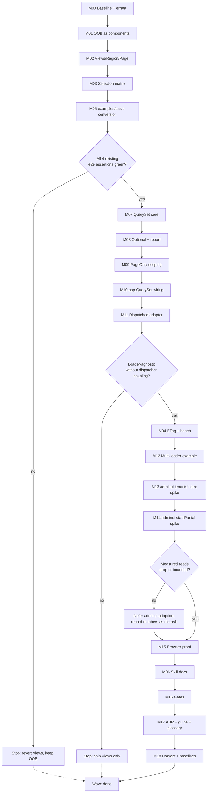

# SUPERB plan — query set → templ: the Props seam, three views, one loader contract

**Created:** 2026-11-27, 15:24 CET · **Repo:** `/home/lars/projects/cqrs-htmx`, branch `master`
**Status:** PLANNED (nothing of this wave implemented; the design note `docs/proposals/2026-11-27_query-set-to-templ-view-seam.md` is the thesis this plan executes)
**Scope line:** every fact in §3 was read at source or produced by a command in this session. Anything not in §3 is a hypothesis. Predecessor: the design note above (proposal, not decision).

---

## 0. Thesis

templ's unit of composition is **Props**; this library's unit is **one query → one component**. Real HTMX pages are three views over one view model (full page, swap region, OOB fragments), so today every page either grows a god query or hand-assembles props in the handler. `adminui.tenantsIndex` is the proof: one tenant scan plus up to `DefaultPageSize` (50) per-tenant membership reads, with an inline comment admitting the missing batched query.

This wave makes the props struct the only seam: **query set → Props → view set**, with `Views[T]` selecting Page/Region/OOB from the request, `OOB` as a templ fragment instead of a string, and `QuerySet[T]` fanning loaders out in parallel with per-loader view scoping. The 1% that lands first is the render surface (~40 net LOC of selection logic); everything else is proof, docs, and adoption.

## 1. Non-goals (the verschlimmbessern guard)

- **No deprecation of `RenderTempl` / `RenderTemplResult` / `RenderPartialOrFull` / `RenderIf` / `OOBHTML`.** They are the degenerate 1-query / 2-view cases of the same seam. Removing them would break every consumer to buy nothing.
- **No query set in the domain.** `identity-model` and `usermgmt` stay presentation-free; no `PageModelQuery` aggregate-shaped query.
- **No templ dependency.** Keep the structural `TemplComponent` interface; templ stays a consumer choice.
- **No new re-export aliases** (ADR-0062). New symbols are root-exported directly, nothing aliased.
- **No adminui full adoption in this wave.** Two spikes with measured receipts only; a panel-wide rewrite is its own plan.
- **No upstream ask filed as part of this wave.** The batched-membership-count ask (TODO item h.2) stays a recorded follow-up; the spike measures the N+1 before and after so the ask can be argued with numbers later.
- **No speculative caching layer.** `ETagResults()` composition is in scope; per-page cache keys are not.
- **No streaming render.** templ writes to an `io.Writer`; shell-first streaming is a different design.

## 2. Invariants

1. The tree builds after every milestone. A half-landed symbol with red gates is not a stopping point.
2. Root package coverage stays ≥ 90% (`coverage-thresholds.tsv` row `.`); measured baseline this session is **94.5%**, so new code must ship with its tests in the same milestone.
3. A query never returns a templ component; a component never dispatches. Both are review rules and get one test each where mechanically checkable.
4. No silent fallback: an unroutable view (HTMX request whose `HX-Target` matches no declared region and no default region exists) returns a mapped error, never a full page swapped into a fragment target.
5. `RenderPartialOrFull` and its tests stay byte-identical green; the new surface is additive.
6. Count and doc pins move in the same commit as the symbols they pin (skill reference rows, README/SKILL claims, `docs/CORPUS_BASELINE`, `docs/status/TAIL_BASELINE` untouched unless a report lands).
7. No `--no-verify` without the named-justification protocol (the receipted go-appkit floor hold, CURRENT_FOCUS 2026-11-21) recorded in the commit message.

## 3. Verified fact base (read at source or produced by a command this session)

| # | Fact | Evidence |
| --- | --- | --- |
| F1 | Root module tests green at **94.5%** coverage; every root subpackage green | `GOEXPERIMENT=jsonv2 go test ./... -count=1 -coverprofile=/tmp/root-cover.out` this session |
| F2 | Root coverage threshold is 90; thresholds are single-sourced | `scripts/checks/coverage-thresholds.tsv` row `.` → `90` |
| F3 | Root package is 55 non-test `.go` files | `ls *.go \| grep -v _test \| wc -l` |
| F4 | Render surface today: `Render`, `RenderTempl`, `RenderHTML`, `RenderTemplResult`, `RenderIf`, `RenderPartialOrFullFunc`, `RenderPartialOrFull`, `ETagResults` | `options_render.go` (12 exported funcs incl. `Redirect`/`Trigger`/`PushURL`) |
| F5 | OOB exists only in string form; it wraps `
`, passes through fragments that already carry `hx-swap-oob`, and escapes the id | `partial.go:52-66` |
| F6 | `htmx.Target(r)` reads the `HX-Target` header; `htmx.RenderPartial` excludes history-restore | `htmx/htmx.go:170`, `htmx/htmx.go:180` |
| F7 | The repo already routes on `HX-Target` in a shipped example | `examples/basic/main.go:414` |
| F8 | No identifier collisions for `Views`/`View`/`Region`/`QuerySet`/`Loader`/`PageOnly`/`OOB` in the root package | `rg '^(type\|func) (View\|Views\|Region\|Load\|QuerySet\|PageOnly\|Props\|OOB\|Page)\b'` → only `loginpage.Page` (different module) |
| F9 | `adminui` owns **no** query dispatcher: zero `app.Query`/`query.Dispatcher`/`Queries:` references; handlers read `config.Service` directly and mount their own mux | `rg -n "app.Query\|App.Query\|QueryTyped\|query.Dispatcher\|Queries:" adminui/*.go` → no hits |
| F10 | `adminui.tenantsIndex` does one `TenantMembers` read per visible tenant, bounded by page size, and says so in a comment | `adminui/handler_tenants.go:19-67`, comment at `:70` |
| F11 | `adminui.DefaultPageSize = 50`, clamped 10..200 at `New` | `adminui/util.go:96`, `adminui/config.go:82-86` |
| F12 | `adminui.statsPartial` re-derives stats, window intelligence and the stats region on every poll, then strips the volatile timestamp before hashing the ETag | `adminui/handler_dashboard.go:80-115` |
| F13 | The demos already have browser proof: 4 serial Playwright tests assert full vs partial, OOB consumption, `HX-Target` bare count | `e2e/tests/root-htmx.spec.ts` (DEMO `:18932`) |
| F14 | Skill doc gates: every module-qualified symbol named in the skill must exist, and every Go fence must parse | `scripts/checks/check-skill-claims.sh`, `scripts/checks/check-skill-snippets.sh` |
| F15 | ADR index ends at 0067, so the next free number is 0068 | `docs/adr/INDEX.md` tail |
| F16 | Corpus ratchet: 70,798 lines / 476 md files pending this plan's own growth | `bash scripts/checks/check-docs-corpus-budget.sh --ratchet` (baseline re-pinned this session) |
| F17 | Pre-push hook runs release-train (strict) + version-drift strict; the go-appkit floor hold is the standing receipted red | `.githooks/pre-push`, CURRENT_FOCUS 2026-11-21 |
| F18 | Page/view vocabulary is absent from the domain glossary | `docs/DOMAIN_LANGUAGE.md` (no Props / view set / region row) |

## 4. Pareto breakdown

### 4.1 The 1% that delivers 51%

**Three views over one props struct, selected by the request.** Concretely `OOBTempl`/`OOB[T]` (F5's string form becomes a component), `View[T]` + `Page`/`Region`/`Region.Default()`/`OOB` constructors, and `Views[T]` selection (`HX-Target` match → declared default region for partials → Page for navigations → mapped error otherwise). It is ~40 net LOC plus the selection tests, and it deletes the per-handler `if htmx.RenderPartial` branch that every consumer writes today. Proof: `examples/basic` `/demo/items` converted, with F13's four existing browser assertions still green.

### 4.2 The next 3% (to 64%)

**`QuerySet[T]`: loaders, not queries, as the unit.** Parallel fan-out, per-field apply, fail-fast with deterministic error selection, `Optional()` degradation with a visible `LoadReport`, and `PageOnly()` view scoping so a polled region stops paying for page-only facts. The load-bearing decision is in §10 E1: loaders are plain functions with names, and dispatched queries are one adapter — because `adminui` has no dispatcher (F9), a queries-only QuerySet would be unusable by the repo's largest consumer.

### 4.3 The next 16% (to 80%)

**Proof.** The `adminui` `tenantsIndex` spike (N+1 measured before/after, F10/F11), the `statsPartial` spike (loaders skipped per poll, F12), the browser proof for region selection under a boosted wrapper (gotcha 55's inheritance class, F13), the `examples/basic` multi-loader conversion, and the ETag/perf composition tests.

### 4.4 The remaining 20% (to 100%)

**Gates, docs, release, harvest.** ADR-0068, a guide, glossary rows, FEATURES/CHANGELOG, skill-reference rows (F14), layered/reexport/lint gates, corpus + tail baselines (F16), TODO harvest, and the release-readiness note (additive root API → next minor). Plus the explicitly deferred tail: adminui panel-wide adoption, the batched-counts upstream ask, per-view props types, shell-first streaming, per-page cache keys.

## 5. Comprehensive plan (30–100 min tasks, sorted by tier then impact)

| ID | Task | Tier | Min | Done when |
| --- | --- | --- | --- | --- |
| M00 | Baseline receipts + errata record (F1–F18 into this file; E1 erratum on the proposal) | T0 | 30 | §3 rows evidenced, §10 E1 written |
| M01 | `OOBTempl(id, TemplComponent)` + `OOB[T]` as components; `OOBHTML` delegates to one shared writer | 1% | 45 | Bytes identical to `OOBHTML`, golden tests green |
| M02 | `View[T]` + `Page`/`Region`/`OOB` constructors + `Views[T]` selection (target → default → page → mapped error) | 1% | 90 | `go build`/`go vet` clean, doc comments with examples |
| M03 | Selection matrix tests (page, region-by-target, default region, unroutable, history restore, OOB order, type mismatch) | 1% | 60 | 7 cases green, no partial write on error |
| M05 | Convert `examples/basic` `/demo/items` to `Views` + templ OOB badge; keep `/demo/items/count` as the `RenderIf` teaching case | 1% | 60 | Existing 4 Playwright assertions still pass |
| M07 | `Loader[T]`/`LoadFunc` + `QuerySet[T]` core: parallel fan-out, per-field apply, fail-fast, ctx cancel | 4% | 90 | Loader barrier test proves concurrency; cancel test green |
| M08 | `Optional()` degradation + `LoadReport` + `OnLoadError` hook; fatal errors mapped via `httperr.MapError` | 4% | 60 | Optional failure renders page with zero field; fatal aborts |
| M09 | `PageOnly()` view scoping + shared scope resolution with `Views` | 4% | 60 | Region request dispatches only region loaders (counted) |
| M10 | `app.QuerySet(set, opts...)` + `QuerySetHandler` for non-App consumers | 4% | 75 | 200 page, 200 region, 500 unroutable, 400 decode |
| M11 | Dispatched-query adapter (`DispatchFunc` + `Load(name, decoder, into)`) and the authz posture table | 4% | 60 | Posture test: each loader keeps `query/<Name>` |
| M04 | `Views` + `ETagResults()` composition, Content-Type, single-render proof, bench vs `RenderPartialOrFull` | 20% | 45 | 304 on repeat; allocs recorded |
| M12 | Example proof: multi-loader page with `PageOnly` in `examples/basic`; extend `root-htmx.spec.ts` | 20% | 60 | Browser green with 2 loaders + 1 page-only |
| M13 | `adminui` spike A: `tenantsIndex` → `QuerySet`; measure reads/render (51 → bounded) | 20% | 90 | Receipt numbers in the plan log; routeSpec/posture gates green |
| M14 | `adminui` spike B: `statsPartial` → region view + `PageOnly`; keep the stamp-stripped ETag | 20% | 75 | 304 path unchanged; skipped-loaders number recorded |
| M15 | Browser proof: boosted wrapper + `hx-target="this"`, OOB consumption, history-restore → Page | 20% | 90 | Chromium green; firefox divergences recorded |
| M06 | Skill docs: `references/core-api.md` rows, SKILL.md discoverability, README feature row | 20% | 45 | `check-skill-claims` + `check-skill-snippets` green |
| M16 | Gates: module layers, reexport policy, cqrs-lint, golangci-lint, isolation, coverage, `nix fmt` (scoped) | 20% | 75 | Every named gate green or receipted |
| M17 | ADR-0068 + `docs/guides/query-set-to-templ.md` + DOMAIN_LANGUAGE rows + FEATURES + CHANGELOG | 20% | 90 | Link gate green, glossary terms defined |
| M18 | TODO harvest (adminui adoption, batched counts ask, props-splitting), corpus/tail baselines, release-readiness note, execution log | 20% | 45 | TODO rows exist, baselines re-pinned, log filled |

## 6. Fine breakdown (≤12 min each, sorted by tier then order)

| ID | Task | Min | Verify |
| --- | --- | --- | --- |
| M00.1 | `date`, `git status`, record HEAD/branch in §12 | 3 | log line written |
| M00.2 | Run root tests with coverprofile; record 94.5% | 5 | §3 F1 written |
| M00.3 | Collision grep for the seven new identifiers | 3 | §3 F8 written |
| M00.4 | Corpus gate advisory; record 70,798 / 476 | 3 | §3 F16 written |
| M00.5 | Write §3 rows F1–F18 with evidence pointers | 12 | table complete |
| M00.6 | Append erratum E1 to the design note (dated, additive) | 4 | proposal shows E1 |
| M01.1 | Decide the component signature (`OOBTempl(id, c) TemplComponent`) | 8 | comment in `partial.go` |
| M01.2 | Extract the shared envelope writer used by both forms | 10 | `OOBHTML` still byte-identical |
| M01.3 | Implement the component form; buffer only to detect pre-tagged fragments | 12 | golden test |
| M01.4 | Add `OOB[T](id, func(T) TemplComponent)` props form | 8 | generic test compiles |
| M01.5 | Golden tests: strategy variants, empty id, pre-tagged passthrough | 12 | suite green |
| M01.6 | `go test ./... -run 'OOB'` + coverage of `partial.go` | 5 | output recorded |
| M02.1 | Define `View[T]` with an unexported selection method (constructors only) | 10 | compiles |
| M02.2 | `Page[T]` constructor | 5 | unit test |
| M02.3 | `Region[T](selector)` + `.Default()` marker | 8 | unit test |
| M02.4 | `OOB[T]` view constructor over the M01 component | 6 | unit test |
| M02.5 | Selection algorithm: target → default region (partial) → Page → `unroutable_view` | 12 | table-driven unit |
| M02.6 | `Views[T](views ...View[T]) HandlerOption` + build-time validation (exactly one Page, ≤1 default region) | 12 | panic/rejection test |
| M02.7 | Primary-then-OOB render order + `text/html` Content-Type | 8 | assertion |
| M02.8 | Doc comments with a runnable example block | 10 | `go vet` clean |
| M02.9 | `go build ./...` + `go vet` | 6 | clean |
| M03.1 | New `views_test.go` Ginkgo table scaffolding | 8 | suite compiles |
| M03.2 | Case: no HTMX headers → Page | 6 | green |
| M03.3 | Case: `HX-Target` matches Region | 8 | green |
| M03.4 | Case: partial + no target + declared default → default region | 8 | green |
| M03.5 | Case: partial + unknown target + no default → mapped error, zero body | 8 | error code asserted |
| M03.6 | Case: history-restore → Page | 6 | green |
| M03.7 | Case: two OOB views append in declaration order after the primary | 8 | byte assertion |
| M03.8 | Case: result type mismatch → Rejection mapped, nothing written | 8 | green |
| M05.1 | Re-read the demo templ funcs and `renderItemCount` | 6 | notes |
| M05.2 | Add `itemCount` templ fragment; drop the hand-built OOB string | 10 | renders |
| M05.3 | Rewrite `/demo/items` as `Views(Region("#item-list"), Page, OOB("item-count"))` | 12 | build |
| M05.4 | Keep `/demo/items/count` as the `RenderIf` teaching case, update its comment | 8 | build |
| M05.5 | Update the example's package doc bullet list | 6 | build |
| M05.6 | `go build ./...` + `go test` in `examples/basic` | 8 | green |
| M05.7 | Run the root-htmx Playwright spec (chromium) | 12 | 4 tests green |
| M07.1 | Define `Loader[T]` (name, scope, optional, load, apply) | 10 | compiles |
| M07.2 | `LoadFunc[T](name, func(ctx) (any, error), apply)` | 8 | unit |
| M07.3 | `QuerySet[T]` container + `Load`/`LoadFunc` builders + validation (empty, duplicate names) | 12 | rejection tests |
| M07.4 | Parallel execution (WaitGroup, per-loader slots) | 12 | barrier test |
| M07.5 | First-error cancellation of the shared context | 8 | cancel test |
| M07.6 | Deterministic error selection (declaration order, not completion order) | 10 | flake-proof test |
| M07.7 | Single-goroutine apply phase after join; nil-apply and type-mismatch guards | 10 | unit |
| M07.8 | Tests: parallel proof, fail-fast, cancel, zero loaders, duplicate names | 12 | suite green |
| M08.1 | `Optional()` marker and zero-value semantics | 6 | unit |
| M08.2 | `LoadReport` (names + errors, no payloads) | 10 | unit |
| M08.3 | `OnLoadError` option seam | 8 | unit |
| M08.4 | Fatal error mapped through `httperr.MapError` at the handler edge | 8 | status assertion |
| M08.5 | Optional failure renders the page with a zero field | 12 | golden |
| M08.6 | Warn-log optional failures with loader name | 8 | log assertion |
| M09.1 | `PageOnly()` marker | 5 | compiles |
| M09.2 | Scope resolution shared with `Views` (one function, two callers) | 12 | unit |
| M09.3 | Skip page-only loaders on region requests | 8 | counted test |
| M09.4 | Full request dispatches every loader | 6 | counted test |
| M09.5 | Region request dispatches only region loaders | 10 | counted test |
| M09.6 | Document the cost model on the option | 8 | godoc |
| M09.7 | Bench: page vs region loader count | 8 | numbers recorded |
| M10.1 | Decide `app.QuerySet(set, opts...)` shape (no decoder: loaders own their decoding) | 10 | godoc |
| M10.2 | Build the handler with the standard pipeline bits (server timing, enrichment, config) | 12 | compiles |
| M10.3 | Reuse the existing `config.render` path so `Views` composes unchanged | 8 | region test |
| M10.4 | Route errors through the App error handler | 8 | 500 assertion |
| M10.5 | Tests: 200 page, 200 region, 500 unroutable, 400 decode | 12 | green |
| M10.6 | HTMX response headers still applied (trigger/retarget) | 8 | header assertions |
| M10.7 | `QuerySetHandler` for bare-mux consumers | 10 | unit |
| M11.1 | `DispatchFunc` type | 5 | compiles |
| M11.2 | `Load(name, decoder, into)` building a dispatched loader | 10 | unit |
| M11.3 | Adapter from `*query.Dispatcher` (root, two lines) | 6 | compile assertion |
| M11.4 | Posture test: dispatched loader still answers per `query/<Name>` | 12 | gate test green |
| M11.5 | Doc table: dispatched loader vs function loader, who authorizes what | 10 | godoc |
| M11.6 | Decode error inside a loader → 400 mapping | 8 | test |
| M04.1 | `ETagResults()` after `Views` answers 304 on repeat | 10 | test |
| M04.2 | ETag changes when props change | 8 | test |
| M04.3 | Counting component proves one render per request | 10 | test |
| M04.4 | Content-Type `text/html` for all three shapes | 6 | test |
| M04.5 | `BenchmarkViews` vs `RenderPartialOrFull`, allocs recorded | 10 | `-bench` output |
| M12.1 | Add a second loader-backed query (counts) to the demo | 8 | build |
| M12.2 | Declare the QuerySet with 2 loaders + 1 `PageOnly` | 10 | build |
| M12.3 | Swap `/demo/items` to `app.QuerySet` + `Views` | 10 | build |
| M12.4 | `go test` in `examples/basic` | 8 | green |
| M12.5 | Extend `root-htmx.spec.ts` with a region-by-target case | 12 | spec compiles |
| M12.6 | Run chromium e2e for the spec | 12 | green |
| M13.1 | Re-read `tenantsIndex` + `tenantMemberCounts`; list every read | 8 | list in log |
| M13.2 | Define `tenantsPageProps` mirroring `tenantsListData` | 10 | compiles |
| M13.3 | Loader: tenant scan + search/status filters | 12 | test |
| M13.4 | Loader: member counts for the visible page only | 12 | test |
| M13.5 | `PageOnly` loader: status counts / nav / base path | 10 | test |
| M13.6 | Swap the handler to `QuerySet` + `Views(page, region)` | 12 | page renders |
| M13.7 | Instrument reads/render before and after; record both numbers | 12 | receipt in log |
| M13.8 | Run routeSpec / posture / adminui-surface gates | 10 | green |
| M13.9 | Delete helpers the swap orphaned | 6 | `go build` |
| M14.1 | List every fact `statsPartial` derives | 6 | list in log |
| M14.2 | Split into region loaders vs `PageOnly` loaders | 12 | compiles |
| M14.3 | Region view replaces the manual buffer, keep stamp-stripped ETag | 12 | 304 test |
| M14.4 | Assert `If-None-Match` still answers 304 | 8 | test |
| M14.5 | Count loaders skipped per poll | 10 | receipt |
| M14.6 | Run the dashboard live spec | 12 | green |
| M14.7 | Write both spike receipts into §12 | 6 | log |
| M15.1 | Read `boost-guard.spec.ts` + gotcha 55/57 notes | 8 | notes |
| M15.2 | Spec: boosted page with a self-fetching region element → no blanking | 12 | green |
| M15.3 | Spec: OOB element consumed, zero `[hx-swap-oob]` left in the target | 12 | green |
| M15.4 | Spec: history-restore request renders the Page | 10 | green |
| M15.5 | Run chromium battery for touched specs | 12 | green |
| M15.6 | Run firefox; record divergences (advisory) | 12 | notes |
| M15.7 | `git restore` screenshot churn | 6 | clean tree |
| M06.1 | Add the new options to `references/core-api.md` catalogue | 8 | rows land |
| M06.2 | Add a props/view-set snippet to SKILL.md discoverability | 8 | fence parses |
| M06.3 | Run `check-skill-claims.sh` | 4 | green |
| M06.4 | Run `check-skill-snippets.sh` | 4 | green |
| M06.5 | Add the README root feature-table row | 8 | build-free doc check |
| M06.6 | Run `check-readme-splitbrain.sh` | 5 | green |
| M16.1 | `nix run .#check-module-layers` | 6 | green |
| M16.2 | `nix run .#check-reexport-policy -- --strict` | 6 | green |
| M16.3 | `nix run .#check-cqrs-lint` | 12 | zero findings |
| M16.4 | `golangci-lint run` on root | 12 | green |
| M16.5 | Coverage gate for the root row | 10 | ≥90 |
| M16.6 | Module isolation leg (root + examples) | 12 | green |
| M16.7 | `nix fmt` scoped to owned paths only (gotcha 53) | 8 | no foreign files touched |
| M16.8 | Shellcheck if any script changed | 6 | green |
| M17.1 | ADR-0068 draft: seam, two invariants, fail-loud selection, loader-agnostic contract | 12 | draft file |
| M17.2 | ADR index row | 4 | index updated |
| M17.3 | Guide `docs/guides/query-set-to-templ.md` (before/after, decision table) | 12 | file lands |
| M17.4 | Glossary rows: Props, View set, Region, QuerySet, Loader | 10 | glossary updated |
| M17.5 | FEATURES root rows (Views, QuerySet, OOB templ) | 10 | rows land |
| M17.6 | CHANGELOG `[Unreleased]` entries under root | 8 | entries land |
| M17.7 | Link check for the new docs | 8 | green |
| M18.1 | TODO rows: adminui panel-wide adoption, batched-counts ask, props splitting, cache keys | 10 | rows exist |
| M18.2 | Corpus baseline re-pin + ledger sentence | 8 | ratchet green |
| M18.3 | Tail budget ratchet check | 4 | green |
| M18.4 | Docs-gates battery advisory run | 8 | recorded |
| M18.5 | Release-readiness note (additive API → next root minor) | 6 | note in log |
| M18.6 | Fill §12 execution log with receipts | 8 | log complete |

## 7. Execution graph

## 8. Kill points (decide, then either proceed or stop honestly)

| KP | Question | Stop rule |
| --- | --- | --- |
| KP1 | Do the four existing browser assertions still pass after the `examples/basic` conversion, with fewer handler lines? | If the conversion needs more handler code than it deletes, keep `OOB` (still a win) and drop `Views` from the wave. |
| KP2 | Can `QuerySet` stay loader-agnostic (plain functions + a dispatch adapter) without weakening per-query authz? | If not, ship `Views` + `OOB` only; the QuerySet waits for an ADR. Never weaken `query/<Name>` posture to make the API prettier. |
| KP3 | Do the adminui spikes measurably reduce reads (tenants N+1) or work-per-poll (stats)? | If no, record the numbers as the batched-counts ask and do not adopt inside adminui. |

## 9. Recorded decisions (autonomous, reversible)

- **D1 Vocabulary.** `Views[T]`, `Page`, `Region`, `OOB`, `QuerySet[T]`, `Loader`, `PageOnly`, `Optional`. Chosen because each name states its role, none collides in root (F8), and they read as one family.
- **D2 Fail loud, not fall back.** An HTMX request whose target matches no region and has no declared default returns a mapped error. A silent full-page fallback reproduces the 2026-10-18 blanking class from the other direction.
- **D3 Exactly one `Page`, at most one default `Region`.** Validated when the option is built, not at request time.
- **D4 Apply after join.** Loaders run concurrently; props are written by one goroutine after all complete. This removes every data race by construction and makes `PageOnly` skipping trivially correct.
- **D5 `QuerySet` lives in root for now.** A `view/` subpackage would need a `DispatchFunc` seam to avoid the module-layers back-edge; if the surface stays under ~200 LOC, root is the cheaper honest placement. Revisit when the ADR lands.
- **D6 No deprecations, no aliases.** Additive only (ADR-0062).
- **D7 `OOBHTML` becomes a wrapper over the shared writer**, so the wire bytes have one source and the string form cannot drift from the component form.

## 10. Errata against the design note (annotate, do not rewrite)

**E1 (2026-11-27, found while planning):** the design note assumes loaders are dispatched queries. `adminui` has **no query dispatcher** (F9): it mounts its own mux and reads `config.Service` directly. A queries-only `QuerySet` would therefore be unusable by the repo's largest consumer. Correction: a loader is a **named function** `func(ctx) (any, error)` plus an apply function; dispatched queries are one adapter (`Load`, via `DispatchFunc`) that preserves `query/<Name>` posture. Function loaders are authorized by whatever the consumer's session/route layer already enforces, and that distinction must be documented next to the API.

## 11. Owner questions (defaults chosen so work can proceed)

1. **Placement** (root vs `view/` subpackage). Default per D5: root, revisit at the ADR.
2. **Naming** (D1). Default: the family above, glossary rows landed with the code.
3. **adminui adoption depth.** Default: two spikes with receipts; a panel-wide conversion is harvested as its own TODO row, not folded into this wave.
4. **Error policy.** Default per D2/D4: fatal loaders fail the request; `Optional()` is the only degradation path and it is visible through `LoadReport`/`OnLoadError`.

## 12. Execution log

| When | Milestone | Receipt |
| --- | --- | --- |
| 2026-11-27 15:24 | plan written | this file; `git status` clean at HEAD `1bc3d848` before planning |

## 13. Verification bars (the wave is done when)

- Root tests green, coverage ≥ 90 (baseline 94.5 measured at plan time).
- The four pre-existing Playwright assertions on `/demo/items` still pass; the new region/OOB cases pass in chromium.
- `check-module-layers`, `check-reexport-policy --strict`, `check-cqrs-lint`, `check-skill-claims`, `check-skill-snippets`, corpus ratchet, tail ratchet all green.
- Two adminui spike receipts with numbers in §12 (or an explicit deferral per KP3).
- ADR-0068 + guide + glossary rows landed, and every new symbol named in the skill resolves (F14).
