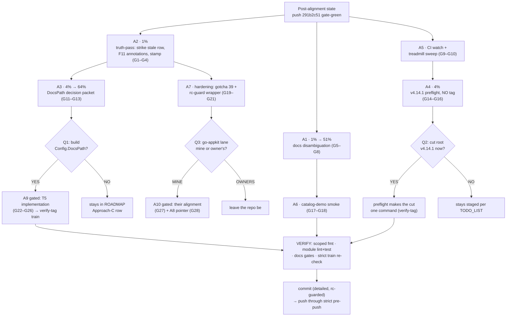

# SUPERB Pareto Plan — Post-Alignment Execution Wave (catalog/v4 follow-through + fleet tails)

> **OUTCOME 2026-10-24** — SUPERSEDED 2026-10-24 — its tooling rows (bump-dep lint, StateShape, treadmill, templ chain) are TODO_LIST P2 rows.

> **Status: AWAITING OWNER APPROVAL** for the gated lanes; the 1% and 4% tiers are
> execution-ready. **Created:** 2026-10-12 18:20.
> **Supersedes for execution:** [`2026-10-12_17-33_SUPERB-catalog-v4-integration-pareto-plan.md`](2026-10-12_17-33_SUPERB-catalog-v4-integration-pareto-plan.md)
> (its T3 tier was consumed by the 10-sweep family alignment, push `58a6a7ce..291b2c51`).
> **Inputs:** that plan · [`docs/status/2026-10-12_18-11_catalog-v4-plan-family-alignment-push_status.md`](../../status/archived/2026-10-12_18-11_catalog-v4-plan-family-alignment-push_status.md)
> (sections a–f) · the three owner questions below.
>
> **ANNOTATED 2026-10-12 (evening, same day):** A1 done `46ed1cec`; A2 done `46ed1cec` (stale-row strike + TODO stamp + `$`-anchor note); A5 done this session — CI watch found the `291b2c51` push had red'ed master on 2 jobs (templ codegen drift in dashboardui + exhaustruct StateShape in usermgmt, ~4h undetected), both repaired forward at `0d473d99`, and the go-cqrs-lite treadmill verified CURRENT (12 pins, no fresh tags — tail did not grow); A3 done `1bc4ce48` (verdict slot open → Q1); A4 done as preflight only (receipts `ff36c975`/`a4f28aae`/`3e2bf224` verified, `verify-tag --dry-run` ALL GUARDS PASSED — the cut itself still awaits Q2); A6 resolved as stale-gap (pre-existing `TestHTTPHandlers_ServeSpecs`, `main_test.go:50`, since `25cfd08b`; ROADMAP gap struck `1bc4ce48`). Pile pushed `563b8dc8..98c3fd6e` through strict pre-push (866 requires 0/0/0). A7 in flight; A8/A9/A10 + the root cut remain owner-gated (Q1/Q2/Q3).

## 0. Context (verified this session)

1. The catalog question is **answered and documented**; the alignment is **pushed and
   gate-green** (866 requires, 0 unpublished / 0 lag through strict pre-push).
2. Three decision lanes are OPEN and owner-gated: **(Q1)** T1+T2 approval + the T5
   demand signal; **(Q2)** cut root v4.14.1 now vs stay staged; **(Q3)** go-appkit's
   own alignment — mine or the owner's calendar.
3. Known residuals: sync-demo hermetic break (`AddSyncOpenAPI`, pre-existing on
   origin, rides v4.14.1); stale-on-arrival P2 row (bump executed after filing);
   missing outcome annotations (F11); TODO stamp stale; CI on `291b2c51` unwatched;
   two cosmetic commit-title `$`-anchor leaks; the lag-tail-grows lesson (go-appkit
   v0.9.0 appeared mid-alignment) is real and uncodified.

## 1. Pareto breakdown

- **1% → 51%:** Make the record TRUE and the confusion impossible — T1 docs
  disambiguation (F1–F4) + the truth-pass (strike stale row, F11 annotations,
  TODO stamp). ~70 min total, zero risk, kills the exact conflation the owner hit.
- **4% → 64%:** Decision-ready artifacts — T2 `Config.DocsPath` packet (F5–F7) and
  the root v4.14.1 **preflight** (receipts + wave-member single-tests + tag
  readiness, WITHOUT tagging) so Q2's YES is one command. ~110 min.
- **20% → 80%:** CI watch + upstream-treadmill check; T6 catalog-demo smoke; the
  gotcha-39 codification + rc-guard process hardening; T7 cross-repo pointer.
- **Remaining 80% of work (gated):** T5 implementation; go-appkit alignment lane;
  the long-tail sightings (status report §f items 29–40) routed to TODO/ROADMAP.

## 2. Comprehensive plan (30–100 min, sorted by value/effort)

| # | Task | Tier | Est | Impact | Effort | Value | Gate |
| --- | --- | --- | --- | --- | --- | --- | --- |
| A1 | ~~**T1 docs disambiguation bundle** — guide See Also + Serving (F1–F2), setup README footnote (F3), demo doc-comment links (F4)~~ DONE `46ed1cec` | 1% | 40 min | High | Low | **High** | none |
| A2 | ~~**Truth-pass on session artifacts** — strike/reword stale P2 row (keep go-appkit remainder), F11 outcome annotations on plan + research note, TODO "Updated:" stamp, note the `$`-anchor title leaks in the plan's outcome note~~ DONE `46ed1cec` | 1% | 30 min | Medium | Low | Medium (record honesty) | none |
| A3 | ~~**T2 DocsPath decision packet** — seam design + scenarios + demand-signal criteria (F5–F6), consolidated INTO `ROADMAP.md:75-83` Approach-C row (F7, no duplicate artifact)~~ PACKET DONE `1bc4ce48`; verdict open → Q1 | 4% | 50 min | High (decision) | Low | Medium | owner verdict |
| A4 | ~~**Root v4.14.1 preflight (prep-only, NO tag)** — verify the staged sync-asset defect-fix receipts (`ff36c975`, `a4f28aae`) + 1.27.2-floor receipts; single-test every wave member (gotcha 24/38a); CHANGELOG completeness; `verify-tag` dry-run readiness~~ DONE — dry-run ALL GUARDS PASSED; cut awaits Q2 | 4% | 60 min | High | Medium | High | owner YES to cut (Q2) |
| A5 | ~~**CI watch + treadmill check** — CI verdict on `291b2c51`; `ls-remote` fresh-tag sweep (the tail grows — gotcha-39 candidate); verdicts into the next report~~ DONE — found + repaired the 2-job master red (`0d473d99`); treadmill current | 20% | 30 min | Medium | Low | Medium | none |
| A6 | ~~**T6 catalog-demo visual smoke** — httptest boot, assert `/openapi.json` `/asyncapi.json` `/diagram.d2`, strike `ROADMAP.md:236` gap (F17–F18)~~ RESOLVED stale-gap — pre-existing `TestHTTPHandlers_ServeSpecs` covers it; ROADMAP struck `1bc4ce48` | 20% | 30 min | Low | Low | Low | none |
| A7 | **Process hardening** — AGENTS gotcha 39 (refresh-cache AFTER the last sweep; the tail grows — live-proven today); rc-guard sweep→commit wrapper sketch; optional upstream `bump-dep --commit-mine` filing draft | 20% | 45 min | Medium | Low | Medium | filing owner-gated |
| A8 | **T7 go-appkit docs pointer** — one-liner linking the integration map (F19) | 80% | 30 min | Low | Low | Low | cross-repo |
| A9 | **(GATED) T5 `Config.DocsPath` implementation** — F12 config+validation, F13 machine wiring, F14 serving test, F15 README/doc.go/CHANGELOG, F16 verify-tag train + consumer sweep | 80% | 100 min | High | Medium | High if approved | **owner YES (Q1)** |
| A10 | **(GATED) go-appkit alignment lane** — their catalog v4.7.1→v4.8.0 + accumulated wave, their gates | 80% | 100 min | Medium | Medium | Medium | owner (Q3) |

**Execution order: A2 → A1 → A5 → A3 → A4 → A6 → A7 → (decisions) → A8/A9/A10.**

## 3. Fine breakdown (≤12 min, sorted)

| # | Task | Parent | Est | Gate |
| --- | --- | --- | --- | --- |
| G1 | Strike/reword stale P2 row: "bump prep" → executed by the alignment; remainder = go-appkit consumers | A2 | 8 min | — |
| G2 | Outcome annotation: 17-33 plan (T3 consumed by alignment, push `291b2c51`) | A2 | 6 min | — |
| G3 | Outcome annotation: research note (add "2026-10-12: catalog v4.8.0 swept onto all consumers here") | A2 | 6 min | — |
| G4 | TODO "Updated:" stamp refresh | A2 | 4 min | — |
| G5 | F1 guide See Also distinction note | A1 | 12 min | — |
| G6 | F2 guide § Serving full-API-docs pointer | A1 | 8 min | — |
| G7 | F3 setup README EventCatalogPath footnote | A1 | 8 min | — |
| G8 | F4 catalog-demo doc-comment links | A1 | 8 min | — |
| G9 | CI verdict on `291b2c51` (`gh run list --workflow=ci.yml`) | A5 | 12 min | — |
| G10 | Fresh-upstream-tag sweep (`ls-remote` vs go.mod pins) | A5 | 6 min | — |
| G11 | F5 packet: seam design (config field, validation, docserver mount, session-gating) | A3 | 12 min | — |
| G12 | F6 packet: scenarios + go/no-go demand criteria | A3 | 12 min | — |
| G13 | F7 ROADMAP Approach-C row consolidation, in place | A3 | 8 min | — |
| G14 | v4.14.1 receipts verify (sync-asset `ff36c975`/`a4f28aae` + 1.27.2 floor) | A4 | 12 min | — |
| G15 | v4.14.1 wave-member single-tests (gotcha 24/38a: every member, not the cluster) | A4 | 12 min | — |
| G16 | v4.14.1 CHANGELOG completeness + `verify-tag` dry-run | A4 | 12 min | — |
| G17 | F17 catalog-demo smoke spec skeleton | A6 | 12 min | — |
| G18 | F18 wire spec + green run + ROADMAP:236 strike | A6 | 12 min | — |
| G19 | AGENTS gotcha 39 line (tail-grows / refresh-cache-after-last-sweep) | A7 | 8 min | — |
| G20 | rc-guard sweep→commit wrapper sketch (one-page, in agents-notes or scripts sketch) | A7 | 12 min | — |
| G21 | upstream `bump-dep --commit-mine` filing draft | A7 | 12 min | owner files |
| G22 | (GATED) F12 DocsPath config field + validation tests | A9 | 12 min | owner YES |
| G23 | (GATED) F13 machine wiring + failure-path test | A9 | 12 min | owner YES |
| G24 | (GATED) F14 serving test (docserver routes golden) | A9 | 12 min | owner YES |
| G25 | (GATED) F15 README row + doc.go + CHANGELOG | A9 | 12 min | owner YES |
| G26 | (GATED) F16 verify-tag train + consumer sweep + strict gates | A9 | 12 min | owner YES |
| G27 | (GATED) go-appkit lane: their-gates inventory + sweep plan | A10 | 12 min | owner (Q3) |
| G28 | F19 go-appkit docs README pointer | A8 | 8 min | cross-repo |

## 4. Execution graph



## 5. Anti-Verschlimmbesserung guardrails

1. **A4 never tags** — the cut is the owner's Q2 YES; preflight only makes it one command.
2. **T2 consolidates INTO the ROADMAP row** — no duplicate proposal artifact.
3. **A9 needs explicit owner YES** (`ROADMAP.md:222` demand-signal rule).
4. **Annotations are append-only** (G2/G3 annotate, never rewrite findings).
5. **rc-guard the sweep→commit chain this time** — the status report's d2 stumble (partial-state commit) must not recur; commit only after PASS rc.
6. **Scoped fmt** (`nix run .#fmt -- <paths>`); TODO_LIST only `[ ]`/`[~]`; docs-only turns carry no CHANGELOG receipts.
7. **Cross-repo touches (A8/A10) follow that repo's rules**; no cqrs-htmx gates assume them.
8. **Commit immediately after fmt, before the daemon polls** (one tool call); push through the strict pre-push gates — never bypass lag; if fresh upstream tags re-red it, report, don't sweep autonomously.

## 6. Verification

```sh
nix run .#fmt -- <touched paths>
rg -n 'catalog-demo' docs/guides/event-catalog-guide.md setup/README.md        # A1
rg -n 'ANNOTATED|superseded' docs/planning/2026-10-12_17-33_*.md               # A2
gh run list --workflow=ci.yml --limit 3                                        # A5
bash scripts/checks/check-release-train.sh --refresh-cache                     # before push
nix run .#test   # only if A9/A4 code lands; battery per TODO_LIST doctrine
```
