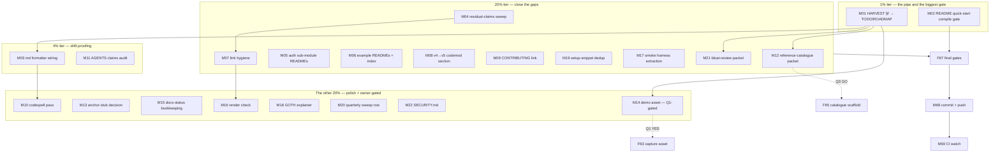

# SUPERB Pareto Plan — README Follow-Through & Docs-Truth Wave

> **OUTCOME 2026-10-24** — SUPERSEDED 2026-10-24 — M18/M20 landed; M20's quarterly ritual is the README sweep TODO row.

**Created:** 2026-10-17 09:03 · **Session:** README rewrite follow-through (README went 1266 → 507 lines, all gates green, captured in `554c6d0f`…`8d62074d`)
**Inputs:** `docs/status/2026-10-17_08-55_readme-rewrite-self-review.md` §f (45 routed items), `TODO_LIST.md` (2026-10-12 state), `ROADMAP.md` open questions, live tree verification 09:02.
**Goal:** make the consumer-facing surface (README, sub-module/example READMEs, guides) **accurate, complete, and drift-proof** — mechanize what can lie, close what's missing, decide what's owner-gated. No verschlimmbessern: no speculative rewrites, no touching tracked work outside harvest mechanics, no reformatting of unrelated docs.

## Errata (corrections to the 08-55 status report, verified 09:02)

1. §f-19 cited `docs/guides/v4-to-v5.md` — the guide lives at **`docs/migrations/v4-to-v5.md`** (the README links it correctly; only the status report's path was wrong).
2. §f-38 cited the `docs/status/README.md` "27 live" claim — the actual live tail is **45 files** (`ls docs/status/*.md | wc -l`). The README's count is stale (pre-existing drift, folded into M15).
3. Verified-open confirmations (no already-done items planned): README has 0 CHANGELOG mentions, `CONTRIBUTING.md` has 0 release-playbook mentions, `docs/migrations/v4-to-v5.md` has 0 codemod mentions, README ADR-0046 is plain text (not a link).

## Pareto Breakdown

> Tiers are directional (the 80/20 is a heuristic, not accounting). What matters: order of execution — 1% first, then 4%, then 20%, then the rest.

### The 1% that delivers ~51%

| Task | Why it is the 1% |
| ---- | ---------------- |
| **M01 — HARVEST the 08-55 report §f into TODO_LIST/ROADMAP** | Routes all 45 items into the living backlog. Without it, every other item dies in a timestamped file nobody reads. Zero value leakage tolerance: this is the pipe, not the water. |
| **M02 — README quick-start compile gate** | The single biggest documented failure class of the old README was *silently lying about the code* (architecture tree claimed root implements CSRF; it's a deprecated re-export). One gate — extract the fenced quick start from README.md, build it `GOWORK=off` in a temp module — makes the worst lie a CI red. The session proved the harness works (4 iterations, ~30 lines of bash). |

### The 4% that delivers ~64% (the 1% plus…)

| Task | Why |
| ---- | ---- |
| **M03 — wire a markdown formatter into the repo** | Formatting drift is currently ungoverned (treefmt has NO md program — AGENTS gotcha-10 corrected only yesterday). A gate makes every future md edit canonical, ending the npx-on-demand improvisation. |
| **M11 — AGENTS.md Quick-Reference claims audit** | AGENTS.md held a claim falsifiable in 118 ms for an unknown period. Sessions repeat commands they read there. Auditing the command/claim table restores trust in the AI-facing memory itself. |

### The 20% that delivers ~80% (the 4% plus…)

| Task | Why |
| ---- | ---- |
| **M04 — README residual-claims sweep** (lockout, ACK, JournalSSEStore, "27 factories", "21/20 events/commands") | The last unverified claims in the new README; counts drift on every domain change — de-number or verify. |
| **M07 — README link hygiene** (CHANGELOG link, ADR-0046 link, anchor machine-check) | The repo's own changelog is invisible from the README; anchor typos break navigation silently. |
| **M05 + M06 — sub-module & example READMEs** (3 auth sub-modules, 4 examples, examples index) | Closes every "consumer lands on a bare directory" gap the rewrite papered over with dir links. |
| **M08 + M09 — migration-guide codemod section + CONTRIBUTING → release-playbook** | The codemod is featured in the README but absent from the guide that migrating users actually read; maintainers lack the onboarding link. |
| **M19 — setup-snippet dedup** (README vs setup/README) | Two near-copies of the same quick start = guaranteed future drift; link one. |
| **M17 — smoke-test harness extraction** | The extract→build→run→probe loop becomes reusable (`scripts/selftests/`), paying down the 4-rebuild tax this session paid. |

### The other 20% (the remaining ~20% of result — do last, or never)

Polish and owner-gated lanes: M10 (codespell/markdownlint pass), M13 (old-anchor deep-link decision), M14 (demo asset — owner Q1), M15 (docs-status bookkeeping), M16 (post-push render check), M18 (GOTH explainer), M20 (quarterly claim-sweep process row), M21 (module-README bloat review packet), M22 (SECURITY.md), M12 (reference-catalogue decision packet — owner Q3 gates the build).

---

## Step 2 — Comprehensive Plan (22 medium tasks, 30–100 min each)

Sorted by importance → impact → effort → customer-value. `Pri`: C=critical path, H=high, M=medium, L=low.

| ID | Task | Tier | Pri | Impact | Effort | Customer value | Depends on |
| -- | ---- | ---- | --- | ------ | ------ | -------------- | ---------- |
| M01 | HARVEST 08-55 report §f → TODO_LIST.md (T-route) + ROADMAP.md (R-route) + ROADMAP Open Questions (D-route); update TODO_LIST `Updated:` header; de-dup vs existing rows (docs-health HARVEST mechanics) | 1% | C | Routes all 45 items | 30m | Indirect (everything) | — |
| M02 | README quick-start compile gate, atomic per gotcha 19: `scripts/checks/check-readme-quickstart.sh` (extract fenced block → temp module with local replaces → `GOWORK=off go build`, candidate-count guard, unique tmpdir) + fixture self-test + flake app `.#check-readme-quickstart` + check-modules stage + CI step + `docs/status/README.md`/AGENTS command rows | 1% | C | Kills the README-lies class | 100m | High (docs never lie) | — |
| M03 | Markdown formatter wiring: pick pinned tool (treefmt-nix prettier/dprint program — mind the templ-wrapper lesson, gotcha 22a), one-time normalize pass over md (review diff stat; EXCLUDE `docs/status/archived/` and `scripts/testdata/`), check gate + self-test + CI | 4% | H | Ends md drift class | 90m | Low visible / high trust | M01 |
| M11 | AGENTS.md Quick-Reference claims audit: enumerate every command/claim in the table + gotchas where feasible, run each, record rc, fix falsifiables (docs-only edits), keep durables with evidence | 4% | H | Restores AI-memory trust | 90m | Indirect (every session) | — |
| M04 | README residual-claims sweep: verify lockout surface (`usermgmt/lockout.go`), ACK protocol (`ack.go`), `JournalSSEStore` mapper contract; count `go-cqrs-lite/middleware/v4` factories; de-number "21 events/20 commands" if drift-prone; fix found inaccuracies | 20% | H | Truth of the sales page | 45m | Medium | — |
| M07 | README link hygiene: add CHANGELOG.md link; make ADR-0046 a link; machine-verify the two internal anchors (GFM slug rules); fix if broken | 20% | H | Navigation + discovery | 30m | Medium | — |
| M05 | READMEs for `usermgmt/totp`, `usermgmt/webauthn`, `usermgmt/oauth2` (≤20 lines each: what it provides, inject-as field, config pointer to usermgmt README, license-consistent tone) | 20% | M | Closes bare-dir gaps | 45m | Medium (auth adopters) | — |
| M06 | READMEs for `examples/{admin-demo,dashboard-demo,middleware-showcase,system-demo}` (≤15 lines each: what it shows, port, run cmd) + `examples/README.md` index table with ports column | 20% | M | Same, for demos | 60m | Medium (evaluators) | — |
| M08 | Add codemod section to `docs/migrations/v4-to-v5.md` (dry-run default, `-apply`, symbol tables derived from module graph); cross-link from README migrations paragraph | 20% | M | Migration UX | 30m | Medium (v5 migrators) | — |
| M09 | CONTRIBUTING.md: link `docs/guides/release-playbook.md` + one-line maintainer onboarding pointer | 20% | L | Maintainer onboarding | 15m | Low | — |
| M19 | Setup-snippet dedup: shorten README's setup quick start to a 5-line teaser + link to `setup/README.md`; verify zero information loss | 20% | M | Removes a drift copy | 30m | Low | — |
| M17 | Extract the session's smoke-test harness into `scripts/selftests/lib/` (server spawn + Go HTTP probe + unique high port + server-log-first assertion), reuse-ready; document in AGENTS tooling row | 20% | M | Reusable verification | 45m | Indirect | — |
| M21 | Module-README bloat review packet: measure `usermgmt/README.md` + `setup/README.md` against the sales-page rubric, write treat-or-keep verdicts with effort estimates (NO edits — decision packet only, `docs/proposals/`) | 20% | M | Prevents the next 1266-line README | 45m | Indirect | M01 |
| M12 | Reference-catalogue decision packet (owner Q3): inventory what the old README tables covered (`git show 8d62074d^:README.md`), GO/NO-GO criteria for `docs/reference/handler-options.md` vs pkg.go.dev-canonical, park in `docs/proposals/` | 20% | H | Decides where reference lives | 45m | High if built | M01 |
| M13 | Old-anchor deep-link decision (owner): list the ~10 old headings likely externally linked; decide HTML `<a id>` stubs vs accept-the-break; execute stubs if chosen | rest | L | External link hygiene | 30m | Low | — |
| M15 | Docs-status bookkeeping: fix `docs/status/README.md` live-tail count (27 → actual), run `.#check-docs-tail-budget` (advisory), route findings to the existing round-19 tail-archive TODO row (no new row) | rest | L | Reading-map truth | 30m | Low | — |
| M10 | `buildflow -s codespell` over README + docs; fix findings; markdownlint if a step exists (else note absence in errata of this plan) | rest | L | Typo-class polish | 30m | Low | M03 |
| M16 | Post-push GitHub render spot-check: anchors, decision-tree box chars on mobile, table rendering; screenshot into this plan's addendum | rest | L | Visual verification | 15m | Low | M07, push |
| M20 | Document the quarterly README↔FEATURES claim-sweep as a recurring TODO row (one row, not a system) | rest | L | Recurring truth | 15m | Indirect | M01 |
| M18 | `docs/goth-stack.md` explainer; point the README badge + GOTH callout at it | rest | L | Stack story | 30m | Low | — |
| M22 | `SECURITY.md` (supported versions + contact; no autowired disclosure policy) | rest | L | Compliance surface | 15m | Low | — |
| M14 | Demo-asset lane (owner Q1): capture answer; if YES pick source (setup-demo/admin panel), capture screenshot/GIF ≤ 1 MB, embed with alt text; if NO, strike this row in TODO | rest | L | Conversion | 15m/90m | Medium if YES | M01, Q1 |

**Totals:** ~13.5 h medium-granularity effort. Critical path (M01→M02→M03): ~3.7 h.

## Step 3 — Fine Breakdown (69 tasks, each ≤ 12 min)

Sorted within their medium task; medium tasks in execution order. `P`: priority composite (C/H/M/L).

| ID | Task (≤12 min each) | P | Est |
| -- | -------------------- | --- | --- |
| F01 | Read docs-health HARVEST mechanics + TODO_LIST routing rules; list the 45 §f items with their T/R/D routes | C | 8m |
| F02 | Create TODO_LIST rows for the ~14 T-routed items (P2/P3 sections, evidence-linked) | C | 12m |
| F03 | Create ROADMAP rows for the ~20 R-routed items (grouped, one line each) | C | 12m |
| F04 | Add D-routed items (f-10 anchors, f-11 asset, f-16 catalogue) to ROADMAP Open Questions if not duplicates of Q1/Q3 | C | 6m |
| F05 | De-dup pass: grep new rows against existing TODO/ROADMAP entries; merge overlaps | C | 10m |
| F06 | Update TODO_LIST `Updated:` header with this harvest; strike nothing preemptively | C | 6m |
| F07 | Write `scripts/checks/check-readme-quickstart.sh`: extract first go-fence under `## Quick start` → temp module (local replace to repo root + proxy deps) → `GOEXPERIMENT=jsonv2 GOWORK=off go build`; print candidate count; fail on zero/missing fence | C | 12m |
| F08 | Harden the script: unique tmpdir (`mktemp -d`), trap cleanup, timeout, offline-skip under CI if proxy unavailable (env-flag) | C | 10m |
| F09 | Run gate green on current README (the proven harness port) | C | 8m |
| F10 | Fixture self-test `scripts/selftests/test-check-readme-quickstart.sh`: clean pass / broken-fence fail / poisoned-code fail (offline stub) | C | 12m |
| F11 | Wire flake app `.#check-readme-quickstart` + check-modules stage + CI step + `docs/status/README.md` command row + AGENTS Quick-Reference row (atomic bundle) | C | 12m |
| F12 | Commit gate bundle; run `CI=true bash scripts/selftests/test-check-readme-quickstart.sh` (env-leak class, gotcha 27c) | C | 8m |
| F13 | Formatter decision: prefer treefmt-nix `programs.prettier` (or dprint) — check nixpkgs availability + the templ-wrapper trap does not apply (no Go involved); record choice + pin in flake comment | H | 10m |
| F14 | Add formatter config to flake treefmt block; `nix fmt` on ONE file; inspect diff | H | 10m |
| F15 | One-time normalize: `nix fmt` over md, excluding `docs/status/archived/` + `scripts/testdata/` (treefmt excludes config); review `git diff --stat` before committing; daemon-race: single chained command (gotcha 4) | H | 12m |
| F16 | Add `check-md-format` gate (or fold into existing formatting check) + CI + self-test if warranted; else document that treefmt check covers it | H | 12m |
| F17 | Re-amend AGENTS gotcha 10: canonical md formatter NOW exists (supersede the npx-on-demand note) | H | 6m |
| F18 | Verify lockout claims: read `usermgmt/lockout.go` + ServiceConfig wiring vs README bullet; fix wording if fields differ | H | 10m |
| F19 | Verify ACK claims: read `ack.go` + guide vs README "opt-in ACK protocol" bullet | H | 8m |
| F20 | Verify `JournalSSEStore` mapper contract wording vs `transport/journalsse.go` | H | 8m |
| F21 | Count `go-cqrs-lite/middleware/v4` exported factories; fix the "27" or replace with "every factory" | H | 10m |
| F22 | Decide + execute de-numbering of "21 event payloads / 20 commands" → "every identity event/command" (drift-proof) or keep with a freshness note | H | 8m |
| F23 | Apply all M04 fixes; re-run docs gates | H | 6m |
| F24 | Add `CHANGELOG.md` link to README (Documentation → Reference group) | H | 4m |
| F25 | Make "ADR 0046" in README Realtime section a link to `docs/adr/0046-*.md` (verify filename) | H | 5m |
| F26 | Anchor check: apply GFM slugger rules to the 2 internal anchors (`#ready-made-uis--the-one-call-setup` ×2); script it (10-line python) or verify by hand | H | 10m |
| F27 | Write `usermgmt/totp/README.md` (≤20 lines: provides/config/inject/link) | M | 10m |
| F28 | Write `usermgmt/webauthn/README.md` (same shape) | M | 10m |
| F29 | Write `usermgmt/oauth2/README.md` (same shape + PKCE client note) | M | 10m |
| F30 | Write `examples/admin-demo/README.md` (shows/port/run, ≤15 lines) | M | 8m |
| F31 | Write `examples/dashboard-demo/README.md` | M | 8m |
| F32 | Write `examples/middleware-showcase/README.md` | M | 8m |
| F33 | Write `examples/system-demo/README.md` | M | 8m |
| F34 | Write `examples/README.md` index (table: example / shows / port / run) — ports from each main.go | M | 12m |
| F35 | Add codemod section to `docs/migrations/v4-to-v5.md` (usage, flags, drift-proof derivation note) | M | 12m |
| F36 | Cross-link the codemod from README's migrations paragraph (one clause) | M | 4m |
| F37 | CONTRIBUTING.md: release-playbook link + one-line onboarding | L | 6m |
| F38 | Shorten README setup snippet to teaser + link; diff information content vs `setup/README.md` | M | 10m |
| F39 | Extract smoke harness → `scripts/selftests/lib/readme_smoke.sh` (spawn/unique-port/log-first/probe/cleanup) | M | 12m |
| F40 | Add harness self-test + AGENTS tooling row mention | M | 10m |
| F41 | Measure `usermgmt/README.md` + `setup/README.md` (wc, heading count, table count) vs sales-page rubric; record numbers in packet | M | 10m |
| F42 | Write the bloat-review packet `docs/proposals/2026-10-17_module-readme-bloat-review.md` (verdicts + efforts, NO edits) | M | 12m |
| F43 | Inventory old-README table content: `git show 8d62074d^:README.md` — list dropped tables (HandlerOptions, CSRF fields, rate-limit fields, Service methods, SSE API, response builder) | H | 10m |
| F44 | Write reference-catalogue decision packet `docs/proposals/2026-10-17_reference-catalogue-packet.md` (GO/NO-GO criteria, maintenance cost, pkg.go.dev alternative) — owner Q3 gates the build | H | 12m |
| F45 | Enumerate AGENTS Quick-Reference claims → checklist file (temp, /tmp) | H | 8m |
| F46 | Execute claims: run each command (nix apps, gates), capture rc + output tail | H | 12m |
| F47 | Fix falsifiable claims (docs-only edits, one commit) | H | 10m |
| F48 | Record durable claims with evidence in AGENTS (only where load-bearing) | H | 8m |
| F49 | Old-anchor lane: list top-10 externally-plausible old headings (`git show` old README `^## `) | L | 8m |
| F50 | Decision stubs-vs-accept (owner); if stubs: add one `<a id>` block to README | L | 10m |
| F51 | Fix `docs/status/README.md` live-tail count (27 → verified number) | L | 6m |
| F52 | Run `nix run .#check-docs-tail-budget` (advisory); route findings to existing round-19 tail row | L | 8m |
| F53 | `buildflow -s codespell` over md set; triage findings | L | 10m |
| F54 | Fix codespell findings (allowlist vendored terms if FP) | L | 10m |
| F55 | Check a markdownlint step exists in buildflow (`buildflow --dry-run --verbose`); if absent, note in plan errata — do NOT hand-roll one (BuildFlow owns it; delegation rule) | L | 6m |
| F56 | Post-push render check on GitHub: anchors ×2, decision tree on narrow viewport, module-map table; append screenshot link to this plan | L | 10m |
| F57 | Add quarterly README↔FEATURES claim-sweep recurring row to TODO_LIST (one row) | L | 6m |
| F58 | Write `docs/goth-stack.md` explainer (what GOTH is, the three repos, link topology) | L | 12m |
| F59 | Point README GOTH badge + callout at the explainer | L | 4m |
| F60 | Write `SECURITY.md` (scope: library, no runtime; contact; supported majors) | L | 10m |
| F61 | Capture owner answers (Q1 asset, Q2 voice, Q3 catalogue) when given; route to M14/M12 rows | L | 5m |
| F62 | If Q1=YES: pick demo source + shot list (3 candidates) | L | 10m |
| F63 | If Q1=YES: capture + optimize asset (≤1 MB), commit under `docs/assets/` | L | 12m |
| F64 | If Q1=YES: embed in README hero with alt text; render check | L | 8m |
| F65 | If Q3=GO: scaffold `docs/reference/handler-options.md` from F43 inventory (structure only; filling = new wave) | L | 12m |
| F66 | Run docs-links + docs-freshness + large-files after every README/docs edit batch | C | 5m |
| F67 | Final: re-run `nix run .#check-modules` (docs stages) + full gates battery for touched surfaces | C | 12m |
| F68 | Commit + push this wave (docs-only commits; detailed messages; pre-push strict gates) | C | 10m |
| F69 | Post-push CI watch (`.#push-and-watch`); triage any red | C | 10m |

**Fine totals:** ~9.5 h; every task ≤ 12 min; C-path (F01–F12, F66–F69) ≈ 2.5 h.

## Execution Graph (mermaid)

## Guardrails (verschlimmbesserung ban)

1. **No code-module changes** in this wave — docs, scripts, flake gate wiring only. The only Go compiled is extracted-from-README scratch in temp dirs.
2. **No reformatting of historical artifacts** — `docs/status/archived/`, `scripts/testdata/`, ADRs stay byte-identical (annotation conventions forbid rewrites).
3. **New gates ship atomically** (checker + fixture self-test + flake app + check-modules stage + CI step + README command row — gotcha 19); anything less is dead code.
4. **Owner-gated before build:** M12→F65 (Q3), M14→F62-64 (Q1), M13 stubs. Packets may be written; builds wait.
5. **TODO_LIST stays the living source** — this plan is a snapshot; every executed row gets struck in TODO_LIST with evidence, and the plan itself gets ANNOTATE-mode treatment when superseded, never rewritten.
6. **Daemon-aware commits:** chain fmt+add+commit in single tool calls (gotcha 4); docs-only commits may use `--no-verify` ONLY for the documented eval-cache/environment classes with justification in the message.

## Owner Questions (blocking, from the 08-55 report §g)

- **Q1 (asset):** screenshot/GIF in the README hero, or code-only? → gates M14.
- **Q2 (voice):** keep the slightly-marketing register, or engineering-terse everywhere? → gates any voice pass (deliberately NOT a task above until answered).
- **Q3 (catalogue):** build `docs/reference/handler-options.md`, or is pkg.go.dev canonical? → gates M12/F65.
